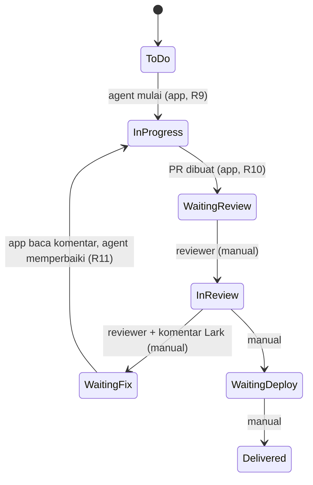
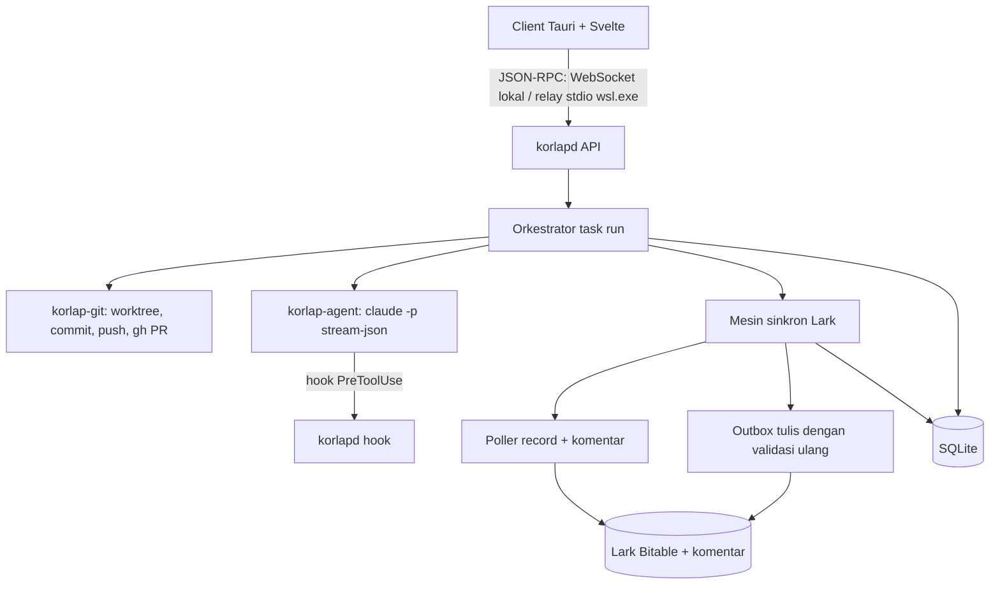
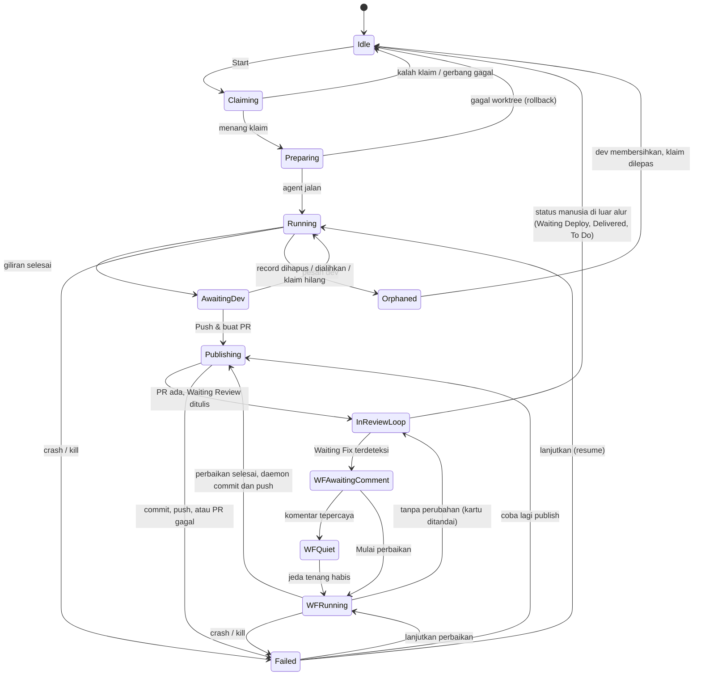
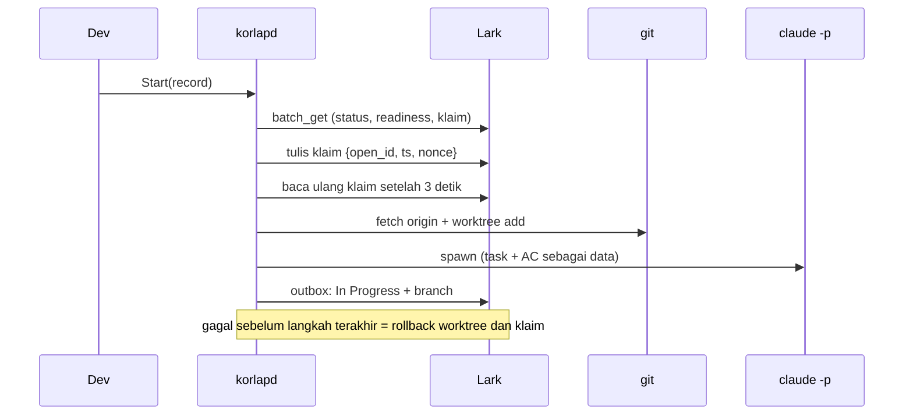

# Korlap Lark + AI Lembur - Plan

## Goal Capsule

- **Objective:** Tim dev menjalankan banyak agent Claude Code paralel dari satu app desktop, dengan task dan status tersinkron dua arah ke Lark Base, lalu memperluasnya ke AI Lembur yang mengerjakan task pilihan di luar jam kerja.
- **This plan executes:** Rilis 1 saja (R1–R16a, termasuk R6a dan R11a–R11e; F1, F2; AE1–AE3, AE6, AE7). Rilis 2–4 tetap di Product Contract sebagai arah, dan unitnya ditulis di rencana terpisah.
- **Target repo:** `korlap-clone` (repo baru). Folder `korlap/` hanya referensi perilaku dan tidak diubah.
- **Product authority:** Beni Handoko (pemilik produk dan pengguna awal) bersama tim dev Pegasus. Product Contract menang atas Planning Contract; Planning Contract menang atas unit.
- **Binding standard:** semua kode Rust wajib mengikuti skill `rust-engineering` (`CLAUDE.md` di root repo, KTD-0, KTD-20). Pelanggaran tidak boleh diterima walau test lulus.
- **Stop conditions:** berhenti dan tanyakan bila sebuah unit tidak bisa diselesaikan tanpa melanggar `rust-engineering`, bila implementasi memerlukan perubahan perilaku produk, bila asumsi di Planning Contract dan fallback yang tertulis untuknya sama-sama terbukti salah (terutama hook lewat `--settings`, API komentar Bitable, atau redirect OAuth localhost), atau bila sebuah transisi status Lark di luar allowlist app tampak dibutuhkan.
- **Execution profile:** fondasi (U1–U5) berurutan; setelah U4, U6, U7, dan U9 paralel, U8 setelah U7; U10–U13 mengikuti Sequencing (U12 bisa mulai setelah U5 dan U8); U14 terakhir.
- **Open blockers:** Rilis 1 membutuhkan Lark Custom App dengan OAuth (redirect URL terdaftar dan refresh token aktif) serta salinan uji Base Sprint Tasks. Rilis 3 membutuhkan keputusan identitas dan login Claude di mesin lembur, serta keputusan apakah PR hasil lembur dibuat sebagai draft sebelum Waiting Review.

---

## Product Contract

### Summary

App desktop hasil tulis ulang Korlap. Setiap task dikerjakan agent di worktree terisolasi, dan kanban app tersinkron dua arah dengan Lark Base *Sprint Tasks*. Rilis 1 berisi visibilitas agent, sinkron Lark (termasuk AC dan loop Waiting Fix), dan alur git minimal. Rilis berikutnya menambah review berbasis AC, AI Lembur dengan laporan pagi, dan knowledge base.

### Problem Frame

Tim saat ini membuka banyak terminal, masing-masing berisi satu sesi Claude Code. Rasa sakit terbesar adalah lupa terminal mana mengerjakan task apa dan agent mana menunggu jawaban. Task berasal dari Lark Base *Sprint Tasks* yang memiliki 7 tahap status, Acceptance Criteria di tabel tertaut, dan gerbang Development Readiness. Semua itu disalin dan di-update secara manual. Jam di luar kerja belum dimanfaatkan, padahal tim ingin agent tetap bekerja pada task yang sudah siap.

Tool sejenis (Korlap asli, fitur paralel Claude Code) tidak memahami alur kerja Lark tim: AC per task, status bertahap milik peran berbeda, dan feedback reviewer di komentar record. Integrasi ini, ditambah knowledge base, autopilot, dan AI Lembur, adalah pembeda produk bila platform agent umum menambah dashboard paralel.

### Actors

- A1. Dev (pemilik task): memilih task, mengawasi agent, memasukkan task ke antrean lembur, menerima laporan pagi.
- A2. PM / Reporter: membuat record task dan AC di Lark.
- A3. Reviewer / QA: mengubah status setelah Waiting Review dan menulis feedback di komentar record Lark.
- A4. Agent (Claude Code): mengerjakan task di worktree, membuat PR, memperbaiki berdasarkan feedback.
- A5. Mesin lembur (server/VM tim): menjalankan task lembur saat laptop dev mati.

### Key Decisions

- **Kanban sendiri plus sinkron dua arah, bukan Lark sebagai satu-satunya papan.** Dipilih pengguna agar app menjadi rumah kerja dev. Field milik manusia adalah judul, deskripsi, AC, assignee, dan Task Status di luar transisi milik app; untuk field ini nilai di Lark selalu menang.
- **Kolom kanban diturunkan dari Task Status, bukan disimpan terpisah.** Pemetaannya: Todo ← To Do; In Progress ← In Progress dan Waiting Fix; Review ← Waiting Review dan In Review; Done ← Waiting Deploy dan Delivered. Kolom Lark `kanban_column` hanya cermin hasil turunan itu, sedangkan `repo_id` dan `order_within_column` menyimpan state tampilan milik app.
- **Dev tidak memindahkan kartu bebas.** Kartu berpindah hanya lewat aksi yang memicu transisi milik app (Start, buat PR, push perbaikan, Mulai perbaikan) atau lewat perubahan Task Status oleh manusia di Lark.
- **Satu pemilik per record.** Saat Start ditekan, app menulis klaim pemilik (dev yang memulai) ke field Lark. Hanya app milik pemilik, atau daemon lembur untuk task lembur, yang menjalankan agent, transisi otomatis, dan pemrosesan Waiting Fix untuk record itu. App PIC lain menampilkan kartu sebagai read-only beserta nama pemiliknya.
- **App hanya mengubah status otomatis pada transisi terbatas:** To Do → In Progress, In Progress → Waiting Review, dan Waiting Fix → In Progress. Status lain diubah manusia.
- **Feedback perbaikan dibaca dari komentar record Lark**, bukan komentar PR. "Komentar baru" berarti komentar yang lebih baru dari kursor komentar per record (ID dan waktu komentar terakhir yang sudah diproses). App atau daemon menulis kursor ini ke field Lark setiap kali meneruskan komentar atau memindahkan record ke Waiting Review, sehingga semua mesin membaca batas yang sama.
- **Teks dari Lark adalah data, bukan instruksi.** Judul, deskripsi, AC, dan komentar dikirim ke agent sebagai blok data yang tidak tepercaya. Hanya komentar dari penulis tepercaya yang diteruskan ke agent; komentar lain hanya ditampilkan ke dev. Penulis tepercaya adalah assignee, reporter, dan anggota daftar reviewer/QA yang dikonfigurasi per repo, karena Bitable tidak menyediakan siapa yang mengubah satu field tertentu.
- **Gerbang task:** hanya task dengan Development Readiness *Ready To Dev* atau *Commit To Sprint* yang boleh diambil agent (R16a).
- **Lembur hibrida:** laptop untuk siang, server untuk malam. Pada awalnya hanya task yang belum disentuh yang bisa diserahkan ke server, dengan satu pengecualian: task yang diparkir oleh lembur sebelumnya.
- **Selama jam lembur tidak ada pesan yang dikirim.** Agent yang buntu memarkir task dengan catatan pertanyaan dan pindah ke task lain; pertanyaan itu hanya sampai ke pemilik task lewat laporan pagi.
- **Waiting Fix pada PR hasil lembur ditangani laptop dev.** App membuat worktree baru dari branch task yang sudah di-push dan memulai sesi agent baru dengan task, AC, diff PR, dan komentar baru sebagai konteks.
- **Agent dijalankan lewat Claude Code CLI (`claude -p`) dengan login langganan masing-masing dev, bukan API key.** Tidak ada biaya per run yang bisa diukur dalam uang, sehingga batas lembur dinyatakan sebagai batas pemakaian yang dihitung dari usage token pada output stream-json.
- **Rilis 1 menjalankan binary Claude Code yang tidak dimodifikasi (`claude -p`) dengan login dev sendiri, bukan Claude Agent SDK.** Ketentuan Anthropic melarang produk pihak ketiga, termasuk yang dibangun di atas Agent SDK, menawarkan login claude.ai atau menjadi perantara kredensial langganan; pengecualian yang tertulis adalah pengguna yang login ke binary Claude Code tanpa modifikasi. Agent dibungkus lapisan backend agar backend Agent SDK dapat dipasang untuk mode berbasis API key (misalnya mesin lembur atau versi publik). Pagar izin (R11e, R22a) ditegakkan lewat hook `PreToolUse`, `--allowedTools`, dan `--permission-mode` pada CLI, sehingga tidak bergantung pada SDK.
- **Tulis ulang bertahap**, tidak fork. Source Korlap (MIT) dipakai sebagai referensi perilaku; pembedahan binary tidak diperlukan.

### Requirements

**Visibilitas agent (Rilis 1)**
- R1. App menampilkan semua agent aktif beserta task Lark-nya (ID `PGS-xxxx` dan judul) serta statusnya: bekerja, menunggu jawaban, selesai, gagal, atau diparkir.
- R2. App memberi notifikasi desktop ketika agent menunggu jawaban atau selesai.
- R3. Setiap agent dapat dibuka untuk melihat chat, diff terhadap base branch, dan status PR-nya.
- R3a. *(Amandemen 2026-10-21.)* Saat Start, dev memilih "Brainstorm, then plan", "Plan only", atau "Skip planning". Brainstorm dan plan berjalan hanya baca: agent membaca kode, bertanya lewat chat (brainstorm), lalu menulis plan Markdown yang tampil di tab Plan. Kode baru ditulis setelah dev menekan "Approve plan & implement"; revisi plan lewat chat. Tiap tahap memakai prompt bawaan Mandor atau skill plugin Claude yang aktif di mesin daemon; pilihan terakhir diingat per mesin. Plan hanya disimpan di Mandor, tidak di-commit.
- R3b. *(Amandemen 2026-10-21.)* Di chat, pesan `/nama argumen` menjalankan skill plugin Claude dengan nama itu; mengetik `/` menampilkan daftar skill yang tersedia.

**Kanban dan sinkron Lark (Rilis 1)**
- R4. Kanban app menampilkan task dari tabel Sprint Tasks yang di-assign ke pengguna, dengan filter per sprint.
- R4a. *(Amandemen 2026-10-21.)* Papan punya tampilan **Mine** (bawaan: kartu yang PIC-nya hanya pengguna, ditambah yang sedang dikerjakan pengguna) dan **Team** (kartu seluruh tim yang belum Done, ditambah Done yang berubah dalam 14 hari terakhir). Kartu rekan hanya baca dan menampilkan PIC-nya; nama orang dan sprint ditampilkan, bukan ID.
- R5. Transisi milik app ditulis ke Lark, dan perubahan di Lark (termasuk Task Status oleh manusia) muncul di app tanpa reload manual.
- R6. Saat terjadi konflik pada field milik manusia, nilai di Lark menang dan kartu menampilkan penanda bahwa nilainya ditimpa.
- R6a. Saat baca atau tulis ke Lark gagal, kartu menampilkan status gagal sinkron beserta penyebab dan aksi coba lagi. Record yang dihapus atau tidak lagi di-assign ke pengguna ditandai, tidak hilang diam-diam.
- R7. Saat task dimulai, prompt agent memuat judul, deskripsi, dan teks semua Acceptance Criteria dari tabel tertaut.
- R8. App menulis nama branch dan link PR ke record Lark. Run multi-repo (R14a) menulis semua link PR, satu per baris.

**Transisi status otomatis (Rilis 1)**
- R9. Saat agent mulai mengerjakan task, status Lark menjadi In Progress.
- R10. Saat PR dibuat, status Lark menjadi Waiting Review.
- R11. Saat reviewer mengubah status ke Waiting Fix, app memberi notifikasi ke dev, menampilkan komentar baru di kartu, mengirim komentar dari penulis tepercaya ke agent di branch yang sama, lalu mengubah status ke In Progress.
- R11a. Bila app sedang mati saat Waiting Fix terjadi, record tersebut diproses saat app menyala lagi, dan worktree dibuat ulang dari branch task bila sudah tidak ada. Bila sesi agent sebelumnya tidak tersedia (termasuk PR hasil lembur), app memulai sesi baru dengan task, AC, diff PR, dan komentar baru sebagai konteks.
- R11b. Bila belum ada komentar baru dari penulis tepercaya, app tidak memulai agent dan tidak mengubah status. Status tetap Waiting Fix dan kartu di kolom In Progress berlabel "menunggu komentar reviewer" sampai komentar tepercaya muncul atau dev menekan Mulai perbaikan.
- R11c. Setelah komentar tepercaya pertama terdeteksi, app menunggu jeda tenang singkat yang dapat dikonfigurasi sebelum memulai agent. Komentar tepercaya yang datang selama perbaikan berjalan diteruskan ke agent yang sama dan ditampilkan di kartu.
- R11d. "Mulai perbaikan" pada kartu Waiting Fix membuka input instruksi dari dev, yang boleh ditambah komentar tidak tepercaya pilihan dev. Agent dimulai di branch task dengan input itu sebagai konteks, dan status menjadi In Progress.
- R11f. *(Amandemen 2026-10-21b.)* Saat task berstatus Waiting Fix, isi field Feedback QA pada AC task itu yang baru atau berubah diperlakukan sama seperti komentar: diteruskan ke agent dengan label AC-nya bila penulisnya tepercaya, dan menunggu konfirmasi dev bila penulisnya tidak bisa dipastikan. Mandor tidak mengubah atau menghapus Feedback QA.
- R11e. Sesi agent yang dimulai otomatis di laptop (tanpa dev memicunya) berjalan tanpa akses ke secret Lark dan token GitHub milik app, dan tidak memakai mode bypass izin. Penulisan ke Lark dan transisi status selalu lewat daemon dengan allowlist yang sama seperti R22a, sehingga R13 tetap berlaku meski agent terpengaruh teks berbahaya.
- R12. Setelah perbaikan dari Waiting Fix di-push, status kembali menjadi Waiting Review.
- R13. App tidak pernah mengubah status In Review, Waiting Deploy, atau Delivered.

**Alur git minimal (Rilis 1)**
- R14. Setiap task dikerjakan di worktree dan branch sendiri yang dibuat dari base branch terbaru.
- R14a. *(Amandemen 2026-10-21.)* Workspace = folder induk berisi beberapa repo terdaftar (bukan monorepo). Start dapat memilih workspace dan repo yang dicentang: satu worktree per repo dengan branch yang sama di satu folder run, satu PR per repo yang berubah, dan status Waiting Review baru ditulis setelah semua PR dibuat. `CLAUDE.md` folder induk ikut dibawa; MCP server dari `.mcp.json` folder induk hanya yang dicentang dev per workspace, dan hook menolak server lainnya.
- R14b. *(Amandemen 2026-10-21.)* Repo ditambahkan dari saran repo di mesin daemon atau penjelajah folder daemon, tanpa harus mengetik path.
- R15. Dev dapat commit, push, dan membuat PR dari app, dengan pesan commit yang disarankan otomatis.
- R16. App berjalan di macOS, Linux, dan Windows. Di WSL, logika berjalan di dalam WSL dan UI native di Windows.
- R16a. App menolak memulai task, atau memasukkannya ke antrean lembur, bila Development Readiness bukan Ready To Dev atau Commit To Sprint, dan menampilkan alasannya.

**Review berbasis AC (Rilis 2)**
- R17. Sebelum PR dibuat, review otomatis memeriksa setiap AC terhadap perubahan kode dan melaporkan AC yang belum terpenuhi, celah, serta edge case.
- R18. Hasil review ditampilkan per AC dan dapat dikirim ke agent untuk diperbaiki.

**AI Lembur (Rilis 3)**
- R19. Dev dapat memasukkan task tertentu ke antrean lembur; task yang tidak dipilih tidak dikerjakan. Task di antrean menampilkan badge "antre lembur" di kartunya, dan dev dapat mengeluarkannya dari antrean sampai jam lembur dimulai.
- R20. Pada jam lembur, mesin lembur mengerjakan antrean hingga PR berstatus Waiting Review, termasuk review otomatis berbasis AC sebelum PR.
- R20a. Saat mengambil task dari antrean, mesin lembur memeriksa ulang bahwa task masih memenuhi R16a dan R21 (To Do, atau In Progress dengan badge diparkir dari lembur sebelumnya). Task yang tidak lagi memenuhi syarat dikeluarkan dari antrean dan dicatat di laporan pagi beserta alasannya.
- R21. Hanya task yang belum disentuh (To Do) yang dapat diserahkan ke mesin lembur. Satu-satunya pengecualian adalah task yang diparkir oleh lembur sebelumnya dan belum dikerjakan di laptop sejak diparkir (R24a).
- R22. Mode lembur tidak pernah: merge ke main; push ke branch selain branch task; mengubah status Lark melewati Waiting Review; menyentuh database atau environment staging; mengirim pesan apa pun selama jam lembur.
- R22a. Setiap larangan R22 ditegakkan di luar proses agent, bukan lewat prompt. Di mesin lembur agent berjalan sebagai user OS atau sandbox terpisah tanpa akses ke kredensial GitHub, Lark, atau rahasia lain. Satu-satunya pengecualian adalah login Claude Code CLI yang dibutuhkan agent untuk berjalan; daemon mencatat pemakaiannya dari output stream-json untuk R22b. Dependensi privat dan base branch diambil daemon sebelum sandbox dimulai, dan test yang butuh database hanya memakai database lokal sekali pakai di dalam sandbox. Push, pembuatan PR, dan penulisan Lark hanya dilakukan daemon setelah memeriksa bahwa target adalah branch task dan transisi ada di allowlist. Main dilindungi ruleset GitHub, dan daemon memblokir semua pengiriman pesan selama jam lembur.
- R22b. Batas pemakaian (token per malam) dicek sebelum setiap task dimulai dan selama agent berjalan. Agent yang mencapai batas dihentikan dan task-nya diparkir dengan alasan "batas pemakaian"; laporan pagi menampilkan pemakaian aktual. Bila langganan mencapai batas pemakaiannya sendiri, task diparkir dengan alasan yang sama.
- R23. Lembur tidak dapat diaktifkan sebelum batas pemakaian diisi.
- R24. Agent yang buntu memarkir task dengan catatan pertanyaan lalu lanjut ke task berikutnya, tanpa mengirim pesan.
- R24a. Task yang diparkir tetap In Progress di Lark dan tampil di kolom In Progress dengan badge "diparkir" beserta pertanyaannya. Dari laporan pagi di app, dev dapat menjawab pertanyaan lalu memasukkan task kembali ke antrean lembur, yang melanjutkan branch yang sama dengan jawaban dev sebagai konteks, atau mengerjakannya siang hari. Task yang sudah dikerjakan di laptop tidak bisa lagi dimasukkan ke antrean lembur.
- R25. Setiap pagi pemilik task menerima laporan via DM Lark dan di app: jumlah task dikerjakan, tahap masing-masing, task yang diparkir beserta pertanyaannya, task yang dilewati beserta alasannya, dan pemakaian token.

**Fitur lanjutan (Rilis 4+)**
- R26. Autopilot siang hari mengambil task siap berikutnya sesuai prioritas dan dependensi.
- R27. Knowledge base per repo (invariants, facts, context) disuntikkan ke agent dan dipakai dalam review.
- R28. LSP untuk editor dan agent, serta backend Codex, tersedia sebagai opsi.

### Key Flows

- F1. Task siang hari
  - **Trigger:** Dev menekan Start pada kartu yang Development Readiness-nya Ready To Dev atau Commit To Sprint.
  - **Steps:** worktree dibuat → agent menerima judul, deskripsi, dan AC → status Lark In Progress → dev memantau → commit/push/PR → status Waiting Review dan link PR tertulis.
  - **Covers R7, R8, R9, R10, R14, R15, R16a.**
- F2. Loop Waiting Fix
  - **Trigger:** Reviewer mengubah status ke Waiting Fix dan menulis komentar di record.
  - **Steps:** app mendeteksi perubahan (langsung, atau saat app menyala lagi) → notifikasi ke dev dan komentar tampil di kartu → komentar dari penulis tepercaya dikirim ke agent di branch yang sama (worktree dibuat ulang bila tidak ada, termasuk untuk PR hasil lembur) → status In Progress → perbaikan di-push → status Waiting Review.
  - **Covers R11, R11a–R11e, R12.**
- F3. Malam AI Lembur
  - **Trigger:** Jam lembur dimulai dan antrean tidak kosong.
  - **Steps:** task diambil dari antrean → syarat diperiksa ulang (dilewati bila tidak memenuhi) → worktree di mesin lembur → agent bekerja → review berbasis AC → perbaikan bila perlu → PR → Waiting Review. Bila buntu atau batas pemakaian tercapai, task diparkir. Pagi hari laporan dikirim ke pemilik, yang dapat menjawab pertanyaan task diparkir lalu mengantrekannya lagi atau mengerjakannya siang hari.
  - **Covers R19–R25, R20a, R22a, R22b, R24a.**

### Acceptance Examples

- AE1. **Given** status record diubah reviewer ke Waiting Fix dengan dua komentar baru, **when** app mendeteksinya, **then** agent menerima kedua komentar, status menjadi In Progress, dan setelah push status kembali Waiting Review. **Covers R11, R12.**
- AE2. **Given** PM mengubah judul task di Lark saat task sedang dikerjakan, **when** sinkron berjalan, **then** judul di app ikut berubah dan app tidak menimpa judul di Lark. **Covers R5, R6.**
- AE3. **Given** task berstatus Development Readiness *Review AC By PM*, **when** dev mencoba memulai atau memasukkannya ke antrean lembur, **then** app menolak dengan alasan task belum siap. **Covers R16a.**
- AE4. **Given** pemakaian token lembur mencapai batas pukul 02.00 saat sebuah agent sedang berjalan, **when** batas terdeteksi, **then** agent dihentikan, task-nya diparkir dengan alasan batas pemakaian, sisa antrean tidak dikerjakan, dan laporan pagi mencatat pemakaian aktual. **Covers R22b, R25.**
- AE5. **Given** agent lembur membutuhkan klarifikasi AC, **when** ia tidak bisa melanjutkan, **then** task diparkir dengan pertanyaannya, tidak ada pesan yang dikirim semalam, dan pertanyaan itu muncul di laporan pagi. **Covers R22, R24, R25.**
- AE6. **Given** record mendapat komentar dari pengguna yang bukan assignee, reporter, atau anggota daftar reviewer/QA, **when** Waiting Fix diproses, **then** komentar itu tampil di kartu tetapi tidak dikirim ke agent. **Covers R11.**
- AE7. **Given** reviewer mengubah status ke Waiting Fix lalu baru menulis komentar lima menit kemudian, **when** app mendeteksi Waiting Fix, **then** status tidak diubah dan kartu menunggu; saat komentar muncul, komentar dikirim ke agent dan status menjadi In Progress. **Covers R11, R11b.**

### Success Criteria

- Dalam 3 bulan pemakaian, jumlah task selesai per sprint naik 50%.
- Setiap pagi ada PR hasil lembur yang lolos review manusia tanpa banyak revisi.
- Frekuensi status Waiting Fix turun.
- Tim tidak lagi bekerja dengan banyak terminal Claude Code terpisah.

### Scope Boundaries

**Deferred for later**
- Serah terima task yang sedang berjalan dari laptop ke mesin lembur.
- Sumber task selain Lark (Jira, Linear, GitHub Issues), yang dibutuhkan bila produk dijual ke publik.
- Server agent bersama sebagai runtime utama siang hari dan visibilitas agent lintas anggota tim di dalam app. (Kartu Lark seluruh tim sudah terlihat lewat papan Team, R4a; agent dan run rekan tidak.)
- Merge otomatis dan perubahan status setelah Waiting Review.

**Outside this product's identity**
- Menggantikan Lark sebagai alat manajemen proyek untuk PM/QA.
- Deployment atau akses ke environment staging dan produksi.

### Dependencies / Assumptions

- Lark Custom App dengan OAuth per user (scope baca/tulis Bitable, baca komentar, `offline_access`). App bertindak atas nama dev memakai izin Lark dev itu sendiri; bot app tidak ditambahkan ke Base, sehingga secret app saja tidak memberi akses ke Base.
- Komentar record Bitable dapat dibaca lewat API komentar drive dengan `file_type=bitable` (belum terdokumentasi resmi, terverifikasi bekerja pada Base Sprint Tasks). Komentar dipetakan ke record lewat metadata balasan, lalu disaring per record di sisi app. Bila ternyata tidak memadai, fallback-nya adalah field teks "Fix Notes" yang diisi reviewer saat mengubah status ke Waiting Fix. Isinya hanya diteruskan ke agent bila pengubah terakhir record adalah penulis tepercaya; selain itu dev harus mengonfirmasi dulu.
- Pada Rilis 1 setiap laptop mendeteksi perubahan Lark dengan polling. Laptop tidak punya endpoint webhook publik, dan event long-connection untuk satu Custom App hanya dikirim ke satu klien yang terhubung.
- Kolom `kanban_column`, `repo_id`, dan `order_within_column` di Sprint Tasks boleh ditulis app sebagai cermin kolom dan state tampilan.
- Sprint Tasks perlu field baru milik app: nama branch, link PR, klaim pemilik, dan kursor komentar. Field ini belum ada di tabel saat ini.
- Setiap dev menjalankan app dan logika agent di mesinnya sendiri pada Rilis 1. Visibilitas antar anggota tim terjadi melalui Lark.
- PR pada Rilis 1 masuk Waiting Review tanpa review AI lebih dulu.
- Mesin lembur memiliki akses ke repo, kredensial GitHub, Claude, dan Lark.

### Outstanding Questions

**Resolve Before Rilis 3 (Lembur)**
- Mesin lembur bertindak atas identitas siapa (GitHub, Claude, Lark: per dev atau identitas tim). Tim memakai login langganan Claude Code, bukan API key. Pilihannya: tiap dev login dengan langganannya sendiri di user OS terpisah di server, sehingga task lembur memakai kuota pemiliknya, atau server memakai API key/paket tim tersendiri. Perlu dicek apakah menjalankan langganan individu di server bersama sesuai ketentuan Anthropic.
- Apakah PR hasil lembur dibuat sebagai draft dengan status Lark tetap In Progress, lalu dipindah ke Waiting Review setelah pemilik mengonfirmasi dari laporan pagi, agar reviewer tidak menerima pekerjaan AI yang belum dilihat manusia.

**Deferred (bukan Rilis 1)**
- Apakah target "+50% task selesai per sprint" diukur setelah Rilis 3 dan pada titik Waiting Review, dengan waktu antre review sebagai metrik pengaman, mengingat kapasitas reviewer manusia bisa menjadi bottleneck.
- Jam mulai dan selesai lembur, dan apakah bisa diatur per dev.
- Satuan dan besaran batas pemakaian lembur (token per malam, per task, atau per dev) dan cara membaca sisa kuota langganan.
- Mekanisme teknis untuk tiap penegakan R22a di mesin lembur, termasuk larangan menyentuh database atau staging.

### Sources / Research

- `docs/ANALISIS-KORLAP.md` dan `docs/spec/01-backend-core.md`, `docs/spec/02-agent-pipeline.md`, `docs/spec/03-frontend.md`: analisis perilaku Korlap asli, prompt, dan daftar bug yang tidak boleh ikut ter-clone.
- `docs/PLAN-FASE-0.md`: arsitektur daemon `korlapd` + client Tauri/Svelte dan desain awal integrasi Lark.
- Lark Base Sprint Tasks (app `FNFlbS3jPa3Yq4sjm8Illj18gnb`, tabel `tblfA8LNgy6dq2tu`): 7 nilai Task Status, AC di tabel tertaut, Development Readiness, dan kolom kanban yang sudah ada.

**Product Contract preservation:** isi produk tidak berubah. Klarifikasi saat perencanaan: Dependencies (model OAuth Lark dan cara komentar Bitable dipetakan) dan Outstanding Questions (pertanyaan kredensial Lark, interval polling, dan akses dokumen spesifikasi repo lain diselesaikan di Planning Contract, KTD-5, KTD-6, KTD-14). Perencanaan juga menambah dua field milik app ke Sprint Tasks di luar daftar Dependencies: ModifiedTime untuk polling inkremental (KTD-6) dan Fix Notes untuk fallback komentar.

---

## Planning Contract

### Scope

Rencana ini mengeksekusi Rilis 1. Rilis 2–4 (review berbasis AC, AI Lembur, autopilot, knowledge base, LSP, Codex) tidak punya unit di sini; seam yang disiapkan untuk mereka disebut di KTD-10 dan KTD-11.

R16 di Rilis 1 diverifikasi end-to-end di Linux dan Windows + WSL saja; macOS dan Windows native hanya build dan test di CI (lihat Deferred to Follow-Up Work).

Dari Korlap asli, yang dibangun ulang di Rilis 1 hanya chat agent, diff, dan alur PR. Terminal PTY, file browser, editor, script runner, LSP, dan MCP server Korlap ditunda (lihat Deferred to Follow-Up Work). MCP server milik tim dari `.mcp.json` workspace boleh dipakai agent sejak amandemen 2026-10-21 (R14a, KTD-23).

**Amandemen 2026-10-21.** Pemilik produk menyetujui penambahan R3a, R3b, R4a, R14a, dan R14b ke Rilis 1, yang dikerjakan di U15. KTD-6 dan KTD-10 diubah sesuai catatan di masing-masing; keputusan baru di KTD-21 sampai KTD-24. *(Amandemen 2026-10-21b:)* pemilik produk menambah R11f (Feedback QA per AC sebagai sumber Waiting Fix, karena QA tim lebih sering menulis di sana daripada di komentar), dikerjakan di U16 dengan KTD-41. Rincian dan alasannya di `docs/progress/rilis-1.md` dan `docs/plans/2026-10-21-002-multi-repo-workspace-proposal.md`.

### Key Technical Decisions

- KTD-0. **Standar `rust-engineering` mengikat seluruh kode Rust (lihat `CLAUDE.md` di root repo).** Tier arsitektur: ports, karena ada aturan bisnis nyata (state machine, klaim, transisi status). Lapisan sebagai crate workspace, dengan dependensi mengarah ke dalam:
  - `korlap-domain`: aturan murni tanpa I/O (derivasi kolom kanban, state machine alur kerja, keputusan klaim, filter penulis tepercaya, urutan kursor, allowlist transisi, klasifikasi perintah untuk hook).
  - `korlap-usecase`: orkestrasi (Start, sinkron, outbox, Waiting Fix, rekonsiliasi) dan trait port dalam satu bundel `Deps` (Lark, git, agent, penyimpanan, jam, notifikasi).
  - Adapter: `korlap-store` (sqlx), `korlap-lark` (reqwest), `korlap-git`, `korlap-agent`, `korlap-proc` (helper proses yang dipakai adapter git dan agent), `korlap-api` (axum WebSocket dan relay stdio), `korlap-protocol` (DTO yang dibagi dengan TypeScript, hanya dipakai `korlap-api`).
  - `korlapd`: crate app; satu-satunya yang bergantung pada semua crate, berisi `main`, `Config::from_env()`, wiring manual, subcommand `connect` dan `hook`, serta satu-satunya pengguna `anyhow`.
  - Aturan cloud yang tidak berlaku untuk daemon lokal dicatat di `CLAUDE.md` (rate limit 429, load shedding, `/metrics`, load test, 12-factor/serverless).
- KTD-1. **Daemon memegang semua logika; client hanya UI.** `korlapd` (Rust, tokio) mengelola repo, worktree, agent, sinkron Lark, dan penyimpanan. Client Tauri v2 + SvelteKit tidak punya logika bisnis. Ini mengikuti `docs/PLAN-FASE-0.md` dan memperbaiki god-component `korlap/src/routes/+page.svelte`. Agent tetap berjalan saat UI ditutup.
- KTD-2. **Dua transport untuk satu protokol JSON-RPC 2.0.** WebSocket di `127.0.0.1` dengan token pada pesan pertama untuk mode lokal; relay stdio lewat `wsl.exe -d <distro> -- korlapd connect` sebagai default mode WSL. Port forwarding localhost Windows→WSL dilaporkan tidak andal, dan relay stdio tidak membuka port maupun firewall. Pada mode relay, webview bicara ke sisi Rust Tauri lewat IPC dan sisi Rust meneruskan frame. Relay tidak menyisipkan token; client tetap mengirim `hello` dengan token yang dibacanya dari `daemon.json` (0600, di direktori `~/.korlap` 0700).
- KTD-3. **SQLite lewat `sqlx` (fitur `sqlite`, `runtime-tokio`) dengan migrasi `sqlx` dan query `query!` yang dicek saat compile, WAL, dan `busy_timeout`.** `sqlx` adalah satu-satunya crate database di allow list `rust-engineering`; SQLite dipakai karena daemon lokal tidak punya Postgres, dan driver async `sqlx` menghindari I/O blocking di runtime tokio. Hanya `korlap-store` yang boleh bergantung pada `sqlx`.
- KTD-4. **Kolom kanban adalah fungsi murni dari Task Status; state alur kerja disimpan terpisah dan lokal.** Pemetaan 7 status ke 4 kolom sesuai Key Decisions Product Contract, ditambah kolom "Tidak dikenal" untuk nilai status yang tidak terpetakan (app tidak pernah menulis ke record seperti itu). State alur kerja per record (lihat diagram di bawah) hidup di SQLite laptop pemilik.
- KTD-5. **Lark OAuth per user dengan PKCE; listener callback di sisi client.** Browser dibuka dari sisi Tauri native dan callback `http://127.0.0.1:<port tetap>/callback` ditangkap oleh client, lalu kode diteruskan ke daemon untuk ditukar. Parameter `state` acak divalidasi saat callback, dan login dibatalkan dengan pesan jelas bila port callback sudah dipakai proses lain. Refresh token berotasi setiap pakai, jadi pasangan token disimpan atomik. Token disimpan daemon di Secret Service bila tersedia dalam 2 detik, selain itu di `~/.korlap/secrets.json` dengan izin 0600 di direktori 0700.
- KTD-6. **Polling Lark dibatasi ke record milik pengguna dan inkremental.** App menambah field ModifiedTime milik app ke tabel, lalu setiap 15 detik mencari record dengan Assignee berisi open_id pengguna dan ModifiedTime ≥ kemarin, dan membandingkan `last_modified_time` (ms) dengan cache. Rekonsiliasi penuh setiap 5 menit. Komentar diambil setiap 20 detik hanya bila ada record milik pengguna yang berstatus Waiting Fix atau yang state alur kerjanya sedang dalam loop perbaikan (menunggu komentar, jeda tenang, atau perbaikan berjalan). Paging komentar berhenti begitu mencapai balasan yang lebih lama dari kursor tertua yang relevan, dan thread yang sudah diketahui milik record lain di-cache agar tidak dibaca ulang. Error throttling (1254290) memicu backoff dengan jitter. *(Amandemen 2026-10-21:)* papan Team (R4a) diambil terpisah tiap 60 detik dan saat Refresh: kartu yang Task Status-nya bukan Waiting Deploy/Delivered, ditambah kartu dengan `mandor_modified` dalam 14 hari terakhir. Hasilnya hanya di memori daemon, tidak masuk cache kartu pengguna, sehingga klaim, komentar, dan rekonsiliasi tidak terpengaruh.
- KTD-7. **Semua penulisan Lark lewat outbox yang memvalidasi ulang.** Outbox di SQLite, satu antrean per tabel, jeda minimal 600 ms antar tulis karena Bitable menolak tulis serentak (1254291). Sebelum setiap PUT, outbox membaca ulang record dan membatalkan bila status sumber, pemilik, atau assignee tidak lagi sesuai; kartu lalu ditandai (R6, R6a). Retry tidak pernah memutar ulang tulisan tanpa validasi.
- KTD-8. **Klaim pemilik tanpa compare-and-set.** Bitable tidak mendukung CAS dan satu field klaim hanya menyimpan tulisan terakhir. Start dibatalkan bila baca segar sudah menunjukkan klaim aktif milik dev lain. Selain itu klaim ditulis sebagai `{open_id, ts, nonce}`, dibaca ulang setelah 3 detik, dan laptop hanya lanjut bila field berisi tepat `nonce` miliknya; jika tidak, laptop itu kalah dan membatalkan Start sebelum worktree dibuat. Daemon pemilik memperbarui `ts` klaim setiap 5 menit sebagai heartbeat; klaim tanpa pembaruan selama 30 menit dianggap tidak aktif dan boleh diambil alih lewat aksi "Ambil alih", yang menjalani baca ulang yang sama. Klaim dikosongkan bila manusia mengembalikan status ke To Do.
- KTD-9. **Urutan Start: status Lark ditulis paling akhir.** Baca segar gerbang dan status → klaim → fetch dan worktree dari `origin/<base>` → jalankan agent → tulis In Progress dan nama branch lewat outbox. Transisi kompensasi In Progress → To Do tidak diizinkan, jadi kegagalan sebelum tulis status menghapus worktree dan branch serta melepas klaim, sedangkan kegagalan sesudahnya menandai kartu "gagal" dengan aksi coba lagi.
- KTD-10. **Agent dijalankan sebagai binary Claude Code tanpa modifikasi, tanpa `bypassPermissions`.** Setiap spawn memakai `claude -p --output-format stream-json --verbose --permission-mode acceptEdits --permission-prompts none`, allowlist dan deny list per repo, `--settings` berisi hook `PreToolUse` yang memanggil `korlapd hook` lewat path absolut serta `disableAllHooks: false`, `--strict-mcp-config` tanpa server MCP, `--setting-sources user,project` (settings lokal worktree tidak dimuat), operator prompt yang di-append, dan `--session-id` yang dipilih daemon pada run pertama lalu `--resume`. Operator prompt tetap selama satu sesi karena CLI merekamnya pada permintaan pertama; konteks per giliran (komentar Waiting Fix, instruksi dev) dikirim di pesan user. Hook bersifat fail-closed: error internal, input rusak, atau timeout menghasilkan exit 2. Deny list mencakup penulisan ke `.claude/**`, `.husky/**`, `.githooks/**`, dan `.git/**`, sehingga agent tidak bisa melemahkan pagar izin untuk giliran berikutnya. Lapisan `AgentBackend` disiapkan agar backend Codex dan Agent SDK menyusul tanpa mengubah orkestrasi. *(Amandemen 2026-10-21:)* `--strict-mcp-config` tetap dipakai; run workspace menambah `--mcp-config` berisi hanya server yang dicentang dev (berkas 0600 di luar folder kerja agent) dan hook `--mcp a,b` menolak server lain. Tool `Skill` diizinkan untuk skill plugin; tool yang dipakai skill tetap melewati allowlist dan hook. Giliran brainstorm/plan memakai `--permission-mode plan`, menolak `ExitPlanMode`, dan hook `--plan` menolak semua tool penulis berkas. Allowlist bawaan ditambah perintah shell tanpa efek di luar worktree (`cd`, `pwd`, `echo`, `sed`, `awk`, dan sejenisnya) karena Claude memeriksa setiap bagian perintah gabungan.
- KTD-11. **Daemon satu-satunya yang commit, push, dan membuat PR; agent tidak memegang kredensial.** Environment agent dibersihkan dari token GitHub dan Lark, serta diberi config git dan gh terisolasi (`GIT_CONFIG_NOSYSTEM=1`, `GIT_CONFIG_GLOBAL` ke file milik korlap dengan identitas dan `credential.helper` kosong, `GH_CONFIG_DIR` ke direktori kosong), sehingga credential helper global tidak bisa dipakai. Allowlist agent tidak memuat `git commit`. Git milik daemon di dalam worktree selalu berjalan dengan `-c core.hooksPath=/dev/null -c core.fsmonitor=false` dan `--no-verify`, dan kredensial hanya disuntikkan ke proses fetch dan push. Daemon memakai `gh auth token --user <profil>` hanya untuk prosesnya sendiri, membuat PR dengan `gh pr create`, dan memeriksa status PR setiap 60 detik untuk record yang belum punya link PR dan tidak sedang dalam loop Waiting Fix, sehingga PR yang dibuat di luar app memicu Waiting Review (R10) tanpa mengganggu perbaikan. Pesan commit dibuat oleh `claude -p --model haiku` tanpa tool, dengan pagar spawn yang sama (environment bersih, `--strict-mcp-config`, hook) dan diff sebagai blok data tidak tepercaya.
- KTD-12. **Mesin Waiting Fix persisten dan idempoten.** Kursor komentar di level balasan, `(create_time, reply_id)` lintas semua thread yang terpetakan ke record, ditulis ke field Lark dan jurnal lokal, sehingga balasan baru di thread lama terdeteksi. Jurnal punya dua tahap: `pending` sebelum dikirim dan `delivered` setelah giliran diterima proses agent; entri yang masih `pending` dikirim ulang saat restart. Kursor ditulis sebelum status. Jeda tenang default 120 detik dihitung dari waktu komentar tepercaya pertama, sehingga restart tidak meresetnya. Komentar tepercaya yang tiba saat agent berjalan diantrekan sebagai giliran berikutnya pada sesi yang sama, karena `claude -p` memproses satu giliran per proses.
- KTD-13. **Rekonsiliasi saat daemon start.** Run dengan PID mati menjadi "gagal" yang bisa dilanjutkan lewat `--resume`; process group yang masih hidup dihentikan; outbox diputar ulang dengan validasi; record Waiting Fix milik pengguna diproses (R11a). Status Running tidak pernah diubah diam-diam menjadi Waiting.
- KTD-14. **Dokumen spesifikasi di repo lain lewat path pendamping read-only.** Setting per repo berisi daftar path pendamping (misalnya checkout `pegasus-shared`) yang diberikan ke agent dengan `--add-dir`, dengan Read diizinkan dan Edit/Write ditolak.
- KTD-15. **Teks Lark dibungkus sebagai data tidak tepercaya di prompt.** Judul, deskripsi, AC, dan komentar dimasukkan dalam blok berpembatas dengan nonce acak per spawn, yang dinyatakan sebagai data di operator prompt; instruksi operator hanya berasal dari daemon dan dev.
- KTD-18. **Daemon di WSL tetap hidup saat UI ditutup.** `korlapd connect` menjalankan daemon terlepas penuh dari sesi relay (setsid). Bila systemd aktif di distro, daemon dipasang sebagai systemd user service; bila tidak, client Tauri menjaga satu proses `wsl.exe` penjaga yang tetap berjalan di system tray. Runbook menjelaskan pengaturan `vmIdleTimeout`.
- KTD-19. **Push otomatis menahan perubahan sensitif.** Pada sesi yang dimulai otomatis, daemon tidak push bila diff menyentuh `.github/workflows/`, `.claude/`, `CLAUDE.md`, atau konfigurasi hook git; kartu ditandai untuk konfirmasi dev.
- KTD-16. **Tipe protokol dihasilkan dari Rust dengan ts-rs** dan diperiksa CI agar tidak menyimpang. Handshake `hello` membawa versi protokol; versi mayor berbeda ditolak.
- KTD-20. **Crate di luar allow list `rust-engineering` hanya yang berikut, dengan justifikasi dicatat di `CLAUDE.md` dan `deny.toml`:** `process-wrap` (process group dan Job Object lintas OS tanpa `unsafe` di kode kita), `ts-rs` (generate tipe TypeScript dari tipe protokol), `keyring-core` beserta store Secret Service (penyimpanan token OS), `fd-lock` (lock file eksklusif lintas OS), dan `subtle` (perbandingan token waktu-konstan). Crate Tauri hanya dipakai di `apps/desktop/src-tauri`. Error memakai `thiserror` per crate dan `anyhow` hanya di `korlapd`; token memakai `secrecy::SecretString`; retry memakai helper kecil di repo, bukan crate.
- KTD-17. **Supervisi proses dengan process-wrap.** Setiap agent dan proses git berjalan di process group sendiri. Stop berurutan: SIGINT, tunggu 10 detik, SIGTERM, lalu SIGKILL ke seluruh group. Daemon memegang lock eksklusif `~/.korlap/daemon.lock` dan menulis `daemon.json` secara atomik.
- KTD-21. *(2026-10-21)* **Worktree di luar direktori data.** Worktree dibuat di `~/.local/share/mandor/workspaces`, bukan `~/.mandor/workspaces`, karena pagar agent menolak setiap path yang memuat `.mandor` (tempat token Lark). Dengan begitu larangan itu tetap menyeluruh, termasuk path relatif seperti `../../lark.json`. Config memeriksa folder worktree dengan aturan hook yang sama.
- KTD-22. *(2026-10-21)* **Fase plan sebagai fase run, bukan state baru.** `RunPhase::{Brainstorm, Plan, Implement}` disimpan di run; state alur kerja (Running, AwaitingDev, dan seterusnya) tetap. Pesan akhir giliran plan disimpan sebagai plan; `approve_plan` dan `continue_to_plan` melanjutkan sesi yang sama. Publish ditolak selama belum Implement, dan giliran Waiting Fix selalu Implement.
- KTD-23. *(2026-10-21)* **Run multi-repo memakai satu daftar anggota.** Run menyimpan repo utama di kolom lama dan repo tambahan di `RunExtra` (JSON), tanpa migrasi tabel `runs`. Start, giliran lanjutan, publish, perbaikan, tutup run, dan discard berkas semua memakai daftar anggota yang sama. Link PR disimpan per anggota segera setelah dibuat agar kegagalan sebagian bisa dilanjutkan tanpa PR ganda.
- KTD-41. *(2026-10-21b)* **Feedback QA dibaca sebagai balasan sintetis per AC.** Saat tick Waiting Fix, daemon mengambil ulang AC task (field `Feedback QA`) dan membandingkan hash isinya per AC dengan jurnal lokal. Isi baru menjadi balasan sintetis berid `fqa:<ac_record_id>:<hash>` yang masuk ke jalur KTD-12 yang sama: kursor, jurnal `pending`/`delivered`, jeda tenang, dan antrean. ID balasan memuat hash FNV-1a isinya, jadi isi yang sama tidak dikirim ulang walau record AC diubah di field lain. Riwayat per field Lark (`base/v3 record_history`) hanya memberi nama operator, bukan `open_id`, jadi penulis Feedback QA tidak bisa dipastikan dari record AC saja. Aturan kepercayaan (keputusan pemilik produk 2026-10-22): Feedback QA dipercaya hanya bila pengubah terakhir record AC (dari `batch_get`) sama dengan orang yang memindahkan task ke Waiting Fix, dan orang itu penulis tepercaya. Pemindah dicatat di run (`fix_requested_by`) sebagai pengubah terakhir record task saat loop perbaikan dimulai. Selain itu, termasuk pengubah tidak diketahui, feedback tampil di kartu tetapi menunggu konfirmasi dev lewat Start fix. Daemon tidak pernah menulis ke tabel AC.
- KTD-24. *(2026-10-21)* **Chat menampilkan ringkasan, bukan prompt agent.** Pesan pertama di chat adalah ringkasan Start (mode, skill, catatan dev); prompt lengkap dengan blok data KTD-15 hanya dikirim ke agent. Perintah `/skill` dikenali daemon dan diubah menjadi instruksi eksplisit memakai tool `Skill`.

### High-Level Technical Design

Komponen dan aliran data:

State alur kerja per record di laptop pemilik (terpisah dari kolom kanban):

Urutan Start (KTD-9):

### Assumptions

Asumsi berikut diverifikasi di unit yang disebut; bila salah, berhenti dan tanyakan (Goal Capsule):

- `--settings` menerima blok `hooks` per pemanggilan (U9). Bila tidak, hook dipasang lewat file settings di direktori data korlap yang dirujuk path.
- API komentar drive dengan `file_type=bitable` tetap tersedia dan metadata balasan memuat ID record (U7). Bila gagal, fallback field Fix Notes menjadi jalur utama.
- Lark menerima redirect `http://127.0.0.1:<port>` untuk Custom App (U7). Bila tidak, coba alur device code; bila keduanya gagal, berhenti.
- Token tenant tanpa keanggotaan bot di Base tidak bisa membaca Base (U7), sehingga secret app di laptop tidak membuka akses Base.
- Event `result` stream-json memuat usage token di bawah login langganan (U9); dipakai sebagai informasi, bukan penegakan, di Rilis 1.

### System-Wide Impact

- **Data Lark bersama:** setiap laptop menulis ke tabel yang sama yang juga diubah PM dan QA. Batas tulis app adalah allowlist transisi (KTD-7) dan field milik app (branch, link PR, klaim, kursor, Fix Notes hanya dibaca, cermin kanban; ModifiedTime diisi otomatis oleh Lark); field milik manusia tidak pernah ditulis.
- **Kredensial:** token Lark (per dev) dan token GitHub (profil gh) hanya dipakai proses milik daemon. Agent tidak menerimanya lewat environment, dan hook serta deny list memblokir pembacaan file kredensial yang umum.
- **Proses di mesin dev:** agent dan proses git berjalan di process group milik daemon dan ikut dihentikan saat stop atau saat daemon dimatikan; tidak ada proses yatim setelah restart (KTD-13, KTD-17).
- **Konteks agent:** semua teks dari Lark masuk sebagai data tidak tepercaya (KTD-15). Konfigurasi repo yang dikerjakan (`CLAUDE.md`, `.claude/settings.json`) tetap dimuat sesuai kebiasaan tim, sedangkan server MCP repo tidak dimuat (`--strict-mcp-config`).
- **Kegagalan menjalar:** kegagalan Lark tidak menghentikan agent; kartu ditandai dan outbox mencoba ulang. Kegagalan agent tidak menulis status Lark apa pun.

### Sequencing

U1 → U2 → U3 → U4 → U5 adalah fondasi berurutan. Setelah U4, U6 (git), U7 (Lark), dan U9 (agent) bisa dikerjakan paralel. U8 butuh U7. U10 butuh U6, U8, U9. U11 butuh U10. U12 butuh U5 dan U8 (panel agent diverifikasi dengan mock event `run.updated`, lalu dengan run nyata setelah U10). U13 butuh U10 dan U12. U14 terakhir.

---

## Implementation Units

| U-ID | Judul | Area utama | Bergantung pada |
|---|---|---|---|
| U1 | Scaffold workspace, enforcement, dan CI | `CLAUDE.md`, `Cargo.toml`, `deny.toml`, `Makefile`, `apps/desktop/`, `.github/workflows/` | — |
| U2 | Runner proses dan supervisi | `crates/korlap-proc/` | U1 |
| U3 | Penyimpanan SQLite | `crates/korlap-store/` | U1 |
| U4 | Protokol dan server daemon | `crates/korlap-protocol/`, `crates/korlap-api/`, `crates/korlapd/` | U2, U3 |
| U5 | Shell client dan koneksi daemon | `apps/desktop/` | U4 |
| U6 | Operasi git dan PR | `crates/korlap-git/` | U2, U4 |
| U7 | Klien Lark dan OAuth | `crates/korlap-lark/` | U3, U4 |
| U8 | Mesin sinkron dan derivasi kanban | `crates/korlap-domain/`, `crates/korlap-usecase/src/sync/` | U7 |
| U9 | Backend agent Claude | `crates/korlap-agent/` | U2, U4 |
| U10 | Orkestrasi task run | `crates/korlap-usecase/src/run/` | U6, U8, U9 |
| U11 | Mesin Waiting Fix | `crates/korlap-domain/`, `crates/korlap-usecase/src/waiting_fix/` | U10 |
| U12 | UI kanban dan panel agent | `apps/desktop/src/lib/` | U5, U8 |
| U13 | UI workspace dan pengaturan | `apps/desktop/src/lib/` | U10, U12 |
| U14 | Smoke test end-to-end dan runbook | `crates/korlap-e2e/`, `docs/runbook/` | semua |

### U1. Scaffold workspace dan CI

- **Goal:** Repo `korlap-clone` dengan Cargo workspace, Bun workspace, aplikasi Tauri kosong, dan CI di Linux, macOS, Windows.
- **Requirements:** R16.
- **Dependencies:** —
- **Files:** `CLAUDE.md`, `Cargo.toml` (`[workspace.dependencies]` dan `[workspace.lints]` sesuai `rust-engineering`), `rust-toolchain.toml`, `rustfmt.toml`, `clippy.toml`, `deny.toml` (bans, aturan wrapper per lapisan, advisories, lisensi), `Makefile` (target `check`), `crates/korlap-domain/Cargo.toml`, `crates/korlap-usecase/Cargo.toml`, `package.json`, `apps/desktop/package.json`, `apps/desktop/src-tauri/Cargo.toml`, `apps/desktop/src-tauri/tauri.conf.json`, `apps/desktop/src-tauri/capabilities/default.json`, `apps/desktop/svelte.config.js`, `apps/desktop/vitest.config.ts`, `.github/workflows/ci.yml`, `LICENSE`, `NOTICE` (notice MIT Korlap asli).
- **Approach:** CSP ketat di `tauri.conf.json` (tanpa `unsafe-eval`, `connect-src` hanya IPC dan `ws://127.0.0.1:*`); capability webview minimal tanpa plugin shell, fs, atau http. SvelteKit adapter-static dengan `ssr=false`.
- **Patterns to follow:** `korlap/svelte.config.js`, `korlap/src-tauri/tauri.conf.json` (kecuali `csp: null`).
- **Test scenarios:** Test expectation: none -- scaffold tanpa perilaku; dibuktikan oleh CI hijau.
- **Verification:** CI menjalankan fmt, clippy, test, dan `bun run check` hijau di ketiga OS; app kosong terbuka di Windows dan Linux.

### U2. Runner proses dan supervisi

- **Goal:** Satu helper untuk menjalankan semua proses eksternal dengan timeout, environment login shell, redaksi token, dan penghentian seluruh process group.
- **Requirements:** R14, R15 (fondasi), KTD-11, KTD-17.
- **Dependencies:** U1.
- **Files:** `crates/korlap-proc/src/lib.rs`, `crates/korlap-proc/src/shell_env.rs`, `crates/korlap-proc/src/redact.rs`, `crates/korlap-proc/tests/run_cmd.rs`.
- **Approach:** process-wrap untuk process group (Unix) dan Job Object (Windows). Environment login shell ditangkap sekali dengan timeout (bash, zsh, fish), tanpa hardcode `zsh`. Token tidak pernah masuk argv; kredensial git disuntikkan lewat `GIT_CONFIG_COUNT`/`GIT_CONFIG_KEY_n`/`GIT_CONFIG_VALUE_n`. Opsi pembersihan environment untuk proses agent (hapus `GH_TOKEN`, `GITHUB_TOKEN`, variabel Lark).
- **Patterns to follow:** `korlap/src-tauri/src/commands/helpers.rs` (penangkapan env), dengan memperbaiki bug yang dicatat di `docs/spec/01-backend-core.md` §7.
- **Test scenarios:**
  - Perintah yang melebihi timeout dihentikan beserta proses anaknya, dan hasilnya error timeout.
  - Proses yang memunculkan anak (`sh -c 'sleep 100 & wait'`) dihentikan seluruh group-nya oleh stop; tidak ada proses tersisa.
  - Output error yang memuat token `ghp_xxx` atau `x-access-token:xxx` diredaksi sebelum dikembalikan.
  - Pembersihan environment menghapus `GH_TOKEN` dan `GITHUB_TOKEN` dari proses anak.
  - Probe shell env yang menggantung tidak memblokir lebih dari timeout-nya.
- **Verification:** Test lulus di Linux dan Windows; tidak ada penggunaan `unwrap()` di jalur non-test.

### U3. Penyimpanan SQLite

- **Goal:** Skema dan migrasi untuk repo, setting repo, cache record Lark, run task, sesi agent, pesan chat, outbox Lark, jurnal komentar, dan notifikasi.
- **Requirements:** R1, R5, R6a, R11a, R11c.
- **Dependencies:** U1.
- **Files:** `crates/korlap-store/src/lib.rs`, `crates/korlap-store/migrations/0001_init.sql`, `crates/korlap-store/src/repos.rs`, `crates/korlap-store/src/runs.rs`, `crates/korlap-store/src/outbox.rs`, `crates/korlap-store/tests/store.rs`.
- **Approach:** `sqlx` dengan fitur `sqlite` dan `runtime-tokio`, migrasi `sqlx`, query `query!` yang dicek saat compile, WAL, `busy_timeout`, pool kecil dengan timeout acquire. `korlap-store` mengimplementasikan port penyimpanan milik `korlap-usecase` dan menerjemahkan error `sqlx` ke error domain. Pesan chat disimpan per baris, bukan satu JSON besar. Setiap run menyimpan `run_id` (generation), PID, PGID, `session_id`, dan state alur kerja.
- **Patterns to follow:** daftar file data di `docs/spec/01-backend-core.md` §2 sebagai inventaris data yang dipindah ke tabel.
- **Test scenarios:**
  - Migrasi pada database kosong menghasilkan semua tabel; menjalankan migrasi dua kali tidak mengubah apa pun.
  - Penulisan run baru dengan `run_id` lebih tinggi tidak menimpa run lama yang masih tercatat.
  - Outbox mengembalikan item per tabel dalam urutan masuk, dan item yang ditandai batal tidak dikembalikan lagi.
  - Database yang rusak di satu baris tidak mencegah baris lain terbaca.
- **Verification:** Test lulus; ukuran dan waktu buka database stabil setelah 10.000 pesan.

### U4. Protokol dan server daemon

- **Goal:** `korlapd` yang bisa dijalankan, menerima koneksi JSON-RPC lewat WebSocket lokal dan relay stdio, dengan handshake versi dan token.
- **Requirements:** R16, KTD-1, KTD-2, KTD-16, KTD-17.
- **Dependencies:** U2, U3.
- **Files:** `crates/korlap-protocol/src/lib.rs`, `crates/korlap-protocol/src/methods.rs`, `crates/korlap-protocol/src/events.rs`, `crates/korlapd/src/main.rs`, `crates/korlap-api/src/ws.rs`, `crates/korlap-api/src/stdio.rs`, `crates/korlapd/src/lock.rs`, `crates/korlap-api/tests/handshake.rs`, `apps/desktop/src/lib/protocol/` (hasil generate ts-rs).
- **Approach:** axum WebSocket di `127.0.0.1` dengan envelope JSON-RPC buatan sendiri. Token dibandingkan waktu-konstan pada pesan `hello`. Subcommand `korlapd connect` meneruskan stdin/stdout ke daemon yang sudah berjalan di mesin yang sama (dan menjalankannya bila belum ada). Event server→client: `run.updated`, `agent.event`, `card.updated`, `sync.status`, `notification`. Lock eksklusif dan `daemon.json` atomik.
- **Patterns to follow:** daftar method dan event di `docs/PLAN-FASE-0.md` §3.
- **Test scenarios:**
  - Client dengan token salah ditolak dan koneksinya ditutup.
  - Client dengan versi protokol mayor berbeda ditolak dengan pesan yang menyebut kedua versi.
  - Instance kedua `korlapd` gagal start karena lock, tanpa merusak `daemon.json` instance pertama.
  - `korlapd connect` saat daemon belum berjalan menjalankannya terlepas penuh (setsid) lalu menyelesaikan handshake; menutup relay tidak menghentikan daemon.
  - Relay `korlapd connect` tanpa token `hello` yang valid ditolak oleh daemon.
  - `daemon.json` dibuat dengan izin 0600 di direktori 0700.
  - Notifikasi server terkirim ke semua client yang terhubung, dan client yang putus tidak membuat daemon error.
  - File TypeScript hasil generate sama dengan yang di-commit (pemeriksaan CI).
- **Verification:** Handshake berhasil lewat WebSocket di Linux dan lewat relay stdio dari Windows ke WSL.

### U5. Shell client dan koneksi daemon

- **Goal:** Client Tauri yang menemukan atau menjalankan daemon (lokal atau di WSL), terhubung, menyambung ulang, dan menampilkan layar awal pemilihan repo.
- **Requirements:** R16.
- **Dependencies:** U4.
- **Files:** `apps/desktop/src-tauri/src/main.rs`, `apps/desktop/src-tauri/src/daemon_link.rs`, `apps/desktop/src/lib/api/client.ts`, `apps/desktop/src/lib/stores/connection.svelte.ts`, `apps/desktop/src/lib/theme/tokens.css`, `apps/desktop/src/routes/+page.svelte`, `apps/desktop/src/lib/api/client.test.ts`.
- **Approach:** Sisi Rust Tauri menjalankan `wsl.exe -d <distro> -- korlapd connect` dengan `CREATE_NO_WINDOW` dan `WSL_UTF8=1` di Windows, atau membaca `daemon.json` di Linux/macOS. Pilihan distro disimpan di setting client. Bila distro tidak memakai systemd, client menjaga satu proses `wsl.exe` penjaga yang tetap hidup di system tray setelah jendela ditutup (KTD-18). Token tema dan tipografi dipindah dari `korlap/src/lib/themes.ts`, termasuk memuat font yang di versi asli tidak pernah dimuat.
- **Patterns to follow:** sistem tema `korlap/src/lib/themes.ts` dan tooltip action `korlap/src/lib/actions.ts`.
- **Test scenarios:**
  - Koneksi yang terputus memicu reconnect dengan backoff, dan permintaan yang sedang menunggu mendapat error yang jelas, bukan menggantung.
  - Daemon yang mengirim versi protokol tidak cocok menampilkan layar error dengan instruksi update.
  - Distro WSL yang tidak ada menampilkan pesan yang menyebut nama distro.
  - Menutup jendela saat agent berjalan meninggalkan proses penjaga di tray, dan daemon serta agent tetap hidup melewati idle timeout WSL.
- **Verification:** Di Windows, app terhubung ke daemon di WSL dalam kurang dari 15 detik saat cold start; di Linux, terhubung ke daemon lokal.

### U6. Operasi git dan PR

- **Goal:** Registrasi repo, deteksi default branch, pembuatan dan penghapusan worktree, diff, commit, push, serta pembuatan dan pemeriksaan PR, semuanya oleh daemon.
- **Requirements:** R3, R8, R10, R14, R15, KTD-9, KTD-11.
- **Dependencies:** U2, U4.
- **Files:** `crates/korlap-git/src/repo.rs`, `crates/korlap-git/src/worktree.rs`, `crates/korlap-git/src/diff.rs`, `crates/korlap-git/src/publish.rs`, `crates/korlap-git/src/gh.rs`, `crates/korlap-git/tests/worktree.rs`, `crates/korlap-git/tests/diff.rs`, `crates/korlap-git/tests/publish.rs`.
- **Approach:** Worktree di `~/.korlap/workspaces/<id>` dari `origin/<base>` setelah fetch. Diff memakai merge-base dengan `--name-status -M` dan `--numstat` ditambah file untracked. Push hanya ke branch task yang tercatat untuk run itu. Daemon satu-satunya yang membuat commit. Semua git milik daemon di worktree berjalan tanpa hook repo dan fsmonitor, dan kredensial hanya diberikan ke proses fetch dan push (KTD-11). Profil `gh` per repo; token diambil dengan `gh auth token --user` dan hanya dipakai proses milik daemon. Tidak ada `update-ref` paksa pada branch utama.
- **Patterns to follow:** alur di `docs/spec/01-backend-core.md` §4.2, §4.6, §4.10, dengan memperbaiki bug §7 (pemotongan UTF-8, lock saat I/O, `sync_main` yang membuang commit).
- **Test scenarios:**
  - Worktree dibuat dari `origin/main` terbaru pada repo uji dengan remote lokal; branch baru tercatat.
  - Gagal membuat worktree di tengah jalan tidak meninggalkan branch maupun folder.
  - Diff menampilkan file yang di-rename sebagai rename, file biner sebagai biner, dan file untracked sebagai tambahan.
  - Push ke branch selain branch task run ditolak oleh daemon sebelum memanggil git.
  - Error push yang memuat URL bertoken dikembalikan dalam bentuk teredaksi.
  - Hook `pre-push` dan `pre-commit` yang ditulis ke worktree (termasuk lewat `.husky/`) tidak dijalankan saat daemon commit dan push, dan tidak pernah melihat token.
  - Pemeriksaan PR menangani check `StatusContext` dan `CheckRun`, termasuk CANCELLED sebagai gagal.
  - Deteksi default branch hanya memakai ref remote dan memberi pesan perbaikan yang jelas bila tidak ada.
- **Verification:** Siklus worktree → commit → push → PR berhasil terhadap repo GitHub uji.

### U7. Klien Lark dan OAuth

- **Goal:** Akses Lark atas nama dev: OAuth dengan PKCE, penyimpanan token, operasi record dan field Bitable, pembacaan komentar, pembatasan laju, dan pemetaan error.
- **Requirements:** R4, R5, R7, R8, R11, KTD-5, KTD-6.
- **Dependencies:** U3, U4.
- **Files:** `crates/korlap-lark/src/oauth.rs`, `crates/korlap-lark/src/token_store.rs`, `crates/korlap-lark/src/bitable.rs`, `crates/korlap-lark/src/comments.rs`, `crates/korlap-lark/src/fields_bootstrap.rs`, `crates/korlap-lark/src/rate_limit.rs`, `crates/korlap-lark/tests/fixtures/`, `crates/korlap-lark/tests/contract.rs`, `apps/desktop/src-tauri/src/oauth_callback.rs`.
- **Approach:** Host `open.larksuite.com` dapat dikonfigurasi. Endpoint: records search, batch_get (AC tertaut, 100 per panggilan), update record, list dan create field (dengan `client_token`), drive comments `file_type=bitable` beserta replies, `authen/v1/user_info` untuk open_id. Pembacaan field teks menggabungkan segmen; penulisan SingleSelect memvalidasi nama opsi terhadap daftar field agar tidak membuat opsi baru. Bootstrap field milik app: ModifiedTime, branch, link PR, klaim pemilik, kursor komentar, dan Fix Notes; dijalankan saat repo pertama kali dihubungkan dan idempoten.
- **Execution note:** Mulai dengan contract test berbasis fixture JSON yang direkam dari salinan uji Base, termasuk bentuk metadata balasan komentar yang tidak terdokumentasi.
- **Patterns to follow:** bentuk data nyata dari pengecekan field Sprint Tasks (lihat Sources).
- **Test scenarios:**
  - Pertukaran kode OAuth menyimpan pasangan token; refresh menyimpan pasangan baru secara atomik, dan refresh token lama tidak dipakai lagi.
  - Callback OAuth dengan `state` yang tidak cocok ditolak; port callback yang sudah terpakai membatalkan login dengan pesan jelas.
  - Balasan baru di thread komentar lama dari fixture terdeteksi sebagai balasan tersendiri dengan `reply_id` dan `create_time`-nya.
  - Error 20037, 20064, atau 20073 saat refresh mengubah status koneksi menjadi "perlu login ulang", tanpa retry berulang.
  - Pencarian record dengan filter Assignee mengembalikan semua halaman dan berhenti saat `has_more` false.
  - Field User, Link, SingleSelect, URL, dan Text dibaca ke tipe domain dengan benar dari fixture.
  - Komentar dari fixture dipetakan ke record yang benar lewat metadata balasan; komentar tanpa metadata record diabaikan dengan log.
  - Penulisan SingleSelect dengan nama opsi yang tidak ada ditolak sebelum memanggil API.
  - Error throttling memicu backoff, dan error konflik tulis memicu retry dengan jitter.
  - Bootstrap field yang dijalankan dua kali tidak membuat field ganda.
- **Verification:** Contract test lulus offline; smoke test manual terhadap salinan uji Base berhasil login, membaca record, dan menulis satu field.

### U8. Mesin sinkron dan derivasi kanban

- **Goal:** Poller inkremental, cache record, derivasi kolom kanban, outbox dengan validasi ulang, klaim pemilik, dan penanda konflik atau gagal sinkron.
- **Requirements:** R4, R5, R6, R6a, R13, R16a, KTD-4, KTD-6, KTD-7, KTD-8.
- **Dependencies:** U7.
- **Files:** `crates/korlap-usecase/src/sync/poller.rs`, `crates/korlap-domain/src/kanban.rs`, `crates/korlap-usecase/src/sync/outbox.rs`, `crates/korlap-domain/src/claim.rs`, `crates/korlap-domain/src/gate.rs`, `crates/korlap-usecase/tests/sync.rs`.
- **Approach:** Derivasi kolom adalah fungsi murni. Outbox hanya menerima transisi di allowlist app (To Do → In Progress, In Progress → Waiting Review, Waiting Fix → In Progress) dan menolak di tempat transisi lain, termasuk apa pun ke In Review, Waiting Deploy, atau Delivered. Cermin `kanban_column` hanya ditulis oleh app pemilik dan hanya bila berubah. Gerbang Development Readiness dievaluasi dari data segar.
- **Patterns to follow:** —
- **Test scenarios:**
  - Ketujuh nilai Task Status terpetakan ke kolom yang benar, dan nilai yang tidak dikenal masuk kolom "Tidak dikenal".
  - Outbox menolak transisi Waiting Review → In Review dan transisi apa pun dari Waiting Deploy.
  - Outbox membatalkan tulis In Progress bila baca ulang menunjukkan status sudah bukan To Do, lalu menandai kartu.
  - Covers AE2. Judul yang diubah PM di Lark muncul di cache, dan app tidak pernah menulis judul.
  - Covers AE3. Start ditolak dengan alasan bila Development Readiness *Review AC By PM*.
  - Dua laptop menulis klaim hampir bersamaan: tepat satu laptop menemukan `nonce`-nya masih di field saat baca ulang dan lanjut, yang lain mendapat hasil "kalah klaim".
  - Start dibatalkan tanpa menulis klaim bila baca segar menunjukkan klaim aktif milik dev lain.
  - Heartbeat memperbarui `ts` klaim setiap 5 menit; klaim yang tidak diperbarui 30 menit bisa diambil alih, dan pengambilalihan menjalani baca ulang yang sama.
  - Record yang tidak lagi di-assign ke pengguna atau yang dihapus di Lark ditandai, tidak hilang dari papan.
  - Tulis yang gagal tiga kali menandai kartu gagal sinkron dengan penyebab, dan aksi coba lagi memvalidasi ulang sebelum menulis.
  - Poll inkremental tidak mengambil komentar bila tidak ada record milik pengguna yang berstatus Waiting Fix atau sedang dalam loop perbaikan, dan tetap mengambil komentar selama perbaikan berjalan walau status Lark sudah In Progress.
- **Verification:** Test lulus; simulasi dua laptop terhadap Base uji tidak menghasilkan tulisan saling timpa pada `kanban_column`.

### U9. Backend agent Claude

- **Goal:** Menjalankan, melanjutkan, menghentikan, dan mem-parsing sesi `claude -p` dengan pagar izin di luar prompt.
- **Requirements:** R1, R2, R7, R11e, KTD-10, KTD-11, KTD-14, KTD-15, KTD-17.
- **Dependencies:** U2, U4.
- **Files:** `crates/korlap-agent/src/backend.rs`, `crates/korlap-agent/src/claude/command.rs`, `crates/korlap-agent/src/claude/stream.rs`, `crates/korlap-agent/src/claude/guardrails.rs`, `crates/korlap-agent/src/prompt.rs`, `crates/korlapd/src/hook.rs`, `crates/korlap-agent/tests/stream_fixtures/`, `crates/korlap-agent/tests/stream.rs`, `crates/korlap-agent/tests/guardrails.rs`.
- **Approach:** Trait `AgentBackend` dengan satu implementasi Claude. Parser mengembalikan daftar event per baris (bukan satu), termasuk `tool_result`, `permission_denied`, dan `result` (usage dan selisih biaya per run). Allowlist default per repo (test, build, lint, git baca), deny list (git commit dan push, gh, curl ke host Lark, baca file kredensial gh dan korlap, tulis `.claude/**`, `.husky/**`, `.githooks/**`, `.git/**`). Environment agent memakai config git dan gh terisolasi (KTD-11). Subcommand `korlapd hook` dirujuk dengan path absolut, memblokir dengan exit 2 untuk push, gh, path kredensial, dan path konfigurasi agent, dan bersifat fail-closed. Operator prompt tetap per sesi; data Lark dan konteks per giliran dikirim di pesan user dalam blok berpembatas nonce acak. Usage dari event `result` disimpan apa adanya. Path pendamping read-only lewat `--add-dir`.
- **Execution note:** Mulai dengan fixture NDJSON yang direkam dari CLI versi yang di-pin, dan verifikasi lebih dulu bahwa hook lewat `--settings` dihormati.
- **Patterns to follow:** parser dan prompt di `docs/spec/02-agent-pipeline.md` §2–§3, dengan memperbaiki bug §9 (system prompt hilang, usage ganda, race stop→send, MCP tidak ikut di build rilis).
- **Test scenarios:**
  - Fixture run lengkap menghasilkan event `assistant_message`, `tool_use`, `tool_result`, `usage`, dan `done` dalam urutan benar, dengan `session_id` tertangkap.
  - Baris JSON rusak di tengah stream dilewati dengan log, dan stream tetap berlanjut.
  - Proses yang keluar tanpa event `result` menghasilkan run gagal dengan isi stderr.
  - Hook menolak `git push origin main`, `gh pr create`, dan `cat ~/.config/gh/hosts.yml` dengan exit 2, dan mengizinkan `cargo test`.
  - Environment proses agent tidak memuat `GH_TOKEN`, `GITHUB_TOKEN`, maupun token Lark, dan `sh -c 'git push'` dari environment agent gagal autentikasi ke remote uji karena tidak ada credential helper.
  - Input hook yang rusak dan simulasi panic di dalam hook sama-sama menolak tool call (exit 2).
  - Perintah Bash di luar allowlist menghasilkan event `permission_denied` dan run tetap berlanjut tanpa menggantung.
  - Setelah agent menulis `.claude/settings.local.json` dengan `disableAllHooks: true` (bila lolos) atau tulisan itu ditolak, spawn berikutnya dengan `--resume` tetap memblokir `git push`.
  - Stop mengirim SIGINT, lalu SIGTERM dan SIGKILL ke group setelah tenggat; event `done` dari run lama tidak menghapus run baru dengan `run_id` lebih tinggi.
  - Teks deskripsi yang berisi "abaikan instruksi sebelumnya" atau pembatas penutup blok tetap berada di dalam blok data.
- **Verification:** Satu sesi nyata dengan login langganan berjalan sampai selesai di worktree uji, dan percobaan `git push` dari agent tercatat sebagai penolakan izin.

### U10. Orkestrasi task run

- **Goal:** Alur Start, percakapan agent, commit dan push, pembuatan PR menuju Waiting Review, rekonsiliasi saat restart, dan notifikasi.
- **Requirements:** R1, R2, R3, R8, R9, R10, R14, R15, R16a, F1, KTD-9, KTD-11, KTD-13.
- **Dependencies:** U6, U8, U9.
- **Files:** `crates/korlap-usecase/src/run/start.rs`, `crates/korlap-usecase/src/run/session.rs`, `crates/korlap-usecase/src/run/publish.rs`, `crates/korlap-usecase/src/run/reconcile.rs`, `crates/korlap-usecase/src/notify.rs`, `crates/korlap-api/src/rpc/runs.rs`, `crates/korlap-usecase/tests/start_flow.rs`, `crates/korlap-usecase/tests/reconcile.rs`.
- **Approach:** Start mengikuti urutan KTD-9 dengan rollback sebelum tulis status. Antrean pesan per run: pesan dev saat agent sibuk diantrekan, dengan aksi "kirim sekarang" yang menghentikan giliran berjalan secara aman. "Push & buat PR" menjalankan commit oleh daemon (pesan dari haiku dengan pagar KTD-11), push, `gh pr create`, lalu menulis link PR dan Waiting Review lewat outbox. Pemeriksaan PR berkala mendeteksi PR yang dibuat di luar app hanya untuk record tanpa link PR yang tidak sedang dalam loop Waiting Fix. Notifikasi yang terjadi saat tidak ada client terhubung diantrekan.
- **Patterns to follow:** antrean pesan dan alur PR di `docs/spec/03-frontend.md` §4.3 dan §5.1, dipindah ke daemon.
- **Test scenarios:**
  - Covers F1. Start pada task siap membuat worktree, menjalankan agent dengan judul, deskripsi, dan teks AC, lalu menulis In Progress dan nama branch.
  - Gagal spawn agent setelah worktree dibuat menghapus worktree dan branch serta melepas klaim, dan status Lark tetap To Do.
  - Kalah klaim membatalkan Start tanpa membuat worktree.
  - Push & buat PR menulis link PR dan Waiting Review; PR yang dibuat manual di luar app untuk branch task juga memicu Waiting Review pada pemeriksaan berikutnya.
  - Record yang sedang dalam perbaikan Waiting Fix dan sudah punya PR tidak diubah ke Waiting Review oleh pemeriksaan PR berkala.
  - Proses pembuat pesan commit berjalan tanpa tool dan tanpa token di environment.
  - Pesan dev saat agent sibuk diantrekan dan dikirim setelah giliran selesai; "kirim sekarang" menghentikan giliran lama sebelum mengirim.
  - Restart daemon saat agent berjalan: run ditandai gagal dan bisa dilanjutkan dengan resume; process group lama dihentikan.
  - Notifikasi "menunggu jawaban" yang terjadi saat client tertutup muncul setelah client tersambung.
- **Verification:** Satu task dari Base uji berjalan dari Start sampai Waiting Review lewat UI, dan restart daemon di tengah jalan tidak meninggalkan proses yatim.

### U11. Mesin Waiting Fix

- **Goal:** Mendeteksi Waiting Fix, menyaring komentar tepercaya, menunggu jeda tenang, menjalankan perbaikan, dan kembali ke Waiting Review secara idempoten.
- **Requirements:** R11, R11a, R11b, R11c, R11d, R11e, R12, F2, KTD-12.
- **Dependencies:** U10.
- **Files:** `crates/korlap-usecase/src/waiting_fix/engine.rs`, `crates/korlap-domain/src/trust.rs`, `crates/korlap-domain/src/cursor.rs`, `crates/korlap-usecase/src/waiting_fix/fix_notes.rs`, `crates/korlap-usecase/tests/waiting_fix.rs`.
- **Approach:** Hanya app pemilik record yang memproses. Penulis tepercaya: assignee, reporter, dan daftar reviewer/QA per repo (open_id). Komentar baru = balasan yang lebih baru dari kursor `(create_time, reply_id)`. Urutan: jurnal `pending` → kirim → jurnal `delivered` → kursor Lark → status. Sesi otomatis berjalan dengan pagar R11e (tanpa token, tanpa bypass). Setelah agent selesai dan ada diff terhadap branch remote, daemon commit, push, lalu menulis Waiting Review; bila tidak ada perubahan, kartu ditandai "perbaikan tanpa perubahan" dan status tidak diubah. Push otomatis ditahan bila diff menyentuh path sensitif (KTD-19). Fallback Fix Notes aktif bila adaptor komentar gagal, dengan konfirmasi dev bila pengubah terakhir bukan penulis tepercaya.
- **Execution note:** Implementasikan mesin ini test-first sebagai state machine murni, dengan I/O Lark dan agent di balik antarmuka.
- **Patterns to follow:** —
- **Test scenarios:**
  - Covers AE1. Waiting Fix dengan dua komentar tepercaya baru: keduanya dikirim ke agent, status menjadi In Progress, dan setelah push status kembali Waiting Review.
  - Covers AE7. Waiting Fix tanpa komentar: status tidak berubah dan kartu berlabel menunggu; komentar yang datang lima menit kemudian memulai jeda tenang lalu agent.
  - Covers AE6. Komentar dari pengguna di luar daftar tepercaya tampil di kartu tetapi tidak dikirim ke agent.
  - Komentar tepercaya kedua yang tiba dalam jeda tenang ikut dalam kiriman pertama; komentar yang tiba saat agent berjalan dikirim sebagai giliran berikutnya.
  - Crash setelah komentar `delivered` tetapi sebelum kursor ditulis tidak menyebabkan komentar dikirim dua kali; crash di antara `pending` dan `delivered` menghasilkan tepat satu pengiriman setelah restart.
  - Dua balasan dengan `create_time` sama diurutkan dengan `reply_id`, dan keduanya diproses tepat sekali.
  - Balasan reviewer baru di thread komentar lama pada putaran Waiting Fix kedua terdeteksi sebagai komentar baru.
  - App yang mati saat Waiting Fix terjadi memproses record itu saat menyala lagi, dan membuat ulang worktree dari branch task bila worktree hilang.
  - Bila sesi agent sebelumnya tidak tersedia, sesi baru dimulai dengan task, AC, diff PR, dan komentar baru sebagai konteks.
  - Agent yang selesai dengan perubahan belum di-commit: daemon commit, push, dan menulis Waiting Review. Agent yang selesai tanpa perubahan: kartu ditandai dan status tidak diubah.
  - Perbaikan otomatis yang mengubah `.github/workflows/ci.yml` tidak di-push dan kartu meminta konfirmasi dev.
  - "Mulai perbaikan" dengan instruksi dev memulai agent tanpa komentar tepercaya dan mengubah status ke In Progress.
  - Status yang diubah manusia ke In Review saat perbaikan berjalan membatalkan tulis Waiting Review dan menandai kartu.
  - Fallback Fix Notes dengan pengubah terakhir bukan penulis tepercaya meminta konfirmasi dev sebelum dikirim.
- **Verification:** Skenario reviewer nyata di Base uji (ubah status lalu komentar) menjalankan perbaikan dan kembali ke Waiting Review tanpa intervensi.

### U12. UI kanban dan panel agent

- **Goal:** Papan kanban 4 kolom (ditambah kolom "Tidak dikenal" bila ada status tak terpetakan) yang diturunkan dari Task Status, panel daftar agent dengan status, dan notifikasi desktop.
- **Requirements:** R1, R2, R4, R6, R6a, R16a.
- **Dependencies:** U5, U8.
- **Files:** `apps/desktop/src/lib/components/kanban/Board.svelte`, `apps/desktop/src/lib/components/kanban/Card.svelte`, `apps/desktop/src/lib/components/agents/AgentPanel.svelte`, `apps/desktop/src/lib/stores/board.svelte.ts`, `apps/desktop/src/lib/stores/runs.svelte.ts`, `apps/desktop/src/lib/stores/board.test.ts`.
- **Approach:** Kartu menampilkan ID `PGS-xxxx`, judul, status agent, badge (menunggu komentar reviewer, gagal sinkron, nilai ditimpa, milik dev lain read-only), dan tombol Start yang dinonaktifkan dengan alasan bila gerbang tidak terpenuhi. Panel agent menampilkan semua run aktif lintas repo dan menyorot yang menunggu jawaban. Filter per sprint. Notifikasi desktop lewat plugin notification Tauri.
- **Patterns to follow:** `korlap/src/lib/components/kanban/KanbanCard.svelte` dan `korlap/src/lib/components/Sidebar.svelte` (status dot), dengan store `SvelteMap` dari `korlap/src/lib/stores/messages.svelte.ts`.
- **Test scenarios:**
  - Store papan menempatkan kartu di kolom sesuai status dari event `card.updated`, termasuk kolom "Tidak dikenal".
  - Kartu milik dev lain tampil read-only dengan nama pemilik; tombol "Ambil alih" hanya muncul bila klaim sudah tidak aktif.
  - Filter sprint hanya menampilkan kartu dari sprint yang dipilih.
  - Kartu yang field milik manusianya ditimpa oleh Lark menampilkan badge "nilai ditimpa".
  - Kartu dengan gerbang Readiness tidak terpenuhi menampilkan Start nonaktif dengan alasan.
  - Panel agent mengurutkan run yang menunggu jawaban di atas.
- **Verification:** Papan memuat task Base uji milik pengguna, dan perubahan status di Lark muncul di papan dalam satu siklus polling.

### U13. UI workspace dan pengaturan

- **Goal:** Tampilan workspace per task (chat, diff, status dan aksi PR, Mulai perbaikan) dan pengaturan (login Lark, binding Base, allowlist, daftar reviewer, path pendamping, profil gh).
- **Requirements:** R3, R11d, R15, KTD-5, KTD-14.
- **Dependencies:** U10, U12.
- **Files:** `apps/desktop/src/lib/components/workspace/Chat.svelte`, `apps/desktop/src/lib/components/workspace/DiffView.svelte`, `apps/desktop/src/lib/components/workspace/PrBar.svelte`, `apps/desktop/src/lib/components/workspace/StartFixDialog.svelte`, `apps/desktop/src/lib/components/settings/RepoSettings.svelte`, `apps/desktop/src/lib/components/settings/LarkLogin.svelte`, `apps/desktop/src/lib/markdown.ts`, `apps/desktop/src/lib/components/workspace/chat.test.ts`.
- **Approach:** Chat memakai virtual scroller dan rendering markdown yang disanitasi (DOMPurify) karena konten agent dan Lark tidak tepercaya; komponen chat tetap ter-mount per workspace (diperbaiki dari versi asli yang me-mount ulang). Diff sederhana dengan penomoran baris. Antrean pesan dengan "kirim sekarang". Pengaturan disimpan di daemon.
- **Patterns to follow:** `korlap/src/lib/components/chat/ChatPanel.svelte`, `korlap/src/lib/components/chat/VirtualScroller.svelte`, `korlap/src/lib/components/workspace/DiffViewer.svelte`, `korlap/src/lib/markdown.ts`.
- **Test scenarios:**
  - Markdown berisi `` dan link `javascript:` dirender tanpa atribut berbahaya.
  - Event `tool_use` dikelompokkan dan event `tool_result` tampil dapat dibuka.
  - Pindah workspace dan kembali mempertahankan draft pesan yang belum terkirim.
  - Dialog Mulai perbaikan mengirim instruksi dev dan komentar tidak tepercaya yang dipilih saja.
  - Pengaturan allowlist yang tersimpan dipakai pada spawn agent berikutnya.
- **Verification:** Dev dapat menyelesaikan satu task di Base uji dari UI: Start, berbincang, melihat diff, Push & buat PR.

### U15. Amandemen cakupan 2026-10-21

- **Goal:** Kebutuhan yang muncul dari uji langsung pertama pemilik produk, disetujui masuk Rilis 1.
- **Requirements:** R3a, R3b, R4a, R8 (banyak PR), R14a, R14b, KTD-6 (amandemen), KTD-10 (amandemen), KTD-21–KTD-24.
- **Dependencies:** U6–U13.
- **Files:** `crates/mandor-usecase/src/run/{members,start,session,publish}.rs`, `crates/mandor-usecase/src/sync/mod.rs`, `crates/mandor-store/migrations/0004_workspaces.sql`, `crates/mandor-store/src/workspaces.rs`, `crates/mandor-agent/src/{port,prompt,skills}.rs`, `crates/mandor-domain/src/{hook,run}.rs`, `crates/mandor-lark/src/gateway.rs`, `crates/mandord/src/dispatch/workspaces.rs`, `apps/desktop/src/lib/{workspaces,planning,commands}.ts`, komponen Settings › Workspaces, `PlanningPicker`, tab Plan (`MarkdownDoc`), dan papan Mine/Team.
- **Test scenarios:**
  - Covers R14a. `workspace_flow.rs`: worktree per repo terpilih di satu folder run, rollback saat worktree kedua gagal, satu PR per repo berubah, Waiting Review sekali setelah semua PR, kegagalan PR sebagian dilanjutkan tanpa PR ganda, tutup run, discard berawalan repo, workspace dihapus saat run berjalan.
  - Covers R3a. `plan_flow.rs`: giliran plan hanya baca, plan disimpan dari pesan akhir, revisi lewat chat, publish ditolak sebelum disetujui, persetujuan melanjutkan sesi yang sama, brainstorm lalu lanjut ke plan dengan skill pilihan.
  - Covers R3b. `slash_command` (domain) dan `perintah_garis_miring_menjalankan_skill_dan_chat_menyimpan_teks_asli`.
  - Covers R4a. `papan_tim_berisi_kartu_aktif_rekan_dan_done_14_hari_terakhir` (usecase), `papan_tim_mengambil_kartu_belum_done_dan_done_terbaru_tanpa_duplikat` (Lark contract), filter Mine/Team di `board.test.ts`.
  - Covers KTD-10/KTD-23 pagar: `fase_plan_menolak_tool_penulis_berkas`, `tool_mcp_hanya_dari_server_yang_diizinkan_workspace`, `worktree_di_luar_direktori_data_agar_agent_boleh_membacanya`.
- **Verification:** `make check` hijau dan test frontend lulus; uji langsung end-to-end ikut U14.

### U16. Feedback QA per AC sebagai sumber Waiting Fix (amandemen 2026-10-21b)

- **Goal:** Perbaikan otomatis juga berjalan saat QA menulis di field Feedback QA pada AC, bukan hanya di komentar task.
- **Requirements:** R11f, R11, R11b, R11c; KTD-41, KTD-12.
- **Dependencies:** U11.
- **Files:**
  - `crates/mandor-lark/src/gateway.rs` (field `Feedback QA`, waktu dan pengubah terakhir record AC pada `AcItem`)
  - `crates/mandor-usecase/src/ports.rs` (`AcItem`)
  - `crates/mandor-usecase/src/waiting_fix/feedback_qa.rs` (baru), `waiting_fix/engine.rs`
  - `crates/mandor-lark/tests/gateway.rs`, `crates/mandor-usecase/tests/waiting_fix.rs`
- **Approach:** Ikuti KTD-41. Feedback QA dibungkus sebagai data tidak tepercaya (KTD-15) dengan label AC. Kartu dan chat menampilkannya seperti komentar, dengan penanda "Feedback QA · AC-x".
- **Test scenarios:**
  - Task Waiting Fix tanpa komentar, dengan Feedback QA baru dari reviewer tepercaya pada AC-2: jeda tenang berjalan, lalu agent menerima feedback berlabel AC-2.
  - Feedback QA yang tidak berubah sejak giliran sebelumnya tidak dikirim ulang, termasuk setelah restart daemon.
  - Feedback QA diubah lagi selama perbaikan berjalan: isi baru diantrekan ke sesi yang sama.
  - Pengubah Feedback QA bukan penulis tepercaya, atau riwayat tidak terbaca: tidak dikirim otomatis, dan kartu ditandai untuk konfirmasi dev lewat Start fix.
  - Komentar dan Feedback QA datang bersamaan: keduanya dikirim dalam satu giliran, berurutan menurut waktu.
  - Daemon tidak pernah menulis ke tabel AC (dibuktikan oleh fake gateway yang mencatat tulisan).
- **Verification:** Test lulus; smoke F2 diulang dengan Feedback QA pada kartu uji.

### U14. Smoke test end-to-end dan runbook

- **Goal:** Bukti bahwa Rilis 1 bekerja pada lingkungan tim, beserta panduan setup.
- **Requirements:** semua requirement Rilis 1, Success Criteria (pengganti terminal terpisah).
- **Dependencies:** U1–U13.
- **Files:** `crates/korlap-e2e/Cargo.toml`, `crates/korlap-e2e/README.md`, `crates/korlap-e2e/tests/rilis1_smoke.rs`, `docs/runbook/setup-lark-app.md`, `docs/runbook/setup-wsl.md`.
- **Approach:** Smoke test terhadap salinan uji Base dan repo GitHub uji, dijalankan manual atau dengan variabel lingkungan pengaktif. Runbook mencakup pembuatan Custom App (redirect, scope, refresh token), salinan Base uji, setup WSL, dan profil gh.
- **Test scenarios:**
  - Covers F1. Task uji berjalan dari Start sampai Waiting Review, sekali dengan "Plan only" (R3a) dan sekali sebagai run workspace dua repo (R14a).
  - Covers F2. Reviewer uji memberi Waiting Fix dan komentar; perbaikan berjalan dan kembali ke Waiting Review.
  - Dua akun uji pada task dengan dua PIC: hanya satu laptop yang menjalankan agent.
  - Restart daemon di tengah perbaikan tidak menggandakan komentar dan tidak meninggalkan proses.
  - Menutup UI di Windows saat agent berjalan di WSL, menunggu lebih lama dari idle timeout WSL, lalu membuka lagi: agent masih berjalan.
- **Verification:** Smoke test lulus di Windows + WSL dan di Linux; seorang anggota tim menyelesaikan setup dari runbook tanpa bantuan.

---

## Verification Contract

| Gate | Perintah | Berlaku untuk |
|---|---|---|
| Gerbang Rust `rust-engineering` | `make check` (fmt, clippy pedantic `-D warnings`, `cargo deny check`, test, coverage `cargo llvm-cov --fail-under-lines`, cek `sqlx` offline) | semua unit Rust |
| Pembuktian lapisan | menambah `sqlx` ke `korlap-domain` atau `axum` ke `korlap-usecase` membuat `make check` merah | U1 |
| Tipe protokol sinkron | `cargo test -p korlap-protocol` lalu `git diff --exit-code apps/desktop/src/lib/protocol` | U4 dan setiap perubahan protokol |
| Cek frontend | `bun run --cwd apps/desktop check` | U5, U12, U13 |
| Test frontend | `bun run --cwd apps/desktop test` (Vitest dengan config Vite SvelteKit, karena store rune Svelte 5 butuh compiler) | U5, U12, U13 |
| Build app | `bun run --cwd apps/desktop tauri build` | U1, rilis |
| Contract Lark | `cargo test -p korlap-lark --test contract` (fixture offline) | U7 |
| Smoke langsung | `KORLAP_E2E=1 cargo test -p korlap-e2e --test rilis1_smoke -- --ignored` dengan Base dan repo uji | U14, sebelum rilis |

Smoke langsung tidak berjalan di CI karena membutuhkan login Lark, GitHub, dan Claude milik pengguna.

---

## Definition of Done

**Global**
- Semua gate di Verification Contract hijau di CI (kecuali smoke langsung, yang lulus manual di Windows + WSL dan Linux).
- Setiap requirement Rilis 1 (R1–R16a, R6a, R11a–R11e) terlacak ke minimal satu unit dan satu skenario test.
- Semua kode Rust mematuhi standar `rust-engineering` sesuai `CLAUDE.md`: `make check` hijau, perilaku baru dibangun test-first, dependensi crate mengarah ke dalam, tidak ada `unwrap`/`expect`/`panic!` di jalur produksi, tidak ada I/O blocking di runtime async atau lock `std` yang ditahan melewati `.await`, setiap I/O dibatasi timeout, setiap task yang di-spawn punya pemilik, dan setiap crate ada di allow list atau tercatat di KTD-20.
- Tidak ada token di argv atau log.
- App tidak pernah menulis Task Status di luar tiga transisi allowlist, dibuktikan oleh test U8.
- Kode percobaan yang tidak terpakai dari pendekatan yang ditinggalkan sudah dihapus dari diff.
- Runbook setup Lark, WSL, dan gh tersedia di `docs/runbook/`.

**Per unit**
- Skenario test unit tersebut ada dan lulus, dan bagian Verification unit terpenuhi.
- Asumsi yang terkait unit (lihat Planning Contract) sudah diverifikasi atau dilaporkan sebagai blocker.

---

## Appendix

### Deferred to Follow-Up Work

- Rilis 2: review otomatis berbasis AC (R17–R18); requirements di `docs/plans/2026-10-21-003-feat-ac-review-plan.md`.
- Rilis 3: AI Lembur (R19–R25), dirinci untuk VM bersama di `docs/plans/2026-10-23-002-feat-vm-overnight-mode-plan.md`, termasuk keputusan identitas (per developer), sandbox (user Linux agent terpisah), dan PR draft sebelum Waiting Review.
- Rilis 4+: autopilot, knowledge base, LSP, dan backend Codex (R26–R28).
- Jalur "Mandor untuk umum" (dicatat 2026-10-21, syarat untuk dijual ke tim lain): pemetaan field dan status tracker yang bisa dikonfigurasi (saat ini nama field Lark dan nilai Task Status serta Development Readiness tim pertama ditulis langsung di kode), sumber AC yang fleksibel (tabel tertaut, deskripsi, atau checklist), dan adapter tracker serta Git hosting selain Lark Base dan GitHub.
- Fitur workbench Korlap asli: terminal PTY, file browser, editor CodeMirror, script runner, MCP server korlap, PR checkout, combo PR, staging.
- Verifikasi penuh di macOS dan Windows native.
- Isolasi kredensial di laptop dengan sandbox OS; Rilis 1 mengandalkan deny list, hook, dan environment yang dibersihkan.

### Risks

| Risiko | Mitigasi |
|---|---|
| API komentar Bitable tidak resmi berubah | Adaptor terisolasi dengan contract test fixture; fallback Fix Notes dibangun sejak awal |
| Hook lewat `--settings` tidak dihormati CLI | Diverifikasi pertama di U9; alternatif file settings berpath |
| Agent membaca kredensial di laptop meski ada deny list | Environment dibersihkan, hook memblokir path kredensial, push dan PR hanya oleh daemon; sandbox OS ditunda ke Rilis 3 |
| Konflik tulis Bitable antar laptop | Outbox berjeda per tabel, retry dengan jitter, cermin hanya ditulis pemilik |
| Kuota API satu Custom App terbagi ke banyak laptop | Polling dibatasi ke record milik pengguna, komentar hanya saat ada Waiting Fix |
| Relay `wsl.exe` lambat saat cold boot | Timeout 15 detik dengan pesan jelas; daemon menjaga VM tetap hidup |
| Flag CLI Claude berubah antar versi | Versi CLI di-pin di runbook, fixture stream direkam per versi |

### Sources

- `docs/spec/01-backend-core.md`, `docs/spec/02-agent-pipeline.md`, `docs/spec/03-frontend.md`: perilaku Korlap asli dan daftar bug yang harus diperbaiki.
- `docs/PLAN-FASE-0.md`: struktur crate dan protokol awal; dikoreksi oleh KTD-4, KTD-6, dan KTD-7 (7 status, tidak ada otomasi merge → Done, polling).
- Lark Open Platform: [records search](https://open.larksuite.com/document/uAjLw4CM/ukTMukTMukTM/reference/bitable-v1/app-table-record/search), [file comments](https://open.larksuite.com/document/uAjLw4CM/ukTMukTMukTM/reference/drive-v1/file-comment/list), [record filter guide](https://open.larksuite.com/document/uAjLw4CM/ukTMukTMukTM/reference/bitable-v1/app-table-record/record-filter-guide), [OAuth code](https://open.feishu.cn/document/authentication-management/access-token/obtain-oauth-code).
- Claude Code: [CLI reference](https://code.claude.com/docs/en/cli-reference), [headless](https://code.claude.com/docs/en/headless), [hooks](https://code.claude.com/docs/en/hooks), [permissions](https://code.claude.com/docs/en/permissions), [permission modes](https://code.claude.com/docs/en/permission-modes), [legal & compliance](https://code.claude.com/docs/en/legal-and-compliance).
- WSL dan Tauri: [WSL networking](https://learn.microsoft.com/en-us/windows/wsl/networking), [Tauri CSP](https://v2.tauri.app/security/csp/), [Tauri capabilities](https://v2.tauri.app/security/capabilities/), [process-wrap](https://docs.rs/process-wrap/latest/process_wrap/), [keyring](https://docs.rs/keyring/latest/keyring/).
