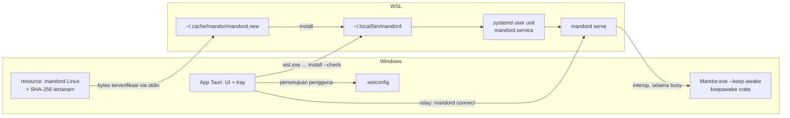
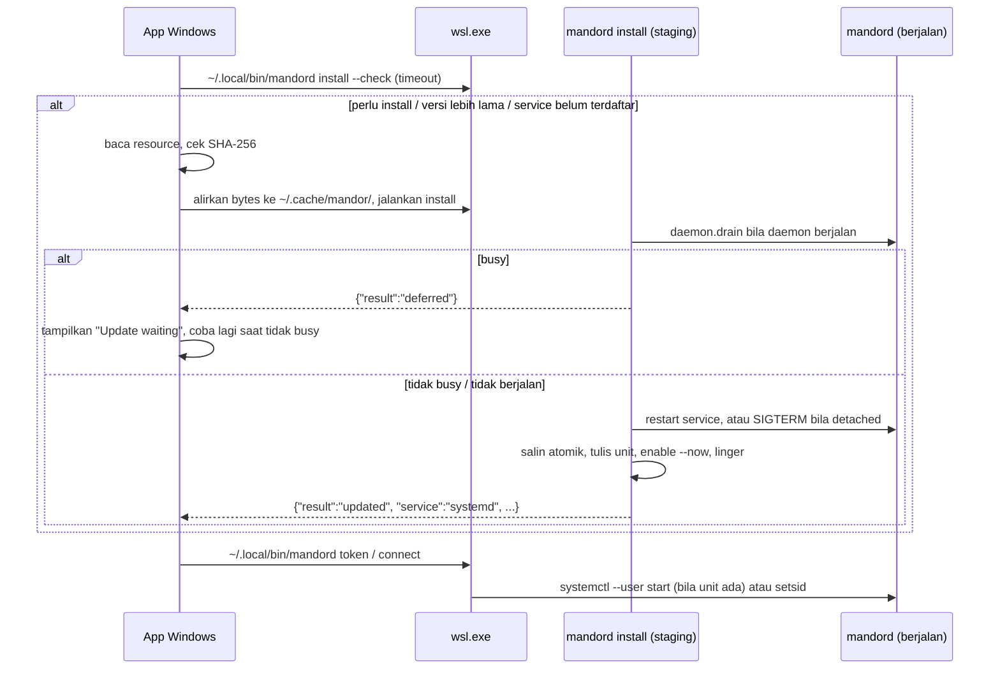

# Daemon sebagai service OS dan satu installer per OS - Plan

## Goal Capsule

- **Objective:** Agent tetap bekerja walau UI ditutup, di-Quit, atau crash, dan pengguna cukup memasang satu installer per OS. Ini fondasi mesin lembur (R19–R24 di plan Rilis 1).
- **Product authority:** dokumen ini, dibuat dari permintaan pemilik produk (2026-10-23) dan keputusan review dokumen pada hari yang sama. R-ID di bawah berlaku lokal untuk dokumen ini.
- **Changes:** menggantikan KTD-18 di `docs/plans/2026-10-18-001-feat-korlap-lark-lembur-plan.md` sebagai mekanisme utama (setsid dan proses penjaga di tray tetap ada sebagai fallback), dan memperluas R16 (Windows + WSL, Linux, macOS) dengan cara distribusi.
- **Execution profile:** Implementation Units hanya untuk **tahap 1 (Windows + WSL)**, dikerjakan test-first di repo ini. Tahap 2 (Linux native) dan tahap 3 (macOS) dicatat di Deferred to Follow-Up Work; seam-nya (subcommand `install`, sinyal `busy`, `drain`, penjaga keep-awake milik daemon) dibangun di tahap 1.
- **Authority hierarchy:** `CLAUDE.md` (standar `rust-engineering` mengikat) > Product Contract dokumen ini > Planning Contract > unit. KTD sebelumnya tetap berlaku kecuali disebut diubah.
- **Stop conditions:** berhenti dan tanya pemilik produk bila sebuah unit tidak bisa selesai tanpa melanggar `rust-engineering`, bila asumsi A2–A5 terbukti salah, atau bila perilaku produk harus berubah.
- **Tail ownership:** commit per unit di branch fitur setelah gerbang hijau, PR ke `main`, tanpa merge sendiri. Uji langsung di Windows dijalankan bersama pemilik produk.

---

## Product Contract

### Summary

Daemon `mandord` selalu berjalan di tempat workspace berada (WSL, Linux, atau macOS) dan dikelola service OS, bukan oleh app. UI berjalan di desktop. Satu installer per OS membawa UI dan daemon dengan versi yang sama. App memasang dan memperbarui daemon sendiri, hanya saat tidak ada agent yang bekerja. Selama agent atau review berjalan, laptop dijaga tidak sleep, termasuk setelah app di-Quit, dan di WSL, VM dijaga tetap hidup.

### Problem Frame

Tim sekarang bekerja di Windows dengan WSL sebagai workspace (Docker, PHP, Go, repo semua di WSL), lalu akan pindah ke Linux, dan sebagian memakai macOS. Hari ini:
- daemon dijalankan app lewat `setsid`. Bila daemon crash, tidak ada yang menyalakannya lagi sampai app dibuka;
- WSL berhenti setelah app di-Quit, karena distro mati setelah 15 detik idle dan VM setelah 60 detik, sehingga daemon dan agent ikut mati;
- laptop yang sleep menghentikan agent;
- installer Windows dan biner daemon dipasang terpisah, sehingga versinya bisa tidak cocok.

Mesin lembur (agent bekerja semalaman) tidak mungkin tanpa masalah ini diselesaikan.

### Requirements

- R1. Daemon tetap berjalan saat jendela ditutup, app di-Quit, atau app crash, dan hidup lagi otomatis bila daemon crash.
- R2. Satu installer per OS memuat UI dan daemon dengan versi yang sama. Pengguna tidak memasang daemon secara manual. Biner daemon yang dipasang harus identik dengan yang dibawa installer.
- R3. Pembaruan daemon tidak pernah menghentikan agent atau review yang sedang berjalan. Bila sedang ada, pembaruan ditunda dan pengguna diberi tahu. App dev yang sedang menyala (KTD-36) boleh berhenti saat pembaruan, dan pengguna diberi tahu.
- R4. Di WSL, distro dan VM tetap hidup tanpa app, setelah pengguna menyetujui perubahan setelan WSL global. Butuh Windows 11; di Windows 10, UI memberi tahu bahwa Quit tidak aman untuk lembur.
- R5. Selama agent atau review berjalan, laptop tidak masuk sleep, termasuk setelah app di-Quit. Di luar itu, pengaturan sleep tidak diubah.
- R6. UI menampilkan status service daemon, linger, keep-alive WSL, dan keep-awake, beserta aksi untuk memperbaikinya.
- R7. Bila service OS tidak tersedia (mis. systemd belum aktif di WSL), Mandor tetap bekerja seperti sekarang (setsid dan proses penjaga di tray) dan memandu pengguna mengaktifkannya. Setelah systemd aktif, service terdaftar pada pembukaan app berikutnya.
- R8. Logika daemon sama di WSL, Linux, dan macOS; perbedaan platform hanya di adapter pemasangan, service, dan perintah keep-awake.

### Key Flows

- F1. **Pemasangan pertama di Windows:** pengguna menjalankan installer, lalu membuka app. App mendapati daemon belum ada di WSL, memeriksa hash biner bawaan, menyalinnya ke WSL, mendaftarkannya sebagai systemd user service, lalu tersambung. Bila systemd belum aktif, app tersambung lewat setsid dan menampilkan panduan.
- F2. **Pembaruan:** pengguna memasang installer versi baru. Saat app dibuka, versi daemon di WSL lebih lama. Bila tidak ada agent atau review yang berjalan, daemon menolak run baru sebentar (drain), lalu diganti dan service di-restart; app dev yang menyala ikut berhenti dan UI memberi tahu. Bila sedang ada, app tersambung ke daemon lama, menampilkan "Update waiting for running agents", dan mencoba lagi saat semua selesai.
- F3. **Ditinggal lembur:** pengguna menjalankan beberapa agent, menutup jendela (app ke tray) atau Quit, lalu meninggalkan laptop dalam keadaan dicolok. Agent terus berjalan, dan laptop tidak sleep sampai semua agent selesai, baik app di tray maupun sudah di-Quit.

### Acceptance Examples

- AE1. **Covers R1, R4, R5.** Given Windows 11, systemd aktif, linger aktif, dan keep-alive WSL disetujui, when app di-Quit saat agent berjalan dan laptop ditinggal melewati timeout sleep power plan, then laptop tidak sleep, agent masih berjalan, dan app yang dibuka lagi tersambung ke daemon yang sama.
- AE2. **Covers R3.** Given agent sedang berjalan dan versi daemon di WSL lebih lama, when app versi baru dibuka, then daemon tidak diganti, agent tetap berjalan, dan UI menampilkan bahwa pembaruan menunggu.
- AE3. **Covers R7.** Given systemd tidak aktif, when app dibuka, then app tersambung lewat setsid seperti sekarang dan menampilkan langkah mengaktifkan systemd; setelah systemd diaktifkan dan app dibuka lagi, service terdaftar.
- AE4. **Covers R5.** Given satu agent berjalan, when Windows mencoba sleep karena idle, then laptop tetap terjaga; beberapa menit setelah agent selesai, keep-awake dilepas.
- AE5. **Covers R1.** Given daemon berjalan sebagai service, when proses daemon mati tiba-tiba, then systemd menyalakannya lagi dan run yang terputus tampil Failed dengan Resume (perilaku Rilis 1; auto-resume ditunda ke Rilis 3).
- AE6. **Covers R2.** Given biner daemon di folder instalasi diubah, when app dibuka, then biner tidak dijalankan dan UI menampilkan error pemasangan.

### Success Criteria

- Agent bertahan saat UI ditutup atau di-Quit dan laptop ditinggal (dicolok) melewati timeout sleep, sesuai AE1.
- Anggota tim memasang Mandor di Windows + WSL cukup dengan satu installer dan runbook, tanpa membangun daemon sendiri.
- Cold start app di Windows tetap tersambung ke daemon di WSL dalam kurang dari 15 detik (target Rilis 1); pemasangan pertama tidak dihitung.

### Scope Boundaries

- Tidak menangani laptop yang ditutup layarnya (lid) atau kehabisan baterai; runbook menjelaskan pengaturan "lid close: do nothing".
- Tidak menyalakan Windows atau WSL saat login atau setelah reboot (autostart). Run yang terputus oleh reboot memakai Resume.
- Tidak melanjutkan run secara otomatis setelah daemon crash (ditunda ke mesin lembur Rilis 3).
- Tidak menandatangani installer Windows; SmartScreen tetap memperingatkan.
- Tidak membuat updater otomatis; pembaruan lewat installer baru.
- Tidak mengubah `/etc/wsl.conf` atau menjalankan `sudo` atas nama pengguna.

### Dependencies / Assumptions

- Tim memakai WSL 2 dari Microsoft Store (mendukung systemd) dan distro Ubuntu. Lembur setelah Quit butuh Windows 11.
- Workflow `release` (PR #6) sudah ada dan menghasilkan installer Windows serta biner daemon Linux.
- Kredensial git dan `gh` untuk push oleh daemon disimpan di dalam WSL (`gh auth` atau credential store WSL), bukan ssh-agent sesi atau Git Credential Manager Windows lewat interop.

---

## Planning Contract

### Key Technical Decisions

- **KTD-42. Daemon tetap proses terpisah, dan siklus hidupnya milik service OS.** Di WSL dan Linux: systemd user unit; di macOS (tahap 3): launchd LaunchAgent. App tidak lagi menjadi pemilik siklus hidup daemon. KTD-18 (setsid dan proses penjaga di tray) tetap ada hanya sebagai fallback bila service OS tidak tersedia. Alasan: daemon yang menempel pada app tidak bisa memenuhi R1, dan protokol yang sudah memisahkan UI dari daemon membuka jalan daemon di mesin lain nanti.
- **KTD-43. Daemon memasang dirinya sendiri: subcommand `mandord install`.**
  - Biner menyalin dirinya ke `~/.local/bin/mandord` secara atomik, menulis unit systemd, menjalankan `daemon-reload`, `enable --now`, dan mencoba `loginctl enable-linger`.
  - Berkas sementara dibuat eksklusif (`O_EXCL`) di direktori tujuan, lalu di-rename. Biner bermode `0755`, unit `0644`. Install menolak bila tujuan atau direktori induknya symlink atau bukan milik pengguna.
  - `mandord install --check` hanya membaca: melaporkan versi biner terpasang dan keadaan service (unit ada dan sesuai, ada tapi berbeda, tidak ada; systemd tersedia atau tidak; linger aktif atau tidak).
  - Perintah ini idempoten dan mencetak hasil JSON satu baris: `result` salah satu dari `installed`, `updated`, `service_only`, `up_to_date`, `deferred`, `error`, ditambah `service` (`systemd` | `none`), `linger` (bool), `apps_stopped` (bool), `warnings` (daftar), dan `message` untuk `error`. Token tidak pernah masuk keluaran atau log.
  - Alasan: satu implementasi yang sama dipakai app Windows (lewat `wsl.exe`), paket Linux, dan macOS, dan bisa dites tanpa app.
- **KTD-44. Sinyal `busy` dan `managed_by` dari daemon.** RPC `status` menambah `busy` (ada run berstatus Running, WfRunning, atau Reviewing) dan `managed_by` (`systemd` bila variabel `INVOCATION_ID` yang di-set systemd ada, selain itu `detached`; dibaca di `Config::from_env`). App dev yang menyala tidak dihitung busy (keputusan pemilik produk). `busy` dipakai UI dan penjaga keep-awake; `install` memakai `drain` (KTD-52).
- **KTD-45 (diubah). Keep-awake dimiliki daemon, dieksekusi oleh perintah penjaga di OS desktop.**
  - Daemon memantau `busy` dan, selama busy, menjalankan satu proses penjaga dari perintah yang dikonfigurasi (`MANDOR_KEEP_AWAKE_CMD`, dibaca di `Config::from_env`). Proses dihentikan setelah busy false terus-menerus selama masa tenggang (default 5 menit), atau saat daemon berhenti.
  - Di Windows + WSL, perintahnya adalah app Mandor sendiri dalam mode `--keep-awake` lewat interop WSL (`/mnt/c/.../Mandor.exe --keep-awake`). Mode ini tidak membuka jendela atau webview; ia memegang `keepawake` (idle dan sleep, bukan layar) di thread utamanya dan keluar saat stdin tertutup. Bila daemon mati, stdin tertutup dan pegangan ikut lepas.
  - Jalur perintah diberikan app: ditulis sebagai `Environment=` di unit oleh `install`, dan di mode setsid diteruskan lewat environment `connect`.
  - Di Linux (tahap 2) perintahnya `systemd-inhibit`, di macOS (tahap 3) `caffeinate`. Logika daemon sama.
  - Alasan: keep-awake harus bertahan setelah Quit (R5), dan hanya daemon yang hidup selama itu. WSL tidak bisa mencegah Windows sleep sendiri, jadi eksekusinya lewat interop.
- **KTD-46. Keep-alive WSL lewat `.wslconfig` dengan persetujuan.** App menulis `[general] instanceIdleTimeout=-1` dan `[wsl2] vmIdleTimeout=-1` hanya setelah pengguna menekan persetujuan, mempertahankan kunci dan komentar lain, menyimpan cadangan `.wslconfig.mandor-bak` sebelum perubahan pertama, dan bisa dinonaktifkan dari UI (menghapus hanya dua kunci itu). `wsl --shutdown` diperlukan agar berlaku; bila busy, UI memperingatkan bahwa itu menghentikan agent dan menyarankan menunggu. Proses penjaga di tray tetap berjalan selama app hidup. Alasan: systemd service saja tidak membuat WSL tetap hidup; distro mati setelah 15 detik idle dan VM setelah 60 detik (dokumentasi WSL, 2026-10).
- **KTD-47. `mandord connect` memakai service bila terpasang.** Bila unit systemd ada, `connect` menjalankan `systemctl --user start` lalu menunggu `daemon.json`; bila tidak, perilaku setsid yang sekarang. Lock single-instance (`fd-lock`) tetap mencegah dua daemon.
- **KTD-48. Installer Windows membawa biner daemon Linux sebagai resource, dengan hash tertanam.** Resource hanya dipasang di build Windows (`tauri.windows.conf.json`). Workflow `release` membangun daemon lebih dulu, lalu build Windows menyertakan biner dan menanam SHA-256-nya ke app saat kompilasi (build script Tauri). Versi app dan daemon diambil dari satu sumber, dan CI menolak bila berbeda.
- **KTD-49 (diubah). App Windows memasang daemon dari bytes yang sudah diverifikasi.**
  - Probe: `$HOME/.local/bin/mandord install --check` dengan jalur absolut, lewat `wsl.exe` dengan timeout dan keluaran dibatasi. Keluaran yang gagal atau tidak dikenali (biner tidak ada atau versi lama tanpa `install`) dianggap "perlu install"; timeout dianggap "tidak bisa dicek".
  - Install: app membaca resource ke memori, memeriksa SHA-256 terhadap hash tertanam, lalu mengalirkan bytes yang sama lewat stdin ke berkas di `~/.cache/mandor/` (direktori `0700`) di WSL dan menjalankan `install` dari sana. Tidak ada eksekusi langsung dari `/mnt/c`. Hash tidak cocok berarti error tanpa eksekusi.
  - Relay `connect` dan `token` juga memakai jalur absolut `$HOME/.local/bin/mandord` setelah daemon terpasang.
- **KTD-50. Tanpa systemd: hanya panduan.** Mandor tidak mengubah `/etc/wsl.conf` dan tidak menjalankan `sudo`. UI menampilkan langkahnya (tambah `[boot] systemd=true`, lalu `wsl --shutdown`) dan memakai fallback KTD-18.
- **KTD-51 (diubah). Crate baru: `keepawake` (MIT) hanya di app Tauri** untuk mode `--keep-awake`, dicatat di tabel crate `CLAUDE.md`. `sha2` (sudah dijustifikasi) ditambah ke build script app Tauri. Daemon tidak menambah crate di tahap 1; `systemctl`, `loginctl`, dan perintah penjaga dipanggil sebagai proses lewat `mandor-proc` dengan timeout.
- **KTD-52. `drain` atomik sebelum restart.** RPC baru `daemon.drain` dalam satu langkah memeriksa busy; bila busy, menjawab `busy`; bila tidak, daemon menolak semua run baru (start, resume, langkah workflow, review, fix-loop) dengan error "daemon is updating" sampai berhenti, atau sampai batas waktu drain (2 menit) habis lalu kembali normal. `install` memakai `drain`, bukan `status`. Untuk daemon versi sebelum fitur ini (tanpa `daemon.drain`), `install` menghitung busy dari `runs.list` dan menerima celah sekali itu (dicatat di Risks).
- **KTD-53. Migrasi dari daemon `detached`.** Bila daemon yang berjalan dikelola setsid dan drain berhasil, `install` mengirim SIGTERM ke pid di `daemon.json`, menunggu lock dan `daemon.json` lepas dalam batas waktu, lalu menjalankan `enable --now`. Bila tidak lepas tepat waktu, hasilnya `error` tanpa menyalakan service, supaya tidak ada restart berulang karena lock.

### High-Level Technical Design

Komponen tahap 1:

Alur saat app Windows dibuka (KTD-43, KTD-47, KTD-49, KTD-52, KTD-53):

Keputusan pemasangan sebagai tabel (logika murni, lihat U3):

| Biner terpasang | Versi | Service | Daemon berjalan | drain | Keputusan |
|---|---|---|---|---|---|
| tidak | — | — | — | — | install |
| ya | sama | sesuai, atau systemd tidak ada | — | — | up_to_date |
| ya | sama | tidak ada atau berbeda, systemd ada | — | — | service_only (tulis unit, enable; detached dihentikan lewat drain dulu) |
| ya | lebih lama | — | tidak | — | install |
| ya | lebih lama | — | ya, `systemd` | idle | install + restart service |
| ya | lebih lama | — | ya, `detached` | idle | install + SIGTERM + enable --now |
| ya | lebih lama | — | ya | busy | deferred |
| ya | lebih baru | — | — | — | up_to_date dengan peringatan (app lebih lama dari daemon) |

### Assumptions

- A1. (Dihapus.) Biner tidak lagi dieksekusi dari `/mnt/c`; app selalu menyalin bytes terverifikasi ke WSL (KTD-49).
- A2. `loginctl enable-linger` untuk pengguna sendiri berhasil tanpa sudo di Ubuntu WSL. Bila gagal, service berhenti saat user manager berhenti (mis. setelah Quit, karena proses penjaga tray ikut berhenti), sehingga lembur setelah Quit tidak aman; UI menampilkannya sebagai status yang belum siap.
- A3. Daemon yang dijalankan systemd tetap menangkap environment login shell (sudah dilakukan `Config`), sehingga `git`, `gh`, dan `claude` terbaca dari PATH pengguna, dan push serta pembuatan PR berhasil dengan kredensial di dalam WSL. Variabel sesi (`SSH_AUTH_SOCK`, `WSL_INTEROP`) tidak tersedia.
- A4. `keepawake` di Windows (idle, `ES_SYSTEM_REQUIRED`) menahan sleep karena idle tanpa hak admin, termasuk di laptop Modern Standby saat layar mati.
- A5. Interop WSL (menjalankan `.exe` Windows) berfungsi dari proses yang dijalankan systemd user unit. Diverifikasi paling awal di U7; bila salah, berhenti dan tanya.

### Sequencing

U1 → U2 → U3 → U4 → U6 → U7 → U8 → U9, dengan U5 paralel terhadap U1–U4. U1–U4 di daemon dan bisa dites di Linux. U5 menyiapkan rilis. U6–U8 di sisi Tauri, daemon (penjaga keep-awake), dan UI. U9 adalah runbook dan uji langsung di Windows. Spike A5 (interop dari systemd unit) dijalankan di awal U7, sebelum kodenya ditulis.

---

## Implementation Units

### U1. Sinyal `busy`, `managed_by`, dan keluaran `--version`

- **Goal:** daemon melaporkan apakah ada pekerjaan yang tidak boleh diputus dan siapa yang mengelola prosesnya, dan `--version` bisa dibaca mesin.
- **Requirements:** R3, R5, R6; KTD-44.
- **Dependencies:** —
- **Files:**
  - `crates/mandor-domain/src/run.rs` (fungsi murni "ada run sibuk" dari kumpulan state, memakai `is_busy`)
  - `crates/mandor-protocol/src/dto.rs` (`StatusResult.busy`, `StatusResult.managed_by`), TS diregenerasi
  - `crates/mandord/src/config.rs` (deteksi `managed_by` dari `INVOCATION_ID` sekali di `Config::from_env`)
  - `crates/mandord/src/dispatch.rs` (`status`)
  - `crates/mandord/src/main.rs` (`--version` mencetak satu baris `mandord <semver>` ke stdout lewat stdout tokio, pola `print_token`)
  - test: `crates/mandor-domain/src/run.rs` (tests), `crates/mandord/src/dispatch.rs` atau `crates/mandord/tests/` sesuai pola yang ada
- **Approach:** `busy` dihitung dari run aktif di store, tanpa query baru per run. App dev yang menyala tidak dihitung.
- **Test scenarios:**
  - Tanpa run, `busy` false; satu run Running, WfRunning, atau Reviewing membuat `busy` true; AwaitingDev, InReviewLoop, Failed tidak; app dev menyala tanpa run sibuk tetap false.
  - `managed_by` `systemd` bila `INVOCATION_ID` ada, `detached` bila tidak.
  - Client lama yang tidak mengenal field baru tetap bisa membaca `status` (field tambahan, protokol 1.x).
  - `--version` mencetak tepat `mandord <versi>` dan satu baris baru, tanpa kode ANSI.
- **Verification:** `status` mengembalikan kedua field, `--version` sesuai format, test hijau, TS diregenerasi.

### U2. RPC `daemon.drain`

- **Goal:** pembaruan bisa menghentikan daemon tanpa celah antara cek busy dan restart.
- **Requirements:** R3; KTD-52.
- **Dependencies:** U1
- **Files:**
  - `crates/mandor-usecase/src/run/mod.rs` dan titik start di `crates/mandor-usecase/src/run/start.rs`, review, dan fix-loop (gerbang drain bersama: satu keadaan yang diperiksa semua titik mulai run)
  - `crates/mandor-protocol/src/lib.rs` (`method::DAEMON_DRAIN`), `crates/mandor-protocol/src/dto.rs` (hasil `idle` | `busy`)
  - `crates/mandord/src/dispatch.rs`
  - test: `crates/mandor-usecase/tests/` (pola test run yang ada), `crates/mandord/src/dispatch.rs` (tests)
- **Approach:** pemeriksaan busy dan penyetelan drain terjadi di bawah satu lock async yang juga diambil saat run mulai, sehingga tidak ada run yang lolos di antaranya. Drain berakhir sendiri setelah batas waktu (dari `Clock`) bila daemon tidak berhenti.
- **Execution note:** test-first lewat antarmuka `RunService`; batas waktu dites dengan `Clock` palsu.
- **Test scenarios:**
  - Tidak ada run sibuk: drain menjawab `idle`, lalu `runs.start`, `runs.resume`, langkah workflow, `review.start`, dan fix-loop ditolak dengan "daemon is updating".
  - Ada run sibuk: drain menjawab `busy`, run baru tetap bisa mulai.
  - Run yang mulai bersamaan dengan drain: salah satu menang secara konsisten (run mulai dan drain `busy`, atau drain `idle` dan run ditolak).
  - Batas waktu drain habis: run baru bisa mulai lagi.
- **Verification:** test hijau; `make check` hijau.

### U3. Subcommand `mandord install` dan unit systemd

- **Goal:** biner bisa memasang atau memperbarui dirinya sendiri sebagai service, aman terhadap pekerjaan yang sedang berjalan dan terhadap setup Rilis 1.
- **Requirements:** R1, R2, R3, R7, R8; KTD-43, KTD-50, KTD-52, KTD-53; AE2, AE3, AE5.
- **Dependencies:** U1, U2
- **Files:**
  - `crates/mandor-domain/src/service.rs` (baru: keputusan pemasangan sesuai tabel di High-Level Technical Design, isi unit systemd sebagai teks dari jalur biner dan perintah keep-awake)
  - `crates/mandord/src/install.rs` (baru: `--check`, salin atomik dengan pemeriksaan symlink dan kepemilikan, tulis unit, `systemctl --user`, `loginctl enable-linger`, `daemon.drain` atau `runs.list` ke daemon yang berjalan, SIGTERM untuk daemon detached, keluaran JSON)
  - `crates/mandord/src/main.rs` (subcommand `install`)
  - test: `crates/mandor-domain/src/service.rs` (tests), `crates/mandord/tests/install.rs` (baru, dengan HOME sementara dan `systemctl` palsu lewat konfigurasi jalur biner)
- **Approach:**
  - Unit: `ExecStart` ke `~/.local/bin/mandord serve`, `Restart=always` dengan jeda singkat, `Environment=MANDOR_KEEP_AWAKE_CMD=...` bila diberikan app, tanpa token atau secret.
  - Deteksi systemd: user manager menjawab dalam batas waktu. Bila tidak ada systemd, salin biner saja dan laporkan `service: none` (fallback KTD-18).
  - Pembaruan saat daemon berjalan: `daemon.drain` dengan token dari `daemon.json`. `busy` → `deferred` tanpa menyentuh berkas apa pun. Daemon tanpa `daemon.drain` → busy dihitung dari `runs.list`. RPC gagal atau timeout padahal lock dipegang → `deferred`, bukan idle.
  - Status linger dilaporkan di keluaran; gagal linger bukan error, tapi masuk `warnings`.
  - Semua panggilan proses dan RPC dibatasi timeout.
- **Execution note:** keputusan murni di domain dulu (test-first lewat tabel), baru I/O di `mandord`.
- **Test scenarios:**
  - Keputusan: setiap baris tabel, termasuk versi sama dengan unit hilang atau berbeda (`service_only`) dan daemon detached.
  - Isi unit memuat jalur biner, `Restart=always`, dan perintah keep-awake yang benar, dan tidak memuat token atau environment rahasia.
  - Pemasangan pertama dengan HOME sementara: biner tersalin bermode `0755`, unit `0644`, `systemctl` palsu menerima `daemon-reload` dan `enable --now`.
  - Dijalankan dua kali: tidak ada perubahan kedua kali, hasil `up_to_date`.
  - Drain menjawab busy: biner dan unit tidak berubah, hasil `deferred`.
  - Daemon lama tanpa `daemon.drain`: busy dari `runs.list`; ada run sibuk → `deferred`.
  - RPC ke daemon timeout dengan lock dipegang: `deferred`.
  - Daemon detached idle: SIGTERM, menunggu lock lepas, lalu `enable --now`; lock tidak lepas dalam batas waktu → `error`, service tidak dinyalakan.
  - systemd tidak tersedia: biner tersalin, hasil `service: none`, tanpa error.
  - Linger gagal: hasil sukses, `linger: false`, dengan peringatan.
  - Tujuan berupa symlink atau direktori bukan milik pengguna: `error`, tidak ada yang ditulis.
  - Penyalinan terputus di tengah (berkas sementara tertinggal): biner lama tetap utuh.
  - `--check`: melaporkan versi, keadaan unit, systemd, dan linger tanpa mengubah apa pun.
  - Keluaran JSON tidak pernah memuat token.
- **Verification:** `mandord install` di WSL Ubuntu dengan systemd menghasilkan service aktif yang selamat dari `kill -9`, termasuk saat sebelumnya ada daemon setsid berjalan.

### U4. `connect` memakai service bila terpasang

- **Goal:** app menyalakan daemon lewat systemd bila unit ada, supaya hanya satu pengelola.
- **Requirements:** R1, R7; KTD-47.
- **Dependencies:** U3
- **Files:**
  - `crates/mandord/src/connect.rs`
  - test: `crates/mandord/tests/` (pola test `connect` yang ada) atau test unit di `connect.rs`
- **Approach:** sebelum `start_detached`, bila unit Mandor ada, jalankan `systemctl --user start` dengan timeout lalu tunggu `daemon.json` seperti sekarang. Bila `systemctl` gagal, kembali ke setsid dan catat di log. Di mode setsid, `MANDOR_KEEP_AWAKE_CMD` dari environment `connect` diteruskan ke daemon.
- **Test scenarios:**
  - Unit ada, daemon belum berjalan: `connect` memanggil start lewat `systemctl` (palsu) dan tidak memanggil setsid.
  - Unit tidak ada: perilaku setsid tidak berubah.
  - `systemctl` gagal atau timeout: jatuh ke setsid.
  - Daemon sudah berjalan: tidak ada start sama sekali.
- **Verification:** di WSL dengan service, `mandord connect` setelah `systemctl --user stop` menyalakan daemon lewat service (`managed_by: systemd`).

### U5. Installer Windows membawa daemon Linux dengan hash tertanam

- **Goal:** satu installer Windows berisi UI dan daemon dengan versi yang sama, dan app tahu hash biner yang sah.
- **Requirements:** R2; KTD-48, KTD-51.
- **Dependencies:** — (paralel dengan U1–U4; butuh workflow `release` dari PR #6)
- **Files:**
  - `apps/desktop/src-tauri/tauri.windows.conf.json` (baru: `bundle.resources` untuk biner daemon)
  - `apps/desktop/src-tauri/build.rs` (menghitung SHA-256 biner resource bila ada dan menanamnya ke app; build Windows tanpa biner gagal dengan pesan jelas)
  - `apps/desktop/src-tauri/Cargo.toml` (`sha2` di build-dependencies)
  - `.github/workflows/release.yml` (job Windows menunggu job daemon dan mengunduh biner ke folder resource sebelum build)
  - `.github/workflows/ci.yml` atau skrip kecil (cek versi app = versi `mandord`)
  - `README.md`
- **Approach:** biner daemon dibangun di Ubuntu 22.04 seperti sekarang, diunggah sebagai artifact, lalu diunduh job Windows ke jalur resource. Versi app di `tauri.conf.json` dan versi crate `mandord` disamakan dan dicek CI.
- **Execution note:** ini packaging; buktinya adalah run workflow yang menghasilkan installer berisi resource, bukan test unit.
- **Test expectation:** cek versi di CI (versi berbeda membuat job gagal); hash tertanam sama dengan `sha256sum` biner artifact (dicek di job release).
- **Verification:** installer dari workflow berisi berkas daemon di folder resource, hash cocok, dan CI gagal bila versi app dan daemon dibuat berbeda.

### U6. App Windows memasang dan memperbarui daemon saat dibuka

- **Goal:** pengguna tidak pernah memasang daemon sendiri, biner yang dijalankan selalu terverifikasi, dan pembaruan menunggu pekerjaan selesai.
- **Requirements:** R2, R3, R7; KTD-43, KTD-49, KTD-50; F1, F2; AE2, AE3, AE6.
- **Dependencies:** U3, U5
- **Files:**
  - `apps/desktop/src-tauri/src/provision.rs` (baru: probe `install --check`, verifikasi hash, mengalirkan bytes lewat stdin, menjalankan `install`, membaca hasil JSON, mencoba lagi saat `deferred`)
  - `apps/desktop/src-tauri/src/daemon_link.rs` (`LinkMode::Wsl`: jalur absolut `$HOME/.local/bin/mandord`, argumen probe dan install, `MANDOR_KEEP_AWAKE_CMD` untuk `connect`)
  - `apps/desktop/src-tauri/src/lib.rs` (urutan saat start: provision lalu tersambung; command untuk UI: status provisioning)
  - test: `apps/desktop/src-tauri/src/provision.rs` (tests)
- **Approach:**
  - Hanya mode WSL. Mode lokal tidak berubah sampai tahap 2.
  - Pembacaan resource dan pengaliran stdin berjalan di thread blocking, dengan timeout.
  - Hasil `deferred`: app tetap tersambung ke daemon lama, mengirim event ke UI, dan mencoba lagi saat `status.busy` dari daemon false.
  - Hasil dengan `apps_stopped: true`: UI diberi tahu bahwa app dev berhenti karena pembaruan.
  - Daemon sudah terpasang dengan versi dan service sesuai: hanya satu probe sebelum tersambung.
- **Test scenarios:**
  - Argumen `wsl.exe` untuk probe, staging, dan install dengan dan tanpa distro, memakai jalur absolut.
  - Parsing keluaran `--check`: JSON valid, kosong, teks lain (biner lama), keluaran melebihi batas.
  - Hash: cocok → lanjut; tidak cocok → error tanpa memanggil `wsl.exe` untuk install.
  - Keputusan app: perlu install → install; `up_to_date` → langsung tersambung; `service_only` → install; `deferred` → tersambung dan menjadwalkan ulang; `error` → tersambung dengan fallback dan pesan.
  - Timeout probe: "tidak bisa dicek", lanjut tersambung tanpa memasang, pesan di UI.
- **Verification:** di Windows, pemasangan pertama, pembaruan, dan biner yang diubah berjalan sesuai F1, F2, dan AE6.

### U7. Keep-awake milik daemon dan keep-alive WSL

- **Goal:** laptop tidak sleep selama agent bekerja, termasuk setelah Quit, dan WSL tetap hidup tanpa app setelah disetujui.
- **Requirements:** R4, R5; KTD-45, KTD-46, KTD-51; AE1, AE4.
- **Dependencies:** U1, U4, U6
- **Files:**
  - `crates/mandor-domain/src/power.rs` (baru: keputusan murni pegang/lepas dari riwayat busy dan masa tenggang)
  - `crates/mandord/src/power.rs` (baru: task pemantau busy milik `TaskTracker`, menjalankan dan menghentikan proses penjaga lewat `mandor-proc`, berhenti bersih saat shutdown)
  - `crates/mandord/src/config.rs` (`MANDOR_KEEP_AWAKE_CMD`, masa tenggang)
  - `apps/desktop/src-tauri/src/keep_awake.rs` (baru: mode `--keep-awake` tanpa jendela, memegang `keepawake` di thread utama sampai stdin EOF; diperiksa di `main` sebelum Tauri dan plugin dimulai)
  - `apps/desktop/src-tauri/src/wslconfig.rs` (baru: penggabungan, cadangan, penonaktifan, dan status `.wslconfig`)
  - `apps/desktop/src-tauri/src/lib.rs` (command `wsl_keepalive_status`, `wsl_keepalive_enable`, `wsl_keepalive_disable`)
  - `apps/desktop/src-tauri/Cargo.toml` (`keepawake`)
  - `CLAUDE.md` (tabel crate tambahan: `keepawake`)
  - test: `crates/mandor-domain/src/power.rs` (tests), `crates/mandord/src/power.rs` (tests dengan perintah palsu), `apps/desktop/src-tauri/src/wslconfig.rs` (tests)
- **Approach:**
  - Spike A5 dulu: dari systemd user unit di WSL, jalankan `.exe` Windows dan pastikan prosesnya hidup selama stdin terbuka.
  - Daemon memeriksa busy secara berkala (mis. 30 detik) dan saat run berubah state; penjaga dijalankan saat busy, dihentikan (stdin ditutup, lalu kill dengan timeout) setelah masa tenggang. Penjaga yang mati sendiri dijalankan ulang selama busy, dengan jeda.
  - Mode `--keep-awake` hanya menahan idle dan sleep, bukan layar.
  - `.wslconfig` dibaca, dicadangkan sekali, digabung (mengubah atau menambah dua kunci di bagian yang benar, mempertahankan sisanya), lalu ditulis atomik. Menolak menulis bila berkas berupa symlink. Hanya dipanggil dari aksi pengguna.
  - Status keep-alive: kedua kunci bernilai `-1` atau tidak, ditambah versi Windows (Windows 10 → "tidak didukung").
- **Test scenarios:**
  - Domain: busy false → true memegang; true → false melepas hanya setelah masa tenggang; false → true di dalam masa tenggang tidak melepas; nilai sama berulang tidak memegang ganda.
  - Daemon: perintah palsu dijalankan sekali saat busy, dihentikan setelah tenggang, dijalankan ulang bila mati selama busy, dihentikan saat shutdown; tanpa `MANDOR_KEEP_AWAKE_CMD` tidak ada yang dijalankan.
  - Penggabungan `.wslconfig`: berkas tidak ada; berkas dengan `[wsl2]` berisi kunci lain; kunci sudah ada dengan nilai lain; bagian `[general]` belum ada; komentar dan urutan baris dipertahankan; huruf besar-kecil nama kunci; cadangan dibuat sekali; penonaktifan hanya menghapus dua kunci.
  - Status: kedua kunci `-1` → aktif; salah satu saja → belum aktif.
- **Verification:** di Windows, `powercfg /requests` menampilkan Mandor selama agent berjalan, termasuk setelah app di-Quit, dan tidak lagi beberapa menit setelah selesai.

### U8. UI status kerja latar

- **Goal:** pengguna bisa melihat dan memperbaiki kesiapan kerja latar sebelum meninggalkan laptop.
- **Requirements:** R3, R4, R6, R7; AE3.
- **Dependencies:** U1, U6, U7
- **Files:**
  - `apps/desktop/src/lib/components/settings/BackgroundSettings.svelte` (baru; bagian di Settings)
  - `apps/desktop/src/lib/components/settings/Settings.svelte` (navigasi)
  - `apps/desktop/src/lib/background.ts` dan `apps/desktop/src/lib/background.test.ts` (logika status dan pesan)
  - `apps/desktop/src/lib/dev/mock-transport.ts` (mock)
- **Approach:**
  - Empat baris status: service daemon (`managed_by`), linger, keep-alive WSL, dan keep-awake.
  - Keep-alive WSL: status `.wslconfig`, tombol persetujuan dengan penjelasan dampak global, tombol nonaktifkan. Pesan "restart WSL to apply", atau peringatan bahwa `wsl --shutdown` akan menghentikan agent bila busy.
  - Windows 10: "Quit is not safe for overnight work on Windows 10; keep Mandor in the tray."
  - Panduan bila systemd belum aktif, pemberitahuan "Update waiting for running agents", dan pemberitahuan app dev berhenti karena pembaruan.
  - Daemon lama tanpa field baru: baris yang bersangkutan tampil "unknown", bukan error.
  - Hanya mode WSL yang menampilkan keep-alive.
- **Test scenarios:**
  - Logika: kombinasi `managed_by`, linger, dan mode menghasilkan pesan yang tepat (siap lembur, fallback dengan panduan systemd, linger mati).
  - Status keep-alive aktif, belum aktif, dan Windows 10; persetujuan saat busy menampilkan peringatan `wsl --shutdown`.
  - Pemberitahuan pembaruan tertunda muncul saat event `deferred` dan hilang setelah terpasang; pemberitahuan app dev berhenti muncul saat `apps_stopped`.
  - `status` tanpa `busy` atau `managed_by` tampil "unknown".
- **Verification:** dicek visual di mode mock dan di Windows.

### U9. Runbook dan uji langsung Windows + WSL

- **Goal:** anggota tim bisa memasang dari runbook tanpa bantuan, dan skenario lembur terbukti.
- **Requirements:** semua; F1–F3; AE1–AE6.
- **Dependencies:** U1–U8
- **Files:**
  - `docs/runbook/setup-wsl.md` (satu installer, systemd, linger, keep-alive, kredensial git/gh di WSL, lid dan daya)
  - `docs/progress/os-service.md` (baru: progres, hasil uji, asumsi A2–A5)
  - `README.md`
- **Approach:** uji di laptop Windows pemilik produk: pemasangan pertama, upgrade dari setup Rilis 1, pembaruan saat agent berjalan, Quit app saat agent berjalan melewati timeout sleep, daemon dibunuh, biner diubah, cold start.
- **Test scenarios:**
  - Covers F1. Installer baru di WSL tanpa daemon: tersambung, service aktif.
  - Upgrade dari setup Rilis 1 (daemon setsid berjalan, `mandord` lama di PATH): daemon setsid diganti service, probe memakai `~/.local/bin`.
  - Covers F2 / AE2. Installer versi lebih baru saat agent berjalan: tertunda, lalu terpasang setelah agent selesai.
  - Covers AE1. Quit app saat agent berjalan, laptop ditinggal melewati timeout sleep: tidak sleep, agent masih berjalan.
  - Linger nonaktif + Quit: perilaku sesuai A2 dan UI menunjukkan belum siap.
  - Covers AE3. Distro tanpa systemd: fallback dan panduan muncul; setelah systemd diaktifkan, service terdaftar.
  - Covers AE4. Agent berjalan: `powercfg /requests` menampilkan Mandor; dilepas setelah masa tenggang.
  - Covers AE5. `kill -9` daemon: systemd menyalakannya lagi, run tampil Failed dengan Resume.
  - Covers AE6. Biner resource diubah: tidak dijalankan, error tampil.
  - A3. Di bawah service, daemon berhasil `git push` dan `gh pr create` ke `handokobeni/mandor-smoke`.
- **Verification:** hasil dan asumsi A2–A5 tercatat di `docs/progress/os-service.md`.

---

## Verification Contract

| Gate | Perintah | Berlaku untuk |
|---|---|---|
| Gerbang Rust `rust-engineering` | `make check` | U1–U4, U7 (bagian daemon) |
| Pembuktian lapisan | `make red-check` | unit yang menambah dependensi crate |
| Tipe protokol | `MANDOR_REGEN_TS=1 cargo test -p mandor-protocol` | U1, U2 |
| Tauri | `cd apps/desktop/src-tauri && cargo clippy --all-targets -- -D warnings && cargo test` | U5–U7 |
| Tauri di Windows | workflow `ci` dipicu manual (matriks 3 OS) dan workflow `release` | U5–U7 (kode khusus Windows) |
| Frontend | `cd apps/desktop && bun run check && bun run test` | U8 |
| Uji langsung | skenario U9 di Windows + WSL | U9 |

---

## Definition of Done

- Semua gate hijau, termasuk build Windows di CI dan installer dari workflow `release`.
- Skenario U9 lulus di Windows + WSL dan tercatat di `docs/progress/os-service.md`.
- Standar `rust-engineering` terpenuhi: test-first, tanpa `unwrap`/`expect`/`panic!` di jalur produksi, setiap panggilan proses dan RPC dibatasi timeout, konfigurasi hanya dibaca di `Config::from_env`, setiap task punya pemilik dan berhenti saat shutdown, tanpa `unsafe`.
- `keepawake` tercatat di tabel crate `CLAUDE.md`, dan pemakaian `sha2` di app Tauri ditambahkan ke baris yang ada.
- Runbook `setup-wsl.md` cukup bagi anggota tim untuk memasang tanpa bantuan.

---

## Appendix

### Deferred to Follow-Up Work

- **Tahap 2: Linux native.**
  - Paket `.deb` (Debian/Ubuntu), `.rpm` (Fedora/RHEL/openSUSE), dan AppImage (Arch dan distro lain) dari workflow `release`, dengan daemon sebagai sidecar.
  - `mandord install` yang sama dijalankan app saat pertama kali dibuka untuk memasang systemd user unit; untuk `.deb`/`.rpm`, pertimbangkan berkas unit dari paket.
  - Keep-awake: perintah penjaga `systemd-inhibit` yang dijalankan daemon (logika U7 sama).
  - Paket AUR opsional.
  - Flatpak dan Snap tidak dipakai, karena sandbox-nya membatasi akses ke repo, git, Docker, dan proses agent.
- **Tahap 3: macOS.**
  - `.dmg` dengan daemon sidecar.
  - `mandord install` menulis LaunchAgent (`KeepAlive`) di `~/Library/LaunchAgents`.
  - Keep-awake: perintah penjaga `caffeinate`.
  - Butuh akun Apple Developer untuk signing dan notarization.
- **Mesin lembur (Rilis 3):**
  - Auto-resume run yang terputus oleh crash daemon.
  - Keep-awake berbasis jadwal lembur, supaya laptop tidak sleep sebelum antrean dimulai.
- **Lain-lain:**
  - Updater otomatis lewat Tauri updater.
  - Autostart app saat login.
  - Signing installer Windows; checksum atau provenance build untuk biner daemon di GitHub Release.
  - Mengunci action di `ci.yml` ke SHA.

### Risks

- **Linger tidak bisa diaktifkan tanpa sudo (A2).** Service berhenti saat user manager berhenti, sehingga lembur setelah Quit gagal. Mitigasi: status linger di UI, langkah manual di runbook.
- **Interop dari systemd unit (A5).** Bila `.exe` Windows tidak bisa dijalankan dari service, keep-awake setelah Quit tidak berfungsi. Mitigasi: spike di awal U7, berhenti dan tanya bila gagal.
- **`.wslconfig` bersifat global.** Setelan ini mengubah perilaku semua distro dan memakai RAM selama VM hidup. Mitigasi: hanya dengan persetujuan, cadangan sebelum perubahan, penjelasan di UI, dan tombol nonaktifkan.
- **Upgrade pertama dari daemon tanpa `daemon.drain`.** Busy dihitung dari `runs.list`, sehingga ada celah singkat sekali itu. Diterima.
- **App dev berhenti saat pembaruan.** Diterima (keputusan pemilik produk); UI memberi tahu.
- **Mengganti biner saat hook agent memakainya.** Mitigasi: rename atomik, dan pembaruan hanya setelah drain.
- **Versi app lebih lama dari daemon** (mis. pengguna memasang installer lama). Mitigasi: tidak menurunkan versi, handshake protokol `hello` yang sudah ada (Rilis 1) menolak mayor yang berbeda, dan UI memperingatkan.
- **Windows 10:** `vmIdleTimeout` hanya berlaku di Windows 11. Di Windows 10, keep-alive bergantung pada proses penjaga di tray; UI memberi tahu bahwa Quit tidak aman.
- **`systemctl --user` dari `wsl.exe` non-interaktif** bisa gagal bila `XDG_RUNTIME_DIR` atau bus D-Bus tidak ada. Mitigasi: deteksi dengan timeout dan fallback setsid; dibuktikan di U9.
- **Webview tersembunyi di-throttle.** Tidak lagi berpengaruh pada keep-awake karena busy dipantau daemon.

### Sources

- Dokumentasi WSL, Advanced settings configuration (`wsl.conf` `[boot] systemd`, `.wslconfig` `[general] instanceIdleTimeout`, `[wsl2] vmIdleTimeout`), diakses 2026-10-23: https://learn.microsoft.com/en-us/windows/wsl/wsl-config
- Crate `keepawake` 0.6.1 (MIT; Windows, macOS `caffeinate`, Linux `systemd-inhibit`): https://crates.io/crates/keepawake
- Kode yang ada: `crates/mandord/src/connect.rs` (setsid), `crates/mandord/src/main.rs` (`--version`), `crates/mandord/src/serve.rs` (`fd-lock`, `stop_all`), `apps/desktop/src-tauri/src/daemon_link.rs` (`LinkMode`, proses penjaga), `apps/desktop/src-tauri/src/tray.rs`, `.github/workflows/release.yml`.
- Review dokumen 2026-10-23 (coherence, feasibility, security-lens, adversarial) dan keputusan pemilik produk atas temuannya.
