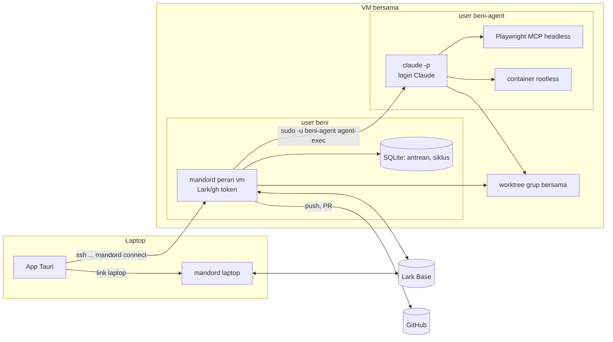
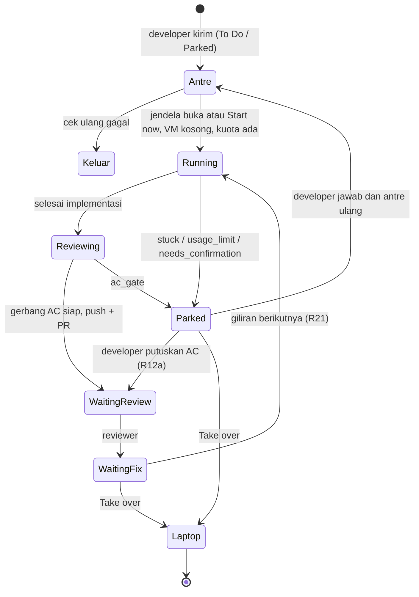

# Mode VM lembur lewat SSH - Plan

## Goal Capsule

- **Objective:** agent mengerjakan kartu semalaman di VM yang selalu menyala, atas nama developer masing-masing, tanpa bergantung pada laptop pribadi.
- **Product authority:** dokumen ini, dari brainstorm dan review dokumen dengan pemilik produk (2026-10-23). Merinci ulang R19–R24 di `docs/plans/2026-10-18-001-feat-korlap-lark-lembur-plan.md` untuk mesin lembur di VM; R-ID di bawah berlaku lokal untuk dokumen ini.
- **Fondasi:** U1–U4 di `docs/plans/2026-10-23-001-feat-daemon-os-service-installer-plan.md` (status `busy`, drain, `mandord install`, `connect` lewat systemd) dipakai apa adanya di VM.
- **Open blockers:** tidak ada untuk implementasi. Konfirmasi tertulis Anthropic tentang pemakaian langganan tanpa pendampingan (Dependencies) wajib ada sebelum rollout ke tim.
- **Execution profile:** U1–U12 di bawah, test-first di repo ini, setelah U1–U4 plan service OS selesai. Uji langsung di VM bersama pemilik produk.
- **Authority hierarchy:** `CLAUDE.md` (standar `rust-engineering` mengikat) > Product Contract dokumen ini > Planning Contract > unit.
- **Stop conditions:** berhenti dan tanya pemilik produk bila sebuah unit tidak bisa selesai tanpa melanggar `rust-engineering`, bila asumsi A1–A5 terbukti salah, atau bila perilaku produk harus berubah.
- **Tail ownership:** commit per unit di branch fitur setelah gerbang hijau, PR ke `main`, tanpa merge sendiri.
- **Product Contract preservation:** berubah: R5 dan AE7 (app dev boleh terjangkau user lain di VM bersama, dengan rentang port per user; keputusan pemilik produk saat planning). Sisanya tidak berubah.

---

## Product Contract

### Summary

VM Linux bersama yang selalu menyala menjadi mesin lembur: tiap developer punya user Linux dan daemon sendiri di sana, atas nama dirinya. Siang hari developer bekerja dengan daemon laptop seperti biasa dan mengantrekan kartu To Do dari tab Overnight; VM mengerjakan antrean satu kartu per developer sampai Waiting Review, mengerjakan Waiting Fix-nya, dan pagi hari developer membaca laporan lalu memilih lanjut di VM atau mengambil alih ke laptop.

### Problem Frame

Lembur di laptop pribadi tidak realistis: laptop dibawa pulang, ditutup, kehabisan baterai, atau dipakai untuk hal lain, dan menjaga Windows serta WSL tetap terjaga semalaman rapuh. Rencana mesin lembur di Rilis 1 (R19–R24) mendefinisikan perilaku antrean, pagar, dan laporan pagi, tapi belum menentukan di mesin mana itu berjalan. Tim juga belum punya baseline seberapa banyak kartu rutin yang bisa diselesaikan agent tanpa didampingi.

### Actors

- A1. **Developer:** pemilik kartu dan pemilik identitas (Lark, GitHub, langganan Claude). Bekerja di laptop siang hari, mengantrekan kartu untuk VM.
- A2. **Admin VM:** menyiapkan VM, user Linux per developer, akses SSH, dan memasang Mandor.
- A3. **Daemon laptop:** daemon developer di laptop (WSL atau Linux), seperti sekarang.
- A4. **Daemon VM:** daemon developer yang sama identitas Lark-nya, berjalan di user Linux developer di VM sebagai service.
- A5. **Reviewer manusia:** memeriksa PR di Waiting Review dan bisa memindahkan kartu ke Waiting Fix.

### Key Decisions

- **Identitas Lark per developer, klaim per daemon.** Klaim kartu, author PR, dan kuota Claude tetap milik developer, sehingga PIC dan filter penulis tepercaya tidak berubah. Klaim juga mencatat daemon mana (laptop atau VM) yang memegang kartu, karena dua daemon developer yang sama tidak boleh sama-sama menganggap kartu itu miliknya. Pindah dari VM bersama ke satu VM per developer nanti tidak butuh desain ulang.
- **VM bersama dulu, daemon per user Linux.** Satu VM untuk tim pada tahap awal; tiap developer punya user Linux dan daemon sendiri.
- **Laptop siang, VM malam, dua daemon per developer.** Hanya kartu To Do, atau kartu yang diparkir lembur sebelumnya, yang dikirim ke VM (R21 Rilis 1). Run yang setengah jalan tidak dipindahkan.
- **Login langganan Claude milik developer.** Developer login sendiri ke Claude Code di user Linux-nya di VM; tidak ada API key.
- **Satu kartu sekaligus per developer.** Antrean dan perbaikan tiap developer di VM dikerjakan berurutan, sehingga beban VM dan kuota bisa diprediksi.
- **Review AC di VM dengan browser headless.** Kartu bisa sampai Waiting Review tanpa Chrome di VM. Pagi hari developer boleh menjalankan review ulang dengan browser-nya sendiri.
- **Waiting Fix kartu VM dikerjakan langsung di VM**, tanpa menunggu jam lembur, sehingga satu putaran review tidak memakan satu hari.
- **Pagar lembur berlaku untuk semua run di VM**, termasuk "Start now" dan Waiting Fix di siang hari, karena run di VM tidak didampingi.
- **Tab Overnight terpisah.** Board tetap untuk pekerjaan laptop; antrean, run VM, dan laporan pagi ada di tab Overnight.
- **Satu rilis.** R1–R22 dibangun bersama; tidak ada tahap yang menunggu baseline.

### Requirements

**Koneksi dan penyiapan**

- R1. App di laptop tersambung ke daemon VM lewat SSH, bersamaan dengan daemon laptop, memakai akses SSH developer sendiri. Host key VM dipin saat pertama tersambung, dan perubahan host key menghentikan koneksi dengan peringatan.
- R2. Admin bisa menyiapkan VM, user Linux per developer, dan daemon sebagai service dengan runbook, tanpa app desktop di VM.
- R3. Developer login Lark, Claude Code, dan GitHub untuk daemon VM-nya sekali lewat terminal SSH mengikuti runbook. App menampilkan status ketiga login itu beserta langkah memperbaikinya.
- R4. Daemon VM berjalan sebagai service yang hidup lagi sendiri setelah crash atau reboot VM, dan pembaruannya menunggu run selesai (fondasi U1–U4 plan service OS).
- R5. Daemon tiap developer di VM terpisah dari developer lain: token, repo, worktree, dan container satu developer tidak bisa diakses user Linux developer lain atau agent-nya. Daemon dan callback login hanya bisa dipakai pemiliknya (token per daemon), dan laptop menjangkaunya lewat SSH. App dev memakai rentang port milik developer itu; app dev bisa terjangkau user lain di VM yang sama, dan risiko ini diterima sampai pindah ke VM per developer.

**Antrean dan jadwal**

- R6. Dari tab Overnight, developer mengirim kartu To Do (atau kartu yang diparkir lembur) ke antrean VM, mengurutkan, dan mengeluarkannya sebelum dikerjakan.
- R7. Developer mengatur jam lembur (mulai dan selesai) dalam zona waktunya. Di luar jam itu antrean menunggu, kecuali developer menekan "Start now" pada sebuah kartu atau kartu VM masuk Waiting Fix (R21). Kartu yang masih berjalan saat jam lembur berakhir diselesaikan, tapi kartu antrean baru tidak dimulai.
- R8. Daemon VM mengerjakan satu kartu sekaligus per developer, berurutan sesuai antrean; Waiting Fix kartu VM mendapat giliran sebelum kartu antrean berikutnya.
- R9. Sebelum mengerjakan kartu, daemon VM memeriksa ulang bahwa kartu masih memenuhi syarat antrean; kartu yang tidak lagi memenuhi dikeluarkan dan dicatat di laporan pagi dengan alasannya.
- R10. VM tidak bisa diaktifkan sebelum developer mengisi batas pemakaian VM per siklus (token). Satu siklus dimulai saat jam lembur dimulai dan berakhir saat jam lembur berikutnya dimulai; semua run VM di siklus itu, termasuk "Start now" dan Waiting Fix siang hari, dihitung ke batasnya. Saat batas tercapai, run dihentikan, kartunya diparkir dengan alasan "usage limit", dan tidak ada kartu VM lain yang dimulai sampai siklus berikutnya. Kartu yang terhenti karena kuota langganan habis diparkir dengan alasan yang sama.

**Eksekusi dan pagar**

- R11. Kartu lembur dikerjakan sampai PR di Waiting Review, termasuk review AC dengan browser headless terhadap app dev di VM.
- R12. Di VM, gerbang Push & PR selalu memblokir, apa pun setelan repo, termasuk untuk push dari Waiting Fix. Bila gerbang tidak siap (ada AC Fail atau "Can't verify" yang belum dikonfirmasi), VM tidak melakukan push; kartu diparkir dengan alasan "AC gate", dan laporan pagi menampilkan baris AC-nya untuk diputuskan developer. Push yang butuh konfirmasi developer karena alasan lain (mis. mengubah CI atau konfigurasi agent) diparkir dengan alasan "needs confirmation".
- R12a. Setelah developer memutuskan semua baris AC yang memblokir dari tab Overnight, daemon VM pemegang klaim langsung push dan membuat PR, tanpa mengantre ulang dan tanpa menjalankan agent.
- R13. Semua run di VM mematuhi pagar lembur Rilis 1 (R22/R22a): tidak merge ke main, tidak push ke branch lain, status Lark tidak melewati Waiting Review, tidak menyentuh database atau environment staging, dan tidak mengirim pesan.
- R14. Agent di VM tidak bisa membaca token Lark, kredensial GitHub, atau token daemon. Satu-satunya kredensial yang dipakai agent adalah login Claude Code developer. Push, pembuatan PR, dan penulisan Lark hanya dilakukan daemon, ke branch kartu itu. Git yang dijalankan daemon di worktree yang bisa diubah agent mengabaikan hook dan konfigurasi lokal repo, dan kredensial push hanya diberikan untuk push oleh daemon.
- R15. Agent yang buntu memarkir kartu dengan catatan pertanyaan lalu lanjut ke kartu berikutnya.

**Kepemilikan kartu antar dua daemon**

- R16. Hanya daemon yang memegang klaim kartu yang boleh menjalankan run, memproses komentar Waiting Fix, dan memperbarui klaim untuk kartu itu. Daemon lain milik developer yang sama menampilkan kartu itu hanya-baca.
- R17. Board di laptop menandai kartu yang dipegang daemon VM sebagai "On VM" dengan tautan ke tab Overnight, bukan sebagai kartu yang diklaim di tempat lain.

**Pagi hari dan lanjutan**

- R18. Laporan pagi di tab Overnight menampilkan per kartu: hasil (Waiting Review, diparkir beserta alasan, dikeluarkan, gagal), PR, hasil review AC, pertanyaan parkir, dan pemakaian. Ringkasan per siklus mencatat jumlah tiap hasil (parkir "AC gate" terpisah dari parkir lain), pemakaian terhadap batas, dan jumlah kartu yang lolos review tanpa pernah masuk Waiting Fix.
- R19. Developer bisa menjalankan review AC ulang dengan browser di laptop terhadap app dev kartu itu di VM.
- R20. Developer menjawab pertanyaan kartu yang diparkir lalu mengembalikannya ke antrean, yang melanjutkan branch yang sama.
- R21. Waiting Fix kartu VM dikerjakan di VM tanpa menunggu jam lembur, dengan semua pagar lembur: begitu perbaikan siap dimulai (komentar tepercaya dan jeda tenang Waiting Fix), perbaikan itu mendapat giliran berikutnya, sebelum kartu antrean, dan langsung mulai bila VM sedang tidak mengerjakan kartu lain.
- R22. Developer bisa memilih "Take over to laptop" untuk kartu VM di Waiting Fix atau yang diparkir. Daemon VM lebih dulu push commit yang belum di-push ke branch kartu (tanpa membuat PR), lalu klaim berpindah ke daemon laptop sebelum laptop mulai bekerja. Setelah itu kartu tidak bisa kembali ke antrean VM.

### Key Flows

- F1. **Penyiapan:** admin membuat user Linux developer, memberi akses SSH, dan memasang daemon sebagai service. Developer login Lark, Claude Code, dan GitHub lewat terminal SSH, lalu menambahkan VM di app laptop; app tersambung lewat SSH dan menampilkan status login.
- F2. **Mengantrekan:** siang hari developer membuka tab Overnight, menambahkan beberapa kartu To Do ke antrean VM, mengisi batas pemakaian per siklus dan jam lembur, lalu menutup laptop.
- F3. **Malam:** pada jam lembur daemon VM mengambil kartu pertama, memeriksa ulang syaratnya, mengklaim, mengerjakan, menjalankan review AC headless, membuka PR bila gerbang AC siap, memindahkan kartu ke Waiting Review, lalu mengambil kartu berikutnya. Kartu yang buntu atau tertahan gerbang AC diparkir, lalu VM lanjut ke kartu berikutnya. Saat batas pemakaian tercapai, VM berhenti mengambil kartu sampai siklus berikutnya (jam lembur berikutnya dimulai).
- F4. **Pagi:** developer membuka app, membaca laporan pagi, menjalankan review ulang dengan browser bila perlu, memutuskan kartu yang tertahan gerbang AC, menjawab pertanyaan kartu yang diparkir, dan mengembalikannya ke antrean atau mengambil alih ke laptop.
- F5. **Perbaikan:** reviewer memindahkan kartu ke Waiting Fix dan menulis komentar. Setelah jeda tenang, daemon VM mengerjakan perbaikannya pada giliran berikutnya, kecuali developer sudah memilih "Take over to laptop".

### Acceptance Examples

- AE1. **Covers R7, R8.** Given developer mengantrekan tiga kartu dengan jam lembur 19:00–06:00, when pukul 19:00, then VM mengerjakan kartu pertama; kartu kedua baru mulai setelah kartu pertama selesai atau diparkir.
- AE2. **Covers R7.** Given kartu dimulai pukul 05:40 dan jam lembur berakhir 06:00, when pukul 06:00, then kartu itu terus dikerjakan sampai selesai atau diparkir, dan kartu berikutnya tidak dimulai.
- AE3. **Covers R7, R13.** Given pukul 14:00 dan developer menekan "Start now" pada kartu di antrean, when kartu dikerjakan, then kartu langsung mulai dan semua pagar lembur tetap berlaku, termasuk larangan mengirim pesan.
- AE4. **Covers R9.** Given kartu di antrean sudah dipindahkan orang lain ke In Progress di Lark, when jam lembur tiba, then kartu dikeluarkan dari antrean dan laporan pagi mencatat alasannya.
- AE5. **Covers R10.** Given jam lembur 19:00–06:00 dan batas pemakaian tercapai pukul 23:00 saat kartu kedua berjalan, when batas tercapai, then agent dihentikan, kartu diparkir dengan alasan "usage limit", dan kartu ketiga tidak dimulai sebelum 19:00 berikutnya, termasuk setelah tengah malam.
- AE6. **Covers R12.** Given review AC headless menghasilkan satu baris "Can't verify", when kartu siap di-push, then VM tidak push, kartu diparkir dengan alasan "AC gate", dan baris itu tampil di laporan pagi.
- AE7. **Covers R5, R14.** Given dua developer punya daemon di VM yang sama, when agent milik developer A berjalan, then agent itu tidak bisa membaca token, repo, atau worktree developer B, tidak bisa menjalankan container yang memasang home developer B, tidak bisa memanggil daemon developer B, dan tidak bisa membaca token Lark atau kredensial GitHub developer A sendiri.
- AE8. **Covers R16, R17.** Given kartu dipegang daemon VM, when daemon laptop developer yang sama melihat kartu itu (termasuk saat kartu di Waiting Fix), then daemon laptop tidak menjalankan run atau memproses komentarnya, dan board menampilkan "On VM".
- AE9. **Covers R21.** Given kartu VM masuk Waiting Fix pukul 11:00 dengan komentar reviewer dan VM sedang tidak mengerjakan kartu lain, when jeda tenang Waiting Fix lewat, then daemon VM langsung mengerjakan perbaikannya tanpa menunggu jam lembur.
- AE10. **Covers R8, R21.** Given VM sedang mengerjakan kartu "Start now" dan kartu lain masuk Waiting Fix, when perbaikan siap dimulai, then perbaikan menunggu sampai kartu yang berjalan selesai atau diparkir, lalu mulai sebelum kartu antrean berikutnya.
- AE11. **Covers R22.** Given kartu VM diparkir dengan commit yang belum di-push dan developer memilih "Take over to laptop", when developer membuka kartu di laptop, then commit itu sudah ada di branch kartu, klaim sudah berpindah ke daemon laptop, run berjalan di laptop pada branch yang sama, dan opsi kirim ke VM tidak tersedia untuk kartu itu.
- AE12. **Covers R12a.** Given kartu diparkir "AC gate" dan developer mengonfirmasi baris "Can't verify" pagi hari, when konfirmasi tersimpan, then daemon VM langsung push dan membuat PR tanpa menjalankan agent.

### Success Criteria

- Developer bisa menutup laptop sore hari dan pagi hari menemukan kartu yang diantrekan sudah di Waiting Review atau diparkir dengan alasan jelas, tanpa intervensi malam hari.
- Laporan pagi merekam angka per siklus (kartu sampai Waiting Review, diparkir per alasan, gagal, pemakaian, kartu yang lolos review tanpa pernah masuk Waiting Fix). Target ditetapkan dari angka bulan pertama.
- Setelah bulan pertama, tim memutuskan dari porsi kartu yang sampai Waiting Review tanpa didampingi (bukan gabungan sampai-atau-diparkir), dari angka lain di atas, dan dari pengalaman developer di pagi hari: lanjut dengan VM bersama, pindah ke satu VM per developer, atau berhenti.
- Admin bisa menyiapkan developer baru di VM dari runbook saja.

### Scope Boundaries

- Memindahkan run yang setengah jalan dari laptop ke VM.
- Akun bot tim, API key Claude, atau daemon bersama untuk banyak developer.
- Daemon native Windows (tanpa WSL).
- Pembuatan VM otomatis atau infrastruktur cloud sebagai kode; admin menyiapkan VM lewat runbook.
- Login yang dipandu dari app; login lewat terminal SSH dengan runbook.
- Menjalankan lebih dari satu kartu VM sekaligus per developer.
- Chrome dengan Claude in Chrome di VM.
- Auto-resume run yang terputus oleh crash daemon (tetap Resume manual seperti Rilis 1).

### Dependencies / Assumptions

- Fondasi U1–U4 di plan service OS (`docs/plans/2026-10-23-001-feat-daemon-os-service-installer-plan.md`) selesai lebih dulu.
- **Harus dipastikan sebelum rollout ke tim:** ketentuan Anthropic yang berlaku mengizinkan login langganan Claude Code milik developer berjalan tanpa didampingi di user Linux-nya pada VM bersama. Hasil dan sumbernya dicatat. Bila tidak diizinkan, keputusan "tanpa API key" dibuka lagi.
- VM Linux dengan systemd dan runtime container per user (rootless); tidak ada developer atau agent di grup `docker` bersama.
- Sumber daya VM cukup untuk satu run per developer aktif sekaligus (app dev, container, dan browser headless).
- Admin VM bersama secara teknis bisa membaca token setiap developer. Risiko ini diterima di tahap VM bersama dengan kontrol: admin sesedikit mungkin, dan runbook memuat langkah mencabut token saat admin atau developer keluar. Risiko ini hilang bila pindah ke satu VM per developer.
- Repo yang dikerjakan lembur punya test dan app dev yang bisa berjalan di Linux tanpa database staging.

### Outstanding Questions

Pertanyaan yang ditunda ke planning sudah dijawab di Planning Contract (KTD-54 sampai KTD-67). Tidak ada pertanyaan produk yang tersisa.

### Sources

- Plan Rilis 1, R19–R24 dan catatan ketentuan Anthropic: `docs/plans/2026-10-18-001-feat-korlap-lark-lembur-plan.md`
- Plan service OS (fondasi U1–U4): `docs/plans/2026-10-23-001-feat-daemon-os-service-installer-plan.md`
- Klaim kartu (`open_id|ts_ms|nonce`, `may_claim`): `crates/mandor-domain/src/claim.rs`, `crates/mandor-usecase/src/sync/claim.rs`
- Gerbang Push & PR (`GateMode::Block`): `crates/mandor-domain/src/push_gate.rs`
- Satu koneksi daemon di app (`LinkMode::Local`, `LinkMode::Wsl`): `apps/desktop/src-tauri/src/daemon_link.rs`, `apps/desktop/src-tauri/src/lib.rs`
- Review dengan Claude in Chrome (`--chrome`, allowlist `mcp__claude-in-chrome`): `crates/mandor-agent/src/port.rs`
- Callback OAuth Lark di daemon: `crates/mandor-lark/src/client.rs`, `crates/mandord/src/settings.rs`

---

## Planning Contract

### Key Technical Decisions

- **KTD-54. Peran daemon dari konfigurasi.** `Config::from_env` membaca `MANDOR_ROLE` (`laptop` default, `vm`) dan `MANDOR_DAEMON_ID` (default dari hostname dan user). Peran `vm` menyalakan antrean, siklus pemakaian, gerbang AC yang selalu memblokir, review headless, dan agent di user terpisah. Logika lain sama di kedua peran (R8 plan service OS).
- **KTD-55. Klaim membawa identitas daemon, kompatibel ke belakang.** Format tetap `open_id|ts_ms|nonce`, dengan nonce berisi `<acak>~<daemon_id>`. `Claim::parse` lama (`splitn(3, '|')`) tetap membacanya. `may_claim`, `held_by`, dan heartbeat membandingkan `open_id` dan `daemon_id`: klaim milik daemon lain dari developer yang sama tidak boleh ditimpa kecuali lewat serah-terima eksplisit (KTD-63). Klaim tanpa `daemon_id` (versi lama) diperlakukan sebagai milik "daemon tak dikenal" dari developer itu dan hanya bisa diambil setelah basi, seperti sekarang.
- **KTD-56. Semua jalur "kartu milik saya" memakai pemegang daemon.** `fix_candidates`, poller (pelepasan klaim saat kartu kembali ke To Do), heartbeat, `release_claim`, dan view kartu memakai predikat baru "dipegang daemon ini", bukan `claimed_by(me)`. View menambah `holder` (`self` | `own_other_daemon` | `other_person`) sehingga board bisa menampilkan "On VM" (R17) dan daemon lain hanya-baca (R16).
- **KTD-57. Antrean dan siklus di daemon VM, disimpan di SQLite.** Migrasi baru: tabel `overnight_queue` (urutan, record, alasan keluar), `overnight_cycles` (awal siklus, token terpakai), dan setelan di tabel `settings` (jam mulai/selesai, offset UTC, batas token, aktif). Penjadwal adalah satu langkah baru di `Schedule::run_due` (`crates/mandord/src/session.rs`) yang memanggil usecase `OvernightService::tick` dengan `Clock`.
- **KTD-58. Jam lembur memakai offset UTC tetap per developer.** Developer mengisi offset (mis. `+07:00`); tidak ada database zona waktu dan tidak ada crate baru. Logika jendela, siklus, dan "kartu baru boleh mulai?" adalah fungsi murni di `mandor-domain`.
- **KTD-59. Pemakaian dihitung per pesan, dedup per `message.id`.** Parser stream mengeluarkan event usage per pesan assistant (input dan output, di-dedup per `message.id`, mengabaikan pesan subagent), selain `result` akhir yang tetap dipakai untuk total run. Batas siklus menghitung input dan output; cache read dan cache creation dicatat terpisah untuk laporan. `rate_limit_event` berstatus `rejected` dan error kuota memarkir kartu dengan alasan "usage limit".
- **KTD-60. Parkir dengan alasan sebagai state baru.** `RunState::Parked` dengan `park_reason` di `RunExtra` (`stuck`, `ac_gate`, `needs_confirmation`, `usage_limit`). Jalur yang sekarang berakhir di `AwaitingDev` lewat `flag_fix` atau `publish_gated` diarahkan ke `Parked` bila peran `vm`. `Parked` tidak dihitung `busy`.
- **KTD-61. Gerbang AC selalu Block di VM.** `gate_mode()` mengembalikan `Block` bila peran `vm`, apa pun setelan repo. `finish_fix_turn` di VM selalu lewat gerbang, termasuk saat tidak ada baris AC di gerbang (diperlakukan siap hanya bila memang tidak ada baris AC). Keputusan developer atas kartu `ac_gate` (R12a) memanggil `publish_gated` dengan `GateDecision` dari tab Overnight, tanpa menjalankan agent.
- **KTD-62. Agent berjalan sebagai user Linux terpisah lewat sudoers sempit.** Tiap developer punya user `<dev>-agent`. Daemon menjalankan agent dengan `sudo -n -u <dev>-agent <wrapper> <argv claude>`, dan aturan sudoers yang dipasang admin hanya mengizinkan wrapper itu. Wrapper (subcommand `mandord agent-exec`) membersihkan environment, memasang `DOCKER_HOST` ke container rootless milik user agent, lalu `exec` Claude Code tanpa modifikasi. Worktree berada di direktori grup bersama (daemon dan agent bisa menulis, user lain tidak). Login Claude Code disimpan di home user agent; Mandor tidak pernah membaca atau menyimpannya.
- **KTD-63. Serah-terima "Take over to laptop" lewat RPC daemon VM.** Laptop meminta daemon VM `runs.handoff`. Daemon VM menghentikan run bila ada, commit dan push branch kartu tanpa PR, menulis klaim dengan `daemon_id` laptop yang diminta, dan menandai kartu "hanya laptop". Laptop lalu memulihkan worktree dari branch kartu (pola `run/ownership.rs`) dan membuat run `AwaitingDev`.
- **KTD-64. Review headless lewat Playwright MCP.** Di peran `vm`, reviewer mendapat MCP Playwright (`--headless --isolated`) dan allowlist `mcp__playwright__*`, menggantikan `--chrome`. Kesiapan browser di VM tidak bergantung pada `chrome_connected`, tapi pada app berjalan dan setelan repo baru `unattended_login` (repo menyiapkan login uji sendiri lewat setup command). Tanpa itu, AC browser menjadi "Can't verify" dan kartu diparkir `ac_gate`. Review ulang pagi (R19) memakai jalur laptop yang ada: Claude in Chrome di laptop, app dev VM lewat port forward SSH, ledger dibaca lewat RPC daemon VM.
- **KTD-65. Git daemon tidak mempercayai konfigurasi worktree.** Selain `core.hooksPath=/dev/null` dan `core.fsmonitor=false`, semua git daemon memakai `GIT_CONFIG_NOSYSTEM=1`, `GIT_CONFIG_GLOBAL` milik daemon, dan menolak worktree yang konfigurasi lokalnya memuat kunci yang bisa mengeksekusi atau mengalihkan (`core.sshCommand`, `credential.*`, `url.*`, `include*`, `core.pager`, filter). Kredensial push tetap hanya disuntikkan untuk push daemon.
- **KTD-66. Login VM lewat terminal.** Subcommand baru `mandord login lark` membuka listener callback di loopback VM (port dari konfigurasi) dan mencetak URL; developer menjalankannya lewat `ssh -L` sesuai runbook. `claude` dan `gh` login di terminal masing-masing (Claude di user agent). RPC `status` menambah status ketiga login untuk ditampilkan app.
- **KTD-67. App memegang dua koneksi: laptop dan VM lewat SSH.** `LinkMode::Ssh { host, user, known_hosts }` menjalankan `ssh -F /dev/null -o BatchMode=yes -o StrictHostKeyChecking=yes -o UserKnownHostsFile=<milik app> -o ExitOnForwardFailure=yes -o ServerAliveInterval=15 <host> mandord connect` sebagai argv tanpa shell. Host key dipin saat developer menambahkan VM, setelah fingerprint dikonfirmasi. Link disimpan per kunci (`laptop`, `vm`), event bernama per link, dan frontend membuat client RPC kedua dengan store terpisah untuk tab Overnight.

### High-Level Technical Design

Komponen:

Siklus hidup kartu di VM:

Keputusan "boleh mulai kartu berikutnya?" (fungsi murni, U3):

| Ada run VM berjalan | Waiting Fix siap | Dalam jendela | Start now | Kuota siklus | Keputusan |
|---|---|---|---|---|---|
| ya | — | — | — | — | tunggu |
| tidak | — | — | — | habis | tidak ada yang mulai |
| tidak | ya | — | — | ada | mulai Waiting Fix |
| tidak | tidak | — | ya | ada | mulai kartu Start now |
| tidak | tidak | ya | tidak | ada | mulai kartu antrean teratas |
| tidak | tidak | tidak | tidak | ada | tunggu jendela |

### Assumptions

- A1. Admin bisa memasang aturan sudoers per developer yang hanya mengizinkan `mandord agent-exec` sebagai `<dev>-agent`, dan user agent punya container rootless sendiri (linger aktif).
- A2. Claude Code yang dijalankan sebagai user agent lewat `sudo -n` membaca login dari home user agent dan berjalan normal dalam mode `-p` stream-json.
- A3. Playwright MCP headless dengan Chromium berjalan di VM dalam batas sumber daya satu run per developer.
- A4. Field klaim Lark menerima nonce yang lebih panjang (`acak~daemon_id`) tanpa batas panjang yang mengganggu.
- A5. Developer bisa memakai `ssh -L` untuk login Lark sekali dan `ssh` biasa untuk link app; VM menjalankan OpenSSH dengan login kunci.

### Sequencing

U1 → U2 → U3 → U4 → U5 → U6 → U7 → U8 → U11, dengan U9 → U10 (app) setelah U1, U3, U5, dan U8. U12 terakhir. U6 (agent user terpisah) boleh dikerjakan paralel setelah U1 karena tidak bergantung pada antrean. Semua setelah U1–U4 plan service OS.

---

## Implementation Units

### U1. Klaim per daemon dan peran daemon

- **Goal:** dua daemon developer yang sama tidak lagi sama-sama menganggap kartu miliknya.
- **Requirements:** R16, R17; KTD-54, KTD-55, KTD-56; AE8.
- **Dependencies:** U1–U4 plan service OS.
- **Files:**
  - `crates/mandor-domain/src/claim.rs` (daemon id di nonce, `held_by_daemon`, `may_claim` sadar daemon, varian `ClaimRefused::OwnOtherDaemon`)
  - `crates/mandor-domain/src/task.rs` (predikat pemegang)
  - `crates/mandor-usecase/src/sync/claim.rs`, `crates/mandor-usecase/src/sync/poller.rs`, `crates/mandor-usecase/src/run/ownership.rs`, `crates/mandor-usecase/src/waiting_fix/engine.rs` (`fix_candidates`)
  - `crates/mandord/src/config.rs` (`MANDOR_ROLE`, `MANDOR_DAEMON_ID`), `crates/mandord/src/views.rs` (`holder`)
  - `crates/mandor-protocol/src/dto.rs` (`CardView.holder`), TS diregenerasi
  - test: `crates/mandor-domain/src/claim.rs` (tests), `crates/mandor-usecase/tests/sync.rs`, `crates/mandor-usecase/tests/waiting_fix.rs`
- **Approach:** daemon id masuk ke nonce agar daemon lama tetap bisa mem-parse. Semua jalur yang sekarang memakai `claimed_by(me)` untuk keputusan bertindak diganti predikat pemegang daemon; `claimed_by(me)` tetap untuk tampilan "milik saya".
- **Execution note:** test-first di domain; pakai dua `station` dengan `me` sama dan `FakeLark` bersama untuk test integrasi.
- **Test scenarios:**
  - Parse dan encode klaim dengan dan tanpa daemon id; klaim lama tetap valid.
  - `may_claim`: klaim aktif daemon lain dari developer sama → ditolak `OwnOtherDaemon`; klaim daemon sendiri → boleh; klaim lama tanpa id, belum basi → ditolak; basi → boleh.
  - Covers AE8. Dua station (laptop, VM) developer sama: VM memegang kartu di Waiting Fix; `tick_waiting_fix` di laptop tidak membuat run; heartbeat laptop tidak memperbarui klaim VM.
  - Poller laptop tidak menghapus klaim VM saat kartu kembali ke To Do; daemon pemegang yang menghapus.
  - View: `holder` `own_other_daemon` untuk kartu yang dipegang VM.
- **Verification:** test hijau; dua daemon nyata dengan identitas Lark sama tidak saling menimpa klaim di Base salinan.

### U2. Penjadwal antrean dan siklus di daemon VM

- **Goal:** daemon VM mengerjakan antrean sesuai jendela, Start now, dan prioritas Waiting Fix, satu kartu sekaligus.
- **Requirements:** R6, R7, R8, R9, R21; KTD-57, KTD-58; AE1, AE2, AE3, AE4, AE9, AE10.
- **Dependencies:** U1.
- **Files:**
  - `crates/mandor-domain/src/overnight.rs` (baru: jendela dengan offset, siklus, keputusan "boleh mulai" sesuai tabel)
  - `crates/mandor-usecase/src/overnight/mod.rs` (baru: `OvernightService` tick, cek ulang `check_start`, mulai kartu lewat `start_planned`, prioritas Waiting Fix)
  - `crates/mandor-usecase/src/ports.rs` (port antrean dan siklus di `Deps`)
  - `crates/mandor-store/migrations/0006_overnight.sql`, `crates/mandor-store/src/overnight.rs` (baru), `.sqlx` diperbarui
  - `crates/mandord/src/session.rs` (langkah jadwal baru, hanya peran `vm`)
  - `crates/mandor-usecase/src/waiting_fix/engine.rs` (di peran `vm`, mulai giliran Waiting Fix lewat penjadwal agar satu kartu sekaligus)
  - test: `crates/mandor-domain/src/overnight.rs` (tests), `crates/mandor-usecase/tests/overnight.rs` (baru), `crates/mandor-store/tests/overnight.rs` (baru)
- **Approach:** penjadwal hanya memutuskan dan memulai; eksekusi memakai jalur start dan Waiting Fix yang ada. Waiting Fix yang siap (lewat jeda tenang) masuk giliran sebelum antrean.
- **Execution note:** test-first lewat tabel keputusan di domain, lalu `FakeClock` di usecase.
- **Test scenarios:**
  - Jendela 19:00–06:00 +07:00: 18:59 tutup, 19:00 buka, 05:59 buka, 06:00 tutup; jendela yang tidak melewati tengah malam; offset negatif.
  - Siklus: mulai saat jendela mulai; run 14:00 masuk siklus yang dimulai 19:00 kemarin.
  - Covers AE1. Tiga kartu antre: hanya satu berjalan; kedua mulai setelah pertama selesai atau parkir.
  - Covers AE2. Kartu mulai 05:40 terus berjalan setelah 06:00; kartu berikut tidak mulai.
  - Covers AE3. Start now pukul 14:00 mulai langsung bila VM kosong.
  - Covers AE4. Kartu yang sudah In Progress milik orang lain dikeluarkan dengan alasan tercatat.
  - Covers AE9, AE10. Waiting Fix siap saat VM kosong mulai langsung; saat VM sibuk menunggu lalu mendahului antrean.
  - Antrean: tambah hanya To Do atau Parked; urut ulang; keluarkan; kartu "hanya laptop" ditolak.
- **Verification:** test hijau; di VM uji, antrean dua kartu berjalan berurutan pada jendela pendek.

### U3. Pemakaian per siklus dan batas

- **Goal:** VM berhenti tepat saat batas token siklus tercapai atau kuota langganan habis.
- **Requirements:** R10; KTD-59; AE5.
- **Dependencies:** U2.
- **Files:**
  - `crates/mandor-agent/src/claude/stream.rs` (event usage per pesan, dedup `message.id`, abaikan subagent; status `rejected`)
  - `crates/mandor-agent/src/port.rs` (`AgentEvent::Usage` per pesan)
  - `crates/mandor-usecase/src/run/session.rs` (akumulasi ke siklus, hentikan run saat batas)
  - `crates/mandor-usecase/src/overnight/mod.rs` (cek batas sebelum mulai)
  - test: `crates/mandor-agent/src/claude/stream.rs` (tests dengan fixture stream-json), `crates/mandor-usecase/tests/overnight.rs`
- **Approach:** total run tetap dari `result`; batas siklus memakai akumulasi per pesan agar bisa berhenti di tengah run. Saat berhenti, run diparkir `usage_limit` (U4).
- **Test scenarios:**
  - Stream dengan tiga pesan, dua di antaranya `message.id` sama: input dihitung sekali.
  - Pesan subagent (`parent_tool_use_id` terisi) tidak dihitung.
  - Covers AE5. Batas tercapai di tengah kartu kedua: run dihentikan, parkir `usage_limit`, kartu ketiga tidak mulai sampai siklus berikutnya, termasuk setelah tengah malam.
  - `rate_limit_event` `rejected`: parkir `usage_limit` tanpa retry.
  - Siklus baru: penghitung kembali nol.
- **Verification:** test hijau; laporan siklus menampilkan pemakaian yang cocok dengan `result` akhir run dalam toleransi.

### U4. Parkir dengan alasan dan gerbang AC VM

- **Goal:** semua kartu VM yang berhenti punya alasan, dan VM tidak pernah push melewati gerbang AC.
- **Requirements:** R12, R12a, R13, R15; KTD-60, KTD-61; AE6, AE12.
- **Dependencies:** U1, U2.
- **Files:**
  - `crates/mandor-domain/src/run.rs` (`RunState::Parked`, `ParkReason`)
  - `crates/mandor-store/src/run_port.rs` (`RunExtra.park_reason`)
  - `crates/mandor-usecase/src/run/publish.rs` (`gate_mode` Block di peran `vm`; jalur keputusan R12a)
  - `crates/mandor-usecase/src/waiting_fix/engine.rs` (`finish_fix_turn` dan `after_fix_review` ke `Parked` di peran `vm`)
  - `crates/mandor-usecase/src/run/session.rs` (agent buntu → `Parked stuck`)
  - `crates/mandor-protocol/src/{lib.rs,dto.rs}` (`overnight.gate_decide`), `crates/mandord/src/dispatch.rs`
  - test: `crates/mandor-usecase/tests/publish_gate.rs`, `crates/mandor-usecase/tests/waiting_fix.rs`, `crates/mandor-usecase/tests/overnight.rs`
- **Approach:** di peran laptop perilaku tidak berubah. Di peran `vm`, setiap `flag_fix`/hasil gerbang yang menunggu developer menjadi `Parked` dengan alasan, lalu penjadwal lanjut ke kartu berikutnya.
- **Test scenarios:**
  - Covers AE6. Review menghasilkan "Can't verify": tidak push, `Parked ac_gate`, penjadwal mulai kartu berikutnya.
  - Repo bersetelan Warn: di peran `vm` tetap Block; di laptop tetap Warn.
  - Waiting Fix tanpa baris AC di gerbang: di `vm` lewat `evaluate` dan siap; dengan baris Fail: `Parked ac_gate`.
  - Perubahan menyentuh CI atau konfigurasi agent: `Parked needs_confirmation`.
  - Covers AE12. Developer mengonfirmasi baris "Can't verify": push dan PR tanpa agent, kartu ke Waiting Review.
  - `Parked` tidak `busy` dan tidak memblokir drain.
- **Verification:** test hijau; tidak ada jalur push di peran `vm` yang melewati `evaluate` Block (dicek dengan test per jalur publish).

### U5. Serah-terima ke laptop

- **Goal:** developer bisa mengambil alih kartu VM tanpa kehilangan kerja malam.
- **Requirements:** R22; KTD-63; AE11.
- **Dependencies:** U1, U4.
- **Files:**
  - `crates/mandor-usecase/src/run/ownership.rs` (handoff di VM: stop, commit, push tanpa PR, tulis klaim ke daemon laptop, tandai "hanya laptop"; sisi laptop: pulihkan worktree)
  - `crates/mandor-usecase/src/run/members.rs` (push tanpa membuat PR)
  - `crates/mandor-protocol/src/{lib.rs,dto.rs}` (`runs.handoff`), `crates/mandord/src/dispatch.rs`
  - test: `crates/mandor-usecase/tests/ownership.rs` (baru atau perluasan suite yang ada)
- **Approach:** serah-terima diminta dari laptop ke daemon VM lewat link VM, karena hanya pemegang klaim yang boleh memindahkannya (R16). Tanda "hanya laptop" disimpan di record antrean VM dan menolak antre ulang.
- **Test scenarios:**
  - Covers AE11. Kartu `Parked` dengan commit belum di-push: handoff mendorong commit ke branch kartu, klaim berpindah ke daemon laptop, laptop membuat run `AwaitingDev` di branch yang sama.
  - Kartu di Waiting Fix sedang berjalan di VM: run dihentikan dulu, lalu serah-terima.
  - Push gagal: klaim tidak berpindah, error dikembalikan.
  - Antre ulang kartu "hanya laptop": ditolak.
- **Verification:** test hijau; serah-terima nyata di VM uji ke laptop mempertahankan semua commit.

### U6. Agent sebagai user Linux terpisah

- **Goal:** agent di VM tidak bisa menjangkau token daemon, dan containernya milik user agent.
- **Requirements:** R5, R14; KTD-62, KTD-65; AE7.
- **Dependencies:** U1.
- **Files:**
  - `crates/mandord/src/main.rs`, `crates/mandord/src/agent_exec.rs` (baru: subcommand `agent-exec`, environment bersih, `DOCKER_HOST` rootless, `exec` claude)
  - `crates/mandor-agent/src/claude/command.rs` (bungkus argv dengan `sudo -n -u <agent_user> mandord agent-exec` di peran `vm`)
  - `crates/mandord/src/config.rs` (`MANDOR_AGENT_USER`, direktori worktree grup)
  - `crates/mandor-git/src/lib.rs` (KTD-65: `GIT_CONFIG_NOSYSTEM`, global milik daemon, tolak konfigurasi lokal berbahaya)
  - `crates/mandor-git/src/` (worktree di direktori grup dengan izin grup)
  - test: `crates/mandor-agent/src/claude/command.rs` (tests argv), `crates/mandord/tests/agent_exec.rs` (baru), `crates/mandor-git/tests/git_flow.rs`
- **Approach:** daemon tidak pernah membaca login Claude. Hook `PreToolUse` dan deny list tetap aktif sebagai lapisan kedua. Bila sudo gagal (aturan belum dipasang), run gagal dengan pesan yang menunjuk runbook, bukan jatuh ke user daemon.
- **Test scenarios:**
  - Argv peran `vm`: `sudo -n -u beni-agent <exe> agent-exec -- claude ...`; peran laptop tidak berubah.
  - `agent-exec`: environment hanya berisi variabel yang diizinkan; tidak ada variabel rahasia; `DOCKER_HOST` diisi.
  - sudo ditolak: run `Failed` dengan pesan runbook, tidak ada fallback ke user daemon.
  - Git daemon pada worktree dengan `core.sshCommand` atau `credential.helper` lokal: operasi ditolak.
  - Covers AE7 (bagian file). Di uji langsung: user agent tidak bisa membaca `~/.mandor` developer dan tidak bisa menjalankan container yang memasang home developer lain.
- **Verification:** test hijau; uji langsung di VM sesuai AE7.

### U7. Review headless di VM

- **Goal:** review AC berjalan di VM tanpa Chrome.
- **Requirements:** R11, R19; KTD-64.
- **Dependencies:** U4, U6.
- **Files:**
  - `crates/mandor-agent/src/claude/command.rs` dan `crates/mandor-agent/src/claude/guardrails.rs` (MCP Playwright headless untuk reviewer peran `vm`, allowlist `mcp__playwright__*`)
  - `crates/mandord/src/hook.rs` / `crates/mandor-domain/src/hook.rs` (klasifikasi tool Playwright)
  - `crates/mandor-usecase/src/review/service.rs` (kesiapan browser peran `vm`: app berjalan dan `unattended_login`)
  - `crates/mandor-domain/src/app_run.rs` (setelan repo `unattended_login`), `apps/desktop/src/lib/components/settings/` (field repo)
  - test: `crates/mandor-usecase/tests/review_flow.rs`, `crates/mandor-agent/src/claude/command.rs` (tests)
- **Approach:** jalur laptop tidak berubah. Di VM, `confirmed.login` digantikan `unattended_login` pada repo; tanpa itu baris browser menjadi "Can't verify".
- **Test scenarios:**
  - Peran `vm`, repo `unattended_login` true, app berjalan: fakta browser tersedia, argv reviewer memuat MCP Playwright, tanpa `--chrome`.
  - Repo tanpa `unattended_login`: baris browser "Can't verify" → `Parked ac_gate` (lewat U4).
  - Tool `mcp__playwright__browser_navigate` ke host di luar app dev: ditolak hook.
  - Peran laptop: tetap memakai Claude in Chrome.
- **Verification:** test hijau; review headless nyata di VM uji pada repo dengan login uji.

### U8. Login dan status di VM

- **Goal:** developer menyiapkan daemon VM dari terminal SSH, dan app menampilkan statusnya.
- **Requirements:** R3, R5; KTD-66.
- **Dependencies:** U1.
- **Files:**
  - `crates/mandord/src/login.rs` (baru: `mandord login lark`, listener callback loopback dengan timeout, URL dicetak)
  - `crates/mandord/src/main.rs`, `crates/mandord/src/dispatch.rs` (`status` menambah status login Lark, gh, Claude user agent)
  - `crates/mandor-domain/src/app_run.rs` atau setelan repo (rentang port app per developer, `MANDOR_PORT_RANGE`)
  - test: `crates/mandord/tests/login.rs` (baru), test `status`
- **Approach:** login Lark memakai alur OAuth PKCE yang sudah ada di `mandor-lark`, dengan callback di daemon bukan di app. Status login Claude dicek dengan menjalankan `claude` sebagai user agent lewat `agent-exec` dalam mode cek, dengan timeout.
- **Test scenarios:**
  - `login lark`: callback dengan code valid menyimpan token; state salah ditolak; timeout menutup listener.
  - `status`: ketiga login dilaporkan `ok`, `missing`, atau `expired`.
  - Port app di luar rentang developer ditolak saat menyimpan setelan repo di peran `vm`.
- **Verification:** test hijau; developer baru menyelesaikan login di VM uji hanya dari runbook.

### U9. Koneksi SSH dan dua link di app

- **Goal:** app tersambung ke daemon laptop dan daemon VM bersamaan.
- **Requirements:** R1; KTD-67.
- **Dependencies:** U8.
- **Files:**
  - `apps/desktop/src-tauri/src/daemon_link.rs` (`LinkMode::Ssh`, argv ssh, known_hosts milik app)
  - `apps/desktop/src-tauri/src/lib.rs` (peta link per kunci, command `daemon_open/send/token` menerima kunci, command tambah VM dengan konfirmasi fingerprint)
  - `apps/desktop/src/lib/api/tauri-transport.ts` (event per link), `apps/desktop/src/lib/stores/connection.svelte.ts` (koneksi per kunci)
  - test: `apps/desktop/src-tauri/src/daemon_link.rs` (tests argv), test frontend transport
- **Approach:** link laptop tetap default; link VM opsional. Host tidak boleh diawali `-` dan argumen tidak pernah lewat shell.
- **Test scenarios:**
  - Argv ssh memuat opsi pin host key dan known_hosts milik app; host diawali `-` ditolak.
  - Dua link aktif: event `daemon://laptop/line` dan `daemon://vm/line` tidak tercampur.
  - Host key berubah: link VM gagal dengan pesan, link laptop tidak terpengaruh.
  - Frontend: store VM terpisah dari store laptop.
- **Verification:** test hijau; app nyata tersambung ke VM uji dan laptop sekaligus.

### U10. Tab Overnight dan badge On VM

- **Goal:** developer mengelola antrean, membaca laporan pagi, dan bertindak atas kartu VM.
- **Requirements:** R6, R7, R10, R12a, R17, R18, R19, R20, R22; AE7 (tampilan).
- **Dependencies:** U2, U3, U4, U5, U9.
- **Files:**
  - `crates/mandor-protocol/src/{lib.rs,dto.rs}` (`overnight.queue.*`, `overnight.settings.*`, `overnight.report`), `crates/mandord/src/dispatch.rs`
  - `apps/desktop/src/lib/stores/nav.svelte.ts` (halaman `overnight`), `apps/desktop/src/lib/components/shell/AppSidebar.svelte`
  - `apps/desktop/src/lib/components/overnight/` (baru: antrean, setelan jendela/offset/batas, laporan per siklus, keputusan AC, Take over, review ulang)
  - `apps/desktop/src/lib/stores/overnight.svelte.ts` dan `overnight.test.ts` (baru)
  - `apps/desktop/src/lib/components/mandor/CardFlagBadge.svelte` (badge "On VM" dari `holder`)
  - `apps/desktop/src/lib/dev/mock-transport.ts`
- **Approach:** tab Overnight membaca dari link VM; board tetap dari link laptop. Teks UI dalam bahasa Inggris.
- **Test scenarios:**
  - Store: tambah, urut ulang, keluarkan kartu; kartu bukan To Do/Parked tidak bisa ditambah.
  - Laporan: kartu dikelompokkan per hasil, parkir `ac_gate` terpisah, ringkasan pemakaian terhadap batas.
  - Keputusan AC memanggil `overnight.gate_decide`; Take over memanggil `runs.handoff` lalu membuka kartu di board.
  - Badge "On VM" muncul untuk `holder` `own_other_daemon` dan membuka tab Overnight.
  - VM tidak tersambung: tab menampilkan status koneksi dan langkah perbaikan.
- **Verification:** test frontend hijau; dicek visual di mode mock dan dengan VM uji.

### U11. Pagar VM menyeluruh

- **Goal:** semua run di VM, termasuk Start now dan Waiting Fix, mematuhi pagar lembur.
- **Requirements:** R13, R14; AE3.
- **Dependencies:** U4, U6.
- **Files:**
  - `crates/mandor-usecase/src/notify.rs` (tidak mengirim pesan di peran `vm`)
  - `crates/mandor-domain/src/gate.rs` (transisi maksimal Waiting Review, sudah ada; test peran `vm`)
  - `crates/mandor-domain/src/hook.rs` (larangan staging tetap, test peran `vm`)
  - test: `crates/mandor-usecase/tests/overnight.rs`, `crates/mandor-domain/src/hook.rs` (tests)
- **Approach:** pagar yang ada di Rilis 1 dipakai ulang; unit ini memastikan tidak ada jalur di peran `vm` yang melewatinya, termasuk jalur siang hari.
- **Test scenarios:**
  - Covers AE3. Start now siang hari: notifikasi pesan ditahan, transisi ke Done ditolak, push hanya ke branch kartu.
  - Waiting Fix di VM: pagar yang sama.
  - Agent mencoba `gh pr merge` atau push ke `main`: ditolak hook dan daemon.
- **Verification:** test hijau.

### U12. Runbook VM dan uji langsung

- **Goal:** admin menyiapkan developer baru dari runbook, dan alur lembur terbukti.
- **Requirements:** R2, R3, R4; Success Criteria; semua AE.
- **Dependencies:** U1–U11.
- **Files:**
  - `docs/runbook/setup-vm.md` (baru: user developer dan agent, sudoers, container rootless dan linger, grup worktree, rentang port, OpenSSH, `mandord install` peran `vm`, login lewat terminal, pencabutan token saat orang keluar)
  - `docs/progress/vm-overnight.md` (baru: hasil uji dan asumsi A1–A5)
  - `README.md`
- **Approach:** uji di VM bersama dengan dua developer: antrean semalam, batas tercapai, kartu parkir AC gate diputuskan pagi, Waiting Fix siang hari, Take over, isolasi antar developer.
- **Test expectation:** uji langsung; hasil per AE dicatat di progres.
- **Verification:** semua AE tercatat lulus atau ada catatan tindak lanjut.

---

## Verification Contract

| Gate | Perintah | Berlaku untuk |
|---|---|---|
| Gerbang Rust `rust-engineering` | `make check` | U1–U8, U11 |
| Pembuktian lapisan | `make red-check` | unit yang menambah dependensi crate |
| Tipe protokol | `MANDOR_REGEN_TS=1 cargo test -p mandor-protocol` | U1, U4, U5, U10 |
| sqlx offline | `make sqlx-check` | U2 |
| Tauri | `cd apps/desktop/src-tauri && cargo clippy --all-targets -- -D warnings && cargo test` | U9 |
| Frontend | `cd apps/desktop && bun run check && bun run test` | U7 (setelan), U9, U10 |
| Uji langsung | skenario U12 di VM bersama | U12 |

---

## Definition of Done

- Semua gate hijau.
- Skenario U12 lulus dan tercatat di `docs/progress/vm-overnight.md`, termasuk AE1–AE12.
- Standar `rust-engineering` terpenuhi: test-first, tanpa `unwrap`/`expect`/`panic!` di jalur produksi, setiap proses dan RPC dibatasi timeout, konfigurasi hanya di `Config::from_env`, task punya pemilik, tidak ada lock `std` melewati `.await`, tanpa `unsafe`, tidak ada crate baru tanpa justifikasi di `CLAUDE.md`.
- Mandor tidak membaca, menyimpan, atau meneruskan login Claude siapa pun.
- Konfirmasi tertulis Anthropic tercatat sebelum rollout ke tim.

---

## Appendix

### Deferred to Follow-Up Work

- Satu VM per developer (menghapus risiko admin dan app dev bersama).
- Isolasi jaringan app dev antar developer.
- Login yang dipandu dari app.
- Pembatasan jaringan agent berbasis allowlist (sandbox Claude Code `strictAllowlist` di user agent) sebagai lapisan tambahan.
- Penanda di PR atau kartu bahwa pekerjaan berasal dari run VM.
- Backoff adaptif polling Lark bila dua daemon per developer memicu throttle.

### Risks

- **Ketentuan Anthropic.** Klausul akses otomatis di Consumer Terms tidak eksplisit untuk kasus ini. Mitigasi: setiap developer login sendiri di user agent-nya, Mandor tidak menyentuh kredensial, dan konfirmasi tertulis sebelum rollout.
- **Login Claude kedaluwarsa di malam hari.** Semua kartu malam itu gagal. Mitigasi: `status` login di app dan cek login sebelum siklus dimulai; kartu tidak dimulai bila login tidak valid.
- **Review headless kurang setia dibanding Claude in Chrome.** Mitigasi: kartu yang ragu menjadi `ac_gate`, metrik `ac_gate` dilaporkan terpisah, review ulang pagi dari laptop.
- **Beban VM bersama.** Satu run plus Chromium dan container per developer. Mitigasi: satu kartu sekaligus per developer; ukur di uji langsung.
- **Polling Lark berlipat.** Dua daemon per developer. Mitigasi: dicatat; backoff adaptif ditunda.
- **Konfigurasi sudoers salah.** Bisa memberi akses lebih luas. Mitigasi: runbook memberi aturan persis satu perintah, dan agent tidak pernah jatuh ke user daemon.

### Sources

- Grounding kode: `crates/mandor-domain/src/claim.rs`, `crates/mandor-usecase/src/sync/claim.rs`, `crates/mandor-usecase/src/waiting_fix/engine.rs`, `crates/mandor-usecase/src/run/{start,publish,ownership,members,session}.rs`, `crates/mandor-domain/src/{run,push_gate,gate,hook}.rs`, `crates/mandor-agent/src/claude/{stream,command,guardrails}.rs`, `crates/mandor-git/src/{lib,publish}.rs`, `crates/mandord/src/{session,serve,connect,settings,views}.rs`, `apps/desktop/src-tauri/src/{daemon_link,lib,oauth_callback}.rs`, `apps/desktop/src/lib/stores/`.
- Claude Code legal and compliance, authentication, sandboxing, headless (diakses 2026-10-23): https://code.claude.com/docs/en/legal-and-compliance, https://code.claude.com/docs/en/authentication, https://code.claude.com/docs/en/sandboxing, https://code.claude.com/docs/en/headless
- Anthropic Consumer Terms: https://www.anthropic.com/legal/consumer-terms
- Playwright MCP: https://github.com/microsoft/playwright-mcp
- Docker rootless: https://docs.docker.com/engine/security/rootless/
- OpenSSH `ssh_config`: https://man.openbsd.org/ssh_config
