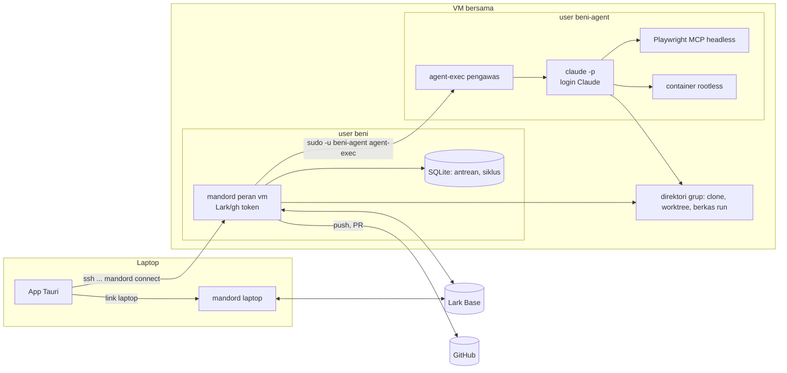
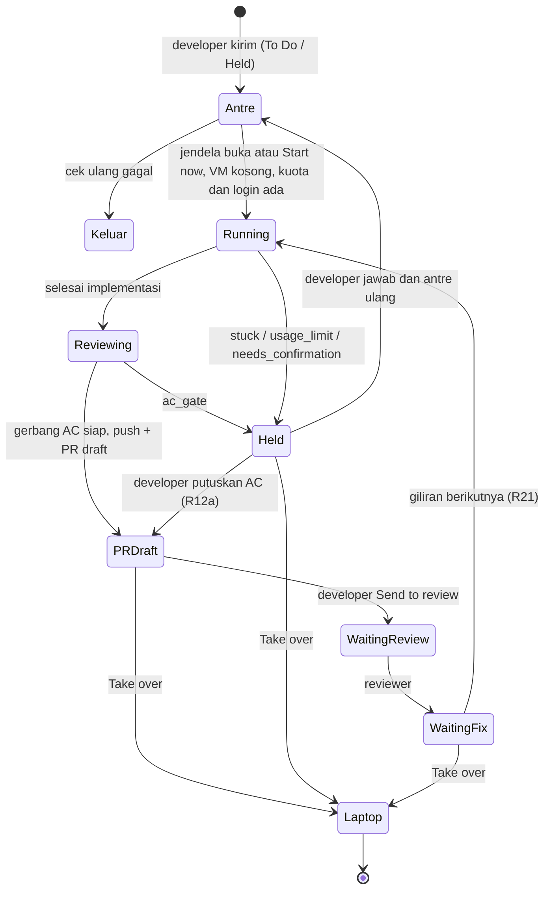

# Mode VM lembur lewat SSH - Plan

## Goal Capsule

- **Objective:** agent mengerjakan kartu semalaman di VM yang selalu menyala, atas nama developer masing-masing, tanpa bergantung pada laptop pribadi.
- **Product authority:** dokumen ini, dari brainstorm dan review dokumen dengan pemilik produk (2026-10-23). Merinci ulang Rilis 3 (AI Lembur, R19–R25) di `docs/plans/2026-10-18-001-feat-korlap-lark-lembur-plan.md` untuk mesin lembur di VM; R-ID di bawah berlaku lokal untuk dokumen ini.
- **Fondasi:** U1–U4 di `docs/plans/2026-10-23-001-feat-daemon-os-service-installer-plan.md` (status `busy`, drain, `mandord install`, `connect` lewat systemd) dipakai apa adanya di VM.
- **Open blockers:** tidak ada untuk implementasi. Konfirmasi tertulis Anthropic tentang pemakaian langganan tanpa pendampingan (Dependencies) wajib ada sebelum rollout ke tim.
- **Execution profile:** U1–U12 di bawah, test-first di repo ini, setelah U1–U4 plan service OS selesai. Uji langsung di VM bersama pemilik produk.
- **Authority hierarchy:** `CLAUDE.md` (standar `rust-engineering` mengikat) > Product Contract dokumen ini > Planning Contract > unit.
- **Stop conditions:** berhenti dan tanya pemilik produk bila sebuah unit tidak bisa selesai tanpa melanggar `rust-engineering`, bila asumsi A1–A5 terbukti salah, atau bila perilaku produk harus berubah.
- **Tail ownership:** commit per unit di branch fitur setelah gerbang hijau, PR ke `main`, tanpa merge sendiri.
- **Product Contract preservation:** berubah: R5 dan AE7 (app dev boleh terjangkau user lain di VM bersama, dengan rentang port per user; keputusan pemilik produk saat planning). 2026-10-23 sesudah merge: R11, R12a, R13, R18 diubah dan R23–R25, AE13–AE15 ditambah (PR draft sampai developer mengonfirmasi, DM laporan Lark, badge Queued), menutup sisa Rilis 3 di plan Rilis 1. Sisanya tidak berubah.

---

## Product Contract

### Summary

VM Linux bersama yang selalu menyala menjadi mesin lembur: tiap developer punya user Linux dan daemon sendiri di sana, atas nama dirinya. Siang hari developer bekerja dengan daemon laptop seperti biasa dan mengantrekan kartu To Do dari tab Overnight; VM mengerjakan antrean satu kartu per developer sampai PR draft, mengerjakan Waiting Fix-nya, dan pagi hari developer menerima laporan (di app dan DM Lark), mengirim PR yang sudah dilihat ke review, lalu memilih lanjut di VM atau mengambil alih ke laptop.

### Problem Frame

Lembur di laptop pribadi tidak realistis: laptop dibawa pulang, ditutup, kehabisan baterai, atau dipakai untuk hal lain, dan menjaga Windows serta WSL tetap terjaga semalaman rapuh. Rencana mesin lembur di Rilis 1 (Rilis 3, R19–R25) mendefinisikan perilaku antrean, pagar, dan laporan pagi, tapi belum menentukan di mesin mana itu berjalan. Tim juga belum punya baseline seberapa banyak kartu rutin yang bisa diselesaikan agent tanpa didampingi.

### Actors

- A1. **Developer:** pemilik kartu dan pemilik identitas (Lark, GitHub, langganan Claude). Bekerja di laptop siang hari, mengantrekan kartu untuk VM.
- A2. **Admin VM:** menyiapkan VM, user Linux per developer, akses SSH, dan memasang Mandor.
- A3. **Daemon laptop:** daemon developer di laptop (WSL atau Linux), seperti sekarang.
- A4. **Daemon VM:** daemon developer yang sama identitas Lark-nya, berjalan di user Linux developer di VM sebagai service.
- A5. **Reviewer manusia:** memeriksa PR di Waiting Review dan bisa memindahkan kartu ke Waiting Fix.

### Key Decisions

- **Identitas Lark per developer, klaim per daemon.** Klaim kartu, author PR, dan kuota Claude tetap milik developer, sehingga PIC dan filter penulis tepercaya tidak berubah. Klaim juga mencatat daemon mana (laptop atau VM) yang memegang kartu, karena dua daemon developer yang sama tidak boleh sama-sama menganggap kartu itu miliknya. Pindah dari VM bersama ke satu VM per developer nanti tidak butuh desain ulang.
- **VM bersama dulu, daemon per user Linux.** Satu VM untuk tim pada tahap awal; tiap developer punya user Linux dan daemon sendiri.
- **Laptop siang, VM malam, dua daemon per developer.** Hanya kartu To Do, atau kartu yang diparkir lembur sebelumnya, yang dikirim ke VM (R21 Rilis 1). Run yang setengah jalan tidak dipindahkan.
- **Login langganan Claude milik developer.** Developer login sendiri ke Claude Code di user Linux-nya di VM; tidak ada API key.
- **Satu kartu sekaligus per developer.** Antrean dan perbaikan tiap developer di VM dikerjakan berurutan, sehingga beban VM dan kuota bisa diprediksi.
- **Review AC di VM dengan browser headless.** Kartu bisa sampai Waiting Review tanpa Chrome di VM. Pagi hari developer boleh menjalankan review ulang dengan browser-nya sendiri.
- **Waiting Fix kartu VM dikerjakan langsung di VM**, tanpa menunggu jam lembur, sehingga satu putaran review tidak memakan satu hari.
- **Pagar lembur berlaku untuk semua run di VM**, termasuk "Start now" dan Waiting Fix di siang hari, karena run di VM tidak didampingi.
- **Tab Overnight terpisah.** Board tetap untuk pekerjaan laptop; antrean, run VM, dan laporan pagi ada di tab Overnight.
- **PR hasil VM dibuat draft sampai developer mengonfirmasi.** Kartu tetap In Progress; developer menekan "Send to review" setelah melihatnya, sehingga reviewer tidak menerima pekerjaan AI yang belum dilihat manusia (menjawab pertanyaan "Resolve Before Rilis 3" di plan Rilis 1). Perbaikan Waiting Fix pada PR yang sudah di-review kembali ke Waiting Review seperti biasa.
- **Laporan pagi juga lewat DM Lark ke developer sendiri** (R25 Rilis 1), berisi ringkasan dan tautan ke tab Overnight, dikirim setelah jam lembur selesai.
- **Kartu di antrean VM ditandai "Queued for VM" di board laptop** (badge antre lembur R19 Rilis 1).
- **Satu rilis.** R1–R25 dibangun bersama; tidak ada tahap yang menunggu baseline.

### Requirements

**Koneksi dan penyiapan**

- R1. App di laptop tersambung ke daemon VM lewat SSH, bersamaan dengan daemon laptop, memakai akses SSH developer sendiri. Host key VM dipin saat pertama tersambung, dan perubahan host key menghentikan koneksi dengan peringatan.
- R2. Admin bisa menyiapkan VM, user Linux per developer, dan daemon sebagai service dengan runbook, tanpa app desktop di VM.
- R3. Developer login Lark, Claude Code, dan GitHub untuk daemon VM-nya sekali lewat terminal SSH mengikuti runbook. App menampilkan status ketiga login itu beserta langkah memperbaikinya.
- R4. Daemon VM berjalan sebagai service yang hidup lagi sendiri setelah crash atau reboot VM, dan pembaruannya menunggu run selesai (fondasi U1–U4 plan service OS).
- R5. Daemon tiap developer di VM terpisah dari developer lain: token, repo, worktree, dan container satu developer tidak bisa diakses user Linux developer lain atau agent-nya. Daemon dan callback login hanya bisa dipakai pemiliknya (token per daemon), dan laptop menjangkaunya lewat SSH. App dev memakai rentang port milik developer itu; app dev bisa terjangkau user lain di VM yang sama, dan risiko ini diterima sampai pindah ke VM per developer.

**Antrean dan jadwal**

- R6. Dari tab Overnight, developer mengirim kartu To Do (atau kartu yang diparkir lembur) ke antrean VM, mengurutkan, dan mengeluarkannya sebelum dikerjakan.
- R7. Developer mengatur jam lembur (mulai dan selesai) dalam zona waktunya. Di luar jam itu antrean menunggu, kecuali developer menekan "Start now" pada sebuah kartu atau kartu VM masuk Waiting Fix (R21). Kartu yang masih berjalan saat jam lembur berakhir diselesaikan, tapi kartu antrean baru tidak dimulai.
- R8. Daemon VM mengerjakan satu kartu sekaligus per developer, berurutan sesuai antrean; Waiting Fix kartu VM mendapat giliran sebelum kartu antrean berikutnya.
- R9. Sebelum mengerjakan kartu, daemon VM memeriksa ulang bahwa kartu masih memenuhi syarat antrean; kartu yang tidak lagi memenuhi dikeluarkan dan dicatat di laporan pagi dengan alasannya.
- R10. VM tidak bisa diaktifkan sebelum developer mengisi batas pemakaian VM per siklus (token). Satu siklus dimulai saat jam lembur dimulai dan berakhir saat jam lembur berikutnya dimulai; semua run VM di siklus itu, termasuk "Start now" dan Waiting Fix siang hari, dihitung ke batasnya. Saat batas tercapai, run dihentikan, kartunya diparkir dengan alasan "usage limit", dan tidak ada kartu VM lain yang dimulai sampai siklus berikutnya. Kartu yang terhenti karena kuota langganan habis diparkir dengan alasan yang sama.

**Eksekusi dan pagar**

- R11. Kartu lembur dikerjakan sampai PR draft, termasuk review AC dengan browser headless terhadap app dev di VM. Status Lark kartu tetap In Progress sampai developer mengirimnya ke review (R23).
- R12. Di VM, gerbang Push & PR selalu memblokir, apa pun setelan repo, termasuk untuk push dari Waiting Fix. Bila gerbang tidak siap (ada AC Fail atau "Can't verify" yang belum dikonfirmasi), VM tidak melakukan push; kartu diparkir dengan alasan "AC gate", dan laporan pagi menampilkan baris AC-nya untuk diputuskan developer. Push yang butuh konfirmasi developer karena alasan lain (mis. mengubah CI atau konfigurasi agent) diparkir dengan alasan "needs confirmation".
- R12a. Setelah developer memutuskan semua baris AC yang memblokir dari tab Overnight, daemon VM pemegang klaim langsung push dan membuat PR draft, tanpa mengantre ulang dan tanpa menjalankan agent.
- R13. Semua run di VM mematuhi pagar lembur Rilis 1 (R22/R22a): tidak merge ke main, tidak push ke branch lain, status Lark tidak melewati Waiting Review, tidak menyentuh database atau environment staging, dan tidak mengirim pesan. Satu-satunya pesan keluar adalah DM laporan dari daemon ke developer itu sendiri setelah jam lembur berakhir (R24).
- R14. Agent di VM tidak bisa membaca token Lark, kredensial GitHub, atau token daemon. Satu-satunya kredensial yang dipakai agent adalah login Claude Code developer. Push, pembuatan PR, dan penulisan Lark hanya dilakukan daemon, ke branch kartu itu. Git yang dijalankan daemon di worktree yang bisa diubah agent mengabaikan hook dan konfigurasi lokal repo, dan kredensial push hanya diberikan untuk push oleh daemon.
- R15. Agent yang buntu memarkir kartu dengan catatan pertanyaan lalu lanjut ke kartu berikutnya.

**Kepemilikan kartu antar dua daemon**

- R16. Hanya daemon yang memegang klaim kartu yang boleh menjalankan run, memproses komentar Waiting Fix, dan memperbarui klaim untuk kartu itu. Daemon lain milik developer yang sama menampilkan kartu itu hanya-baca.
- R17. Board di laptop menandai kartu yang dipegang daemon VM sebagai "On VM" dengan tautan ke tab Overnight, bukan sebagai kartu yang diklaim di tempat lain.

**Pagi hari dan lanjutan**

- R18. Laporan pagi di tab Overnight menampilkan per kartu: hasil (PR draft siap, dikirim ke review, diparkir beserta alasan, dikeluarkan, gagal), PR, hasil review AC, pertanyaan parkir, dan pemakaian. Ringkasan per siklus mencatat jumlah tiap hasil (parkir "AC gate" terpisah dari parkir lain), pemakaian terhadap batas, dan jumlah kartu yang lolos review tanpa pernah masuk Waiting Fix.
- R19. Developer bisa menjalankan review AC ulang dengan browser di laptop terhadap app dev kartu itu di VM.
- R20. Developer menjawab pertanyaan kartu yang diparkir lalu mengembalikannya ke antrean, yang melanjutkan branch yang sama.
- R21. Waiting Fix kartu VM dikerjakan di VM tanpa menunggu jam lembur, dengan semua pagar lembur: begitu perbaikan siap dimulai (komentar tepercaya dan jeda tenang Waiting Fix), perbaikan itu mendapat giliran berikutnya, sebelum kartu antrean, dan langsung mulai bila VM sedang tidak mengerjakan kartu lain.
- R22. Developer bisa memilih "Take over to laptop" untuk kartu VM di Waiting Fix atau yang diparkir. Daemon VM lebih dulu push commit yang belum di-push ke branch kartu (tanpa membuat PR), lalu klaim berpindah ke daemon laptop sebelum laptop mulai bekerja. Setelah itu kartu tidak bisa kembali ke antrean VM.
- R23. Developer menekan "Send to review" pada kartu dengan PR draft: daemon VM menandai PR siap di-review dan memindahkan kartu ke Waiting Review. Sebelum itu reviewer tidak diberi tahu. Perbaikan Waiting Fix pada kartu yang sudah pernah dikirim ke review kembali ke Waiting Review tanpa konfirmasi ulang.
- R24. Setelah jam lembur berakhir, daemon VM mengirim DM Lark ke developer itu sendiri berisi ringkasan siklus (jumlah per hasil, kartu yang perlu keputusan, pemakaian) dan tautan ke tab Overnight. DM tidak dikirim ke orang lain, tidak dikirim selama jam lembur, dan kegagalan kirim tidak menghentikan antrean.
- R25. Kartu yang ada di antrean VM tampil dengan badge "Queued for VM" di board laptop, dan app tidak menawarkan Start untuk kartu itu sampai dikeluarkan dari antrean.

### Key Flows

- F1. **Penyiapan:** admin membuat user Linux developer, memberi akses SSH, dan memasang daemon sebagai service. Developer login Lark, Claude Code, dan GitHub lewat terminal SSH, lalu menambahkan VM di app laptop; app tersambung lewat SSH dan menampilkan status login.
- F2. **Mengantrekan:** siang hari developer membuka tab Overnight, menambahkan beberapa kartu To Do ke antrean VM, mengisi batas pemakaian per siklus dan jam lembur, lalu menutup laptop.
- F3. **Malam:** pada jam lembur daemon VM mengambil kartu pertama, memeriksa ulang syaratnya, mengklaim, mengerjakan, menjalankan review AC headless, membuka PR draft bila gerbang AC siap, lalu mengambil kartu berikutnya. Kartu yang buntu atau tertahan gerbang AC diparkir, lalu VM lanjut ke kartu berikutnya. Saat batas pemakaian tercapai, VM berhenti mengambil kartu sampai siklus berikutnya (jam lembur berikutnya dimulai). Saat jam lembur berakhir, daemon mengirim DM laporan ke developer.
- F4. **Pagi:** developer membuka tautan di DM laporan, membaca laporan pagi, mengirim PR draft yang sudah dilihat ke review, menjalankan review ulang dengan browser bila perlu, memutuskan kartu yang tertahan gerbang AC, menjawab pertanyaan kartu yang diparkir, dan mengembalikannya ke antrean atau mengambil alih ke laptop.
- F5. **Perbaikan:** reviewer memindahkan kartu ke Waiting Fix dan menulis komentar. Setelah jeda tenang, daemon VM mengerjakan perbaikannya pada giliran berikutnya, kecuali developer sudah memilih "Take over to laptop".

### Acceptance Examples

- AE1. **Covers R7, R8.** Given developer mengantrekan tiga kartu dengan jam lembur 19:00–06:00, when pukul 19:00, then VM mengerjakan kartu pertama; kartu kedua baru mulai setelah kartu pertama selesai atau diparkir.
- AE2. **Covers R7.** Given kartu dimulai pukul 05:40 dan jam lembur berakhir 06:00, when pukul 06:00, then kartu itu terus dikerjakan sampai selesai atau diparkir, dan kartu berikutnya tidak dimulai.
- AE3. **Covers R7, R13.** Given pukul 14:00 dan developer menekan "Start now" pada kartu di antrean, when kartu dikerjakan, then kartu langsung mulai dan semua pagar lembur tetap berlaku, termasuk larangan mengirim pesan.
- AE4. **Covers R9.** Given kartu di antrean sudah dipindahkan orang lain ke In Progress di Lark, when jam lembur tiba, then kartu dikeluarkan dari antrean dan laporan pagi mencatat alasannya.
- AE5. **Covers R10.** Given jam lembur 19:00–06:00 dan batas pemakaian tercapai pukul 23:00 saat kartu kedua berjalan, when batas tercapai, then agent dihentikan, kartu diparkir dengan alasan "usage limit", dan kartu ketiga tidak dimulai sebelum 19:00 berikutnya, termasuk setelah tengah malam.
- AE6. **Covers R12.** Given review AC headless menghasilkan satu baris "Can't verify", when kartu siap di-push, then VM tidak push, kartu diparkir dengan alasan "AC gate", dan baris itu tampil di laporan pagi.
- AE7. **Covers R5, R14.** Given dua developer punya daemon di VM yang sama, when agent milik developer A berjalan, then agent itu tidak bisa membaca token, repo, atau worktree developer B, tidak bisa menjalankan container yang memasang home developer B, tidak bisa memanggil daemon developer B, dan tidak bisa membaca token Lark atau kredensial GitHub developer A sendiri. App dev developer B tidak termasuk (R5).
- AE8. **Covers R16, R17.** Given kartu dipegang daemon VM, when daemon laptop developer yang sama melihat kartu itu (termasuk saat kartu di Waiting Fix), then daemon laptop tidak menjalankan run atau memproses komentarnya, dan board menampilkan "On VM".
- AE9. **Covers R21.** Given kartu VM masuk Waiting Fix pukul 11:00 dengan komentar reviewer dan VM sedang tidak mengerjakan kartu lain, when jeda tenang Waiting Fix lewat, then daemon VM langsung mengerjakan perbaikannya tanpa menunggu jam lembur.
- AE10. **Covers R8, R21.** Given VM sedang mengerjakan kartu "Start now" dan kartu lain masuk Waiting Fix, when perbaikan siap dimulai, then perbaikan menunggu sampai kartu yang berjalan selesai atau diparkir, lalu mulai sebelum kartu antrean berikutnya.
- AE11. **Covers R22.** Given kartu VM diparkir dengan commit yang belum di-push dan developer memilih "Take over to laptop", when developer membuka kartu di laptop, then commit itu sudah ada di branch kartu, klaim sudah berpindah ke daemon laptop, run berjalan di laptop pada branch yang sama, dan opsi kirim ke VM tidak tersedia untuk kartu itu.
- AE12. **Covers R12a.** Given kartu diparkir "AC gate" dan developer mengonfirmasi baris "Can't verify" pagi hari, when konfirmasi tersimpan, then daemon VM langsung push dan membuat PR draft tanpa menjalankan agent.
- AE13. **Covers R11, R23.** Given kartu lembur selesai dengan gerbang AC siap, when malam berakhir, then PR berstatus draft dan kartu masih In Progress; when developer menekan "Send to review", then PR siap di-review dan kartu pindah ke Waiting Review.
- AE14. **Covers R24.** Given jam lembur 19:00–06:00 dan tiga kartu dikerjakan, when pukul 06:00 dan kartu terakhir selesai, then developer menerima satu DM Lark berisi ringkasan dan tautan; tidak ada DM yang dikirim sebelum 06:00 atau ke orang lain.
- AE15. **Covers R25.** Given kartu To Do ada di antrean VM, when developer melihat board di laptop, then kartu bertanda "Queued for VM" dan tombol Start tidak tersedia; setelah dikeluarkan dari antrean, Start tersedia lagi.

### Success Criteria

- Developer bisa menutup laptop sore hari dan pagi hari menemukan kartu yang diantrekan sudah berupa PR draft siap dikirim ke review atau diparkir dengan alasan jelas, tanpa intervensi malam hari.
- Laporan pagi merekam angka per siklus (kartu sampai PR draft, dikirim ke review, diparkir per alasan, gagal, pemakaian, kartu yang lolos review tanpa pernah masuk Waiting Fix). Target ditetapkan dari angka bulan pertama.
- Setelah bulan pertama, tim memutuskan dari porsi kartu yang sampai PR draft tanpa didampingi (bukan gabungan sampai-atau-diparkir), dari angka lain di atas, dan dari pengalaman developer di pagi hari: lanjut dengan VM bersama, pindah ke satu VM per developer, atau berhenti.
- Admin bisa menyiapkan developer baru di VM dari runbook saja.

### Scope Boundaries

- Memindahkan run yang setengah jalan dari laptop ke VM.
- Akun bot tim, API key Claude, atau daemon bersama untuk banyak developer.
- Daemon native Windows (tanpa WSL).
- Pembuatan VM otomatis atau infrastruktur cloud sebagai kode; admin menyiapkan VM lewat runbook.
- Login yang dipandu dari app; login lewat terminal SSH dengan runbook.
- Menjalankan lebih dari satu kartu VM sekaligus per developer.
- Chrome dengan Claude in Chrome di VM.
- Auto-resume run yang terputus oleh crash daemon (tetap Resume manual seperti Rilis 1).

### Dependencies / Assumptions

- Fondasi U1–U4 di plan service OS (`docs/plans/2026-10-23-001-feat-daemon-os-service-installer-plan.md`) selesai lebih dulu.
- **Harus dipastikan sebelum rollout ke tim:** ketentuan Anthropic yang berlaku mengizinkan login langganan Claude Code milik developer berjalan tanpa didampingi di user Linux-nya pada VM bersama. Hasil dan sumbernya dicatat. Bila tidak diizinkan, keputusan "tanpa API key" dibuka lagi.
- VM Linux dengan systemd dan runtime container per user (rootless); tidak ada developer atau agent di grup `docker` bersama.
- Sumber daya VM cukup untuk satu run per developer aktif sekaligus (app dev, container, dan browser headless).
- Admin VM bersama secara teknis bisa membaca token setiap developer. Risiko ini diterima di tahap VM bersama dengan kontrol: admin sesedikit mungkin, dan runbook memuat langkah mencabut token saat admin atau developer keluar. Risiko ini hilang bila pindah ke satu VM per developer.
- Repo yang dikerjakan lembur punya test dan app dev yang bisa berjalan di Linux tanpa database staging.

### Outstanding Questions

Pertanyaan yang ditunda ke planning sudah dijawab di Planning Contract (KTD-54 sampai KTD-70). Tidak ada pertanyaan produk yang tersisa.

### Sources

- Plan Rilis 1, Rilis 3 (R19–R25) dan catatan ketentuan Anthropic: `docs/plans/2026-10-18-001-feat-korlap-lark-lembur-plan.md`
- Plan service OS (fondasi U1–U4): `docs/plans/2026-10-23-001-feat-daemon-os-service-installer-plan.md`
- Klaim kartu (`open_id|ts_ms|nonce`, `may_claim`): `crates/mandor-domain/src/claim.rs`, `crates/mandor-usecase/src/sync/claim.rs`
- Gerbang Push & PR (`GateMode::Block`): `crates/mandor-domain/src/push_gate.rs`
- Satu koneksi daemon di app (`LinkMode::Local`, `LinkMode::Wsl`): `apps/desktop/src-tauri/src/daemon_link.rs`, `apps/desktop/src-tauri/src/lib.rs`
- Review dengan Claude in Chrome (`--chrome`, allowlist `mcp__claude-in-chrome`): `crates/mandor-agent/src/port.rs`
- Callback OAuth Lark di daemon: `crates/mandor-lark/src/client.rs`, `crates/mandord/src/settings.rs`

---

## Planning Contract

### Key Technical Decisions

- **KTD-54. Peran daemon dari konfigurasi, diteruskan sebagai nilai domain.** `Config::from_env` membaca `MANDOR_ROLE` (`laptop` default, `vm`) dan `MANDOR_DAEMON_ID` (default dari hostname dan user). `mandord` meneruskan `DaemonRole` (didefinisikan di `mandor-domain`) dan id daemon ke konstruktor `RunService`, `SyncService`, dan `OvernightService` saat wiring; cabang perilaku di `mandor-usecase` hanya membaca field itu. Peran `vm` menyalakan antrean, siklus pemakaian, gerbang AC yang selalu memblokir, review headless, dan agent di user terpisah.
- **KTD-55. Klaim membawa identitas daemon, kompatibel baca ke belakang.** Format tetap `open_id|ts_ms|nonce`, dengan nonce berisi `<acak>~<daemon_id>`, sehingga `Claim::parse` lama (`splitn(3, '|')`) tetap membacanya. `may_claim`, `held_by`, dan heartbeat membandingkan `open_id` dan `daemon_id`: klaim aktif milik daemon lain dari developer yang sama tidak boleh ditimpa kecuali lewat serah-terima (KTD-63). Klaim tanpa `daemon_id` diperlakukan sebagai milik daemon tak dikenal dan hanya bisa diambil setelah basi. Daemon versi lama tetap menimpa klaim dengan `open_id` sama, jadi app menolak mengaktifkan link VM bila daemon laptop belum mendukung klaim per daemon (dicek dari versi protokol `hello`).
- **KTD-56. Semua jalur "bertindak atas kartu saya" memakai pemegang daemon.** `fix_candidates`, poller (pelepasan klaim saat kartu kembali ke To Do), heartbeat, `release_claim`, `revalidate` outbox (`crates/mandor-domain/src/task.rs`), dan view kartu memakai predikat baru "dipegang daemon ini". `claimed_by(me)` tetap hanya untuk tampilan "milik saya". View menambah `holder` (`self` | `own_other_daemon` | `other_person`) untuk badge "On VM" (R17) dan mode hanya-baca (R16).
- **KTD-57. Antrean dan siklus di daemon VM, disimpan di SQLite.** Migrasi baru: tabel `overnight_queue` (urutan, record, target repo atau workspace yang dipilih saat mengantre, tanda "hanya laptop", alasan keluar), `overnight_cycles` (awal siklus, token input dan output, token cache terpisah), dan setelan di tabel `settings` (jam mulai dan selesai, offset UTC, batas token, aktif). Penjadwal adalah langkah baru di `Schedule::run_due` (`crates/mandord/src/session.rs`) yang memanggil `OvernightService::tick` dengan `Clock`. Kartu To Do dimulai lewat `start_planned` dengan `Planning::Skip` (VM tidak menunggu persetujuan plan); kartu `Held` yang diantre ulang melanjutkan run yang ada dengan giliran baru di sesi, branch, dan worktree yang sama, membawa jawaban developer.
- **KTD-58. Jam lembur memakai offset UTC tetap per developer.** Developer mengisi offset (mis. `+07:00`); tidak ada database zona waktu dan tidak ada crate baru. Logika jendela, siklus, dan keputusan "boleh mulai" adalah fungsi murni di `mandor-domain`.
- **KTD-59. Pemakaian per pesan sebagai event domain baru.** `AgentEvent::MessageUsage { message_id, usage }` baru di `crates/mandor-domain/src/agent.rs`, dikeluarkan parser stream per pesan assistant (dedup per `message.id`, mengabaikan pesan subagent). `AgentEvent::Usage` tetap total run dari `result`, sehingga statistik run dan jurnal tidak berubah artinya. Batas siklus menghitung input dan output; cache dicatat terpisah untuk laporan. `rate_limit_event` berstatus `rejected` dan error kuota menahan kartu dengan alasan "usage limit". Penjadwal juga mengecek status login Claude sebelum memulai siklus; login tidak valid berarti tidak ada kartu yang dimulai.
- **KTD-60. Kartu tertahan sebagai state baru `Held`, terpisah dari `is_parked`.** `RunState::Held` (disimpan `held`) dengan `hold_reason` (`stuck`, `ac_gate`, `needs_confirmation`, `usage_limit`) dan `hold_note` (pertanyaan agent) di `RunExtra`. `Held` tidak termasuk `is_parked()` (yang tetap Orphaned dan Stopped) dan tidak `busy`, sehingga `publish_gated` menerima run `Held` untuk keputusan AC (R12a). Semua pemanggil `is_parked()` dan `is_busy()` (antara lain `publish_gated`, `heartbeat_all`, Waiting Fix `process_record`, drain) diperiksa untuk state baru. Di UI istilahnya tetap "Parked". Jalur yang sekarang berakhir di `AwaitingDev` lewat `flag_fix` atau gerbang menjadi `Held` bila peran `vm`. `RunExtra` juga mencatat `entered_waiting_fix` untuk metrik "lolos tanpa Waiting Fix".
- **KTD-61. Gerbang AC selalu Block di VM.** `gate_mode()` mengembalikan `Block` bila peran `vm`, apa pun setelan repo. `finish_fix_turn` di VM selalu lewat `evaluate`. Keputusan developer atas kartu `ac_gate` (R12a) memanggil `publish_gated` dengan `GateDecision` dari tab Overnight, tanpa menjalankan agent.
- **KTD-62. Agent sebagai user Linux terpisah, diawasi `agent-exec`.** Tiap developer punya user `<dev>-agent`. Daemon menjalankan `sudo -n -u <dev>-agent mandord agent-exec ...`; aturan sudoers dari admin hanya mengizinkan subcommand `agent-exec` (jalankan, reap). `agent-exec` tetap hidup sebagai induk pengawas: ia membangun environment dari allowlist (termasuk `GIT_CONFIG_NOSYSTEM`, `GIT_CONFIG_GLOBAL`, `GH_CONFIG_DIR`, `GIT_SSH_COMMAND`, `GIT_TERMINAL_PROMPT`, `DOCKER_HOST` rootless), menjalankan Claude Code tanpa modifikasi di process group sendiri, meneruskan SIGINT dan SIGTERM yang diteruskan sudo, melakukan eskalasi sampai SIGKILL ke group sebagai user agent, dan membunuh group bila pipe ke daemon tertutup (daemon mati). Reap setelah restart memakai `agent-exec --reap <run>`. Berkas per run (konfigurasi MCP dengan token kapabilitas, state review untuk hook, gitconfig dan direktori gh agent) ada di direktori run per developer yang bisa dibaca user agent, di luar `~/.mandor`. Clone utama dan worktree tiap repo ada di direktori grup developer (daemon dan agent bisa menulis, user lain tidak). Biner `mandord` bisa dieksekusi user agent, sementara `~/.mandor` tetap `0700`. Login Claude Code ada di home user agent; Mandor tidak pernah membaca atau menyimpannya.
- **KTD-63. Serah-terima "Take over to laptop" lewat RPC daemon VM.** Laptop meminta `runs.handoff` ke daemon VM. Daemon VM menghentikan run bila ada, commit dan push branch kartu tanpa PR, menulis klaim dengan `daemon_id` laptop yang diminta, dan menandai kartu "hanya laptop". Laptop lalu memulihkan worktree dari branch kartu (pola `run/ownership.rs`) dan membuat run `AwaitingDev`.
- **KTD-64. Review headless lewat Playwright MCP.** Di peran `vm`, reviewer mendapat MCP Playwright (`--headless --isolated`) dan allowlist `mcp__playwright__*`, menggantikan `--chrome`. Kesiapan browser di VM bergantung pada app berjalan dan setelan repo baru `unattended_login` (repo menyiapkan login uji sendiri lewat setup command), bukan `chrome_connected` dan `confirmed.login`. Tanpa itu, AC browser menjadi "Can't verify" dan kartu ditahan `ac_gate`. Review ulang pagi (R19) memakai jalur laptop: Claude in Chrome di laptop, app dev VM lewat port forward SSH, ledger lewat RPC daemon VM.
- **KTD-65. Git daemon tidak mempercayai konfigurasi repo yang bisa diubah agent.** Selain `core.hooksPath=/dev/null` dan `core.fsmonitor=false`, semua git daemon memakai `GIT_CONFIG_NOSYSTEM=1` dan `GIT_CONFIG_GLOBAL` milik daemon, dan sebelum setiap perintah menolak repo bila `.git/config` clone utama atau konfigurasi worktree memuat kunci yang bisa mengeksekusi atau mengalihkan (`core.sshCommand`, `credential.*`, `url.*`, `include*`, `core.pager`, `filter.*`). Kredensial push hanya disuntikkan untuk push daemon.
- **KTD-66. Login VM lewat terminal, sebagai client daemon yang berjalan.** `mandord login lark` tersambung ke daemon lokal, memanggil `lark.login.begin`, melayani callback di loopback VM pada port milik developer, lalu meneruskan code ke `lark.login.complete`, sehingga daemon menyimpan token dan memulai sesi tanpa restart. Developer menjalankannya dengan `ssh -L` sesuai runbook; port callback tiap developer didaftarkan di konsol app Lark. `claude` login di user agent, `gh` login di user developer. RPC `status` menambah status ketiga login beserta langkah perbaikan.
- **KTD-67. App memegang dua koneksi: laptop dan VM lewat SSH.** `LinkMode::Ssh { host }` menjalankan `ssh -o BatchMode=yes -o StrictHostKeyChecking=yes -o UserKnownHostsFile=<milik app> -o ExitOnForwardFailure=yes -o ServerAliveInterval=15 <host> '$HOME/.local/bin/mandord' connect` (dan `token`) sebagai argv tanpa shell lokal, memakai konfigurasi ssh developer untuk port dan kunci. Di Windows, ssh dijalankan di dalam WSL lewat `wsl.exe` agar kunci dan konfigurasinya sama dengan workspace developer. Host key dipin saat developer menambahkan VM, setelah fingerprint dikonfirmasi. Link disimpan per kunci (`laptop`, `vm`), event bernama per link, dan frontend membuat client RPC kedua dengan store terpisah untuk tab Overnight.
- **KTD-68. PR draft dan "Send to review".** Di peran `vm`, `publish_members` membuat PR sebagai draft dan tidak memanggil `mark_waiting_review`; run menjadi `AwaitingDev` dengan tanda `draft_pending` di `RunExtra`. RPC baru `overnight.send_to_review` menandai PR siap lewat `gh pr ready` (dengan token daemon) lalu menulis transisi In Progress → Waiting Review lewat outbox. Push Waiting Fix pada PR yang sudah tidak draft tetap memakai jalur lama. Tidak ada gerbang AC ulang saat Send to review, karena gerbang sudah lewat saat PR dibuat.
- **KTD-69. DM laporan lewat bot app Lark.** Daemon VM mengirim satu pesan ke `open_id` developer sendiri memakai identitas bot Custom App yang sama (butuh kapabilitas bot dan izin kirim pesan di konsol Lark), lewat adapter `mandor-lark` dengan timeout dan retry yang ada. Pesan dikirim sekali per siklus saat jam lembur berakhir dan tidak ada run VM berjalan, atau saat kartu terakhir di jendela selesai setelah jam berakhir; status kirim dicatat di `overnight_cycles` agar tidak terkirim dua kali. Isinya ringkasan dan tautan `mandor://overnight`, tanpa isi kode atau komentar.
- **KTD-70. Badge "Queued for VM" dirangkai di app.** Daemon VM tidak menulis apa pun ke Lark untuk antrean. Frontend menggabungkan daftar antrean dari link VM ke kartu board dari link laptop (berdasarkan `record_id`), menampilkan badge, dan menyembunyikan Start. Bila kartu tetap dimulai di laptop (mis. dari perangkat lain), cek ulang R9 di VM mengeluarkannya dari antrean dengan alasan tercatat.

### High-Level Technical Design

Komponen:

Siklus hidup kartu di VM:

Keputusan "boleh mulai kartu berikutnya?" (fungsi murni, U2):

| Ada run VM berjalan | Batas dan login siap | Waiting Fix siap | Start now | Dalam jendela | Keputusan |
|---|---|---|---|---|---|
| ya | — | — | — | — | tunggu |
| tidak | tidak | — | — | — | tidak ada yang mulai |
| tidak | ya | ya | — | — | mulai Waiting Fix |
| tidak | ya | tidak | ya | — | mulai kartu Start now |
| tidak | ya | tidak | tidak | ya | mulai kartu antrean teratas |
| tidak | ya | tidak | tidak | tidak | tunggu jendela |

"Batas dan login siap" berarti batas siklus sudah diisi dan belum habis, dan login Claude user agent valid.

### Assumptions

- A1. Admin bisa memasang aturan sudoers per developer yang hanya mengizinkan `mandord agent-exec` sebagai `<dev>-agent`, dan kedua user (developer dan agent) punya linger aktif; user agent punya container rootless sendiri.
- A2. Claude Code yang dijalankan sebagai user agent lewat `sudo -n` membaca login dari home user agent dan berjalan normal dalam mode `-p` stream-json; sudo meneruskan SIGINT dan SIGTERM ke `agent-exec`.
- A3. Playwright MCP headless dengan Chromium berjalan di VM dalam batas sumber daya satu run per developer.
- A4. Field klaim Lark menerima nonce yang lebih panjang (`acak~daemon_id`).
- A5. Developer punya akses ssh berbasis kunci ke VM dari WSL atau Linux, dan bisa memakai `ssh -L` untuk login Lark.

### Sequencing

U1 → U2 → U4 → U13 → U3 → U14 → U5 → U6 → U7 → U8 → U11, lalu U9 setelah U8, dan U10 setelah U2, U3, U4, U5, U9, dan U13. U12 terakhir. U6 boleh dikerjakan paralel setelah U1. Semua setelah U1–U4 plan service OS.

---

## Implementation Units

### U1. Klaim per daemon dan peran daemon

- **Goal:** dua daemon developer yang sama tidak lagi sama-sama bertindak atas kartu yang sama.
- **Requirements:** R16, R17; KTD-54, KTD-55, KTD-56; AE8.
- **Dependencies:** U1–U4 plan service OS.
- **Files:**
  - `crates/mandor-domain/src/claim.rs` (daemon id di nonce, `held_by_daemon`, `may_claim` sadar daemon, `ClaimRefused::OwnOtherDaemon`)
  - `crates/mandor-domain/src/task.rs` (predikat pemegang, `revalidate`), `crates/mandor-domain/src/role.rs` (baru: `DaemonRole`)
  - `crates/mandor-usecase/src/sync/claim.rs`, `crates/mandor-usecase/src/sync/poller.rs`, `crates/mandor-usecase/src/run/ownership.rs`, `crates/mandor-usecase/src/waiting_fix/engine.rs` (`fix_candidates`)
  - `crates/mandord/src/config.rs` (`MANDOR_ROLE`, `MANDOR_DAEMON_ID`), `crates/mandord/src/app.rs` (wiring), `crates/mandord/src/views.rs` (`holder`)
  - `crates/mandor-protocol/src/dto.rs` (`CardView.holder`), TS diregenerasi
  - test: `crates/mandor-domain/src/claim.rs` (tests), `crates/mandor-domain/src/task.rs` (tests), `crates/mandor-usecase/tests/sync.rs`, `crates/mandor-usecase/tests/waiting_fix.rs`
- **Approach:** daemon id masuk ke nonce agar daemon lama tetap bisa mem-parse. Semua jalur keputusan yang memakai `claimed_by(me)` diganti predikat pemegang daemon.
- **Execution note:** test-first di domain; pakai dua `station` dengan `me` sama dan `FakeLark` bersama untuk test integrasi.
- **Test scenarios:**
  - Parse dan encode klaim dengan dan tanpa daemon id; klaim lama tetap valid.
  - `may_claim`: klaim aktif daemon lain dari developer sama → `OwnOtherDaemon`; klaim daemon sendiri → boleh; klaim lama tanpa id, belum basi → ditolak; basi → boleh.
  - Covers AE8. Dua station developer sama: VM memegang kartu di Waiting Fix; `tick_waiting_fix` di laptop tidak membuat run; heartbeat laptop tidak memperbarui klaim VM.
  - Outbox laptop untuk kartu yang dipegang VM dibatalkan sebagai `NotOwner`.
  - Poller laptop tidak menghapus klaim VM saat kartu kembali ke To Do.
  - View: `holder` `own_other_daemon` untuk kartu yang dipegang VM.
- **Verification:** test hijau; dua daemon nyata dengan identitas Lark sama tidak saling menimpa klaim di Base salinan.

### U2. Penjadwal antrean dan siklus di daemon VM

- **Goal:** daemon VM mengerjakan antrean sesuai jendela, Start now, dan prioritas Waiting Fix, satu kartu sekaligus.
- **Requirements:** R6, R7, R8, R9, R10 (syarat aktif), R20, R21; KTD-57, KTD-58; AE1, AE2, AE3, AE4, AE9, AE10.
- **Dependencies:** U1.
- **Files:**
  - `crates/mandor-domain/src/overnight.rs` (baru: jendela dengan offset, siklus, keputusan "boleh mulai" sesuai tabel)
  - `crates/mandor-usecase/src/overnight/mod.rs` (baru: `OvernightService` tick, cek ulang `check_start`, mulai To Do lewat `start_planned` dengan `Planning::Skip`, lanjutkan `Held` lewat giliran baru, prioritas Waiting Fix)
  - `crates/mandor-usecase/src/ports.rs` (port antrean dan siklus di `Deps`)
  - `crates/mandor-store/migrations/0006_overnight.sql`, `crates/mandor-store/src/overnight.rs` (baru), `.sqlx` diperbarui
  - `crates/mandord/src/session.rs` (langkah jadwal baru, hanya peran `vm`)
  - `crates/mandor-usecase/src/waiting_fix/engine.rs` (di peran `vm`, giliran Waiting Fix lewat penjadwal)
  - test: `crates/mandor-domain/src/overnight.rs` (tests), `crates/mandor-usecase/tests/overnight.rs` (baru), `crates/mandor-store/tests/overnight.rs` (baru)
- **Approach:** penjadwal hanya memutuskan dan memulai; eksekusi memakai jalur start, lanjut sesi, dan Waiting Fix yang ada.
- **Execution note:** test-first lewat tabel keputusan di domain, lalu `FakeClock` di usecase.
- **Test scenarios:**
  - Jendela 19:00–06:00 +07:00: 18:59 tutup, 19:00 buka, 05:59 buka, 06:00 tutup; jendela tanpa lewat tengah malam; offset negatif.
  - Siklus mulai saat jendela mulai; run 14:00 masuk siklus yang dimulai 19:00 kemarin.
  - Batas siklus belum diisi: tidak ada kartu yang dimulai, termasuk Start now.
  - Covers AE1. Tiga kartu antre: hanya satu berjalan; kedua mulai setelah pertama selesai atau tertahan.
  - Covers AE2. Kartu mulai 05:40 terus berjalan setelah 06:00; kartu berikut tidak mulai.
  - Covers AE3. Start now pukul 14:00 mulai langsung bila VM kosong.
  - Covers AE4. Kartu yang sudah In Progress milik orang lain dikeluarkan dengan alasan tercatat.
  - Covers AE9, AE10. Waiting Fix siap saat VM kosong mulai langsung; saat VM sibuk menunggu lalu mendahului antrean.
  - Kartu To Do dimulai dengan target repo dari antrean dan tanpa menunggu persetujuan plan.
  - Kartu `Held` yang dijawab dan diantre ulang dilanjutkan pada branch dan sesi yang sama, dengan commit sebelumnya utuh.
  - Antrean: tambah hanya To Do atau `Held`; urut ulang; keluarkan; kartu "hanya laptop" ditolak.
- **Verification:** test hijau; di VM uji, antrean dua kartu berjalan berurutan pada jendela pendek.

### U4. Kartu tertahan dengan alasan dan gerbang AC VM

- **Goal:** semua kartu VM yang berhenti punya alasan, dan VM tidak pernah push melewati gerbang AC.
- **Requirements:** R12, R12a, R13, R15, R18 (metrik); KTD-60, KTD-61; AE6, AE12.
- **Dependencies:** U1, U2.
- **Files:**
  - `crates/mandor-domain/src/run.rs` (`RunState::Held`, `HoldReason`)
  - `crates/mandor-store/src/run_port.rs` (`RunExtra.hold_reason`, `hold_note`, `entered_waiting_fix`)
  - `crates/mandor-usecase/src/run/publish.rs` (`gate_mode` Block di peran `vm`; terima run `Held` untuk keputusan R12a)
  - `crates/mandor-usecase/src/waiting_fix/engine.rs` (`finish_fix_turn` dan `after_fix_review` ke `Held` di peran `vm`; set `entered_waiting_fix`)
  - `crates/mandor-usecase/src/run/session.rs` (agent buntu → `Held stuck` dengan pertanyaan), pemanggil `is_parked()`/`is_busy()` lain
  - `crates/mandor-protocol/src/{lib.rs,dto.rs}` (`overnight.gate_decide`), `crates/mandord/src/dispatch.rs`
  - test: `crates/mandor-usecase/tests/publish_gate.rs`, `crates/mandor-usecase/tests/waiting_fix.rs`, `crates/mandor-usecase/tests/overnight.rs`
- **Approach:** di peran laptop perilaku tidak berubah. Di peran `vm`, setiap hasil yang menunggu developer menjadi `Held` dengan alasan, lalu penjadwal lanjut ke kartu berikutnya.
- **Test scenarios:**
  - Covers AE6. Review menghasilkan "Can't verify": tidak push, `Held ac_gate`, penjadwal mulai kartu berikutnya.
  - Repo bersetelan Warn: di peran `vm` tetap Block; di laptop tetap Warn.
  - Waiting Fix dengan baris AC Fail: `Held ac_gate`.
  - Perubahan menyentuh CI atau konfigurasi agent: `Held needs_confirmation`.
  - Agent buntu: `Held stuck` dengan pertanyaan tersimpan, lalu kartu berikutnya dimulai.
  - Covers AE12. Developer mengonfirmasi baris "Can't verify" pada run `Held`: `publish_gated` menerima, push dan PR draft tanpa agent, kartu tetap In Progress.
  - `Held` tidak `busy`, tidak `is_parked`, tidak memblokir drain, dan dilewati `heartbeat_all` sesuai aturan klaim.
  - Kartu yang pernah masuk Waiting Fix tercatat `entered_waiting_fix`.
- **Verification:** test hijau; setiap jalur publish di peran `vm` punya test yang membuktikan lewat `evaluate` Block.

### U3. Pemakaian per siklus dan batas

- **Goal:** VM berhenti tepat saat batas token siklus tercapai, kuota langganan habis, atau login Claude tidak valid.
- **Requirements:** R10; KTD-59; AE5.
- **Dependencies:** U2, U4.
- **Files:**
  - `crates/mandor-domain/src/agent.rs` (`AgentEvent::MessageUsage`)
  - `crates/mandor-agent/src/claude/stream.rs` (usage per pesan, dedup `message.id`, abaikan subagent; status `rejected`)
  - `crates/mandor-usecase/src/run/session.rs` (akumulasi ke siklus, hentikan run saat batas), `crates/mandor-store/src/codec.rs` (varian baru)
  - `crates/mandor-usecase/src/overnight/mod.rs` (cek batas dan login sebelum mulai)
  - test: `crates/mandor-agent/src/claude/stream.rs` (tests dengan fixture stream-json), `crates/mandor-usecase/tests/overnight.rs`
- **Approach:** total run tetap dari `result`; batas siklus memakai akumulasi `MessageUsage` agar bisa berhenti di tengah run. Saat berhenti, run menjadi `Held usage_limit` (U4).
- **Test scenarios:**
  - Stream dengan tiga pesan, dua dengan `message.id` sama: input dihitung sekali; `AgentEvent::Usage` dari `result` tidak berubah.
  - Pesan subagent tidak dihitung.
  - Covers AE5. Batas tercapai di tengah kartu kedua: run dihentikan, `Held usage_limit`, kartu ketiga tidak mulai sampai siklus berikutnya, termasuk setelah tengah malam.
  - `rate_limit_event` `rejected`: `Held usage_limit` tanpa retry.
  - Login Claude tidak valid saat siklus mulai: tidak ada kartu yang dimulai, status tampil.
  - Siklus baru: penghitung kembali nol.
- **Verification:** test hijau; pemakaian siklus cocok dengan jumlah `result` akhir run dalam toleransi.

### U5. Serah-terima ke laptop

- **Goal:** developer bisa mengambil alih kartu VM tanpa kehilangan kerja malam.
- **Requirements:** R22; KTD-63; AE11.
- **Dependencies:** U1, U4.
- **Files:**
  - `crates/mandor-usecase/src/run/ownership.rs` (handoff di VM; sisi laptop memulihkan worktree)
  - `crates/mandor-usecase/src/run/members.rs` (push tanpa membuat PR)
  - `crates/mandor-protocol/src/{lib.rs,dto.rs}` (`runs.handoff`), `crates/mandord/src/dispatch.rs`
  - test: `crates/mandor-usecase/tests/ownership.rs` (baru atau perluasan suite yang ada)
- **Approach:** serah-terima diminta dari laptop ke daemon VM lewat link VM, karena hanya pemegang klaim yang boleh memindahkannya (R16).
- **Test scenarios:**
  - Covers AE11. Kartu `Held` dengan commit belum di-push: handoff mendorong commit, klaim berpindah ke daemon laptop, laptop membuat run `AwaitingDev` di branch yang sama.
  - Kartu di Waiting Fix sedang berjalan di VM: run dihentikan dulu, lalu serah-terima.
  - Push gagal: klaim tidak berpindah, error dikembalikan.
  - Antre ulang kartu "hanya laptop": ditolak.
- **Verification:** test hijau; serah-terima nyata di VM uji mempertahankan semua commit.

### U6. Agent sebagai user Linux terpisah

- **Goal:** agent di VM tidak bisa menjangkau token daemon, tetap bisa dihentikan, dan containernya milik user agent.
- **Requirements:** R5, R14; KTD-62, KTD-65; AE7.
- **Dependencies:** U1.
- **Files:**
  - `crates/mandord/src/main.rs`, `crates/mandord/src/agent_exec.rs` (baru: induk pengawas, environment dari allowlist, process group, penerusan sinyal, eskalasi kill, kill saat pipe daemon tertutup, `--reap`)
  - `crates/mandor-agent/src/claude/command.rs`, `crates/mandor-agent/src/claude/guardrails.rs` (bungkus argv dengan `sudo -n -u <agent_user> mandord agent-exec` di peran `vm`; berkas run di direktori run, bukan `~/.mandor/agent`)
  - `crates/mandor-agent/src/port.rs` (konfigurasi MCP dan state review di direktori run yang bisa dibaca user agent)
  - `crates/mandor-proc/src/reap.rs` (reap peran `vm` lewat `agent-exec --reap`)
  - `crates/mandord/src/config.rs` (`MANDOR_AGENT_USER`, direktori grup, direktori run)
  - `crates/mandor-git/src/lib.rs` (KTD-65 untuk clone utama dan worktree), `crates/mandor-git/src/` (clone dan worktree di direktori grup)
  - test: `crates/mandor-agent/src/claude/command.rs` (tests argv), `crates/mandord/tests/agent_exec.rs` (baru), `crates/mandor-git/tests/git_flow.rs`
- **Approach:** daemon tidak pernah membaca login Claude. Hook `PreToolUse` dan deny list tetap aktif sebagai lapisan kedua. Bila sudo gagal, run gagal dengan pesan yang menunjuk runbook, tidak jatuh ke user daemon. Test `agent-exec` dijalankan sebagai user yang sama di CI (tanpa sudo); pemisahan uid dibuktikan di uji langsung.
- **Test scenarios:**
  - Argv peran `vm`: `sudo -n -u beni-agent <exe> agent-exec -- claude ...`; peran laptop tidak berubah.
  - `agent-exec`: environment hanya berisi variabel allowlist; tidak ada variabel rahasia; variabel isolasi git dan `DOCKER_HOST` diisi.
  - SIGTERM ke `agent-exec`: diteruskan ke group, lalu SIGKILL setelah batas waktu; group habis.
  - Pipe dari daemon tertutup: `agent-exec` membunuh group.
  - Stop karena batas pemakaian, serah-terima, dan timeout giliran menghentikan agent lewat jalur yang sama.
  - Reap setelah restart: `agent-exec --reap` membersihkan group run lama.
  - sudo ditolak: run `Failed` dengan pesan runbook, tanpa fallback.
  - Git daemon pada clone utama atau worktree dengan `core.sshCommand`, `credential.helper`, atau `include.path`: operasi ditolak.
  - Covers AE7 (bagian file dan container). Uji langsung: user agent tidak bisa membaca `~/.mandor`, tetap bisa membaca berkas run, dan tidak bisa menjalankan container yang memasang home developer lain.
- **Verification:** test hijau; uji langsung di VM sesuai AE7.

### U7. Review headless di VM

- **Goal:** review AC berjalan di VM tanpa Chrome.
- **Requirements:** R11, R19; KTD-64.
- **Dependencies:** U4, U6.
- **Files:**
  - `crates/mandor-agent/src/claude/command.rs`, `crates/mandor-agent/src/claude/guardrails.rs` (MCP Playwright headless untuk reviewer peran `vm`, allowlist `mcp__playwright__*`)
  - `crates/mandor-domain/src/hook.rs` (klasifikasi tool Playwright: hanya host app dev)
  - `crates/mandor-usecase/src/review/service.rs` (kesiapan browser peran `vm`)
  - `crates/mandor-domain/src/app_run.rs` (setelan repo `unattended_login`), `crates/mandord/src/dispatch/app_run.rs`, `apps/desktop/src/lib/components/settings/` (field repo)
  - test: `crates/mandor-usecase/tests/review_flow.rs`, `crates/mandor-agent/src/claude/command.rs` (tests), `crates/mandor-domain/src/hook.rs` (tests)
- **Approach:** jalur laptop tidak berubah. Di VM, `confirmed.login` digantikan `unattended_login` pada repo.
- **Test scenarios:**
  - Peran `vm`, repo `unattended_login` true, app berjalan: fakta browser tersedia, argv reviewer memuat MCP Playwright, tanpa `--chrome`.
  - Repo tanpa `unattended_login`: baris browser "Can't verify" → `Held ac_gate` (lewat U4).
  - `mcp__playwright__browser_navigate` ke host di luar app dev: ditolak hook.
  - Peran laptop: tetap Claude in Chrome.
- **Verification:** test hijau; review headless nyata di VM uji pada repo dengan login uji.

### U8. Login, status, dan port di VM

- **Goal:** developer menyiapkan daemon VM dari terminal SSH, dan app menampilkan statusnya.
- **Requirements:** R3, R5; KTD-66.
- **Dependencies:** U1, U6.
- **Files:**
  - `crates/mandord/src/login.rs` (baru: `mandord login lark` sebagai client daemon lokal, listener callback loopback dengan timeout)
  - `crates/mandord/src/main.rs`, `crates/mandord/src/dispatch.rs` (`status` menambah status login Lark, gh, dan Claude user agent beserta langkah perbaikan)
  - `crates/mandor-protocol/src/dto.rs` (status login), TS diregenerasi
  - `crates/mandord/src/config.rs` (port callback dan rentang port app per developer), `crates/mandord/src/dispatch/app_run.rs` (validasi port)
  - test: `crates/mandord/tests/login.rs` (baru), test `status`
- **Approach:** login Lark memakai RPC `lark.login.begin` dan `lark.login.complete` yang sudah ada; callback dilayani CLI, bukan app desktop. Status login Claude dicek lewat `agent-exec` dalam mode cek, dengan timeout.
- **Test scenarios:**
  - `login lark`: code valid → daemon menyimpan token dan sesi Lark mulai tanpa restart; state salah ditolak; timeout menutup listener.
  - `status`: ketiga login `ok`, `missing`, atau `expired`, masing-masing dengan langkah perbaikan.
  - Port app di luar rentang developer ditolak saat menyimpan setelan repo di peran `vm`.
- **Verification:** test hijau; developer baru menyelesaikan login di VM uji hanya dari runbook.

### U9. Koneksi SSH dan dua link di app

- **Goal:** app tersambung ke daemon laptop dan daemon VM bersamaan.
- **Requirements:** R1; KTD-55 (cek versi), KTD-67.
- **Dependencies:** U8.
- **Files:**
  - `apps/desktop/src-tauri/src/daemon_link.rs` (`LinkMode::Ssh`, argv ssh dengan jalur absolut, ssh lewat WSL di Windows, known_hosts milik app)
  - `apps/desktop/src-tauri/src/lib.rs` (peta link per kunci, command `daemon_open/send/token` menerima kunci, command tambah VM dengan konfirmasi fingerprint)
  - `apps/desktop/src/lib/api/tauri-transport.ts` (event per link), `apps/desktop/src/lib/stores/connection.svelte.ts` (koneksi per kunci)
  - test: `apps/desktop/src-tauri/src/daemon_link.rs` (tests argv), test frontend transport
- **Approach:** link laptop tetap default; link VM opsional. Host tidak boleh diawali `-`; argumen tidak pernah lewat shell lokal.
- **Test scenarios:**
  - Argv ssh memuat opsi pin host key, known_hosts milik app, dan `'$HOME/.local/bin/mandord' connect` atau `token`; di Windows dibungkus `wsl.exe`; host diawali `-` ditolak.
  - Dua link aktif: event `daemon://laptop/line` dan `daemon://vm/line` tidak tercampur.
  - Host key berubah: link VM gagal dengan pesan, link laptop tidak terpengaruh.
  - Daemon laptop belum mendukung klaim per daemon: link VM tidak diaktifkan, pesan meminta pembaruan.
  - Frontend: store VM terpisah dari store laptop.
- **Verification:** test hijau; app nyata tersambung ke VM uji dan laptop sekaligus.

### U10. Tab Overnight dan badge On VM

- **Goal:** developer mengelola antrean, membaca laporan pagi, dan bertindak atas kartu VM.
- **Requirements:** R3 (tampilan), R6, R7, R10, R12a, R17, R18, R19, R20, R22, R23, R25; KTD-70; AE13, AE15.
- **Dependencies:** U2, U3, U4, U5, U9, U13.
- **Files:**
  - `crates/mandor-protocol/src/{lib.rs,dto.rs}` (`overnight.queue.*`, `overnight.settings.*`, `overnight.report`), `crates/mandord/src/dispatch.rs`
  - `apps/desktop/src/lib/stores/nav.svelte.ts` (halaman `overnight`), `apps/desktop/src/lib/components/shell/AppSidebar.svelte`
  - `apps/desktop/src/lib/components/overnight/` (baru: antrean dengan pilihan target repo, setelan jendela/offset/batas, status login, laporan per siklus, keputusan AC, jawaban kartu tertahan, Take over, review ulang)
  - `apps/desktop/src/lib/stores/overnight.svelte.ts` dan `overnight.test.ts` (baru)
  - `apps/desktop/src/lib/components/mandor/CardFlagBadge.svelte` (badge "On VM" dari `holder` dan "Queued for VM" dari antrean link VM)
  - `apps/desktop/src/lib/dev/mock-transport.ts`
- **Approach:** tab Overnight membaca dari link VM; board tetap dari link laptop. Teks UI dalam bahasa Inggris.
- **Test scenarios:**
  - Store: tambah dengan target repo, urut ulang, keluarkan; kartu bukan To Do/Held tidak bisa ditambah.
  - VM tidak bisa diaktifkan sebelum batas siklus diisi.
  - Status tiga login tampil dengan langkah perbaikan; login `expired` memberi peringatan.
  - Laporan: kartu dikelompokkan per hasil, `ac_gate` terpisah, ringkasan pemakaian terhadap batas, dan jumlah kartu yang sampai Waiting Review tanpa pernah masuk Waiting Fix.
  - Keputusan AC memanggil `overnight.gate_decide`; jawaban kartu tertahan mengantre ulang; Take over memanggil `runs.handoff` lalu membuka kartu di board.
  - Badge "On VM" muncul untuk `holder` `own_other_daemon` dan membuka tab Overnight.
  - Covers AE15. Kartu To Do di antrean VM tampil "Queued for VM" di board dan Start disembunyikan; setelah dikeluarkan, Start muncul lagi; link VM terputus → badge hilang dengan status "VM offline".
  - Kartu dengan PR draft menampilkan tombol "Send to review" yang memanggil `overnight.send_to_review`.
  - VM tidak tersambung: tab menampilkan status koneksi dan langkah perbaikan.
- **Verification:** test frontend hijau; dicek visual di mode mock dan dengan VM uji.

### U11. Pagar VM menyeluruh

- **Goal:** semua run di VM, termasuk Start now dan Waiting Fix, mematuhi pagar lembur.
- **Requirements:** R13, R14; AE3.
- **Dependencies:** U4, U6.
- **Files:**
  - `crates/mandor-domain/src/hook.rs` (peran `vm`: tool pengirim pesan dan MCP di luar allowlist ditolak; larangan staging tetap)
  - `crates/mandor-domain/src/gate.rs` (transisi maksimal Waiting Review; test peran `vm`)
  - test: `crates/mandor-domain/src/hook.rs` (tests), `crates/mandor-usecase/tests/overnight.rs`
- **Approach:** pagar Rilis 1 dipakai ulang; unit ini memastikan tidak ada jalur di peran `vm` yang melewatinya, termasuk jalur siang hari. Notifikasi in-app ke developer tetap jalan.
- **Test scenarios:**
  - Covers AE3. Start now siang hari: tool pengirim pesan ditolak hook, transisi ke Done ditolak, push hanya ke branch kartu.
  - Waiting Fix di VM: pagar yang sama.
  - Agent mencoba `gh pr merge` atau push ke `main`: ditolak hook dan daemon.
- **Verification:** test hijau.

### U13. PR draft dan "Send to review"

- **Goal:** pekerjaan VM baru sampai ke reviewer setelah developer melihatnya.
- **Requirements:** R11, R12a, R23; KTD-68; AE12, AE13.
- **Dependencies:** U4.
- **Files:**
  - `crates/mandor-usecase/src/run/members.rs` (PR draft di peran `vm`)
  - `crates/mandor-usecase/src/run/publish.rs` (tanpa `mark_waiting_review` untuk PR draft; `send_to_review`)
  - `crates/mandor-git/src/` (adapter `gh pr create --draft` dan `gh pr ready` dengan token daemon dan timeout)
  - `crates/mandor-store/src/run_port.rs` (`RunExtra.draft_pending`)
  - `crates/mandor-protocol/src/{lib.rs,dto.rs}` (`overnight.send_to_review`), `crates/mandord/src/dispatch.rs`
  - test: `crates/mandor-usecase/tests/publish_gate.rs`, `crates/mandor-usecase/tests/overnight.rs`
- **Approach:** peran laptop tidak berubah. Di VM, publish pertama berakhir di PR draft dan kartu In Progress; Send to review adalah satu-satunya jalan ke Waiting Review untuk PR draft.
- **Test scenarios:**
  - Covers AE13. Gerbang siap di VM: PR dibuat draft, tidak ada transisi Lark, `draft_pending` tercatat.
  - Send to review: `gh pr ready` dipanggil, transisi In Progress → Waiting Review masuk outbox, `draft_pending` hilang.
  - Send to review pada kartu tanpa PR draft atau yang dipegang daemon lain: ditolak.
  - `gh pr ready` gagal atau timeout: tidak ada transisi Lark, error dikembalikan.
  - Waiting Fix pada PR yang sudah tidak draft: kembali ke Waiting Review tanpa konfirmasi.
  - Covers AE12. Keputusan AC pada kartu `ac_gate`: PR draft, kartu tetap In Progress.
- **Verification:** test hijau; di VM uji, PR draft muncul di GitHub dan berpindah ke ready setelah Send to review.

### U14. DM laporan pagi

- **Goal:** developer tahu hasil malam tanpa membuka app lebih dulu.
- **Requirements:** R13, R24; KTD-69; AE14.
- **Dependencies:** U2, U3.
- **Files:**
  - `crates/mandor-domain/src/overnight.rs` (kapan DM siklus boleh dikirim; isi ringkasan sebagai teks)
  - `crates/mandor-usecase/src/overnight/mod.rs` (kirim sekali per siklus, catat status)
  - `crates/mandor-usecase/src/ports.rs` (port kirim pesan ke diri sendiri), `crates/mandor-lark/src/` (adapter kirim pesan bot dengan timeout)
  - `crates/mandor-store/src/overnight.rs` (status DM per siklus)
  - test: `crates/mandor-domain/src/overnight.rs` (tests), `crates/mandor-usecase/tests/overnight.rs`, `crates/mandor-lark/tests/contract.rs`
- **Approach:** port hanya menerima penerima "developer pemilik daemon", sehingga tidak ada jalur kirim ke orang lain. Pesan hanya dari daemon, tidak pernah dari agent.
- **Test scenarios:**
  - Covers AE14. Jendela berakhir 06:00 dengan kartu terakhir selesai 06:20: DM terkirim sekali setelah 06:20, tidak sebelum 06:00.
  - Siklus tanpa kartu: DM berisi "no cards ran" atau tidak dikirim, sesuai setelan default (kirim).
  - Kirim gagal: dicatat, dicoba lagi pada tick berikutnya sampai batas percobaan, antrean tidak terhenti.
  - Restart daemon setelah DM terkirim: tidak terkirim dua kali.
  - Isi ringkasan memuat jumlah per hasil, kartu yang perlu keputusan, pemakaian, dan tautan; tidak memuat isi kode atau komentar.
- **Verification:** test hijau; DM nyata diterima di Lark uji setelah jam lembur pendek berakhir.

### U12. Runbook VM dan uji langsung

- **Goal:** admin menyiapkan developer baru dari runbook, dan alur lembur terbukti.
- **Requirements:** R2, R3, R4; Success Criteria; semua AE.
- **Dependencies:** U1–U11, U13, U14.
- **Files:**
  - `docs/runbook/setup-vm.md` (baru: user developer dan agent, linger keduanya, sudoers persis, container rootless, direktori grup untuk clone/worktree/berkas run, izin eksekusi biner dengan `~/.mandor` tetap `0700`, rentang port, port callback Lark terdaftar, kapabilitas bot dan izin kirim pesan di app Lark, OpenSSH, `mandord install` peran `vm`, login lewat terminal, pencabutan token saat orang keluar)
  - `docs/progress/vm-overnight.md` (baru: hasil uji dan asumsi A1–A5)
  - `README.md`
- **Approach:** uji di VM bersama dengan dua developer: antrean semalam, batas tercapai, kartu `ac_gate` diputuskan pagi, Waiting Fix siang hari, Take over, isolasi antar developer.
- **Test expectation:** uji langsung; hasil per AE dicatat di progres.
- **Verification:** semua AE tercatat lulus atau ada catatan tindak lanjut.

---

## Verification Contract

| Gate | Perintah | Berlaku untuk |
|---|---|---|
| Gerbang Rust `rust-engineering` | `make check` | U1–U8, U11, U13, U14 |
| Pembuktian lapisan | `make red-check` | unit yang menambah dependensi crate |
| Tipe protokol | `MANDOR_REGEN_TS=1 cargo test -p mandor-protocol` | U1, U4, U5, U8, U10, U13 |
| sqlx offline | `make sqlx-check` | U2 |
| Tauri | `cd apps/desktop/src-tauri && cargo clippy --all-targets -- -D warnings && cargo test` | U9 |
| Frontend | `cd apps/desktop && bun run check && bun run test` | U7 (setelan), U9, U10 |
| Uji langsung | skenario U12 di VM bersama | U12 |

---

## Definition of Done

- Semua gate hijau.
- Skenario U12 lulus dan tercatat di `docs/progress/vm-overnight.md`, termasuk AE1–AE15.
- Standar `rust-engineering` terpenuhi: test-first, tanpa `unwrap`/`expect`/`panic!` di jalur produksi, setiap proses dan RPC dibatasi timeout, konfigurasi hanya di `Config::from_env`, task punya pemilik, tidak ada lock `std` melewati `.await`, tanpa `unsafe`, tidak ada crate baru tanpa justifikasi di `CLAUDE.md`.
- Mandor tidak membaca, menyimpan, atau meneruskan login Claude siapa pun.
- Konfirmasi tertulis Anthropic tercatat sebelum rollout ke tim.

---

## Appendix

### Deferred to Follow-Up Work

- Satu VM per developer (menghapus risiko admin dan app dev bersama).
- Isolasi jaringan app dev antar developer.
- Login yang dipandu dari app.
- Pembatasan jaringan agent berbasis allowlist (sandbox Claude Code `strictAllowlist` di user agent) sebagai lapisan tambahan.
- Backoff adaptif polling Lark bila dua daemon per developer memicu throttle.

### Risks

- **Ketentuan Anthropic.** Klausul akses otomatis di Consumer Terms tidak eksplisit untuk kasus ini. Mitigasi: setiap developer login sendiri di user agent-nya, Mandor tidak menyentuh kredensial, dan konfirmasi tertulis sebelum rollout.
- **Login Claude kedaluwarsa di malam hari.** Mitigasi: status login di app, cek login sebelum memulai kartu.
- **Review headless kurang setia dibanding Claude in Chrome.** Mitigasi: kartu yang ragu menjadi `ac_gate`, metrik `ac_gate` dilaporkan terpisah, review ulang pagi dari laptop.
- **Daemon laptop versi lama.** Daemon lama menimpa klaim VM. Mitigasi: link VM tidak diaktifkan sebelum daemon laptop diperbarui.
- **Beban VM bersama.** Satu run plus Chromium dan container per developer. Mitigasi: satu kartu sekaligus per developer; ukur di uji langsung.
- **Polling Lark berlipat.** Dua daemon per developer. Mitigasi: dicatat; backoff adaptif ditunda.
- **Konfigurasi sudoers salah.** Mitigasi: runbook memberi aturan persis untuk `agent-exec`, dan agent tidak pernah jatuh ke user daemon.

### Sources

- Grounding kode: `crates/mandor-domain/src/{claim,task,run,agent,push_gate,gate,hook}.rs`, `crates/mandor-usecase/src/sync/{claim,poller}.rs`, `crates/mandor-usecase/src/waiting_fix/engine.rs`, `crates/mandor-usecase/src/run/{start,publish,ownership,members,session}.rs`, `crates/mandor-agent/src/claude/{stream,command,guardrails}.rs`, `crates/mandor-agent/src/port.rs`, `crates/mandor-proc/src/{supervised,cmd,reap}.rs`, `crates/mandor-git/src/{lib,publish}.rs`, `crates/mandor-store/src/{run_port,codec}.rs`, `crates/mandord/src/{session,serve,connect,settings,views}.rs`, `apps/desktop/src-tauri/src/{daemon_link,lib,oauth_callback}.rs`, `apps/desktop/src/lib/stores/`.
- Claude Code legal and compliance, authentication, sandboxing, headless (diakses 2026-10-23): https://code.claude.com/docs/en/legal-and-compliance, https://code.claude.com/docs/en/authentication, https://code.claude.com/docs/en/sandboxing, https://code.claude.com/docs/en/headless
- Anthropic Consumer Terms: https://www.anthropic.com/legal/consumer-terms
- Playwright MCP: https://github.com/microsoft/playwright-mcp
- Docker rootless: https://docs.docker.com/engine/security/rootless/
- OpenSSH `ssh_config`: https://man.openbsd.org/ssh_config
