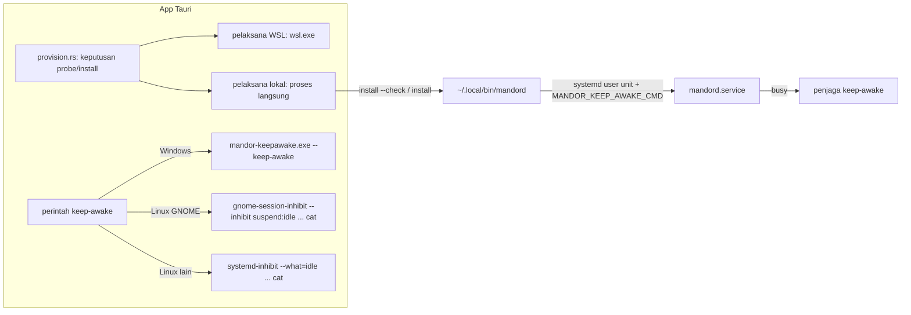

# Paket Linux native (tahap 2 service OS) - Plan

## Goal Capsule

- **Objective:** Pengguna Linux desktop memasang Mandor dari satu paket (`.deb`, `.rpm`, atau AppImage). App memasang daemon sebagai systemd user service, dan selama agent bekerja PC tidak tidur karena idle, termasuk setelah app di-Quit.
- **Product authority:** tahap 2 di Deferred to Follow-Up Work plan service OS (`docs/plans/2026-10-23-001-feat-daemon-os-service-installer-plan.md`), ditambah keputusan pemilik produk atas sintesis cakupan (2026-10-23). R-ID di bawah berlaku lokal; R-ID plan induk disebut dengan awalan "induk".
- **Execution profile:** test-first untuk kode Rust dan TypeScript. Paket dan workflow dibuktikan lewat run workflow `release` dan uji langsung di Ubuntu 24.04 GNOME.
- **Authority hierarchy:** `CLAUDE.md` (standar `rust-engineering` mengikat) > Product Contract dokumen ini > Product Contract plan induk > Planning Contract > unit. KTD plan induk tetap berlaku kecuali disebut diubah.
- **Stop conditions:** berhenti dan tanya pemilik produk bila spike A1 menunjukkan tidak ada mekanisme (gnome-session atau logind `idle`) yang menahan suspend otomatis sambil membiarkan Suspend manual berjalan, bila sebuah unit tidak bisa selesai tanpa melanggar `rust-engineering`, atau bila perilaku produk harus berubah.
- **Tail ownership:** commit per unit di branch fitur setelah gerbang hijau, PR ke `main`, tanpa merge sendiri. Uji langsung dijalankan bersama pemilik produk.

---

## Product Contract

### Summary

Workflow `release` menghasilkan paket `.deb`, `.rpm`, dan AppImage yang membawa UI dan daemon dengan versi sama. Saat dibuka, app Linux memasang atau memperbarui daemon ke `~/.local/bin/mandord` lewat `mandord install` (tanpa `wsl.exe`) lalu tersambung ke biner itu. Selama ada run yang bekerja, daemon menjalankan penjaga yang menahan suspend karena idle: `gnome-session-inhibit` di GNOME, `systemd-inhibit` di desktop lain. Settings → Background work menampilkan status di Linux dan menyediakan tombol untuk melepas service sebelum paket dihapus.

### Problem Frame

Tim akan pindah dari Windows + WSL ke Linux. Hari ini di Linux:
- tidak ada paket; pengguna membangun daemon dan app sendiri, dan app memakai `mandord` dari PATH;
- daemon dijalankan app lewat setsid, kecuali pengguna menjalankan `mandord install` manual;
- tidak ada penjaga keep-awake, sehingga PC bisa suspend saat agent bekerja.

Fondasinya sudah ada (plan induk U1–U4 dan U7): `mandord install`/`uninstall`, drain, `status` dengan `busy`/`managed_by`/`keep_awake`, dan pemantau keep-awake di daemon.

### Requirements

- R1. Satu paket per format (`.deb`, `.rpm`, AppImage) memuat UI dan daemon dengan versi sama. Biner daemon yang dipasang identik dengan yang dibawa paket (hash tertanam). (Memperluas induk R2 ke Linux.)
- R2. Saat dibuka, app Linux memasang atau memperbarui daemon sebagai systemd user service tanpa langkah manual, dengan aturan pembaruan induk R3 (tidak pernah memutus run yang bekerja).
- R3. Selama ada run yang bekerja, PC tidak suspend karena idle, termasuk setelah app di-Quit. Suspend yang dipilih pengguna tetap berjalan. Di luar itu, pengaturan daya tidak diubah. (Induk R5, dengan keputusan yang sama seperti Windows setelah uji U9 plan induk.)
- R4. Settings → Background work di Linux menampilkan status service, linger, dan keep-awake, tanpa baris keep-alive WSL.
- R5. Pengguna bisa melepas service dari Settings sebelum menghapus paket; runbook menjelaskan langkah manual. Data di `~/.mandor` tidak dihapus.
- R6. Build dev (tanpa daemon bawaan) dan `MANDOR_LINK` tetap bekerja seperti sekarang.

### Key Flows

- F1. **Pemasangan pertama:** pengguna memasang paket (`apt install ./mandor_*.deb`, `dnf install`, atau menjalankan AppImage), lalu membuka app. App mendapati daemon belum ada di `~/.local/bin`, memeriksa hash, memasangnya sebagai service, lalu tersambung. Bila systemd user tidak tersedia, app tersambung lewat setsid dan menampilkan panduan.
- F2. **Pembaruan:** sama dengan induk F2, tanpa WSL.
- F3. **Ditinggal lembur:** pengguna menjalankan agent, Quit app, dan meninggalkan PC. Agent terus berjalan dan PC tidak suspend karena idle sampai lima menit setelah agent selesai.
- F4. **Melepas:** pengguna menekan "Remove background service" (atau menjalankan `~/.local/bin/mandord uninstall`), lalu menghapus paket.

### Acceptance Examples

- AE1. **Covers R2, R3.** Given Ubuntu 24.04 GNOME, paket terpasang, dan suspend otomatis 2 menit, when agent bekerja lalu app di-Quit dan PC tidak disentuh melewati batas itu, then PC tidak suspend, agent selesai, dan daftar penahan (`gnome-session-inhibit --list` di GNOME, `systemd-inhibit --list` di desktop lain) menampilkan penahan Mandor selama agent bekerja. Run kontrol tanpa agent dengan setelan yang sama membuktikan PC memang suspend dalam batas itu.
- AE2. **Covers R3.** Given agent bekerja, when pengguna memilih Suspend dari menu, then PC suspend.
- AE3. **Covers R1, R2.** Given daemon terpasang versi lama atau diubah, when app versi baru dibuka tanpa run yang bekerja, then biner diganti dengan yang sah dan service di-restart; bila ada run yang bekerja, pembaruan menunggu.
- AE4. **Covers R5.** Given service terpasang tanpa run yang bekerja, when pengguna menekan "Remove background service", then service berhenti dan terhapus, unit dan biner hilang, dan `~/.mandor` tetap.
- AE5. **Covers R1.** Given paket `.deb`, `.rpm`, dan AppImage dari satu run `release`, then ketiganya membawa daemon dengan hash yang sama dengan artifact daemon.

### Success Criteria

- Anggota tim di Ubuntu memasang Mandor cukup dengan satu paket dan runbook, tanpa membangun daemon.
- AE1 dan AE2 lulus di Ubuntu 24.04 GNOME, di mesin fisik atau di VM yang lulus run kontrol (suspend otomatis benar-benar terjadi tanpa agent).

### Scope Boundaries

- Tidak menandatangani paket dan tidak membuat repositori APT/RPM.
- Tidak ada paket AUR, Flatpak, atau Snap (sandbox membatasi repo, git, Docker, dan proses agent).
- Tidak menangani lid atau baterai; runbook menjelaskan pengaturan daya.
- Tidak membuat updater otomatis atau autostart saat login.
- Tidak membersihkan service lewat skrip paket (`prerm`/`postrm` berjalan sebagai root dan tidak punya sesi pengguna).
- macOS tetap tahap 3.

### Dependencies / Assumptions

- Distro dengan systemd (Ubuntu 22.04+, Fedora 39+) dan desktop GNOME atau KDE. glibc minimal mengikuti runner build daemon (ubuntu-22.04).
- `systemd-inhibit` tersedia di `/usr/bin` (bagian paket `systemd`); di GNOME, `gnome-session-inhibit` tersedia (paket `gnome-session-bin` di Ubuntu).
- Unit plan induk U1–U9 sudah ada di `main` (PR #9 dan #10); U3–U5 memakai `provision.rs`, `daemon_link.rs`, pemantau keep-awake di `crates/mandord/src/power.rs`, dan `background.ts` dari sana.

---

## Planning Contract

### Key Technical Decisions

- **KTD-L1. Service dipasang app lewat `mandord install`, bukan unit dari paket.** Satu mekanisme untuk WSL, `.deb`, `.rpm`, dan AppImage; berjalan sebagai pengguna tanpa root; AppImage tidak punya skrip pasang. Biner disalin ke `~/.local/bin/mandord` sehingga service tidak bergantung pada lokasi paket (jalur AppImage berubah tiap mount). Alasan: plan induk KTD-43 sudah memberi implementasi yang teruji; unit dari paket butuh `systemctl --global` dan tidak mencakup AppImage.
- **KTD-L2. Provisioning dipisah menjadi "pelaksana" WSL dan lokal, dengan keputusan yang sama.** Logika probe dan install (`parse_probe`, `parse_install`, verifikasi hash, `ProvisionState`) dipakai keduanya. Pelaksana lokal menghitung SHA-256 `~/.local/bin/mandord` di Rust (membaca, tidak mengeksekusi), menjalankan `install --check` langsung dengan jalur absolut, menulis bytes terverifikasi ke berkas baru (`create_new` dengan mode berkas `0700`, direktori `0700`) di `~/.cache/mandor/`, lalu menjalankan `install` dari sana. Semua proses dengan timeout yang sama seperti jalur WSL. Alasan: perbedaan hanya di cara menjalankan perintah, bukan di keputusan (induk R8).
- **KTD-L3. App Linux tersambung ke `~/.local/bin/mandord` bila membawa daemon.** Default `LinkMode::Local` memakai jalur itu ketika hash tertanam ada dan berkasnya ada serta bisa dieksekusi; bila tidak (mis. provisioning pertama gagal), jatuh ke `mandord` dari PATH, sama dengan perilaku perintah WSL. Build dev tanpa daemon bawaan tetap memakai PATH; `MANDOR_LINK=local:<path>` tetap menang. Seperti cabang WSL, `LinkMode::Local` meneruskan `MANDOR_KEEP_AWAKE_CMD` ke environment `connect` bila ada perintah keep-awake, sehingga daemon setsid (tanpa systemd) juga menahan sleep. Alasan: R6, R3 di jalur setsid, dan relay harus memakai biner yang sama dengan service.
- **KTD-L4. Penjaga keep-awake Linux dipilih menurut desktop, keduanya membungkus proses yang keluar saat stdin ditutup.**
  - GNOME (`XDG_CURRENT_DESKTOP` memuat `GNOME` dan `gnome-session-inhibit` ada): `gnome-session-inhibit --inhibit suspend:idle --app-id <id app> --reason <alasan berbahasa Inggris>` lalu `cat`. Suspend otomatis GNOME diatur `gnome-settings-daemon` yang memeriksa penahan gnome-session, bukan penahan `idle` logind; Suspend dari menu tetap lewat logind sehingga tetap berjalan (R3, AE2). Butuh session bus pengguna dari service (`DBUS_SESSION_BUS_ADDRESS` dari user manager systemd).
  - Desktop lain: `systemd-inhibit --what=idle --mode=block --who=Mandor --why=<alasan>` lalu `cat`.
  - Jalur program absolut ditemukan app saat provisioning (hanya `/usr/bin` dan `/bin`). `cat` membaca stdin sampai EOF; daemon sudah menghentikan penjaga dengan menutup stdin lalu kill grup proses bila perlu (`crates/mandord/src/power.rs`), dan di bawah systemd cgroup unit ikut dibersihkan bila daemon mati. Tidak ada perubahan kode daemon dan tidak ada crate baru.
  - Tidak ada yang memakai jenis `sleep`, agar Suspend pilihan pengguna tetap berjalan, sama dengan perbaikan AWAYMODE di Windows. Efektivitas kedua kandidat dibuktikan spike A1; yang lulus dan cakupan desktopnya dicatat di sini setelah spike.
- **KTD-L5. Resource dan hash daemon juga untuk target Linux.** `tauri.linux.conf.json` membawa `resources/mandord` dan menetapkan target bundle `deb`, `rpm`, `appimage`. `build.rs` menolak build release Linux tanpa biner asli, seperti Windows (KTD-48). Job `release` baru membangun ketiga paket di `ubuntu-22.04` dari artifact daemon, memeriksa hash tertanam, dan melampirkan paket ke GitHub Release. CI Linux memakai placeholder seperti Windows.
- **KTD-L6. Melepas service dari UI.** Command Tauri lokal menjalankan `~/.local/bin/mandord uninstall` (tanpa `--force`, sehingga run yang bekerja menghasilkan `deferred`) dan mengembalikan laporan JSON-nya. Tombol hanya tampil di Linux dengan daemon bawaan. Setelah berhasil, UI menyatakan bahwa paket bisa dihapus dan bahwa membuka app lagi akan memasang ulang service.

### High-Level Technical Design

### Assumptions

- A1. Dari systemd user service, `gnome-session-inhibit --inhibit suspend:idle` menahan suspend otomatis GNOME di Ubuntu 24.04, dan `systemd-inhibit --what=idle` diizinkan polkit serta menahan suspend otomatis di desktop lain yang diuji; keduanya membiarkan Suspend dari menu berjalan. Dibuktikan lebih dulu di U3 (spike). Bila tidak ada kandidat yang memenuhi: berhenti dan tanya.
- A2. Bundler Tauri v2 di `ubuntu-22.04` menghasilkan `.deb`, `.rpm`, dan AppImage dengan resource `mandord` yang bisa di-resolve dari ketiganya (termasuk AppImage yang di-mount).
- A3. Daemon yang dibangun di `ubuntu-22.04` berjalan di Ubuntu 22.04+ dan Fedora 39+ (glibc).

### Sequencing

U1 → U2 (paket butuh resource dan hash). U3 (spike lebih dulu) dan U4 paralel setelah U1. U5 setelah U4. U6 terakhir.

---

## Implementation Units

### U1. Resource daemon dan hash untuk target Linux

- **Goal:** build Linux membawa daemon dan menanam hash-nya seperti Windows.
- **Requirements:** R1.
- **Dependencies:** —
- **Files:** `apps/desktop/src-tauri/tauri.linux.conf.json` (baru: resource `resources/mandord`, target `deb`/`rpm`/`appimage`), `apps/desktop/src-tauri/build.rs`, `.github/workflows/ci.yml` (placeholder untuk job desktop Linux), `apps/desktop/src-tauri/resources/README.md`, `README.md`.
- **Approach:** syarat "release tanpa biner asli gagal" diperluas ke target Linux; placeholder tetap menghasilkan hash kosong. Karena resource kini wajib ada di build Linux (termasuk `tauri dev`), langkah placeholder CI berlaku untuk Linux dan Windows, dan README serta `resources/README.md` menjelaskan placeholder untuk pengembang Linux (`bun run tauri build` lokal tanpa biner asli akan gagal).
- **Patterns to follow:** `tauri.windows.conf.json`, logika `build.rs` yang ada.
- **Test scenarios:** Test expectation: none -- konfigurasi build; dibuktikan oleh CI desktop Linux yang tetap hijau dengan placeholder dan oleh U2.
- **Verification:** `cargo build` debug dengan placeholder berhasil; build release Linux tanpa biner asli gagal dengan pesan yang jelas.

### U2. Job `release` untuk paket Linux

- **Goal:** satu run `release` menghasilkan `.deb`, `.rpm`, dan AppImage yang membawa daemon dengan hash tertanam.
- **Requirements:** R1; AE5.
- **Dependencies:** U1.
- **Files:** `.github/workflows/release.yml`, `README.md` (bagian rilis).
- **Approach:** job baru di `ubuntu-22.04` (`needs: wsl-daemon`) mengunduh artifact daemon ke `resources`, memasang dependensi sistem Tauri ditambah `patchelf` dan `libfuse2` untuk AppImage, menjalankan build dengan bundle `deb,rpm,appimage`, memeriksa bahwa hash daemon tertanam di biner app (pola langkah Windows), membuat `SHA256SUMS` untuk ketiga paket, lalu mengunggah artifact `mandor-linux-packages`. Job publish melampirkan paket dan `SHA256SUMS` ke GitHub Release untuk tag `v*`. Action dikunci ke SHA seperti job lain.
- **Execution note:** packaging; buktikan dengan run workflow manual dan pemeriksaan isi paket (`dpkg -c`, `rpm -qlp`, `--appimage-extract`).
- **Patterns to follow:** job `windows-app` di `release.yml`.
- **Test scenarios:**
  - Covers AE5. Run manual menghasilkan tiga paket; masing-masing memuat `mandord` dengan SHA-256 sama dengan artifact daemon.
  - Langkah pemeriksaan hash gagal bila resource diganti placeholder.
- **Verification:** artifact `mandor-linux-packages` berisi tiga paket dan `SHA256SUMS` yang cocok; `scripts/check-versions.sh` tetap lulus.

### U3. Perintah keep-awake Linux (spike A1 lebih dulu)

- **Goal:** app menyusun `MANDOR_KEEP_AWAKE_CMD` Linux yang menahan suspend karena idle selama busy.
- **Requirements:** R3; AE1, AE2.
- **Dependencies:** U1.
- **Files:** `apps/desktop/src-tauri/src/provision.rs` (atau modul baru `keep_awake_linux.rs`), test di modul yang sama.
- **Approach:** fungsi murni memilih mekanisme dari desktop yang terdeteksi dan menyusun argv JSON dari jalur absolut (KTD-L4); `XDG_CURRENT_DESKTOP` dibaca sekali di `ClientConfig::from_env`; pencarian jalur dibatasi ke `/usr/bin` dan `/bin`. Bila program mekanisme tidak ada, provisioning tetap berjalan tanpa keep-awake (status daemon `not_configured`, UI menjelaskan).
- **Execution note:** jalankan spike A1 sebelum menulis kode, di Ubuntu 24.04 GNOME. Set suspend otomatis 2 menit lewat `gsettings set org.gnome.settings-daemon.plugins.power sleep-inactive-ac-timeout 120` dan `sleep-inactive-ac-type 'suspend'` (ditambah padanan `-battery-` di laptop; GNOME Settings minimal 15 menit), dan catat nilai lama untuk dikembalikan. (1) Run kontrol: tanpa agent dan tanpa penjaga, buktikan mesin suspend dalam batas itu; bila VM tidak suspend, spike dan AE1/AE2 pindah ke mesin fisik. (2) Untuk tiap kandidat (`gnome-session-inhibit` dan `systemd-inhibit --what=idle`), pasang daemon sebagai service dengan perintah itu, buat daemon busy, Quit app, jangan sentuh mesin; periksa daftar penahan dan bahwa mesin tidak suspend, lalu bahwa Suspend dari menu tetap jalan. Catat hasil dan mekanisme yang lulus di `docs/progress/linux-packages.md`.
- **Patterns to follow:** `keep_awake_json` di `provision.rs`; `parse_keep_awake_cmd` di `crates/mandord/src/config.rs` (argv harus lolos validasinya).
- **Test scenarios:**
  - Desktop GNOME dan `gnome-session-inhibit` ada → argv jalur absolut `gnome-session-inhibit`, `--inhibit suspend:idle`, `--app-id`, `--reason`, lalu jalur absolut `cat`.
  - Desktop lain (atau GNOME tanpa `gnome-session-inhibit`) → argv `systemd-inhibit`, `--what=idle`, `--mode=block`, `--who=Mandor`, lalu `cat`; tidak ada argv yang memuat jenis `sleep`.
  - JSON hasil lolos `parse_keep_awake_cmd` daemon (tanpa karakter kontrol, program absolut).
  - Program mekanisme tidak ditemukan → tidak ada perintah keep-awake, provisioning tidak gagal.
  - Integrasi (unix): dengan program palsu yang mencatat argv dan keluar saat stdin EOF, pemantau daemon menghentikan penjaga setelah masa tenggang (memakai test pemantau yang sudah ada dengan argv Linux).
- **Verification:** spike A1 lulus dan tercatat; test lulus.

### U4. Provisioning lokal dan link ke daemon terpasang

- **Goal:** app Linux memasang dan memperbarui daemon tanpa `wsl.exe` lalu tersambung ke `~/.local/bin/mandord`.
- **Requirements:** R2, R6; AE3.
- **Dependencies:** U1.
- **Files:** `apps/desktop/src-tauri/src/provision.rs`, `apps/desktop/src-tauri/src/lib.rs` (`provision_run`, `ClientConfig`), `apps/desktop/src-tauri/src/daemon_link.rs`, `apps/desktop/src/lib/background.ts` (tipe hasil `provision_run`), test di modul yang sama.
- **Approach:** pisahkan cara menjalankan perintah (WSL vs lokal) dari keputusan probe/install (KTD-L2). Pelaksana lokal: hash biner terpasang di `spawn_blocking`, `install --check` dan `install` sebagai proses langsung dengan timeout dan keluaran dibatasi, berkas sementara `create_new` di `~/.cache/mandor/` (direktori `0700`), bytes yang sudah diverifikasi terhadap hash tertanam. `provision_run` menjalankan jalur lokal untuk `LinkMode::Local` bila daemon dibawa, dan `NotNeeded` bila tidak. `provision_run` mengembalikan pelaksana (`runner`: `wsl` atau `local`) di samping keadaan, sehingga UI tidak menebak dari `ProvisionState`. Jalur lokal memanggil `set_keep_awake` dengan perintah dari U3, dan `LinkMode::Local` meneruskannya ke environment `connect` (KTD-L3). `ClientConfig` memakai `~/.local/bin/mandord` sebagai default Linux saat hash tertanam ada, dengan fallback PATH bila berkas tidak ada (KTD-L3). `HOME` dibaca sekali di `ClientConfig::from_env`.
- **Execution note:** test-first lewat fungsi publik provisioning dengan biner daemon palsu (skrip) di direktori sementara.
- **Patterns to follow:** `provision()` dan test-nya di `provision.rs`; `LinkMode` di `daemon_link.rs`.
- **Test scenarios:**
  - Biner terpasang dengan hash sama dan `install --check` melapor service ada dan sesuai → `UpToDate`, tidak ada install.
  - Biner tidak ada → bytes ditulis ke `~/.cache/mandor/` dengan isi identik resource, `install` dijalankan dari sana → `Installed`.
  - Covers AE3. Biner terpasang berbeda hash → install; laporan `deferred` → `Deferred`.
  - Resource tidak cocok dengan hash tertanam → `Failed` tanpa menjalankan apa pun.
  - `install --check` melewati timeout → `CannotCheck`.
  - Berkas sementara sudah ada di `~/.cache/mandor/` → tidak ditimpa (nama baru atau error), tidak mengikuti symlink.
  - Tanpa daemon bawaan → `NotNeeded`, link tetap `mandord` dari PATH; `MANDOR_LINK=local:/x` menang atas default.
  - Provisioning pertama `Failed` → perintah `connect` tidak menunjuk berkas yang tidak ada (fallback `mandord` dari PATH).
  - Mode setsid (tanpa systemd) → perintah `connect` lokal membawa `MANDOR_KEEP_AWAKE_CMD` bila ada perintah keep-awake, dan tidak membawanya bila tidak ada.
  - Hasil `provision_run` membawa `runner: local` di Linux dan `runner: wsl` di Windows.
  - Jalur WSL tetap lulus test yang ada (tidak ada regresi).
- **Verification:** test Tauri lulus di Linux dan Windows (matrix CI); app dev di WSL tetap tersambung.

### U5. Background work di Linux dan tombol melepas service

- **Goal:** UI menampilkan status Linux dan bisa melepas service.
- **Requirements:** R4, R5; AE4.
- **Dependencies:** U4.
- **Files:** `apps/desktop/src-tauri/src/lib.rs` (command `daemon_uninstall` lokal), `apps/desktop/src/lib/background.ts`, `apps/desktop/src/lib/background.test.ts`, `apps/desktop/src/lib/stores/background.svelte.ts`, `apps/desktop/src/lib/components/settings/BackgroundSettings.svelte`, `apps/desktop/src/lib/dev/mock-transport.ts`.
- **Approach:** `backgroundView` dan getter `wsl` di store membaca `runner` dari hasil `provision_run` (U4), bukan `state !== 'not_needed'`; baris keep-alive hanya untuk WSL. Pesan systemd untuk Linux tidak menyebut `wsl.conf`. Baris keep-awake `not_configured` di Linux menjelaskan bahwa program penahan (`gnome-session-inhibit` atau `systemd-inhibit`) tidak tersedia. Command `daemon_uninstall` menjalankan `uninstall` lokal dengan timeout dan memetakan `uninstalled`/`deferred`/`error` ke pesan UI (KTD-L6); tombol meminta konfirmasi lebih dulu. Setelah `uninstalled`, UI meminta pengguna menutup app sebelum menghapus paket, karena link menunjuk biner yang sudah dihapus.
- **Patterns to follow:** `backgroundView` dan test-nya; aksi `enable_keep_alive`.
- **Test scenarios:**
  - Provisioning lokal dengan service dan linger aktif dan keep-awake `off` → tiga baris "Ready", tanpa baris WSL, `ready: true`.
  - systemd tidak tersedia di Linux → panduan tanpa menyebut WSL.
  - Keep-awake `not_configured` di Linux → pesan program penahan tidak tersedia.
  - `runner: local` dengan state apa pun (termasuk `up_to_date`) → tidak ada baris WSL; `runner: wsl` → baris WSL tetap ada.
  - Covers AE4. Hasil `uninstalled` → pesan bahwa paket bisa dihapus; `deferred` → pesan menunggu agent selesai; `error` → pesan error.
  - Tombol melepas tidak tampil untuk WSL dan build dev.
- **Verification:** `bun run check` dan `bun run test` lulus; tampilan dicek di mode mock.

### U6. Runbook Linux dan uji langsung

- **Goal:** anggota tim bisa memasang dari runbook; semua AE terbukti di Ubuntu 24.04 GNOME.
- **Requirements:** semua; AE1–AE4 (AE5 dibuktikan di U2).
- **Dependencies:** U2, U3, U4, U5.
- **Files:** `docs/runbook/setup-linux.md` (baru), `README.md`, `docs/progress/linux-packages.md` (baru).
- **Approach:** runbook: verifikasi unduhan (`sha256sum -c SHA256SUMS`), pasang paket per format, login `gh`/`claude`, linger, pengaturan daya, arti setiap baris Background work, melepas (tombol, lalu hapus paket), pemecahan masalah (`gnome-session-inhibit --list`, `systemd-inhibit --list`, `journalctl --user -u mandord`). Uji langsung di Ubuntu 24.04 GNOME: mesin fisik, atau VM VirtualBox/VMware yang lulus run kontrol (bukan WSLg). Suspend otomatis 2 menit diatur dengan `gsettings` seperti di spike U3, lalu dikembalikan.
- **Test scenarios:**
  - Covers AE1. Run kontrol tanpa agent: mesin suspend dalam 2 menit. Lalu Quit saat agent bekerja: mesin tidak suspend; penahan dilepas lima menit setelah selesai.
  - Covers AE2. Suspend dari menu saat agent bekerja tetap jalan.
  - Covers AE3. Pasang paket versi lebih baru: `updated` saat idle, `deferred` saat busy.
  - Covers AE4. Tombol melepas lalu `apt remove`: service, unit, biner hilang; `~/.mandor` tetap.
  - Pasang dari `.rpm` (Fedora, VM) dan AppImage sekali masing-masing: app tersambung dan service terpasang.
- **Verification:** hasil tercatat di `docs/progress/linux-packages.md`.

---

## Verification Contract

- `make check` hijau (Rust workspace).
- Di `apps/desktop/src-tauri`: `cargo fmt --check`, `cargo clippy --all-targets -- -D warnings`, `cargo test`.
- `bun run --cwd apps/desktop check` dan `bun run --cwd apps/desktop test`.
- Matrix CI (Linux, macOS, Windows) hijau lewat dispatch manual.
- Run `release` manual menghasilkan tiga paket Linux dan installer Windows; pemeriksaan hash di kedua job lulus.
- Uji langsung U6 tercatat.

## Definition of Done

- U1–U6 selesai dengan test scenario terpenuhi dan gerbang di atas hijau.
- Spike A1 lulus dengan run kontrol, dan mekanisme yang lulus tercatat di KTD-L4 (atau keputusan pemilik produk tercatat bila tidak ada yang lulus).
- AE1–AE4 lulus di uji langsung dan AE5 lulus lewat run `release` (U2), semuanya tercatat di `docs/progress/linux-packages.md`.
- Runbook Linux dan README diperbarui.
- PR ke `main` dibuka; tidak di-merge sendiri.

---

## Appendix

### Deferred to Follow-Up Work

- Tanda tangan paket (GPG untuk `.deb`/`.rpm`) dan repositori APT/RPM.
- Paket AUR.
- Penahan `handle-lid-switch` untuk laptop Linux.
- Membersihkan service secara otomatis saat paket dihapus.
- Build `aarch64`.
- Membaca stderr penjaga keep-awake di daemon agar `keep_awake_error` memuat alasan sebenarnya (mis. penolakan polkit).

### Risks

- **Penahan tidak efektif atau ditolak dari service tanpa sesi (A1).** Polkit bisa menolak `systemd-inhibit`, dan GNOME mengabaikan penahan `idle` logind. Mitigasi: spike dengan dua kandidat dan run kontrol; status `keep_awake: failing` di UI sebagai detektor; berhenti dan tanya bila tidak ada yang lulus.
- **Pesan error penjaga hilang.** `power.rs` tidak membaca stdout/stderr penjaga, sehingga penolakan polkit hanya tampil sebagai "the keep-awake helper exited". Mitigasi: spike membaca pesan langsung di terminal; perbaikan pelaporan dicatat di Deferred bila perlu.
- **Uji palsu-lulus.** "Tidak suspend" juga terjadi bila suspend otomatis tidak pernah terpicu (VM, setelan tidak terpasang). Mitigasi: run kontrol wajib sebelum spike dan AE1.
- **Desktop selain GNOME** (KDE, XFCE) mungkin memperlakukan penahan `idle` logind berbeda. Mitigasi: uji GNOME wajib, KDE bila ada; runbook mencatat perilaku yang diketahui.
- **Service tertinggal setelah paket dihapus.** Daemon terus berjalan dari `~/.local/bin`. Mitigasi: tombol melepas, runbook, dan pesan setelah melepas.
- **glibc lebih tua dari runner build (A3).** Mitigasi: build di `ubuntu-22.04`; distro lebih tua tidak didukung, dicatat di runbook.
- **AppImage butuh FUSE** di beberapa distro. Mitigasi: runbook menyebut `--appimage-extract-and-run`.

### Sources

- Plan induk: `docs/plans/2026-10-23-001-feat-daemon-os-service-installer-plan.md` (KTD-42–KTD-53, Deferred to Follow-Up Work tahap 2) dan hasil uji Windows di `docs/progress/os-service.md` (perbaikan AWAYMODE).
- Kode: `apps/desktop/src-tauri/src/provision.rs`, `apps/desktop/src-tauri/src/daemon_link.rs`, `apps/desktop/src-tauri/src/lib.rs` (`ClientConfig`, `provision_run`), `apps/desktop/src-tauri/build.rs`, `crates/mandord/src/power.rs` (penjaga dihentikan lewat stdin), `crates/mandord/src/config.rs` (`parse_keep_awake_cmd`), `crates/mandord/src/install.rs`, `.github/workflows/release.yml`.
- systemd-inhibit dan inhibitor locks: https://www.freedesktop.org/wiki/Software/systemd/inhibit/
- Review dokumen 2026-10-23 (coherence, feasibility, security-lens, adversarial) dan keputusan pemilik produk: uji kedua mekanisme keep-awake, VM boleh dengan run kontrol, terapkan semua perbaikan.
- Crate `keepawake` 0.6 (implementasi Linux lewat login1 dan `org.freedesktop.ScreenSaver`), dipakai sebagai referensi, tidak ditambahkan ke Linux.
