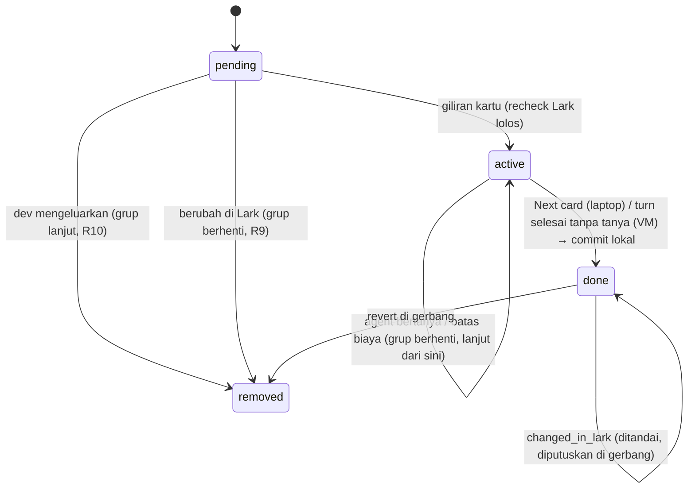
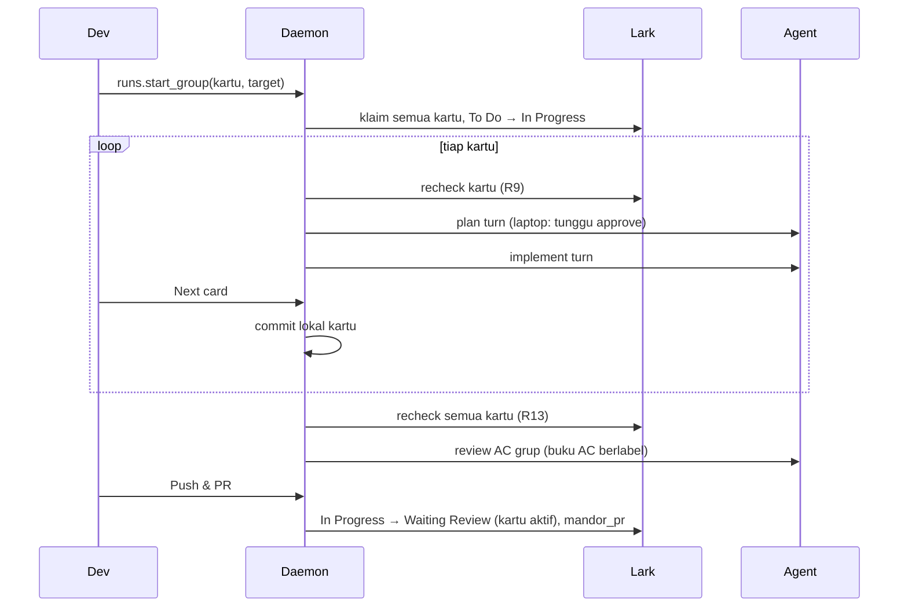

# Run grup kartu satu flow - Plan

## Goal Capsule

- **Objective:** Kartu-kartu satu flow milik satu developer di dalam satu epic dikerjakan sebagai satu run grup: satu branch, berurutan per kartu, satu PR (per repo). Grup bisa dimulai dari app laptop atau diantrekan ke VM lembur sehingga satu flow selesai semalaman.
- **Product authority:** brainstorm dengan pemilik produk dan keputusannya atas dua ronde review dokumen (coherence, feasibility, product-lens, adversarial), 2026-10-23. Melengkapi plan mode VM (`docs/plans/2026-10-23-002-feat-vm-overnight-mode-plan.md`) dan mengubah aturan Rilis 1 "satu kartu = satu run = satu branch = satu PR per repo" untuk run grup saja.
- **Open blockers:** tidak ada. Bagian laptop (U1–U9, U11) sudah di-merge (PR #12); plan VM dan plan siang lalu antre ke VM sudah di-merge (PR #13, #14), jadi U10 dan U12–U17 bisa dikerjakan.
- **Product Contract preservation:** changed 2026-10-31 (keputusan pemilik produk saat merinci U10): R24, F5, dan AE9 baru (grup di-plan kartu pertamanya di laptop lalu diantre ke VM); R22 diperluas dengan Take over PR draft grup dan hasil review AC, mengikuti R22 plan VM yang diperbarui. Diperjelas di Planning Contract (bukan perubahan R): kartu grup di VM yang berakhir tanpa perubahan kode dianggap buntu (KTD-G11), dan keputusan R13 di VM diambil dari laporan Overnight (KTD-G18). Changed 2026-10-31 (keputusan pemilik produk setelah PR #15): R25, F6, AE10, dan AE11 baru; R5, R6, dan R24 diperluas. "One plan for all cards" menjadi pilihan saat Start together: satu plan mencakup AC semua kartu, disetujui sekali, lalu pengerjaan tetap per kartu. Bila AC kartu yang belum selesai berubah setelah plan disetujui, plan grup harus disetujui ulang.
- **Execution profile:** test-first lewat antarmuka publik (usecase dan store dengan fake yang ada); frontend dengan Vitest; uji langsung dengan kartu uji di Base salinan dan repo `mandor-smoke`.
- **Authority hierarchy:** `CLAUDE.md` (standar `rust-engineering` mengikat) > Product Contract > Planning Contract > unit.
- **Stop conditions:** berhenti dan tanya bila perilaku produk harus berubah, atau bila unit tidak bisa selesai tanpa melanggar `rust-engineering`.
- **Tail ownership:** branch fitur, PR ke `main`, tanpa merge sendiri. Bagian laptop sudah dikirim (PR #12); bagian VM (U10, U12–U17) di PR #15. Satu plan grup (U18–U21) satu PR terpisah setelah PR #15.

---

## Product Contract

### Summary

"Start together" memilih kartu To Do satu flow (default: epic sama, PIC saya, lolos gerbang Start, tanpa run dan tidak di antrean VM; dev bisa menambah atau mengurangi). Kartu dikerjakan berurutan di satu branch (plan → kerjakan → commit per kartu), lalu satu gerbang Push & PR di akhir membuat satu PR per repo dan memindahkan semua kartu ke Waiting Review bersama. Grup bisa diantrekan ke VM lembur sebagai satu item.

### Problem Frame

Hari ini setiap kartu adalah satu run dengan branch dan PR sendiri dari branch default. Untuk flow yang kartunya saling bergantung (mis. E-PGS43 "Job & Position": PGS-1401 daftar job, 1402 kartu job, 1403 buat job, 1404 ubah dan hapus job), ini membuat:
- kartu berikutnya tidak melihat kode kartu sebelumnya sampai PR-nya di-merge;
- reviewer menerima beberapa PR kecil yang saling terkait untuk satu fitur;
- agent kehilangan konteks flow di setiap kartu;
- status kartu di Lark bergerak tidak serempak.

Antrean VM lembur sudah mengerjakan kartu berurutan, tetapi tetap satu PR per kartu dari branch default, sehingga flow yang saling bergantung tidak bisa selesai dalam satu malam.

### Requirements

**Membentuk grup**

- R1. Dari kartu To Do, dev memilih "Start together". Mandor menawarkan kartu dengan epic sama, PIC dev itu, berstatus To Do, dan lolos gerbang Start (Development Readiness siap). Kartu yang tidak lolos tampil tidak bisa dipilih beserta alasannya. Dev bisa menambah atau mengurangi kartu sebelum mulai.
- R2. Kartu yang punya run aktif, ada di antrean VM, atau dipegang daemon VM tidak bisa masuk grup. Dev menutup run itu atau mengeluarkannya dari antrean dulu bila ingin memasukkannya.
- R3. Urutan pengerjaan default mengikuti nomor kartu; dev bisa mengubah urutan sebelum mulai.
- R4. Satu grup memakai satu target repo atau workspace, dipilih saat mulai, dan selalu bercabang dari branch default.

**Menjalankan grup**

- R5. Kartu dikerjakan berurutan di satu branch grup: plan, implementasi, dan commit per kartu, lalu kartu berikutnya. Dengan "One plan for all cards" (R25), plan dibuat sekali untuk seluruh grup; implementasi dan commit tetap per kartu.
- R6. Di laptop, plan setiap kartu menunggu persetujuan dev seperti run biasa; dengan R25, plan grup disetujui sekali. Di VM, plan tidak menunggu persetujuan (aturan VM).
- R7. Saat grup dimulai, semua kartu grup diklaim dan pindah ke In Progress di Lark.
- R8. Bila satu kartu tersangkut (agent bertanya, batas biaya, atau batas pemakaian VM), grup berhenti di kartu itu. Kartu yang sudah selesai tetap di branch. Setelah masalahnya beres, grup melanjutkan dari kartu itu di branch yang sama.
- R9. Sebelum memulai setiap kartu, Mandor memeriksa ulang kartu itu di Lark. Kartu yang dipindah ke status lain atau berganti PIC dikeluarkan dari grup: klaimnya dilepas (hanya bila klaim itu masih milik dev ini), statusnya tidak diubah dan dev tidak diminta mengubahnya, dan grup berhenti seperti R8 karena kartu berikutnya mungkin bergantung padanya. Di laptop dev memilih melanjutkan tanpa kartu itu atau menghentikan grup; di VM grup diparkir dengan alasan "card removed". Perubahan status, PIC, atau klaim pada kartu grup yang sedang tidak dikerjakan tidak menghentikan grup seketika: kartu itu ditandai, lalu ditangani R9 sebelum gilirannya (bila belum dimulai) atau R13 di gerbang (bila sudah di-commit). Hanya kehilangan klaim pada kartu yang sedang dikerjakan yang menghentikan grup seperti R8.
- R10. Dev bisa mengeluarkan kartu yang belum dimulai dari grup yang berjalan, atau menghentikan grup. Kartu yang dikeluarkan dev atau belum dimulai saat grup dihentikan dilepas klaimnya dan app meminta dev mengembalikannya ke To Do di Lark. Kartu yang sudah di-commit tetap di branch.
- R11. UI menampilkan grup sebagai satu run dengan progres per kartu (selesai, sedang dikerjakan, menunggu, dikeluarkan).

**PR dan review**

- R12. Push & PR terjadi sekali setelah semua kartu aktif selesai, lewat satu gerbang Push & PR. Buku AC (daftar AC beserta verdict-nya) menggabungkan AC semua kartu aktif grup, dan review AC berjalan sekali untuk seluruh flow, setelah pemeriksaan R13. Bila gerbang menahan karena AC, yang tertahan seluruh grup dengan baris AC diberi label kartunya; setelah dev memutuskan baris itu, push berlanjut tanpa mengulang kartu.
- R13. Setelah kartu terakhir selesai dan sebelum review AC grup, Mandor memeriksa ulang semua kartu. Kartu yang sudah di-commit tetapi berubah di Lark (status atau PIC) tampil "changed in Lark, code already in the branch", dan dev memilih me-revert commit kartu itu atau tetap menyertakannya dengan alasan yang tercatat di PR. Di VM, grup diparkir untuk keputusan ini.
  - Revert menjalankan review AC seluruh grup pada kode setelah revert (di VM sebagai item antrean grup).
  - Revert yang konflik tidak diterapkan: grup ditahan dengan alasan "revert conflict", dan dev memilih tetap menyertakan kartu itu dengan alasan atau mengambil alih grup ke laptop.
  - Kartu yang tetap disertakan tetap ikut buku AC, deskripsi PR (R16), dan Waiting Fix (R17), tetapi Mandor tidak memindahkan statusnya (R14, R17); deskripsi PR mencatat status dan PIC-nya saat itu.
- R14. Di laptop, PR dibuat lalu semua kartu aktif pindah ke Waiting Review bersama. Dari VM, PR dibuat draft dan semua kartu tetap In Progress; satu "Send to review" pada grup menandai PR siap di-review dan memindahkan semua kartu aktif ke Waiting Review bersama, kecuali kartu yang tetap disertakan setelah berubah di Lark (R13).
- R15. Grup dengan target workspace membuat satu PR per repo anggota yang berubah; semua kartu grup membawa tautan PR yang sama.
- R16. Deskripsi PR mencantumkan setiap kartu grup beserta ringkasan AC dan verdict-nya per kartu, serta kartu yang dikeluarkan.

**Waiting Fix**

- R17. Bila QA memindahkan kartu grup ke Waiting Fix, perbaikan dikerjakan di branch dan PR grup yang sama. Bila beberapa kartu grup masuk Waiting Fix, semuanya ditangani dalam satu run perbaikan dengan komentar tepercaya diberi label kartunya. Tiap kartu tetap memakai jeda tenang dan aturan pemberi komentar tepercaya miliknya sendiri. Kartu yang masuk Waiting Fix saat perbaikan grup berjalan ikut sebagai giliran berikutnya di run yang sama sebelum review AC; kartu yang masuk setelah push memulai run perbaikan berikutnya. Hanya kartu yang diperbaiki yang berubah status dan kembali ke Waiting Review setelah perbaikan.
- R18. Review AC setelah perbaikan mencakup AC semua kartu aktif grup, karena kode dipakai bersama. Baris yang verdict-nya berubah menjadi Fail atau Can't verify menahan push perbaikan (diberi label kartunya, dev memutuskan), termasuk baris kartu yang tidak diperbaiki. Baris yang sudah diputuskan dev di gerbang sebelumnya dan verdict-nya tidak berubah tidak menahan lagi. Perubahan verdict di kartu yang tidak diperbaiki dicatat di deskripsi PR tanpa mengubah statusnya.
- R19. Selama kartu grup masih Waiting Fix, deskripsi PR dan kartu grup lain menampilkan peringatan "do not merge: <kartu> is in Waiting Fix". Mandor tidak memblokir merge di GitHub. Waiting Fix yang datang setelah PR grup di-merge dikerjakan sebagai run lanjutan dari branch default. Sebelum push perbaikan, Mandor memeriksa apakah PR grup sudah di-merge; bila sudah, perbaikan menjadi run lanjutan dari branch default dan tidak di-push ke branch grup.

**VM lembur**

- R20. Dari tab Overnight, dev bisa mengantrekan grup sebagai satu item antrean. Grup memakai aturan VM yang sama: satu item sekaligus per developer, pagar lembur, dan batas pemakaian per siklus. Kartu grup yang diantrekan tampil "Queued for VM" di board laptop dan tidak bisa dimulai atau diantrekan sendiri. Bila ada Waiting Fix kartu VM lain yang siap, grup mengalah di antara kartu: setelah kartu yang sedang dikerjakan selesai, perbaikan itu dikerjakan dulu, lalu grup lanjut di branch-nya.
- R21. Bila jam lembur berakhir di tengah grup, kartu yang sedang dikerjakan diselesaikan, lalu grup berhenti dengan alasan "window ended", tetap di depan antrean, dan otomatis dilanjutkan dari kartu berikutnya di awal siklus berikutnya tanpa perlu diantrekan ulang. Grup yang dimulai dengan "Start now" di luar jam lembur berjalan sampai selesai atau tersangkut, tanpa berhenti karena jam.
- R22. Grup yang diparkir (R8, R9, R12, R13) tercatat di laporan pagi dengan progres per kartu; item antrean berikutnya tetap berjalan. Grup diparkir dijawab dan diantrekan ulang, atau diambil alih ke laptop ("Take over to laptop"), sebagai satu kesatuan: klaim semua kartu grup dan branch grup berpindah bersama, dan kartu tersisa mengikuti R6 untuk laptop. Grup yang selesai sebagai PR draft juga bisa diambil alih: laptop melanjutkan di PR draft grup yang sama, hasil review AC VM ikut (usang bila kode laptop berbeda), dan "Send to review" grup dilakukan dari laptop.
- R23. Laporan pagi dan ringkasan siklus menghitung hasil grup per kartu: kartu selesai dihitung mencapai PR draft hanya setelah PR grup dibuat; kartu lain dihitung diparkir dengan alasan grup.
- R24. Grup yang dimulai di laptop dengan plan bisa diantrekan ke VM selama plan kartu pertama menunggu persetujuan ("Approve & queue for VM"), seperti kartu tunggal Planned (plan `2026-10-30-001`): branch grup di-push, klaim semua kartu pindah ke VM, run laptop ditutup, dan VM memulai kartu pertama dari plan yang disetujui lalu mengerjakan kartu sisanya tanpa persetujuan plan (R6). Sumber desain VM dipilih sekali untuk seluruh grup; plan kartu pertama yang punya AC Follow design wajib punya minimal satu sumber desain VM. Grup Planned yang masih menunggu di antrean bisa diambil alih ke laptop dan kembali menunggu persetujuan plan kartu pertama. Grup yang sudah lewat kartu pertama tidak bisa dikirim ke VM. Dengan R25, yang dikirim adalah plan grup: VM mengerjakan semua kartu mengikuti plan itu tanpa giliran plan.

**Satu plan untuk grup**

- R25. Saat Start together, dev bisa memilih "One plan for all cards". Agent membuat satu plan untuk seluruh grup yang mencakup AC semua kartu, dengan satu bagian per kartu, dan dev menyetujuinya sekali (design gaps dan Follow design dihitung untuk AC semua kartu). Setelah itu kartu dikerjakan berurutan mengikuti bagiannya tanpa giliran plan per kartu; commit, R8–R13, Waiting Fix, laporan, dan Take over tetap per kartu. Sebelum memulai setiap kartu, Mandor membaca ulang AC kartu yang belum selesai. Bila ada AC yang ditambah, diubah, atau dihapus, plan grup tidak berlaku lagi: di laptop agent merevisi plan untuk kartu yang tersisa dan dev menyetujuinya ulang sebelum kartu berikutnya dimulai; di VM grup diparkir dengan alasan "plan outdated" sampai dev mengambil alih ke laptop dan menyetujui ulang. Kartu yang sudah di-commit tidak membatalkan plan bila AC-nya berubah; perubahan itu ditangani gerbang AC (R12). Tanpa pilihan ini, perilaku plan per kartu tidak berubah.

### Key Flows

- F1. **Siang, laptop:** dev membuka PGS-1401, menekan "Start together", menerima 1401–1404, lalu mulai. Agent membuat plan 1401; dev menyetujui; agent mengerjakan dan commit; lanjut ke 1402 sampai 1404. Setelah 1404, gerbang Push & PR menampilkan AC keempat kartu; dev mengirim PR; keempat kartu pindah ke Waiting Review.
- F2. **Lembur, VM:** dev mengantrekan grup 1401–1404 di tab Overnight. Malam hari VM mengerjakan keempat kartu berurutan tanpa persetujuan plan, lalu membuat satu PR draft; kartu tetap In Progress. Pagi hari dev membaca laporan, melihat PR, lalu menekan "Send to review" pada grup; keempat kartu pindah ke Waiting Review.
- F3. **Tersangkut:** agent bertanya di kartu 1403. Grup berhenti; 1401–1402 sudah di branch. Dev menjawab; grup melanjutkan dari 1403.
- F5. **Plan siang, lembur VM:** dev memulai grup 1401–1404 di laptop dengan plan, menyetujui plan 1401 lewat "Approve & queue for VM". Malam hari VM mengerjakan 1401 dari plan itu, lalu 1402–1404 tanpa persetujuan plan, dan membuat satu PR draft.
- F6. **Satu plan untuk grup:** dev memilih "Start together" untuk 1401–1404 dengan "One plan for all cards". Agent membuat satu plan dengan bagian 1401–1404; dev menyetujuinya sekali (atau memilih "Approve & queue for VM"). Kartu dikerjakan dan di-commit berurutan tanpa giliran plan lagi. Saat 1403 belum dimulai, PO menambah satu AC di 1403; sebelum 1403 dimulai, agent merevisi plan dan dev menyetujuinya ulang.
- F4. **Waiting Fix:** QA memindahkan 1402 ke Waiting Fix dengan komentar. Perbaikan masuk ke PR grup dan review AC mencakup keempat kartu; 1402 kembali ke Waiting Review; 1401, 1403, dan 1404 tidak berubah status.

### Acceptance Examples

- AE1. **Covers R1, R2.** Given epic E-PGS43 dengan kartu To Do 1401–1404 milik Beni dan 1405 milik Arsya, 1402 sudah punya run, dan 1404 ada di antrean VM, when Beni menekan "Start together" di 1401, then Mandor menawarkan 1401 dan 1403, dan 1402 serta 1404 tidak bisa dipilih beserta alasannya.
- AE2. **Covers R5, R12, R14.** Given grup 1401–1404 di laptop selesai, when dev membuka gerbang Push & PR, then gerbang menampilkan AC keempat kartu, dan setelah PR dibuat keempat kartu berstatus Waiting Review dengan tautan PR yang sama.
- AE3. **Covers R8.** Given grup berjalan dan agent bertanya di kartu ketiga, when pertanyaan belum dijawab, then kartu keempat tidak dimulai dan kartu pertama dan kedua tetap ter-commit di branch grup.
- AE4. **Covers R9.** Given grup berjalan di VM dan kartu ketiga dipindah ke Blocked oleh orang lain, when kartu kedua selesai, then kartu ketiga dikeluarkan dengan klaim dilepas, grup diparkir dengan alasan "card removed", dan kartu keempat belum dikerjakan.
- AE5. **Covers R17, R18.** Given PR grup terbuka dan keempat kartu Waiting Review, when QA memindahkan 1402 ke Waiting Fix dengan komentar tepercaya, then perbaikan di-commit ke branch grup, review AC mencakup keempat kartu, hanya 1402 yang berubah status, dan 1402 kembali ke Waiting Review setelah selesai.
- AE6. **Covers R14.** Given grup selesai di VM dengan PR draft, when dev menekan "Send to review" pada grup, then PR siap di-review dan keempat kartu pindah dari In Progress ke Waiting Review bersama.
- AE7. **Covers R20, R22.** Given grup dan satu kartu tunggal di antrean VM, when grup berhenti di kartu kedua karena batas pemakaian siklus VM, then grup diparkir, laporan pagi menampilkan progres per kartu (kartu pertama sudah di-commit, kartu kedua tertahan) dan menghitung keduanya diparkir dengan alasan grup karena PR grup belum dibuat, dan kartu tunggal tetap dikerjakan.
- AE8. **Covers R13.** Given kartu 1401 sudah di-commit lalu dipindah ke Blocked sebelum gerbang Push & PR, when kartu terakhir selesai, then 1401 tampil "changed in Lark, code already in the branch", review AC dan PR tidak berjalan sebelum dev memilih revert atau tetap menyertakannya, dan bila revert konflik grup ditahan dengan alasan "revert conflict".

- AE9. **Covers R24.** Given grup 1401–1404 di laptop dengan plan 1401 menunggu persetujuan, when dev memilih "Approve & queue for VM" dengan satu sumber desain VM, then branch grup ada di remote, klaim keempat kartu menyebut daemon VM, run laptop tertutup, antrean VM menampilkan satu item grup Planned, dan malam itu VM memulai 1401 tanpa giliran plan dengan pesan pertama berisi plan yang disetujui.

- AE10. **Covers R25.** Given grup 1401–1404 di laptop dimulai dengan "One plan for all cards", when agent selesai membuat plan, then hanya ada satu persetujuan plan yang menampilkan AC keempat kartu, dan setelah disetujui 1401–1404 dikerjakan dan di-commit berurutan tanpa giliran plan per kartu.
- AE11. **Covers R25.** Given plan grup 1401–1404 sudah disetujui dan 1401 sudah di-commit, when AC 1403 diubah di Lark sebelum 1403 dimulai, then di laptop run kembali menunggu persetujuan plan revisi sebelum kartu berikutnya dimulai, dan di VM grup diparkir "plan outdated" tanpa memulai kartu berikutnya; perubahan AC 1401 yang sudah di-commit tidak memicu ini.

### Success Criteria

- Satu flow 3–5 kartu yang saling bergantung selesai sebagai satu PR draft dalam satu malam di VM tanpa campur tangan, bila batas pemakaian siklus cukup dan semua AC bisa diverifikasi.
- Reviewer menerima satu PR per flow dengan ringkasan AC per kartu.

### Scope Boundaries

- Tidak menggabungkan run per-kartu yang sudah ada ke dalam grup.
- Tidak mendukung grup lintas developer atau branch dasar dari PR orang lain (stacked PR); grup selalu dari branch default.
- Tidak mendeteksi dependensi antar kartu secara otomatis; urutan dari nomor kartu dan pilihan dev.
- Tidak mendukung grup yang kartunya butuh repo atau workspace berbeda.
- Tidak memblokir merge di GitHub; hanya memperingatkan (R19).

#### Deferred for later

- Branch dasar dari PR orang lain (stacked PR) untuk flow yang bergantung pada pekerjaan rekan.
- Mengeluarkan kartu dari grup setelah PR dibuat (memecah PR).
- Mengirim grup laptop ke VM setelah kartu pertama selesai (serah-terima di tengah grup).
- Pemeriksaan AC di tengah grup (saat ini satu review di akhir; satu AC yang tidak bisa diverifikasi memarkir seluruh grup setelah semua kartu dikerjakan).

### Dependencies / Assumptions

- Plan mode VM (`docs/plans/2026-10-23-002-feat-vm-overnight-mode-plan.md`) menyediakan antrean, siklus, pagar lembur, "Send to review", "Take over to laptop", dan laporan pagi. R20–R24 plan ini adalah requirement grup baru yang memperluas requirement plan VM: antrean (R6 plan VM), batas siklus (R10), Take over (R22), Send to review (R23), dan laporan pagi (R24); klausa VM di R2, R6, R8, R9, R13, R14 juga bergantung padanya.
- R19 membutuhkan deteksi status merged PR grup, yang belum ada di Mandor (hari ini status PR hanya diperiksa untuk kartu tanpa tautan PR).
- Field `Epic` di Sprint Tasks adalah link dua arah ke tabel "Epic Pegasus"; tidak ada field dependensi antar kartu (Base salinan, 2026-10-23).
- Klaim semua kartu sejak awal (R7) membuat kartu terakhir tampil In Progress berjam-jam sebelum dikerjakan; diterima pemilik produk agar rekan tim tidak mengambil kartu di tengah flow. Klaim tanpa heartbeat menjadi basi setelah 30 menit (Rilis 1), jadi perlindungan ini melemah bila daemon laptop mati lama; grup di VM tidak terpengaruh.

---

## Planning Contract

### Key Technical Decisions

- **KTD-G1. Run grup adalah run biasa dengan daftar kartu, bukan entitas baru.** `runs` tetap menyimpan `record_id` kartu pertama (kartu utama) sehingga jalur yang ada (pesan, review, app run, notifikasi) tetap bekerja. Tabel baru `run_cards` (run_id, record_id, posisi, state kartu, `commits_json` berisi commit per repo anggota, plan kartu, alasan dikeluarkan, catatan "changed in Lark", `fix_requested_by`, `quiet_until_ms`, status loop perbaikan kartu) menyimpan semua kartu. Saat kartu utama keluar (R9, R10, atau revert R13), `runs.record_id` dipindah ke kartu aktif pertama berikutnya dalam transaksi yang sama. Run tunggal adalah grup satu kartu secara konseptual, tetapi tidak dimigrasikan: kode membaca `run_cards` bila ada dan jatuh ke `record_id` bila tidak. Alasan: perubahan terkecil yang menjaga invarian Rilis 1–2 di run tunggal.
- **KTD-G2. Satu kartu hanya boleh di satu run terbuka.** `run_cards` punya kolom `open` yang ikut ditutup bersama run, dengan indeks unik parsial (record_id) WHERE open. Untuk run grup, `active_for(record_id)` membaca `run_cards.open`; untuk run tunggal, `runs.record_id`. Pembuatan run tunggal memeriksa `run_cards` terbuka dan penyisipan `run_cards` memeriksa run tunggal terbuka, dalam transaksi yang sama, sehingga keunikan berlaku dua arah. Board memetakan semua kartu grup ke run-nya.
- **KTD-G3. Daemon membuat commit lokal per kartu; agent tetap dilarang commit.** Saat kartu selesai ("Next card" di laptop, otomatis di VM), daemon commit semua perubahan di worktree (dan setiap anggota workspace) dengan pesan dari `commit_message` yang diawali kunci kartu, tanpa push. Commit tidak di-squash. Publish hanya push (dan commit sisa perubahan bila ada). `GitPort` mengembalikan SHA dari commit dan mendapat operasi revert yang melaporkan konflik. Plan turn kartu berikutnya melanjutkan sesi agent yang sama (konteks flow terjaga); plan disimpan per kartu di `run_cards`, dan `approve_plan` serta `DesignGaps` memakai kartu aktif. Pilihan Planning (Plan/Skip) dipilih sekali saat mulai dan berlaku untuk setiap kartu. Alasan: revert per kartu (R13) dan review per kartu butuh batas commit yang jelas.
- **KTD-G4. State kartu di domain:** `pending → active → done`, `removed{reason}`, dan tanda `changed_in_lark` pada kartu `done`. Keputusan murni di `mandor-domain`: kandidat grup, kartu berikutnya, apakah grup harus berhenti (R8, R9), klasifikasi kartu saat pemeriksaan gerbang (R13), dan kartu yang dipindah status saat publish (R14).
- **KTD-G5. Heartbeat per kartu.** `heartbeat_all` memeriksa setiap kartu terbuka. Kehilangan klaim pada kartu aktif menghentikan run seperti sekarang; pada kartu lain hanya menandai kartu (R9/R13 yang menangani).
- **KTD-G6. Buku AC berlabel kartu.** `ac_rows` mendapat kolom `record_id`; `refresh_ledger` mengambil AC dari semua kartu aktif grup; `AcRowView` membawa kunci kartu. Untuk R18, `ac_rows` menyimpan verdict reviewer sebelum keputusan (`decided_verdict`) di samping alasan dan `decided_by`; fungsi domain setelah review memulihkan keputusan bila verdict baru sama dengan `decided_verdict` (Skipped↔Fail, CheckedManually↔CantVerify). Perilaku ini hanya untuk run grup; run tunggal tetap seperti Rilis 2.
- **KTD-G7. PR grup.** Judul `<KEY-awal>–<KEY-akhir>: <judul epic>` (judul dibaca dari tabel epic yang ditaut field Epic; jatuh ke judul kartu pertama bila gagal), deskripsi per kartu (ringkasan AC, verdict, kartu dikeluarkan, kartu yang tetap disertakan setelah berubah), dan peringatan Waiting Fix (R19) di bagian atas deskripsi selama ada kartu Waiting Fix. `mark_waiting_review` memindahkan setiap kartu aktif yang bukan `changed_in_lark` dan menulis `mandor_pr` ke semuanya.
- **KTD-G8. Waiting Fix grup.** `fix_candidates` dan `fix_loop_records` memetakan semua kartu grup terbuka ke run lewat KTD-G2. Satu run perbaikan per grup; `fix_requested_by`, jeda tenang, dan status loop disimpan per kartu di `run_cards`. State loop run grup diturunkan dari kartunya: run tetap di loop perbaikan selama ada kartu grup di Waiting Fix atau sedang diperbaiki; reset "status diubah manusia" hanya berlaku untuk kartu itu sendiri. `finish_fix_turn` dan `mark_waiting_review` bekerja pada daftar kartu yang diperbaiki, bukan `run.record_id`. Pesan perbaikan menggabungkan komentar per kartu dengan label. Status merged diperiksa saat kartu masuk loop perbaikan, sebelum giliran perbaikan dimulai, dan sebelum push. PR merged sebelum komentar dijurnal: kartu keluar dari run grup dan run tunggal dibuat dari branch default. PR merged yang baru terdeteksi sebelum push: komentar batch dikembalikan ke `pending` agar run tunggal baru menerimanya, dan tidak ada push ke branch grup.
- **KTD-G9. Field Epic dibaca dari Lark** sebagai daftar id record epic pada `Task` (default kosong agar cache lama tetap terbaca); judul epic dibaca dari tabel yang ditaut field itu, mengikuti pola pembacaan AC. Kandidat grup = kartu di cache tugas dengan epic sama, PIC dev, To Do, lolos `check_start`, tanpa run terbuka (KTD-G2), dan tidak di antrean VM. Fungsi kandidat menerima tanda "di antrean VM" sebagai input sehingga AE1 diuji di U1 dengan fake; sumber antrean nyata dipasang di U10.
- **KTD-G10. Item antrean grup.** `QueueItem` mendapat daftar kartu grup (record_id urut). Kunci item adalah kartu pertama saat diantre, atau `runs.record_id` run grup saat ini bila grup diantre ulang (kartu utama bisa pindah setelah revert, KTD-G1); `start_queued`, `handoff`, dan pengecekan antrean menemukan grup lewat anggota mana pun di daftar itu. Daftar disimpan di kolom baru `overnight_queue.group_json` (migrasi `0009`). Semua kartu grup dianggap "di antrean" untuk R2, papan ("Queued for VM"), dan penolakan `queue.add`. Alasan: penjadwal, posisi, Start now, dan Planned tetap per item tanpa tabel baru.
- **KTD-G11. Kartu grup berlanjut otomatis di VM.** `vm_after_turn` untuk run grup: worktree kartu aktif berubah → commit kartu dan tandai `done` lewat jalur `next_card` tanpa menunggu dev; worktree semua anggota bersih → `Held stuck` (R8, keputusan pemilik produk 2026-10-31: berbeda dari laptop, kartu tanpa perubahan di VM dianggap buntu). Pengecekan memakai `dirty` worktree, bukan `WorkChanges::is_empty()`, karena commit lokal kartu sebelumnya membuat `unpushed` selalu lebih dari nol. Perubahan sensitif → `Held needs_confirmation` seperti kartu tunggal. Setelah kartu terakhir, `vm_publish` menjalankan gerbang grup yang sudah ada; hasil `CardsChanged` (R13) menahan run `needs_confirmation` dengan catatan "changed in Lark", seperti jalur VM sekarang. Kartu berikutnya di VM selalu `Planning::Skip` (KTD-57 plan VM), kecuali kartu pertama grup Planned (KTD-G14).
- **KTD-G12. Jeda grup di antara kartu (R20, R21).** Fungsi domain murni memutuskan sebelum kartu berikutnya: jam lembur berakhir (grup tidak dimulai dengan Start now) → jeda "window ended"; ada Waiting Fix kartu VM lain yang siap → jeda "yield to fix"; selain itu lanjut. Jeda = run `Held` dengan alasan baru lalu item grup diantre lagi di posisi pertama (`OvernightStore` mendapat penyisipan di depan). Tick berikutnya melanjutkan grup lewat `continue_group` bila tidak ada kartu aktif, atau lanjutan sesi bila ada. `HoldReason` mendapat `card_removed`, `window_ended`, dan `yield_to_fix`; `hold()` tidak mengirim notifikasi "needs attention" untuk dua yang terakhir. Tanda "dimulai dengan Start now" disimpan di run grup saat `start_queued` memulainya, karena item antrean dihapus begitu run berjalan; item yang diantre ulang membawa `start_now` dari tanda itu sehingga grup Start now tetap berjalan di luar jam (R21). Aturan jeda hanya berlaku sebelum kartu berikutnya, tidak sebelum gerbang setelah kartu terakhir.
- **KTD-G13. Kartu berubah di Lark di VM (R9, AE4).** `advance` di daemon VM memarkir grup `Held card_removed` alih-alih menunggu dev; "Answer and queue" melanjutkan tanpa kartu itu dan meneruskan catatan dev ke kartu berikutnya.
- **KTD-G18. Melanjutkan grup VM yang tertahan.** Item grup yang run-nya `Held` atau `Failed` dilanjutkan menurut keadaan kartunya: ada kartu aktif → lanjutan sesi kartu itu; tidak ada kartu aktif dan masih ada `pending` → `continue_group`; semua kartu selesai → `vm_publish` (review diulang bila verdict usang). `continue_group` dan `gate_card_decision` menerima run `Held` di daemon VM. Keputusan R13 diambil dari laporan Overnight (keputusan pemilik produk 2026-10-31): app memanggil `gate_card_decision` di daemon VM; Keep (dengan alasan) atau Revert lalu mengantre grup di depan, dan tick berikutnya menjalankan review AC grup lalu PR draft. Revert yang konflik menahan grup "revert conflict" (R13).
- **KTD-G14. Grup Planned (R24).** `prepare_for_vm` menerima run grup selama kartu pertama di fase plan menunggu persetujuan; `VmHandover` membawa daftar kartu grup. `queue.add` menyimpan item grup Planned dengan `PlannedWork` kartu pertama. `send_to_vm` memindahkan klaim semua kartu dan menutup run laptop. Di VM, `start_from_plan` untuk grup memulihkan worktree dari branch, membuat run grup (kartu pertama `active` dengan plan, sisanya `pending`), dan memakai `approved_plan_message` ditambah catatan flow. Heartbeat Planned (`tend_planned`) memperbarui klaim semua kartu grup. Item grup Planned baru naik ke `waiting` bila klaim semua kartu dipegang VM; kartu mana pun yang `Hold` atau `Drop` membuat item `held` dengan alasan kartu itu. `send_to_vm` memindahkan klaim kartu pertama paling akhir, dan `start_from_plan` grup memeriksa ulang klaim setiap kartu. Buku AC run grup Planned diisi AC semua kartu berlabel kartunya (seperti `start_group`), lalu tanda Design dari `PlannedWork` diterapkan per `ac_id`.
- **KTD-G15. Take over grup sebagai satu kesatuan (R22).** `handoff` run grup memindahkan klaim setiap kartu terbuka, menandai semuanya "hanya laptop", dan `Handback` membawa baris kartu (state, commit, plan) di samping `VmCarry`. `takeover` laptop dengan baris kartu memulihkan worktree lalu membuat run grup lewat `create_group`, bukan run tunggal. Grup Planned di antrean (tanpa run) kembali sebagai run grup menunggu persetujuan plan kartu pertama.
- **KTD-G16. Laporan per kartu (R23).** `ReportCard` untuk run grup dipecah per kartu: kartu `done` dengan PR grup → "draft"; selain itu "parked (group)" beserta alasan grup.
- **KTD-G17. Pengecualian kartu antrean saat memilih grup (R2).** App meneruskan id kartu di antrean VM (termasuk anggota grup) ke `groups.candidates`, karena daemon laptop tidak membaca antrean VM. Kartu yang dipegang daemon VM sudah tidak lolos lewat klaim.

- **KTD-G19. Plan grup disimpan di run, bukan per kartu (R25).** `RunRecord` mendapat mode plan grup (`per_card` atau `whole_group`); untuk `whole_group`, plan dan persetujuannya disimpan di run (bukan `run_cards.plan`) beserta cuplikan AC per kartu saat plan disetujui (`ac_id` dan hash teks). `start_group` dengan `whole_group` menjalankan satu giliran plan berisi AC semua kartu berlabel kartunya dan prompt "satu bagian per kartu"; `approve_plan` menyimpan cuplikan lalu memulai kartu pertama. `advance` tidak memulai giliran plan untuk kartu berikutnya; pesan implementasi kartu menyebut bagian plan kartu itu. Alasan: plan menyangkut seluruh flow, sedangkan commit dan state tetap per kartu sehingga R8–R19 tidak berubah.
- **KTD-G20. Plan usang dideteksi dari buku AC (R25).** Sebelum memulai setiap kartu (laptop dan VM), `advance` memperbarui buku AC kartu yang belum `done`, lalu membandingkannya dengan cuplikan saat persetujuan (domain `group::plan_outdated`: AC baru, teks berubah, atau AC hilang). Di laptop: run kembali ke fase plan dengan giliran revisi (plan lama, AC yang berubah, kartu yang tersisa) dan menunggu persetujuan; persetujuan ulang memperbarui cuplikan. Di VM: run `Held` dengan `HoldReason::PlanOutdated` (perlu dev), item tidak diantre ulang otomatis, dan aksi laporan hanya Take over. Grup Planned di antrean diperiksa sama saat dimulai (`start_group_from_plan`) dan ditahan dengan alasan yang sama. Alasan: buku AC sudah menandai baris New/Changed (`reconcile_rows`), jadi tidak perlu sumber kebenaran baru.
- **KTD-G21. Serah-terima dan Take over membawa plan grup.** `VmHandover`/`PlannedWork` membawa plan grup dan cuplikannya bila mode `whole_group`; `prepare_for_vm` menerima grup `whole_group` selama plan grup menunggu persetujuan (belum ada kartu yang dimulai). `VmCarry` membawa mode, plan, dan cuplikan; Take over grup `whole_group` yang diparkir "plan outdated" kembali di laptop menunggu persetujuan plan revisi.

### High-Level Technical Design

```mermaid
stateDiagram-v2
  [*] --> Queued: Queue together / Approve & queue for VM (R20, R24)
  Queued --> Running: tick (jam lembur atau Start now)
  Running --> CardDone: turn selesai dengan perubahan → commit kartu
  CardDone --> Running: kartu berikutnya (recheck Lark lolos)
  CardDone --> Held: jam lembur habis / Waiting Fix lain siap (window_ended, yield_to_fix; diantre lagi di depan)
  CardDone --> Held: kartu berubah di Lark (card removed)
  Running --> Held: buntu (worktree bersih) / batas pemakaian / sensitif
  CardDone --> Held: kartu yang sudah di-commit berubah di Lark (R13, Keep/Revert di laporan)
  CardDone --> Draft: kartu terakhir → gerbang grup → PR draft
  Held --> Queued: Answer and queue / Keep atau Revert (review AC grup lalu PR draft)
  Held --> Laptop: Take over
  Draft --> Laptop: Take over
  Draft --> WaitingReview: Send to review grup
```

### Sequencing

Bagian laptop selesai (U1–U9, U11). Bagian VM: U10 → U12 → U13 → U14 → U15 → U16 → U17. U16 mengikuti RPC yang dipakai U12–U15. Satu plan grup: U18 → U19 → U20 → U21, setelah PR #15.

---

## Implementation Units

### U1. Aturan grup di domain

- **Goal:** keputusan murni grup.
- **Requirements:** R1, R2, R3, R8, R9, R10, R13, R14.
- **Dependencies:** U2 (`Task.epic`).
- **Files:** `crates/mandor-domain/src/group.rs` (baru), `crates/mandor-domain/src/ac_ledger.rs` (pemulihan keputusan), `crates/mandor-domain/src/lib.rs`, test di modul yang sama.
- **Approach:** tipe kartu grup dan state (KTD-G4); fungsi kandidat dari daftar tugas (epic, PIC, To Do, `check_start`, tanpa run, tidak di antrean); urutan default dari nomor kartu; kartu berikutnya; keputusan berhenti (kartu dikeluarkan sebelum gilirannya, kehilangan klaim kartu aktif); klasifikasi gerbang (kartu `done` berubah status/PIC → `changed_in_lark`); kartu yang dipindah ke Waiting Review saat publish.
- **Execution note:** test-first.
- **Test scenarios:**
  - Covers AE1. Lima kartu epic sama: dua milik dev To Do siap, satu sudah punya run, satu di antrean, satu milik orang lain → kandidat hanya dua, alasan untuk yang tidak bisa dipilih.
  - Kartu tanpa readiness siap → tidak bisa dipilih dengan alasan dari `check_start`.
  - Urutan default naik menurut nomor kartu; urutan dev dipertahankan.
  - Kartu ketiga berubah status sebelum gilirannya → grup berhenti dengan alasan "card removed".
  - Kehilangan klaim pada kartu `pending` → hanya ditandai; pada kartu `active` → grup berhenti.
  - Kartu `done` berubah PIC, atau berubah status → `changed_in_lark`; tidak masuk daftar kartu yang dipindah status saat publish.
  - Pemulihan keputusan gerbang: verdict baru sama dengan `decided_verdict` → keputusan dipulihkan; berbeda → baris kembali menahan.
  - Kartu `removed` tidak dihitung "semua kartu aktif selesai".

### U2. Field Epic dan status merged PR

- **Goal:** data yang dibutuhkan kandidat grup dan R19.
- **Requirements:** R1, R19.
- **Dependencies:** —
- **Files:** `crates/mandor-lark/src/gateway.rs`, `crates/mandor-lark/src/fields.rs`, `crates/mandor-domain/src/task.rs` (`Task.epic`), `crates/mandor-usecase/src/ports.rs` (pembacaan judul epic di samping `acceptance_criteria`), `crates/mandor-git/src/port.rs`, `crates/mandor-usecase/src/run_ports.rs` (`PrRef` dengan status), test di crate masing-masing.
- **Approach:** baca field `Epic` (link) menjadi daftar id record; tugas yang tersimpan ikut membawa epic (default kosong). Baca judul record epic dari tabel yang ditaut (tabel ditemukan dari properti field link), dengan fallback judul kartu pertama bila gagal. `Gh::pr_for_branch` sudah mengurai `PrState::Merged`; ubahan cukup di `port.rs` agar `PrRef` membawa `Open | Merged | Closed`, dan pemakai lama memakai `is_open()`.
- **Test scenarios:**
  - Record dengan Epic satu link, tanpa Epic, dan Epic dua link → `Task.epic` sesuai.
  - `PrState` Merged/Closed/Open → `PrRef` sesuai; `check_prs` tetap berperilaku sama untuk `Open`.
  - Judul epic terbaca; tabel epic gagal dibaca → fallback tanpa error.
  - Baris tugas cache lama tanpa field epic tetap terbaca.

### U3. Penyimpanan kartu grup dan buku AC berlabel

- **Goal:** `run_cards`, keunikan kartu di run terbuka, dan label kartu di `ac_rows`.
- **Requirements:** R2, R11, R12, R16 (data).
- **Dependencies:** U1.
- **Files:** `crates/mandor-store/migrations/0006_run_cards.sql` (nomor berikutnya saat implementasi), `crates/mandor-store/src/run_port.rs`, `crates/mandor-store/src/ac_ledger.rs`, `crates/mandor-usecase/src/run_ports.rs` (port), `crates/mandor-store/tests/run_cards.rs`, `.sqlx` offline.
- **Approach:** tabel `run_cards` (KTD-G1) dengan indeks unik parsial pada kartu terbuka (KTD-G2); `close` menutup kartu; `active_for` mencari lewat kartu; `ac_rows.record_id` (nullable untuk run lama). Port: simpan/muat kartu, ubah state kartu.
- **Execution note:** test-first lewat store dengan SQLite sementara.
- **Test scenarios:**
  - Kartu yang sama di dua run terbuka → konflik "record already has an active run".
  - Run ditutup → kartu bisa masuk run baru.
  - `active_for(kartu ketiga)` → run grup.
  - Run tunggal untuk kartu `pending` grup → konflik; run grup untuk kartu yang punya run tunggal terbuka → konflik.
  - Kartu utama keluar → `runs.record_id` pindah ke kartu aktif berikutnya, dan kartu yang keluar bisa dipakai run baru.
  - `ac_rows` dengan label kartu bolak-balik; run lama tanpa label tetap terbaca.
  - Migrasi dua kali tidak mengubah apa pun (pola test migrasi yang ada).

### U4. Memulai grup

- **Goal:** `start_group`: klaim semua kartu, In Progress, worktree, buku AC, dan plan turn kartu pertama.
- **Requirements:** R1–R7; F1.
- **Dependencies:** U1, U3.
- **Files:** `crates/mandor-usecase/src/run/group.rs` (baru), `crates/mandor-usecase/src/run/start.rs`, `crates/mandor-usecase/src/review/ledger.rs` (`init_ledger` semua kartu), `crates/mandor-domain/src/run.rs` (nama branch grup), `crates/mandor-usecase/tests/group_flow.rs` (baru), `crates/mandor-usecase/tests/common/run_fakes.rs`.
- **Approach:** klaim berurutan dengan rollback semua klaim bila salah satu gagal; nama branch `mandor/<KEY-awal>-<KEY-akhir>-<slug epic>`; satu worktree (atau satu per anggota workspace) dari branch default; `run_cards` dibuat; outbox To Do → In Progress untuk setiap kartu; plan turn kartu pertama memakai pesan plan dengan konteks flow (judul semua kartu grup) dan AC kartu itu saja.
- **Execution note:** test-first lewat `group_flow.rs`.
- **Test scenarios:**
  - Covers F1. Empat kartu → empat klaim, empat transisi In Progress, satu run dengan empat kartu, plan turn kartu pertama.
  - Klaim kartu ketiga gagal → klaim pertama dan kedua dilepas, tidak ada run, tidak ada transisi.
  - Kartu yang sudah punya run → ditolak sebelum klaim.
  - Target workspace → satu worktree per anggota, satu run.

### U5. Berpindah kartu, berhenti, dan mengeluarkan kartu

- **Goal:** "Next card", commit lokal per kartu, berhenti, mengeluarkan kartu, menghentikan grup, dan heartbeat per kartu.
- **Requirements:** R5, R6, R8, R9, R10, R11; F3; AE3, AE4.
- **Dependencies:** U4.
- **Files:** `crates/mandor-usecase/src/run/group.rs`, `crates/mandor-usecase/src/run/members.rs` (commit tanpa push), `crates/mandor-usecase/src/run/ownership.rs` (heartbeat per kartu; `close_run` melepas klaim semua kartu terbuka di `run_cards`), `crates/mandor-usecase/src/run_ports.rs` (`GitPort` commit dengan SHA, revert dengan konflik), `crates/mandor-git/src/port.rs`, `crates/mandor-git/src/publish.rs`, `crates/mandor-usecase/tests/common/run_fakes.rs`, `crates/mandor-usecase/tests/group_flow.rs`.
- **Approach:** `next_card` hanya dari AwaitingDev + Implement: commit lokal kartu aktif (pesan diawali kunci kartu), tandai `done`, recheck kartu berikutnya di Lark (R9), lalu plan turn kartu berikutnya, atau selesai bila tidak ada lagi. Kartu tanpa perubahan kode tetap `done` tanpa commit. Setelah R9 mengeluarkan kartu, run berada di AwaitingDev dengan catatan "card removed" tanpa kartu aktif; `continue_group` memeriksa ulang dan memulai plan turn kartu `pending` berikutnya. `remove_card` untuk kartu `pending`. `stop_group` push branch grup tanpa PR (agar commit kartu `done` tidak hilang), menutup run, dan melepas klaim semua kartu terbuka; kartu `done` dan `pending` diberi catatan agar dev mengembalikannya ke To Do. Heartbeat per kartu (KTD-G5).
- **Execution note:** test-first.
- **Test scenarios:**
  - Next card setelah implementasi kartu 1 → commit dengan kunci kartu 1, kartu 2 `active`, plan turn kartu 2.
  - Covers AE3. Agent bertanya di kartu 3 (AwaitingDev setelah turn dengan pertanyaan) → kartu 4 tetap `pending`; Next card hanya tersedia setelah dev melanjutkan.
  - Covers AE4 (laptop). Kartu 3 berubah status sebelum gilirannya → dikeluarkan, klaim dilepas bila masih milik dev, grup berhenti dengan pilihan lanjut/hentikan.
  - Remove card `pending` → klaim dilepas, kartu `removed`, catatan "kembalikan ke To Do".
  - Stop group → branch di-push tanpa PR, run ditutup, klaim kartu `pending`, `active`, dan `done` dilepas.
  - Kartu 3 dikeluarkan R9, dev memilih lanjut → plan turn kartu 4.
  - Heartbeat: PIC kartu 4 berubah saat kartu 2 aktif → run tetap berjalan, kartu 4 ditandai.
  - Restart daemon saat kartu 2 aktif → run Failed (rekonsiliasi), Resume melanjutkan kartu 2.

### U6. Gerbang, revert, dan PR grup

- **Goal:** pemeriksaan kartu berubah, revert, review AC grup, PR, dan Waiting Review bersama.
- **Requirements:** R12–R16; AE2, AE8.
- **Dependencies:** U5, U2.
- **Files:** `crates/mandor-usecase/src/run/publish.rs`, `crates/mandor-usecase/src/run_ports.rs`, `crates/mandor-git/src/port.rs` (revert), `crates/mandor-usecase/src/run/members.rs` (judul dan deskripsi PR grup), `crates/mandor-usecase/src/review/service.rs` (brief dengan semua kartu), `crates/mandor-domain/src/push_gate.rs` (ringkasan per kartu), `crates/mandor-usecase/tests/group_flow.rs`, `crates/mandor-usecase/tests/publish_gate.rs`.
- **Approach:** setelah kartu terakhir `done`, recheck semua kartu; kartu `changed_in_lark` menahan gerbang sampai dev memilih revert atau tetap (alasan). Revert memakai revert commit kartu itu; konflik → batalkan revert dan tahan dengan "revert conflict". Revert membuat baris AC stale sehingga review AC grup berjalan ulang. Brief review memuat semua kartu aktif. Publish: push, PR (satu per repo), `mandor_pr` ke semua kartu, transisi Waiting Review untuk kartu aktif selain `changed_in_lark`.
- **Execution note:** test-first.
- **Test scenarios:**
  - Covers AE2. Empat kartu `done`, review lulus → satu PR, empat transisi Waiting Review, `mandor_pr` sama.
  - Covers AE8. Kartu 1 berubah ke Blocked → gerbang menahan; keep dengan alasan → PR mencatat alasan, kartu 1 tidak dipindah status.
  - Revert kartu 1 tanpa konflik → commit revert, baris AC stale, review diperlukan lagi.
  - Revert konflik → tidak ada perubahan di branch, gerbang tertahan "revert conflict".
  - Baris AC gagal di kartu 3 → gerbang menahan seluruh grup dengan label kartu 3; Push anyway dengan alasan → push.
  - Workspace → satu PR per anggota yang berubah, semua kartu membawa tautan yang sama.
  - Revert kartu utama → `runs.record_id` pindah, judul PR memakai kartu aktif, Start kartu yang di-revert tidak ditolak "record already has an active run".

### U7. Waiting Fix grup dan PR merged

- **Goal:** perbaikan kartu grup di branch grup, review AC seluruh grup, peringatan merge, dan run lanjutan setelah merged.
- **Requirements:** R17–R19; F4; AE5.
- **Dependencies:** U2, U6.
- **Files:** `crates/mandor-usecase/src/waiting_fix/engine.rs`, `crates/mandor-usecase/src/waiting_fix/feedback_qa.rs`, `crates/mandor-usecase/src/run/mod.rs` (`fix_loop_records`), `crates/mandor-usecase/src/run/publish.rs` (`mark_waiting_review` per kartu), `crates/mandor-usecase/src/review/service.rs` (pemulihan keputusan setelah review), `crates/mandor-domain/src/push_gate.rs`, `crates/mandor-usecase/src/run/members.rs` (peringatan di deskripsi), `crates/mandor-usecase/tests/waiting_fix.rs`.
- **Approach:** kandidat perbaikan dari kartu grup (KTD-G8); jeda tenang dan `fix_requested_by` per kartu; satu run perbaikan menggabungkan komentar berlabel; kartu baru yang masuk saat run perbaikan berjalan ikut turn berikutnya; review setelah perbaikan memakai semua kartu dengan keputusan lama dipertahankan bila verdict tidak berubah; hanya kartu yang diperbaiki berpindah WF → In Progress → Waiting Review. Peringatan "do not merge" di deskripsi PR selama ada kartu WF. Sebelum push, PR merged → kartu itu dipindah ke run tunggal baru dari branch default.
- **Execution note:** test-first.
- **Test scenarios:**
  - Covers AE5. 1402 ke Waiting Fix dengan komentar tepercaya → perbaikan di branch grup, review mencakup empat kartu, hanya 1402 yang berubah status.
  - 1402 dan 1404 ke Waiting Fix bersamaan → satu run perbaikan, komentar berlabel, keduanya kembali ke Waiting Review.
  - Feedback QA kartu 1404 dari orang yang bukan pemindahnya → tidak dipercaya (aturan per kartu).
  - Baris kartu 1401 yang dulu diputuskan "Push anyway" dan verdict-nya tetap Fail → tidak menahan; baris yang berubah Pass → Fail → menahan.
  - PR merged sebelum push perbaikan → tidak ada push ke branch grup; run tunggal baru untuk kartu itu dari branch default menerima komentar QA yang sama.
  - PR sudah merged saat kartu masuk Waiting Fix → run tunggal langsung dibuat, run grup tidak masuk loop.
  - Kartu utama di Waiting Review dan kartu kedua di Waiting Fix selama dua tick → satu notifikasi, run tetap di loop perbaikan, `fix_requested_by` tidak ditimpa.
  - Deskripsi PR memuat peringatan saat ada kartu WF dan menghilangkannya setelah kembali ke Waiting Review.

### U8. RPC dan DTO grup

- **Goal:** kontrak protokol untuk app.
- **Requirements:** R1, R5, R10, R11, R13.
- **Dependencies:** U4–U7.
- **Files:** `crates/mandor-protocol/src/dto.rs`, `crates/mandor-protocol/src/lib.rs`, `crates/mandord/src/dispatch.rs`, `crates/mandord/src/views.rs`, `apps/desktop/src/lib/protocol/*.ts` (generate), `crates/mandord/tests/daemon.rs`.
- **Approach:** `groups.candidates(record_id)`, `runs.start_group`, `runs.next_card`, `runs.continue_group`, `runs.remove_card`, `runs.stop_group`, `runs.gate_card_decision` (revert/keep). `RunView` membawa `cards` (kunci, judul, state, catatan); `AcRowView` membawa kunci kartu; `CardView.run` diisi untuk semua kartu grup dengan `start_blocked` berisi alasan grup.
- **Test scenarios:**
  - Daemon sungguhan: `groups.candidates` mengembalikan kandidat dan alasan; method tak dikenal tetap error konsisten.
  - Board menampilkan run grup pada keempat kartu; Start nonaktif dengan alasan "in group KEY-…".

### U9. UI grup

- **Goal:** "Start together", progres per kartu, Next card, keputusan kartu berubah di gerbang, dan label kartu di buku AC.
- **Requirements:** R1, R3, R10, R11, R13, R16, R19.
- **Dependencies:** U8.
- **Files:** `apps/desktop/src/lib/components/kanban/StartGroupDialog.svelte` (baru), `apps/desktop/src/lib/components/mandor/TaskCard.svelte`, `apps/desktop/src/lib/components/workspace/Workspace.svelte`, `apps/desktop/src/lib/components/workspace/GroupProgress.svelte` (baru), `apps/desktop/src/lib/components/workspace/GateDialogs.svelte`, `apps/desktop/src/lib/components/workspace/AcReviewTab.svelte`, `apps/desktop/src/lib/group.ts` (baru), `apps/desktop/src/lib/group.test.ts`, `apps/desktop/src/lib/dev/mock-transport.ts`.
- **Approach:** logika murni di `group.ts` (urutan, ringkasan progres, teks alasan); dialog memakai kandidat dari RPC dengan centang dan urutan; workspace menampilkan daftar kartu dengan state dan tombol Next card / Remove / Stop group; gerbang menampilkan kartu "changed in Lark" dengan pilihan revert/keep; buku AC dikelompokkan per kartu.
- **Test scenarios:**
  - Ringkasan progres dari state kartu (2 selesai, 1 aktif, 1 menunggu).
  - Urutan dev dipertahankan saat kandidat dicentang ulang.
  - Tombol Next card hanya saat AwaitingDev + Implement dan ada kartu berikutnya; "Finish" pada kartu terakhir.
  - Kartu tidak bisa dipilih menampilkan alasan.
- **Verification:** dicek di `/?mock` dengan grup tiruan.

### U10. Item antrean grup dan aturan jeda

- **Goal:** antrean VM bisa menyimpan grup sebagai satu item, dan domain memutuskan kapan grup berjeda di antara kartu.
- **Requirements:** R2 (VM), R20, R21; KTD-G10, KTD-G12.
- **Dependencies:** bagian laptop (U1–U9) dan plan VM (sudah di-merge).
- **Files:** `crates/mandor-store/migrations/0009_overnight_group.sql` (baru), `crates/mandor-store/src/overnight.rs`, `crates/mandor-store/tests/overnight.rs`, `crates/mandor-usecase/src/overnight/ports.rs`, `crates/mandor-domain/src/group.rs`, `crates/mandor-domain/src/run.rs` (`HoldReason`), `crates/mandor-usecase/tests/common/` (fake antrean).
- **Approach:** `QueueItem` mendapat daftar kartu grup (kosong = kartu tunggal). Kolom `group_json` nullable agar baris lama tetap terbaca. `OvernightStore` mendapat penyisipan di posisi pertama dan daftar id "di antrean" yang memuat anggota grup. Aturan jeda sebagai fungsi domain murni dengan masukan: jam lembur terbuka, grup dimulai dengan Start now, ada Waiting Fix lain yang siap.
- **Patterns to follow:** `PlannedJson` di `crates/mandor-store/src/overnight.rs` (JSON kolom dengan default), `decide` di `crates/mandor-domain/src/overnight.rs` (keputusan murni dengan `TickState`).
- **Test scenarios:**
  - Item grup tiga kartu disimpan lalu dibaca: urutan kartu sama; item tanpa `group_json` terbaca sebagai kartu tunggal.
  - Penyisipan di depan menempatkan item di posisi pertama tanpa mengubah urutan item lain; Start now tetap dipilih lebih dulu oleh `decide`.
  - Daftar "di antrean" memuat kartu ke-2 dan ke-3 grup.
  - Aturan jeda: jendela tutup dan bukan Start now → window ended; jendela tutup dan Start now → lanjut; Waiting Fix lain siap → yield to fix; selain itu lanjut.
  - `HoldReason` baru bolak-balik `as_str`/`parse`; nilai lama tetap terbaca.
- **Verification:** test store dan domain lulus; migrasi tercatat di metadata sqlx offline.

### U12. Menjalankan grup di VM

- **Goal:** grup tanpa plan berjalan dari antrean sampai PR draft, berjeda, diparkir, dan dilanjutkan sesuai aturan VM.
- **Requirements:** R2 (VM), R6 (VM), R8 (VM), R9 (VM), R13 (VM), R14 (VM), R20, R21, R22 (antre ulang); F2; AE4 (VM), AE6, AE7; KTD-G10, KTD-G11, KTD-G12, KTD-G13, KTD-G18.
- **Dependencies:** U10.
- **Files:** `crates/mandor-usecase/src/overnight/group.rs` (baru), `crates/mandor-usecase/src/overnight/mod.rs`, `crates/mandor-usecase/src/overnight/flow.rs`, `crates/mandor-usecase/src/overnight/planned.rs` (`enqueue_card` untuk grup), `crates/mandor-usecase/src/run/group.rs`, `crates/mandor-usecase/src/run/session.rs` (akhir giliran run grup VM masuk `vm_after_turn`), `crates/mandor-usecase/tests/group_overnight.rs` (baru).
- **Approach:** `start_queued` untuk item grup memanggil `start_group` dengan `Planning::Skip` dan sumber desain item; item grup yang run-nya masih ada dan bisa dilanjutkan memakai `continue_group` (tanpa kartu aktif) atau lanjutan sesi (kartu aktif tersangkut). `vm_after_turn` untuk run grup mengikuti KTD-G11. Sebelum kartu berikutnya, aturan jeda U10 dijalankan; jeda menahan run dan mengantre item grup di depan. `advance` di VM memarkir `card_removed` (KTD-G13). Item grup yang tertahan dilanjutkan menurut KTD-G18, termasuk keputusan Keep/Revert R13. `queue.add` grup di VM menolak bila salah satu kartu sudah di antrean, punya run terbuka, atau gagal gerbang Start.
- **Execution note:** test-first lewat `RunService` dengan fake yang ada; mulai dari F2 penuh (tiga kartu sampai PR draft) sebagai test integrasi pertama.
- **Patterns to follow:** `crates/mandor-usecase/tests/overnight.rs` (station VM, jam palsu), `crates/mandor-usecase/tests/group_flow.rs` (grup laptop).
- **Test scenarios:**
  - Covers F2. Grup tiga kartu di antrean, jam lembur terbuka → tiga giliran berurutan tanpa persetujuan, tiga commit berkunci kartu, satu PR draft, semua kartu tetap In Progress.
  - Covers AE6. "Send to review" pada run grup → PR ditandai siap dan ketiga kartu Waiting Review bersama.
  - Covers AE4 (VM). Kartu ketiga dipindah ke Blocked sebelum gilirannya → kartu ketiga `removed`, klaimnya dilepas, run `Held card_removed`, kartu keempat tidak dimulai; "Answer and queue" melanjutkan ke kartu keempat.
  - Covers AE7. Batas siklus tercapai di kartu kedua → run `Held usage_limit`, kartu tunggal di belakang tetap dimulai pada tick berikutnya, laporan menghitung kedua kartu grup "parked (group)".
  - R21. Jam lembur habis saat kartu kedua berjalan → kartu kedua selesai dan di-commit, run `Held window_ended`, item grup di posisi pertama; siklus berikutnya melanjutkan dari kartu ketiga tanpa diantre ulang.
  - R21. Grup dimulai dengan Start now di luar jam → tidak berjeda karena jam.
  - R20. Waiting Fix kartu VM lain siap saat kartu pertama selesai → grup berjeda `yield_to_fix`, perbaikan dikerjakan, lalu grup lanjut dari kartu kedua di branch yang sama.
  - R8. Kartu pertama sudah di-commit, giliran kartu kedua berakhir dengan pertanyaan dan worktree bersih → `Held stuck`; jawaban melanjutkan sesi kartu kedua.
  - R21. Grup Start now di luar jam memberi jalan ke Waiting Fix lain → setelah perbaikan, grup lanjut pada periode luar jam yang sama.
  - R13. Kartu pertama berubah di Lark setelah di-commit → setelah kartu terakhir, run `Held needs_confirmation` "changed in Lark", tanpa push.
  - R13. Keep dengan alasan → grup diantre di depan → review AC grup → PR draft dengan alasan tercatat; status kartu itu tidak dipindah saat Send to review.
  - R13. Revert kartu pertama → kartu utama run pindah ke kartu kedua, grup diantre ulang dengan kunci baru, review AC grup pada kode setelah revert → PR draft.
  - R13. Revert yang konflik → `Held` "revert conflict", tanpa push.
  - R2. `queue.add` grup dengan satu kartu yang sudah di antrean atau punya run → ditolak dengan alasan, antrean tidak berubah.
- **Verification:** `group_overnight.rs` lulus bersama test `overnight.rs` dan `group_flow.rs` yang ada.

### U13. Grup Planned: plan kartu pertama di laptop lalu antre ke VM

- **Goal:** "Approve & queue for VM" untuk grup laptop yang plan kartu pertamanya menunggu persetujuan.
- **Requirements:** R24, F5, AE9; KTD-G14.
- **Dependencies:** U12.
- **Files:** `crates/mandor-usecase/src/run/send_to_vm.rs`, `crates/mandor-usecase/src/run/planned.rs` (`start_from_plan` grup), `crates/mandor-usecase/src/overnight/planned.rs` (`tend_planned`, `check_planned`), `crates/mandor-usecase/src/run/group.rs`, `crates/mandor-usecase/tests/send_to_vm.rs`, `crates/mandor-usecase/tests/planned_queue.rs`.
- **Approach:** `prepare_for_vm` menerima run grup hanya saat kartu aktif = kartu pertama, fase plan, menunggu persetujuan; paket plan memakai plan kartu pertama dan `VmHandover` membawa daftar kartu. `send_to_vm` memindahkan klaim setiap kartu (aman diulang). Pemeriksaan VM (`check_planned`) memeriksa semua kartu dan repo target (`PlannedWork.repos`). `tend_planned` memperbarui klaim semua kartu item grup. `start_from_plan` grup membuat run grup dengan kartu pertama aktif dan plan-nya, lalu U12 mengambil alih untuk kartu berikutnya.
- **Patterns to follow:** jalur kartu tunggal di `crates/mandor-usecase/src/run/send_to_vm.rs` dan `crates/mandor-usecase/src/overnight/planned.rs`.
- **Test scenarios:**
  - Covers AE9. Grup dua kartu, plan kartu pertama menunggu → prepare, queue add, send → branch di-push, klaim kedua kartu ke VM, run laptop tertutup, satu item grup `waiting`; tick dalam jam lembur memulai kartu pertama dengan pesan berisi plan yang disetujui, lalu kartu kedua tanpa persetujuan.
  - Grup yang sudah lewat kartu pertama → `prepare_for_vm` ditolak.
  - Plan kartu pertama dengan AC Follow design tanpa sumber desain VM → queue add ditolak.
  - Enam jam waktu palsu → klaim kedua kartu item grup tetap segar.
  - Klaim kartu kedua diambil daemon lain → item grup ditahan dengan alasan, tidak dimulai.
  - `send_to_vm` gagal setelah klaim kartu kedua pindah → item tetap `handover_pending`, tidak dimulai; pengulangan menyelesaikan serah-terima.
  - Run grup dari plan → buku AC memuat AC semua kartu berlabel kartunya, dengan tanda Design kartu pertama dari paket plan.
- **Verification:** test kartu tunggal Planned yang ada tetap lulus.

### U14. Take over grup ke laptop

- **Goal:** grup VM (tertahan, gagal, Waiting Fix, PR draft, atau Planned di antrean) kembali ke laptop sebagai satu run grup.
- **Requirements:** R22, R6 (laptop); KTD-G15.
- **Dependencies:** U12, U13.
- **Files:** `crates/mandor-usecase/src/overnight/handoff.rs`, `crates/mandor-usecase/src/run/ownership.rs`, `crates/mandor-usecase/src/run/group.rs`, `crates/mandor-usecase/tests/handoff.rs`.
- **Approach:** `handoff` run grup push perubahan yang belum di-push, memindahkan klaim setiap kartu terbuka, menandai semuanya "hanya laptop", lalu menutup run VM. `Handback` membawa baris kartu dan `VmCarry` (draft, hasil review). `takeover` dengan baris kartu memulihkan worktree dan membuat run grup; kartu `pending` mengikuti R6 laptop (plan menunggu persetujuan). Pengulangan (`handed_back`) mengembalikan baris kartu yang sama.
- **Test scenarios:**
  - Grup tertahan di kartu kedua → laptop mendapat run grup dengan kartu pertama `done`, kartu kedua `active`, kartu ketiga `pending`; klaim ketiganya milik laptop; antre ulang ke VM ditolak "taken over to the laptop".
  - Grup PR draft → run laptop memakai PR yang sama, hasil review ikut, "Send to review" dari laptop memindahkan semua kartu aktif ke Waiting Review.
  - Grup Planned di antrean → run grup laptop menunggu persetujuan plan kartu pertama dengan plan yang sama.
  - Handoff diulang setelah langkah laptop gagal → hasil sama, tanpa push ulang.
  - Snapshot kode laptop berbeda dari snapshot review VM → baris AC yang dibawa ditandai usang.
- **Verification:** test handoff kartu tunggal yang ada tetap lulus.

### U15. Laporan pagi per kartu

- **Goal:** laporan dan ringkasan siklus menghitung hasil grup per kartu.
- **Requirements:** R22, R23; AE7; KTD-G16.
- **Dependencies:** U12.
- **Files:** `crates/mandor-usecase/src/overnight/report.rs`, `crates/mandor-usecase/src/overnight/mod.rs` (`cycle_report`), `crates/mandor-domain/src/overnight.rs` (`report_text`), `crates/mandor-usecase/tests/group_overnight.rs`.
- **Approach:** satu `ReportCard` per kartu grup dengan kunci dan judulnya; hasil "draft" hanya untuk kartu `done` bila PR grup ada; kartu lain "parked (group)" dengan alasan grup (stuck, usage limit, card removed, window ended). Jeda `window_ended` dan `yield_to_fix` tidak dihitung sebagai kegagalan.
- **Test scenarios:**
  - Covers AE7. Grup tertahan batas biaya di kartu kedua → laporan: kartu pertama "parked (group)" committed, kartu kedua "parked (group)" usage limit; jumlah PR draft 0.
  - Grup selesai → semua kartu aktif "draft" dengan PR yang sama; kartu `removed` tercatat dikeluarkan.
  - Teks DM laporan memuat progres grup per kartu dalam satu baris per kartu.
- **Verification:** test laporan kartu tunggal tetap lulus.

### U16. Protokol, RPC, dan UI grup VM

- **Goal:** dev mengantre grup, mengirim grup Planned, melihat dan mengambil alih grup dari app.
- **Requirements:** R2, R11, R14, R20, R22, R23, R24; KTD-G17.
- **Dependencies:** U12–U15.
- **Files:** `crates/mandor-protocol/src/dto.rs`, `crates/mandor-protocol/src/lib.rs`, `crates/mandord/src/dispatch/overnight.rs`, `crates/mandord/src/dispatch/planned.rs`, `crates/mandord/src/dispatch/group.rs`, `crates/mandor-usecase/src/run/group.rs` (`group_candidates` dengan id kartu di antrean), `crates/mandord/src/dispatch.rs`, `crates/mandord/src/views.rs`, `apps/desktop/src/lib/protocol/` (regenerasi), `apps/desktop/src/lib/overnight.ts`, `apps/desktop/src/lib/overnight.test.ts`, `apps/desktop/src/lib/stores/overnight.svelte.ts`, `apps/desktop/src/lib/stores/overnight.test.ts`, `apps/desktop/src/lib/components/overnight/QueueSection.svelte`, `apps/desktop/src/lib/components/overnight/ReportSection.svelte`, `apps/desktop/src/lib/components/workspace/QueueForVm.svelte`, `apps/desktop/src/lib/components/workspace/Workspace.svelte`, `apps/desktop/src/lib/components/kanban/StartTaskDialog.svelte`, `apps/desktop/src/lib/dev/mock-vm.ts`, `docs/design/mandor-design/mandor-design-handoff/prototype/js/components-sheet.js`.
- **Approach:** DTO antrean dan handoff membawa daftar kartu grup; `groups.candidates` menerima id kartu di antrean VM. Tab Overnight mendapat "Queue together" yang membuka pemilih kandidat "Start together" dengan aksi antre. `QueueForVm` tampil untuk run grup saat plan kartu pertama menunggu. Baris antrean grup menampilkan kunci kartu dan badge Planned/No plan; laporan menampilkan baris per kartu, pilihan Keep (dengan alasan) atau Revert untuk grup yang tertahan "changed in Lark" (dikirim ke daemon VM), serta Send to review dan Take over pada run grup lewat aksi yang sudah ada; papan menandai semua kartu grup "Queued for VM". Prototype diperbarui lebih dulu, lalu app.
- **Test scenarios:**
  - DTO item grup dan handoff grup bolak-balik; nilai tak dikenal ditolak.
  - Store: `queuePlanned` untuk grup mengirim daftar kartu; `takeover` grup meneruskan baris kartu ke laptop.
  - Helper: kandidat yang ada di antrean VM tidak bisa dipilih dengan alasan "Queued for VM"; tombol Queue grup Planned nonaktif dengan alasan yang sama seperti kartu tunggal.
  - Baris laporan grup per kartu dengan hasil yang benar.
  - Keputusan Keep/Revert dari laporan memanggil `gate_card_decision` di daemon VM lalu mengantre grup.
- **Verification:** `bun run --cwd apps/desktop check` dan `test` hijau; tampilan dicek di dev mode mock terhadap prototype.

### U17. Runbook dan uji langsung grup di VM

- **Goal:** panduan dan bukti di VM dengan kartu uji di Base salinan.
- **Requirements:** semua bagian VM.
- **Dependencies:** U16.
- **Files:** `docs/runbook/grouped-runs.md`, `docs/runbook/setup-vm.md`, `docs/progress/grouped-runs.md`.
- **Approach:** tiga sampai empat kartu uji baru satu epic uji di Base salinan, repo `mandor-smoke`, sumber desain `mandor-smoke-design`; biner VM dipasang pemilik produk.
- **Test scenarios:**
  - F2 penuh sampai PR draft dan Send to review grup (AE6).
  - F5: plan kartu pertama di laptop lalu VM (AE9).
  - AE4 (VM): satu kartu dipindah ke Blocked sebelum gilirannya.
  - AE7: batas token kecil sehingga grup berhenti di kartu kedua.
  - R21: jam lembur berakhir di tengah grup lalu dilanjutkan siklus berikutnya.
  - Take over grup PR draft ke laptop.
- **Verification:** hasil tercatat di `docs/progress/grouped-runs.md`.

### U18. Satu plan untuk grup di laptop

- **Goal:** grup laptop bisa dimulai dengan satu plan, disetujui sekali, dan disetujui ulang bila AC kartu tersisa berubah.
- **Requirements:** R5, R6, R25; F6; AE10, AE11 (laptop); KTD-G19, KTD-G20.
- **Dependencies:** U1–U9.
- **Files:** `crates/mandor-domain/src/group.rs` (`plan_outdated`, cuplikan AC), `crates/mandor-domain/src/run.rs` (mode plan grup), `crates/mandor-store/migrations/0010_group_plan.sql`, `crates/mandor-store/src/run_port.rs`, `crates/mandor-usecase/src/run/group.rs`, `crates/mandor-usecase/src/run/session.rs` (`approve_plan`), `crates/mandor-usecase/src/run_ports.rs`, `crates/mandor-usecase/tests/group_flow.rs`.
- **Approach:** mode plan disimpan di run; giliran plan grup memakai AC semua kartu berlabel; `approve_plan` menyimpan cuplikan; `advance` memeriksa `plan_outdated` sebelum kartu berikutnya dan memulai giliran revisi bila usang. Mode `per_card` tidak berubah.
- **Test scenarios:**
  - AE10: satu giliran plan dengan AC empat kartu, satu persetujuan, empat commit tanpa giliran plan lagi.
  - AE11 laptop: AC kartu ketiga berubah setelah kartu pertama → giliran revisi, kartu berikutnya tidak dimulai sampai disetujui ulang; cuplikan diperbarui.
  - AC kartu yang sudah `done` berubah → tidak memicu revisi; gerbang AC menangani.
  - AC dihapus atau ditambah di kartu tersisa → revisi.
  - Domain `plan_outdated`: sama, teks berubah, AC baru, AC hilang, kartu `done` diabaikan.
  - Mode `per_card` tetap seperti sebelumnya (test lama hijau).
- **Verification:** `make check`.

### U19. Satu plan untuk grup di VM

- **Goal:** grup `whole_group` bisa dikirim ke VM dengan plan grupnya dan diparkir bila plan usang.
- **Requirements:** R24, R25; AE11 (VM); KTD-G20, KTD-G21.
- **Dependencies:** U18, U12–U14.
- **Files:** `crates/mandor-domain/src/run.rs` (`HoldReason::PlanOutdated`), `crates/mandor-domain/src/planned.rs`, `crates/mandor-usecase/src/run/send_to_vm.rs`, `crates/mandor-usecase/src/overnight/group.rs`, `crates/mandor-usecase/src/overnight/planned.rs`, `crates/mandor-usecase/src/overnight/handoff.rs`, `crates/mandor-usecase/src/overnight/report.rs`, `crates/mandor-usecase/tests/planned_group.rs`, `crates/mandor-usecase/tests/group_overnight.rs`, `crates/mandor-usecase/tests/handoff.rs`.
- **Approach:** `prepare_for_vm` menerima `whole_group` selama plan grup menunggu persetujuan; paket Planned membawa plan grup dan cuplikan; VM memulai kartu pertama dari plan grup dan kartu berikutnya dengan bagian plannya; `plan_outdated` sebelum setiap kartu dan saat grup Planned dimulai → `Held PlanOutdated`; laporan dan DM menampilkan alasan; Take over mengembalikan plan dan mode.
- **Test scenarios:**
  - F6 VM: grup `whole_group` diantre lewat Approve & queue for VM, VM mengerjakan empat kartu tanpa giliran plan, PR draft.
  - AE11 VM: AC kartu ketiga berubah di tengah malam → grup diparkir "plan outdated", kartu ketiga tidak dimulai, item tidak diantre ulang otomatis.
  - Grup Planned `whole_group` dengan AC berubah sebelum dimulai → ditahan "plan outdated".
  - Take over grup "plan outdated" → laptop menunggu persetujuan plan revisi dengan mode yang sama.
- **Verification:** `make check`.

### U20. Protokol dan UI satu plan grup

- **Goal:** dev memilih dan menyetujui plan grup dari app.
- **Requirements:** R25; KTD-G19–KTD-G21.
- **Dependencies:** U18, U19.
- **Files:** `crates/mandor-protocol/src/dto.rs` (`StartGroupParams.plan_mode`, `RunView.plan_mode`), `crates/mandord/src/dispatch/group.rs`, `crates/mandord/src/views.rs`, `apps/desktop/src/lib/components/kanban/GroupCardPicker.svelte`, `apps/desktop/src/lib/components/kanban/StartTaskDialog.svelte`, `apps/desktop/src/lib/components/workspace/Workspace.svelte`, `apps/desktop/src/lib/group.ts`, `apps/desktop/src/lib/overnight.ts`, `apps/desktop/src/lib/dev/mock-transport.ts`, `docs/design/mandor-design/mandor-design-handoff/prototype/js/components-sheet.js`.
- **Approach:** pilihan "One plan for all cards" (default mati) di Start together bila ≥ 2 kartu dan Planning bukan Skip. Panel persetujuan plan menampilkan design gaps semua kartu dan, saat revisi, AC yang berubah per kartu. Label hold "Plan outdated" di laporan. "Approve & queue for VM" tampil untuk plan grup yang menunggu persetujuan. Prototype diperbarui dulu.
- **Test scenarios:**
  - Helper: pilihan hanya muncul untuk ≥ 2 kartu dan Planning bukan Skip; `start_group` mengirim `plan_mode`.
  - `showQueueForVm` untuk `whole_group` selama plan grup menunggu persetujuan.
  - Label "Plan outdated"; laporan hanya menawarkan Take over untuk alasan itu.
- **Verification:** `bun run --cwd apps/desktop check` dan `test` hijau; tampilan dicek di `/?mock`.

### U21. Runbook dan uji langsung satu plan grup

- **Goal:** panduan dan bukti di Base salinan.
- **Requirements:** R25; F6; AE10, AE11.
- **Dependencies:** U20.
- **Files:** `docs/runbook/grouped-runs.md`, `docs/progress/grouped-runs.md`.
- **Approach:** kartu uji baru satu epic di Base salinan, repo `mandor-smoke`.
- **Test scenarios:**
  - AE10 di laptop.
  - AE11 di laptop (ubah AC kartu ketiga setelah kartu pertama di-commit).
  - F6 ke VM lewat Approve & queue for VM sampai PR draft.
- **Verification:** hasil tercatat di `docs/progress/grouped-runs.md`.

### U11. Runbook dan uji langsung laptop

- **Goal:** panduan dan bukti di Base salinan.
- **Requirements:** semua bagian laptop.
- **Dependencies:** U9.
- **Files:** `docs/runbook/grouped-runs.md` (baru), `docs/progress/grouped-runs.md` (baru), `README.md`.
- **Approach:** tiga sampai empat kartu uji baru di Base salinan dalam satu epic uji, repo `mandor-smoke`.
- **Test scenarios:**
  - F1 penuh sampai PR dan Waiting Review keempat kartu.
  - F3: pertanyaan di kartu ketiga lalu lanjut.
  - F4: satu kartu ke Waiting Fix lalu kembali.
  - AE8: satu kartu dipindah di Lark setelah commit.
- **Verification:** hasil tercatat di `docs/progress/grouped-runs.md`.

---

## Verification Contract

- `make check` hijau.
- `bun run --cwd apps/desktop check` dan `bun run --cwd apps/desktop test`.
- Test usecase `group_flow.rs`, `waiting_fix.rs`, `publish_gate.rs`, test store `run_cards.rs` lulus.
- TS protokol diregenerasi dan sinkron.
- Uji langsung U11 tercatat.
- Test `group_overnight.rs`, `planned_queue.rs`, `handoff.rs`, `send_to_vm.rs`, dan store `overnight.rs` lulus untuk AE4 (VM), AE6, AE7, AE9, dan R20–R24.
- Uji langsung U17 di VM tercatat di `docs/progress/grouped-runs.md`.
- Test `group_flow.rs`, `planned_group.rs`, `group_overnight.rs`, dan `handoff.rs` lulus untuk R25, AE10, dan AE11; uji langsung U21 tercatat.

## Definition of Done

- U1–U9 dan U11 selesai dengan skenario test terpenuhi dan gerbang hijau; PR bagian laptop dibuka tanpa merge sendiri.
- U10 dan U12–U17 selesai dengan skenario test terpenuhi, gerbang hijau, dan uji langsung VM tercatat; PR bagian VM dibuka tanpa merge sendiri.
- U18–U21 selesai dengan skenario test terpenuhi, gerbang hijau, dan uji langsung tercatat; PR satu plan grup dibuka tanpa merge sendiri.

---

## Appendix

### Risks

- **Invarian satu record per run tersebar luas** (board, notifikasi, Waiting Fix, heartbeat, check_prs). Mitigasi: kartu utama tetap di `runs.record_id`, `active_for` lewat kartu, test regresi run tunggal tetap dijalankan.
- **Commit per kartu mengubah perilaku publish** (sebelumnya satu commit per repo). Mitigasi: hanya untuk run grup; run tunggal tetap satu commit.
- **Revert di tengah flow** bisa konflik; ditangani sebagai penahanan, bukan kegagalan diam.
- **Biaya review AC grup** pada 3–5 kartu lebih besar; dicatat di laporan untuk dipantau.
- **Refresh buku AC sebagian.** Bila satu kartu gagal dibaca, `reconcile_rows` bisa menandai AC kartu itu Removed. Mitigasi: refresh grup batal seluruhnya bila ada kartu gagal dibaca (baris lama dipertahankan).
- **Beban heartbeat Lark** bertambah satu baca per kartu per siklus; dipantau lewat rate limiter yang ada.
- **Grup memakan seluruh siklus lembur.** Satu grup 4 kartu bisa menghabiskan batas token sebelum kartu tunggal di belakangnya; diterima (R20 satu item sekaligus), dan laporan per kartu (R23) membuatnya terlihat.
- **Jeda grup dan antrean ulang di depan** bisa berbenturan dengan item Start now; Start now tetap menang (KTD-G12 hanya menyisipkan di posisi pertama antrean biasa).
- **Take over grup sebagian gagal** (klaim satu kartu gagal dipindah). Mitigasi: klaim dipindah sebelum run VM ditutup; handoff aman diulang (`latest_for`) untuk kartu yang sudah pindah.

### Assumptions

- `stop_group` push branch tanpa PR agar kerja kartu `done` tidak hilang; dev memutuskan kelanjutannya secara manual.
- Plan turn kartu berikutnya melanjutkan sesi agent yang sama; Planning (Plan/Skip) dipilih sekali untuk seluruh grup.

### Sources

- Product Contract di atas dan dua ronde review dokumen (2026-10-23).
- Peta kode: `crates/mandor-usecase/src/run/{start,session,publish,members,ownership,reconcile}.rs`, `crates/mandor-usecase/src/waiting_fix/engine.rs`, `crates/mandor-usecase/src/review/{ledger,service,capability}.rs`, `crates/mandor-domain/src/{run,claim,gate,push_gate,ac_ledger,task}.rs`, `crates/mandor-store/migrations/0001_init.sql`, `crates/mandor-store/migrations/0005_ac_review.sql`, `crates/mandord/src/{dispatch,views}.rs`.
- Plan mode VM: `docs/plans/2026-10-23-002-feat-vm-overnight-mode-plan.md`; plan siang lalu antre ke VM: `docs/plans/2026-10-30-001-feat-vm-planned-queue-plan.md`.
- Peta kode VM (2026-10-31): `crates/mandor-usecase/src/overnight/{mod,flow,planned,handoff,report,ports}.rs`, `crates/mandor-usecase/src/run/{group,group_gate,send_to_vm,ownership,planned}.rs`, `crates/mandor-domain/src/{overnight,group,planned,run}.rs`, `crates/mandor-store/src/overnight.rs`.
