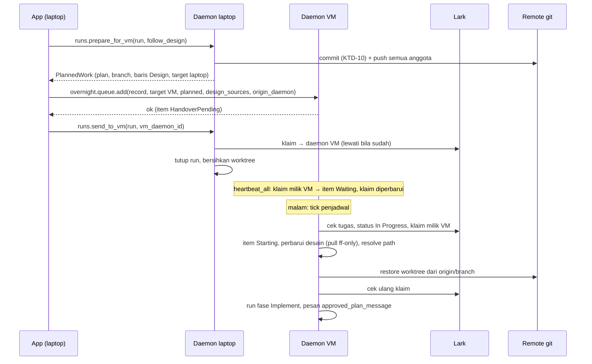
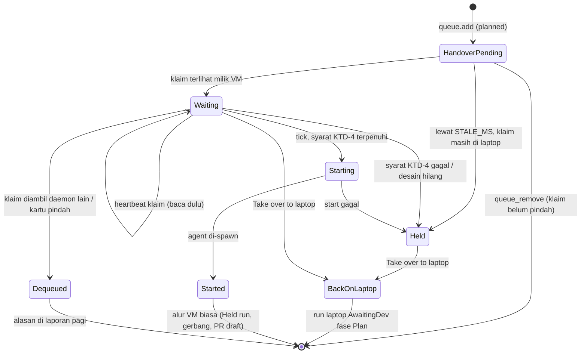

# Plan siang, lembur malam di VM - Plan

## Goal Capsule

- **Objective:** Developer bisa menyusun dan menyetujui plan kartu di laptop pada siang hari, lalu mengantrekan kartu itu ke VM untuk diimplementasikan malam hari. Mengantre langsung tanpa plan tetap bisa. Antrean VM juga bisa memakai sumber desain prototype milik VM.
- **Product authority:** keputusan pemilik produk di sesi 2026-10-30, termasuk keputusan atas review dokumen ronde pertama (workspace ikut, Follow design wajib punya desain VM, kartu Planned yang dikeluarkan tetap menyimpan plan). Melengkapi plan mode VM (`docs/plans/2026-10-23-002-feat-vm-overnight-mode-plan.md`): mengganti "VM selalu mulai tanpa plan" (KTD-57) untuk kartu Planned saja, menutup celah "antrean VM belum bisa memilih sumber desain" di `docs/progress/vm-overnight.md`, dan menambah Take over kartu workspace ke laptop.
- **Open blockers:** tidak ada.
- **Product Contract preservation:** Product Contract baru (bootstrap); tidak mengubah R-ID plan VM. Revisi setelah review ronde pertama: R11, R13 diubah; R14, R15 ditambah.
- **Execution profile:** test-first lewat antarmuka publik usecase dan store dengan fake yang ada; frontend dengan Vitest; uji langsung dengan kartu uji di Base salinan `Sv1NbPJh5aD7SesHvtGlmga8g2f` dan repo `mandor-smoke`.
- **Authority hierarchy:** `CLAUDE.md` (standar `rust-engineering` mengikat) > Product Contract > Planning Contract > unit.
- **Stop conditions:** berhenti dan tanya bila perilaku produk harus berubah, bila unit tidak bisa selesai tanpa melanggar `rust-engineering`, atau bila kartu grup ternyata harus ikut (itu U10 plan grup).
- **Tail ownership:** branch fitur dari `main`, PR ke `main`, tanpa merge sendiri.

---

## Product Contract

### Summary

Panel persetujuan plan di laptop mendapat tombol "Approve and queue for VM". Laptop mendorong branch kartu, mengirim plan yang disetujui, keputusan Follow design, dan sumber desain ke antrean VM, memindahkan klaim ke VM, lalu menutup run laptop. Malam hari VM memulihkan worktree dari branch dan memulai sesi baru yang langsung mengimplementasikan plan itu. Antrean menandai tiap kartu Planned atau No plan. VM punya daftar sumber desain sendiri yang dipilih saat mengantre; folder yang berupa repo git diperbarui sebelum kartu dimulai. Kartu Planned bisa ditarik kembali ke laptop kapan saja sebelum dimulai, termasuk kartu workspace.

### Problem Frame

Kartu lembur di VM dimulai tanpa tahap plan (`Planning::Skip`), jadi pengaman satu-satunya adalah gerbang akhir. Developer tidak bisa mengarahkan pendekatan agent sebelum kode ditulis semalaman, padahal plan yang salah arah baru ketahuan pagi harinya. Selain itu antrean VM tidak bisa memakai desain prototype, sehingga kartu UI dikerjakan tanpa acuan tampilan dan review AC tidak bisa menilai kesesuaian desain.

### Actors

- A1. Developer: menyusun plan siang hari di laptop, mengantre, membaca laporan pagi.
- A2. Daemon laptop: menjalankan sesi plan, mendorong branch, menyerahkan klaim.
- A3. Daemon VM: menyimpan antrean dan sumber desain, mengimplementasikan kartu malam hari.

### Requirements

**Plan lalu antre**
- R1. Saat plan menunggu persetujuan, developer bisa memilih "Approve and implement" (seperti sekarang) atau "Approve and queue for VM". Tombol kedua muncul bila VM terhubung dan run bukan run grup; run repo tunggal dan run workspace sama-sama didukung.
- R2. "Approve and queue for VM" membawa ke VM: teks plan, keputusan Follow design per AC beserta status Design dari tahap plan, target repo atau workspace di VM, branch kartu, dan sumber desain VM yang dipilih.
- R3. Perubahan worktree laptop yang sudah di-track dan berkas plan atau brainstorm baru yang ditulis skill di-commit dan di-push ke branch kartu sebelum klaim pindah. Berkas baru lain yang tidak di-ignore menahan pengiriman dan disebutkan ke developer.
- R4. Setelah antrean VM menerima kartu, klaim pindah ke daemon VM, run laptop ditutup, dan worktree laptop dibersihkan. Bila VM menolak, run laptop tetap di status plan menunggu persetujuan.
- R5. VM memulai kartu Planned dari branch yang di-push, dengan sesi baru yang langsung masuk fase implementasi plan yang disetujui; tidak ada tahap plan ulang di VM.
- R6. Mengantre langsung tanpa plan tetap bekerja seperti sekarang.

**Antrean**
- R7. Antrean menampilkan label Planned atau No plan per kartu, dan nama sumber desain yang dipilih.
- R8. Kartu Planned yang sudah diserahkan ke VM dan belum dimulai tidak bisa sekadar dikeluarkan dari antrean; aksinya "Take over to laptop", yang mengembalikan kartu ke laptop di status plan menunggu persetujuan dengan plan yang sama. Kartu ini boleh diantre lagi.
- R9. Selama kartu Planned menunggu di antrean, klaimnya tetap milik VM dan tidak basi.
- R15. Kartu Planned yang dikeluarkan VM tanpa dikerjakan (syarat mulai gagal, desain hilang) tetap menyimpan plan dan klaimnya di VM; laporan pagi menyebut alasannya dan menawarkan "Take over to laptop".

**Sumber desain VM**
- R10. Settings → VM punya daftar sumber desain milik VM (folder di VM), dengan tambah, ubah, hapus, dan tes path seperti daftar sumber desain laptop.
- R11. Saat mengantre (Planned maupun No plan), developer bisa memilih nol atau lebih sumber desain VM. Bila plan punya AC Follow design, minimal satu sumber desain VM wajib dipilih.
- R12. Sebelum kartu dimulai, sumber desain yang berupa repo git diperbarui (fast-forward saja). Bila pembaruan gagal, kartu tetap dimulai dengan salinan yang ada dan laporan pagi mencatat sumber desain yang tidak diperbarui beserta alasannya.
- R13. Sumber desain yang hilang atau tidak layak saat kartu dimulai mengeluarkan kartu dari antrean dengan alasan yang menyebut nama sumbernya; kartu Planned mengikuti R15.

**Take over**
- R14. "Take over to laptop" bekerja untuk kartu workspace, baik kartu yang sudah dikerjakan VM maupun kartu Planned yang menunggu.

### Acceptance Examples

- AE1. **Covers R1–R5.** Dev menyetujui plan PGS-X lewat "Approve and queue for VM" dengan Follow design pada satu AC dan satu sumber desain VM. Branch kartu berisi commit plan di remote, klaim di Lark menyebut daemon VM, run laptop tertutup. Malam itu VM memulai kartu tanpa giliran plan; pesan pertama agent berisi plan yang disetujui dan AC Follow design; buku AC di VM membawa status Design dari laptop.
- AE2. **Covers R4.** VM tidak terhubung atau menolak antrean saat tombol diklik. Pesan error tampil, run laptop tetap di "Plan · waiting for your approval", klaim tetap di laptop.
- AE3. **Covers R8.** Kartu Planned masih di antrean pukul 15:00; dev klik "Take over to laptop". Kartu keluar dari antrean, klaim kembali ke laptop, run laptop baru berstatus plan menunggu persetujuan dengan teks plan yang sama. "Approve and implement" memulai agent yang pesan pertamanya berisi plan itu.
- AE4. **Covers R9.** Kartu Planned menunggu enam jam di antrean; klaimnya tetap segar dan laptop dev lain tidak bisa mengambilnya.
- AE5. **Covers R11, R12.** Kartu No plan diantre dengan sumber desain `kelola-mock` (repo git privat). Sebelum kartu dimulai, VM melakukan pull fast-forward dengan kredensial `gh` daemon; agent menerima pesan desain dengan path di VM.
- AE6. **Covers R12.** Remote sumber desain tidak terjangkau. Kartu tetap dimulai dengan salinan lama; laporan pagi menulis "Design kelola-mock not updated: …".
- AE7. **Covers R13, R15.** Folder sumber desain dihapus dari VM sebelum malam. Kartu Planned keluar dari antrean dengan alasan "Design source "kelola-mock" is not available: …"; laporan pagi menawarkan Take over, dan Take over mengembalikan plan ke laptop.
- AE8. **Covers R11.** Plan punya AC Follow design dan dev belum memilih sumber desain VM. Tombol "Queue" nonaktif dengan keterangan; panggilan langsung ke VM juga ditolak.
- AE9. **Covers R14.** Kartu workspace (dua repo) yang dikerjakan VM semalam di-Take over. Laptop memulihkan folder run dan kedua worktree dari branch kartu; run laptop siap di `AwaitingDev`.
- AE10. **Covers R3.** Worktree laptop punya berkas baru `notes.txt` yang tidak di-ignore. "Approve and queue for VM" berhenti di langkah pertama dengan pesan yang menyebut `notes.txt`; tidak ada yang di-push.

### Scope Boundaries

- Run grup (beberapa kartu satu branch) tidak mendapat tombol "Approve and queue for VM"; grup di VM adalah U10 plan grup.
- VM tidak menyusun plan sendiri tanpa persetujuan; opsi itu tidak dibangun.
- Gerbang akhir di VM tidak berubah (selalu Block, KTD-61 plan VM).
- Laptop tidak mengirim isi folder desain ke VM; desain VM selalu folder di VM.

#### Deferred to Follow-Up Work

- Laporan pagi menghitung keputusan Decide AC sebagai pass (celah "AC 0 pass" di `docs/progress/vm-overnight.md`).
- Membatasi sumber desain VM ke satu direktori dasar yang diatur admin (usul review keamanan, FYI).

---

## Planning Contract

### Key Technical Decisions

- **KTD-1. App mengorkestrasi dua daemon dalam tiga langkah, seperti "Take over to laptop".** Daemon tidak saling memanggil; app memegang koneksi laptop dan VM (`apps/desktop/src/lib/stores/overnight.svelte.ts` `takeover`). (1) Laptop `runs.prepare_for_vm` commit dan push, mengembalikan paket plan; run tetap terbuka. (2) VM `overnight.queue.add` dengan paket, target VM, sumber desain, dan `daemon_id` laptop asal; item berstatus "handover pending". (3) Laptop `runs.send_to_vm` menyerahkan klaim ke daemon VM dan menutup run. Gagal di (1) tidak mengubah apa pun. Gagal di (2) membiarkan run laptop terbuka (R4), dengan commit plan yang sudah ter-push di branch kartu; ini aman karena run berikutnya memakai branch yang sama. Gagal di (3) meninggalkan item "handover pending"; app menawarkan "Retry handing over" atau "Remove from VM queue" (KTD-6).
- **KTD-2. Paket plan adalah tipe domain yang disimpan di antrean VM.** `PlannedWork` berisi teks plan, branch, baris Design per AC (`ac_id`, `design`, `design_note`, follow design), dan id sumber desain laptop (untuk dipulihkan saat Take over). `QueueItem` mendapat `planned: Option<PlannedWork>`, `design_sources: Vec<String>`, `origin_daemon: Option<String>`, dan status item Planned (`HandoverPending`, `Waiting`, `Starting`, `Held` untuk kartu yang dikeluarkan tapi tetap menyimpan plan). Migrasi baru menambah kolom di `overnight_queue`; baris lama berarti No plan tanpa desain. Item `Held` tidak ikut tick mulai tetapi tetap tampil di laporan pagi.
- **KTD-3. VM memulai kartu Planned lewat jalur Start baru, bukan `start_planned`.** `start_planned` mengklaim kartu To Do dan membuat branch baru. Kartu Planned sudah In Progress, klaimnya milik VM, dan branch-nya ada di remote. Jalur baru menandai item `Starting`, memulihkan worktree tiap anggota dari branch remote (pola `restore_missing` di `run/members.rs`; branch lokal yang tertinggal di-reset ke `origin/<branch>`), membuat run fase `Implement`, mengisi buku AC dari Lark lalu menimpa kolom Design dari paket (baris untuk AC yang sudah hilang diabaikan), dan mengirim pesan baru `approved_plan_message` (tugas, AC, plan, AC Follow design) ditambah pesan desain bila ada. Klaim dicek ulang tepat sebelum agent di-spawn.
- **KTD-4. Syarat mulai kartu Planned di VM:** status item `Waiting`, kartu masih ditugaskan ke dev, status Lark In Progress, dan klaim dipegang daemon VM ini. Bila gagal, item menjadi `Held` dengan alasan (R15). `check_start` (To Do saja) tetap untuk No plan.
- **KTD-5. Heartbeat klaim item Planned di jadwal `heartbeat_all` (5 menit), bukan tick 30 detik.** Item `HandoverPending` tidak di-heartbeat dan tidak dikeluarkan selama klaim dipegang `origin_daemon` dan umur item di bawah `STALE_MS`; setelah itu menjadi `Held` dengan alasan "the claim is still on the laptop". Item `Waiting` dan `Held` di-heartbeat dengan baca-dulu: tulis hanya bila klaim masih dipegang VM dan belum basi. Klaim yang sudah dipegang daemon lain, kartu yang tidak lagi ditugaskan ke dev, atau kartu yang keluar dari In Progress mengeluarkan item dengan alasan dan tidak menulis klaim. Dispatch `overnight.queue.add` tetap memicu tick; item `HandoverPending` dilewati tick.
- **KTD-6. Keluar dari antrean untuk item Planned.** `queue_remove` mengizinkan item `HandoverPending` (klaim belum pernah pindah) dan menolak item yang klaimnya sudah di VM dengan pesan untuk memakai Take over. `runs.handoff` di VM menangani item `Waiting` dan `Held` tanpa run: menolak item `Starting`, mengeluarkan item, menyerahkan klaim ke daemon laptop, dan mengembalikan branch, target, beserta paket plan, tanpa menandai "hanya laptop". `runs.send_to_vm` idempoten: bila klaim sudah dipegang daemon VM tujuan, ia melewati `hand_over_claim` dan menyelesaikan penutupan run.
- **KTD-7. Sumber desain VM memakai RPC `design_sources.*` yang sudah ada di daemon VM.** Daftar sumber desain disimpan per daemon, jadi UI cukup memanggil RPC yang sama lewat koneksi VM; `DesignSourceSettings` dan `FolderBrowser` sudah menerima `rpc`. Tidak ada tabel baru.
- **KTD-8. Resolusi dan pembaruan desain lewat port `DesignPort`, adapter di `mandord`, pull di `mandor-git`.** Penjadwal VM butuh resolusi saat tick, jadi port di bundel `Deps` menyediakan "perbarui bila repo git" dan "resolve id → `DesignRoot` atau alasan". Adapter di `mandord` membaca baris `design_sources` dari store, memakai `probe` yang ada, dan mendelegasikan pull ke method baru pada tipe `Git` di `mandor-git`. Method itu mewarisi konfigurasi git yang diperketat (KTD-65 plan VM: `GIT_CONFIG_NOSYSTEM`, hook mati, `core.fsmonitor` mati, `protocol.ext.allow=never`, penolakan konfigurasi repo yang mengeksekusi), kredensial `gh_active_token` seperti `fetch`, dan `NETWORK_TIMEOUT`. Pull = fetch lalu `merge --ff-only`, hanya untuk folder yang `.git`-nya dimiliki user daemon. Kegagalan pull (alasan tanpa URL remote) dicatat di field baru `RunRecord` untuk laporan pagi (R12).
- **KTD-9. Run grup dikecualikan di dua sisi.** `prepare_for_vm` menolak run grup, UI tidak menampilkan tombolnya, dan VM menolak paket berisi kartu grup.
- **KTD-10. Cakupan commit `prepare_for_vm`.** Yang di-commit: perubahan berkas yang sudah di-track dan berkas baru di `docs/plans/` atau `docs/brainstorms/`. Berkas baru lain yang tidak di-ignore membuat langkah (1) gagal dengan daftar berkas; tidak ada yang di-commit atau di-push. Semua anggota workspace di-push walau tanpa commit baru, supaya branch tiap repo ada di remote untuk dipulihkan VM.
- **KTD-11. Target dan referensi divalidasi di VM.** App memilih target dari daftar repo dan workspace VM (default: id yang sama dengan target laptop). `queue_add` menolak target yang tidak terdaftar di VM, branch yang bukan nama branch turunan kartu (`branch_name` di `crates/mandor-domain/src/run.rs`), paket berisi AC Follow design tanpa sumber desain (R11), dan id sumber desain yang tidak dikenal. App mengambil `daemon_id` VM dari status koneksi VM untuk langkah (3).
- **KTD-12. `runs.takeover` di laptop mendukung workspace dan paket plan.** Target Take over dipilih app dari daftar laptop (default: id yang sama dengan target VM). Untuk workspace, laptop memulihkan folder run (`group_name`) dan worktree tiap anggota dari branch, seperti `restore_missing`. Dengan paket plan, run baru berstatus `AwaitingDev` fase `Plan`: buku AC diisi dari Lark lalu ditimpa baris Design paket, teks plan disimpan, dan sumber desain laptop di paket di-resolve ulang ke `run.design` (sumber yang hilang dilewati dengan catatan chat). `approve_plan` pada run yang sesinya belum pernah dimulai mengirim `approved_plan_message`, bukan `approve_message`.

### High-Level Technical Design

Alur "Approve and queue for VM" dan malam harinya:

State item antrean Planned:

### Sequencing

U1 → (U2, U3, U9) → U4 → U5 → U6 → U7 → U8. U9 hanya bergantung pada U1 dan bisa dikerjakan paralel dengan U2–U3.

### Assumptions

- Status kartu di Lark sudah In Progress sejak Start laptop (`run/start.rs`). Bila tulisan status itu masih tertunda di outbox, KTD-4 menahan kartu (`Held`) dengan alasan, bukan menulis transisi sendiri.
- App bisa mendapatkan `daemon_id` VM dari koneksi VM, sama seperti `daemon_id` laptop untuk Take over.

---

## Implementation Units

### U1. Tipe domain kartu Planned

- **Goal:** Tipe `PlannedWork`, status item Planned, dan aturan syarat mulai serta heartbeat sebagai fungsi murni.
- **Requirements:** R2, R5, R9, R15, KTD-2, KTD-4, KTD-5.
- **Dependencies:** -
- **Files:**
  - `crates/mandor-domain/src/planned.rs` (baru), `crates/mandor-domain/src/lib.rs`
- **Approach:** `PlannedWork` (plan, branch, baris Design, id desain laptop) dan enum status item. `check_planned_start(task, me)` mengembalikan alasan berbahasa Inggris bila kartu tidak lagi ditugaskan, bukan In Progress, atau klaim bukan milik daemon ini. `planned_claim_action(item, task, me, now)` memutuskan untuk item Planned: tunggu (handover pending), perbarui klaim, tahan dengan alasan, atau keluarkan dengan alasan.
- **Patterns to follow:** `check_start` di `crates/mandor-domain/src/gate.rs`; `may_claim` dan `is_stale` di `crates/mandor-domain/src/claim.rs`.
- **Test scenarios:**
  - Kartu In Progress, ditugaskan ke dev, klaim milik VM → boleh mulai.
  - Kartu kembali ke To Do atau pindah ke Waiting Review → alasan menyebut status baru.
  - Klaim milik daemon laptop dev sendiri → alasan "the claim is still on the laptop".
  - Kartu ditugaskan ke orang lain → alasan "no longer assigned to you".
  - Item `HandoverPending`, klaim dipegang `origin_daemon`, umur di bawah `STALE_MS` → tunggu; umur di atas → tahan dengan alasan klaim.
  - Item `Waiting`, klaim milik VM dan segar → perbarui; klaim dipegang daemon lain → keluarkan tanpa menulis.
- **Verification:** test domain lulus tanpa dependensi I/O baru.

### U2. Antrean menyimpan paket plan, status, dan sumber desain

- **Goal:** `QueueItem` membawa paket, status, `origin_daemon`, dan `design_sources`, tersimpan di SQLite.
- **Requirements:** R2, R7, R11, R15, KTD-2.
- **Dependencies:** U1.
- **Files:**
  - `crates/mandor-usecase/src/overnight/ports.rs`
  - `crates/mandor-store/migrations/0008_overnight_planned.sql` (baru)
  - `crates/mandor-store/src/overnight.rs`, `.sqlx` diperbarui
  - `crates/mandor-store/tests/overnight.rs`
- **Approach:** kolom `planned_json`, `design_json`, `origin_daemon`, dan `planned_state` (nullable) di `overnight_queue`. Port mendapat operasi ubah status item dan baca item `Held`. JSON rusak dibaca sebagai error penyimpanan, bukan No plan diam-diam.
- **Test scenarios:**
  - Enqueue item Planned dengan dua sumber desain lalu baca ulang → sama persis.
  - Baris lama tanpa kolom baru → `planned` kosong, `design_sources` kosong.
  - Ubah status `HandoverPending` → `Waiting` → `Held` tersimpan; item `Held` tidak ikut daftar kandidat mulai tetapi muncul di daftar laporan.
  - Reorder dan dequeue tetap bekerja untuk item Planned.
  - JSON rusak di kolom → error penyimpanan.
- **Verification:** test store lulus; cek `sqlx` offline hijau.

### U3. Laptop: siapkan dan kirim kartu ke VM

- **Goal:** `prepare_for_vm` dan `send_to_vm` di `RunService` laptop.
- **Requirements:** R1–R4, KTD-1, KTD-6, KTD-9, KTD-10.
- **Dependencies:** U1.
- **Files:**
  - `crates/mandor-usecase/src/run/send_to_vm.rs` (baru), `crates/mandor-usecase/src/run/mod.rs`
  - `crates/mandor-usecase/src/run_ports.rs` (operasi git untuk daftar berkas baru dan commit terpilih, bila belum ada)
  - `crates/mandor-git/src/` (implementasi operasi git tersebut)
  - `crates/mandor-usecase/tests/send_to_vm.rs` (baru)
- **Approach:** `prepare_for_vm(run_id, follow_design)` mensyaratkan `AwaitingDev`, fase `Plan`, plan ada, bukan run grup, bukan peran VM. Ia menyimpan pilihan Follow design ke buku AC (logika `approve_plan` tanpa menulis DesignGaps ke Lark), memeriksa berkas baru (KTD-10), commit dengan pesan "`<KEY>`: approved plan", lalu push semua anggota dan mengembalikan `PlannedWork` beserta target laptop. `send_to_vm(run_id, vm_daemon)` menyerahkan klaim (atau melewatinya bila sudah di VM tujuan), menulis item chat sistem, menutup run, dan membuang worktree laptop (branch remote tetap).
- **Execution note:** mulai dari test usecase gagal untuk urutan push sebelum klaim.
- **Patterns to follow:** `crates/mandor-usecase/src/overnight/handoff.rs` (commit, push, serah klaim, tutup run); `follow_design_rows` di `run/session.rs`.
- **Test scenarios:**
  - Covers AE1. Run plan menunggu persetujuan dengan berkas plan baru di `docs/plans/` → commit dan push terjadi, paket berisi plan, branch, dan baris Follow design.
  - Covers AE10. Berkas baru `notes.txt` yang tidak di-ignore → error menyebut `notes.txt`, tidak ada commit atau push.
  - Run workspace dengan perubahan di satu anggota saja → kedua anggota di-push.
  - Push gagal → error, klaim tidak berubah, run tetap `AwaitingDev` fase Plan.
  - Run fase Implement, run grup, atau run tanpa plan → `InvalidState`.
  - `send_to_vm` → klaim menyebut daemon VM, run tertutup, worktree dibuang, chat berisi "Queued for the VM".
  - `send_to_vm` diulang setelah klaim sudah pindah tetapi run belum tertutup → run tertutup tanpa error.
  - Covers AE2. `prepare_for_vm` sukses tapi `send_to_vm` tidak dipanggil → run laptop masih bisa "Approve and implement".
- **Verification:** `crates/mandor-usecase/tests/send_to_vm.rs` lulus.

### U4. VM: terima, jaga, mulai, dan kembalikan kartu Planned

- **Goal:** Antrean VM menerima item Planned, menjaga klaimnya, memulainya dari branch, dan mengembalikannya ke laptop.
- **Requirements:** R5, R8, R9, R15, KTD-3, KTD-4, KTD-5, KTD-6, KTD-11.
- **Dependencies:** U1, U2.
- **Files:**
  - `crates/mandor-usecase/src/overnight/mod.rs`, `crates/mandor-usecase/src/overnight/flow.rs`, `crates/mandor-usecase/src/overnight/handoff.rs`, `crates/mandor-usecase/src/overnight/report.rs`
  - `crates/mandor-usecase/src/run/start.rs` (jalur mulai dari paket), `crates/mandor-usecase/src/run/ownership.rs` (`heartbeat_all` untuk item Planned)
  - `crates/mandor-usecase/src/run_ports.rs` (`approved_plan_message` di port prompt), adapter prompt di `crates/mandor-agent`
  - `crates/mandor-usecase/tests/overnight.rs`, `crates/mandor-usecase/tests/handoff.rs`
- **Approach:** `queue_add` dengan paket melewati `check_start` (kartu sudah In Progress), memvalidasi sesuai KTD-11, dan menyimpan item `HandoverPending`. Tick melewati item `HandoverPending`; `heartbeat_all` menjalankan `planned_claim_action` untuk tiap item Planned. `try_start` memakai `check_planned_start`, menandai `Starting`, lalu jalur mulai KTD-3; kegagalan menjadikan item `Held`. Bila VM restart setelah run dibuat tetapi sebelum pesan pertama terkirim, giliran berikutnya mengirim ulang `approved_plan_message`, bukan pesan lanjutan umum. `handoff` dan `queue_remove` mengikuti KTD-6. Laporan pagi memuat item `Held` dengan alasan dan aksi Take over.
- **Patterns to follow:** `try_start` dan `start_queued` di `overnight/mod.rs`; `restore_missing` di `run/members.rs`; `init_ledger` dan `with_design` di `run/start.rs`.
- **Test scenarios:**
  - Covers AE1. Item `Waiting` yang syaratnya terpenuhi → worktree dipulihkan dari branch remote, run fase Implement, pesan pertama `approved_plan_message` berisi plan dan AC Follow design, baris Design di buku AC sama dengan paket.
  - `queue_add` lalu tick langsung, klaim masih di laptop asal → item tetap `HandoverPending`, tidak di-heartbeat, tidak dikeluarkan.
  - Item `HandoverPending` lewat `STALE_MS` → `Held` dengan alasan klaim.
  - `queue_remove` item `HandoverPending` → item hilang; `queue_remove` item `Waiting` → `InvalidState` dengan pesan Take over.
  - Covers AE4. Enam jam waktu palsu berjalan → klaim item `Waiting` diperbarui sebelum basi.
  - Daemon lain mengambil klaim saat VM mati lebih dari `STALE_MS` → heartbeat VM tidak menulis klaim, item dikeluarkan dengan alasan.
  - Covers AE7. Syarat KTD-4 gagal → item `Held` dengan paket dan klaim tetap; laporan pagi menyebut alasan.
  - Covers AE3. `handoff` item `Waiting` atau `Held` tanpa run → item keluar, klaim ke daemon laptop, paket dan target dikembalikan, kartu tidak "hanya laptop".
  - `handoff` item `Starting` → ditolak.
  - Klaim hilang di antara restore worktree dan spawn → agent tidak di-spawn, item `Held`.
  - `queue_add` dengan target tak terdaftar, branch yang bukan turunan kartu, atau Follow design tanpa sumber desain → ditolak dengan pesan bernama.
  - Item No plan tetap memakai `start_planned` dengan `Planning::Skip` (regresi).
- **Verification:** `crates/mandor-usecase/tests/overnight.rs` dan `handoff.rs` lulus; test VM yang ada tetap hijau.

### U5. Sumber desain di antrean VM

- **Goal:** Port `DesignPort`, pull git yang diperketat, dan pemakaiannya saat kartu antrean mulai.
- **Requirements:** R11–R13, KTD-7, KTD-8.
- **Dependencies:** U2, U4.
- **Files:**
  - `crates/mandor-usecase/src/ports.rs` (port di `Deps`), `crates/mandor-usecase/src/overnight/mod.rs`, `crates/mandor-usecase/src/overnight/report.rs`, `crates/mandor-usecase/src/run_ports.rs` (field catatan desain di `RunRecord`)
  - `crates/mandor-store/src/run_port.rs` (simpan field catatan)
  - `crates/mandord/src/design_port.rs` (baru, adapter), `crates/mandord/src/dispatch/design.rs` (memakai adapter yang sama)
  - `crates/mandor-git/src/` (method pull desain di tipe `Git`)
  - `crates/mandor-usecase/tests/overnight.rs`, test `mandor-git` dengan repo sementara (`tempfile`)
- **Approach:** sebelum mulai (Planned maupun No plan), penjadwal meminta port memperbarui lalu me-resolve sumber pilihan. Resolve gagal: No plan dikeluarkan dengan alasan bernama (R13), Planned menjadi `Held` (R15). Pull gagal dicatat di `RunRecord` dan tampil sebagai catatan kartu di laporan pagi (R12). Alasan kegagalan tidak memuat URL remote.
- **Patterns to follow:** `design_roots` dan `probe` di `crates/mandord/src/dispatch/design.rs`; `fetch` dan `distrusts_repo_config` di `crates/mandor-git`.
- **Test scenarios:**
  - Covers AE5. Item dengan sumber repo git yang tertinggal satu commit → fetch dan fast-forward, agent menerima pesan desain dengan path kanonik VM.
  - Covers AE6. Remote tidak terjangkau → kartu tetap mulai, laporan pagi memuat "Design <name> not updated: <alasan>" tanpa URL.
  - Covers AE7. Folder sumber dihapus → No plan keluar dengan alasan bernama; Planned menjadi `Held`.
  - Folder biasa (bukan repo git) → tidak ada pull, langsung dipakai.
  - Repo dengan perubahan lokal yang tidak bisa fast-forward → pull gagal, tidak ada merge.
  - Repo yang konfigurasinya memuat hook, `core.fsmonitor`, atau remote `ext::` → pull ditolak, tidak ada perintah yang dieksekusi.
  - `.git` tidak dimiliki user daemon → pull dilewati dengan catatan.
  - Pull melewati timeout → dibatalkan, dicatat sebagai gagal.
- **Verification:** test usecase dan `mandor-git` lulus; tidak ada proses blocking di thread async.

### U9. Take over ke laptop: workspace dan paket plan

- **Goal:** `runs.takeover` di laptop memulihkan kartu workspace dan kartu Planned.
- **Requirements:** R8, R14, KTD-12.
- **Dependencies:** U1.
- **Files:**
  - `crates/mandor-usecase/src/run/ownership.rs` (`takeover`), `crates/mandor-usecase/src/run/session.rs` (`approve_plan` untuk sesi yang belum dimulai)
  - `crates/mandor-usecase/tests/handoff.rs`, `crates/mandor-usecase/tests/plan_flow.rs`
- **Approach:** `takeover` menerima `StartTarget` (repo atau workspace laptop) dan paket opsional. Untuk workspace, folder run dan worktree tiap anggota dipulihkan dari branch dan dicatat di `run.workspace` dan `run.extra`. Dengan paket, lihat KTD-12.
- **Patterns to follow:** `restore_missing` dan `group_of` di `run/members.rs`; `group_name` di `run/members.rs`.
- **Test scenarios:**
  - Covers AE9. Take over kartu workspace dua repo → folder run dan dua worktree dipulihkan, run `AwaitingDev` dengan anggota lengkap.
  - Covers AE3. Take over dengan paket → run `AwaitingDev` fase Plan, teks plan sama, baris Design sesuai paket; `approve_plan` → pesan pertama berisi plan, tugas, dan AC Follow design.
  - Sumber desain laptop di paket sudah dihapus → Take over tetap berhasil, chat mencatat sumber yang dilewati.
  - Take over repo tunggal tanpa paket tetap seperti sekarang (regresi).
- **Verification:** test usecase lulus.

### U6. Protokol dan RPC

- **Goal:** DTO dan method untuk alur baru, TS diregenerasi.
- **Requirements:** R1–R15.
- **Dependencies:** U3, U4, U5, U9.
- **Files:**
  - `crates/mandor-protocol/src/lib.rs` (`runs.prepare_for_vm`, `runs.send_to_vm`), `crates/mandor-protocol/src/dto.rs`
  - `crates/mandord/src/dispatch/` (run, overnight)
  - `apps/desktop/src/lib/protocol/*.ts` (generated)
  - `crates/mandord/tests/daemon.rs`
- **Approach:** `QueueAddParams` mendapat `planned`, `design_sources`, dan `origin_daemon` opsional; view item antrean mendapat status Planned dan nama sumber desain; `HandoffResult` membawa target dan paket opsional; `runs.takeover` menerima target workspace dan paket opsional. `runs.prepare_for_vm` dan `runs.send_to_vm` ditolak di daemon VM. Satu envelope JSON-RPC yang sama dengan method lain.
- **Test scenarios:**
  - `runs.prepare_for_vm` di daemon VM → error peran.
  - `overnight.queue.add` dengan id sumber desain yang tidak dikenal → ditolak dengan pesan bernama.
  - Round-trip DTO paket plan lewat serde sama persis.
- **Verification:** test daemon lulus; TS protokol sinkron dengan Rust.

### U7. UI: tombol antre, antrean, Take over, dan desain VM

- **Goal:** Developer bisa memakai alur dari app.
- **Requirements:** R1, R4, R7, R8, R10, R11, R14, R15.
- **Dependencies:** U6.
- **Files:**
  - `docs/design/mandor-design/mandor-design-handoff/prototype/` diperbarui dulu dengan layar: panel plan dengan dua tombol; popover antre (daftar desain kosong dan berisi, peringatan Follow design); kegagalan langkah 3; antrean berisi baris Planned dan No plan; Settings → VM saat VM offline
  - `apps/desktop/src/lib/components/workspace/PlanApproval.svelte`, `apps/desktop/src/lib/components/workspace/Workspace.svelte`
  - `apps/desktop/src/lib/components/overnight/QueueSection.svelte`, `apps/desktop/src/lib/components/overnight/ReportSection.svelte`
  - `apps/desktop/src/lib/components/settings/VmSettings.svelte` (memakai `DesignSourceSettings` dengan RPC VM)
  - `apps/desktop/src/lib/stores/overnight.svelte.ts` (orkestrasi KTD-1, Take over dengan paket dan workspace)
  - test Vitest di samping komponen dan store
- **Approach:**
  - **Panel plan:** "Approve and queue for VM" membuka popover di tombol berisi pemilih target VM (default id yang sama), checkbox sumber desain VM (nama sumber laptop ditampilkan sebagai acuan), keadaan kosong yang menautkan ke Settings → VM, dan tombol "Queue". "Queue" nonaktif dengan keterangan bila ada AC Follow design dan belum ada desain VM dipilih (R11). Pilihan Follow design dipakai bersama oleh kedua tombol approve.
  - **Status tiga langkah:** idle → "Pushing the branch…" → "Adding to the VM queue…" → "Handing over the card…" → selesai (run ditutup, kartu tampil di antrean). Kedua tombol nonaktif selama berjalan. Kegagalan langkah 1 dan 2 menampilkan pesan di panel dan run tetap terbuka.
  - **Langkah 3 gagal:** baris antrean diberi tanda "Claim not moved" dengan aksi "Retry handing over" dan "Remove from VM queue", sehingga tetap bisa dipulihkan setelah app dimuat ulang. Retry membaca ulang antrean VM lebih dulu dan berhenti bila item sudah tidak ada.
  - **Baris antrean:** badge Planned / No plan di samping kunci kartu dan nama desain. Baris Planned tetap punya Move up, Move down, dan Start now (nonaktif dengan tooltip selama "Claim not moved"). Tombol X diganti tombol berlabel "Take over to laptop" dengan langkah konfirmasi.
  - **Laporan pagi:** kartu Planned `Held` tampil dengan alasan dan "Take over to laptop".
  - **Settings → VM:** bagian berjudul "Design sources on the VM", nonaktif dengan pesan "VM not connected" saat offline. Keadaan kosong menjelaskan bahwa path adalah folder di VM, bukan laptop ini.
  - **Take over:** target laptop dipilih dari daftar laptop (default id yang sama), termasuk workspace.
- **Test scenarios:**
  - Tombol tersembunyi untuk run grup dan bila VM tidak terhubung.
  - Covers AE8. Ada AC Follow design tanpa desain VM dipilih → "Queue" nonaktif dengan keterangan.
  - Covers AE2. Langkah 2 ditolak → pesan error, `runs.send_to_vm` tidak dipanggil, run tetap terbuka.
  - Langkah 3 gagal → baris "Claim not moved" dengan Retry dan Remove; Retry yang menemukan item hilang berhenti dengan pesan.
  - Antrean merender Planned dan No plan dengan nama desain; baris Planned punya "Take over to laptop", bukan X.
  - Laporan pagi merender kartu Planned `Held` dengan aksi Take over.
  - Settings → VM memanggil `design_sources.list` lewat koneksi VM; saat VM offline bagian itu nonaktif.
- **Verification:** `bun run --cwd apps/desktop check` dan `test` lulus; tampilan dicek di app dev terhadap prototype.

### U8. Runbook, progres, dan uji langsung

- **Goal:** Dokumentasi dan bukti di VM sungguhan.
- **Requirements:** semua AE.
- **Dependencies:** U7.
- **Files:**
  - `docs/runbook/setup-vm.md` (sumber desain di VM: folder dimiliki user dev, hanya bisa dibaca grup `<dev>-agent`), `docs/progress/vm-overnight.md`
  - `mandor-web` `src/app/docs/overnight/page.mdx` menyusul di repo situs (di luar repo ini)
- **Approach:** jalankan AE1–AE10 dengan kartu uji di Base salinan dan repo `mandor-smoke`; catat hasil di progres. Biner VM dipasang sendiri oleh pemilik produk.
- **Test expectation:** none -- dokumentasi dan uji manual.
- **Verification:** AE1–AE10 tercatat lulus di `docs/progress/vm-overnight.md`.

---

## Verification Contract

- `make check` hijau (fmt, clippy pedantic, deny, test, coverage, `sqlx` offline).
- `bun run --cwd apps/desktop check` dan `bun run --cwd apps/desktop test`.
- Test baru: `crates/mandor-usecase/tests/send_to_vm.rs`; test bertambah di `overnight.rs`, `handoff.rs`, `plan_flow.rs`, `crates/mandor-store/tests/overnight.rs`, test `mandor-git`, `crates/mandord/tests/daemon.rs`.
- TS protokol diregenerasi dan sinkron.
- Uji langsung AE1–AE10 tercatat (U8).

## Definition of Done

- U1–U9 selesai dengan skenario test terpenuhi dan semua gerbang hijau.
- Checklist "Before you finish any change" skill `rust-engineering` terpenuhi: tidak ada `unwrap`/`expect` di jalur produksi, setiap I/O baru (pull, push, Lark) ber-timeout, tidak ada lock `std` melewati `.await`.
- Alur No plan dan Take over kartu repo tunggal yang sudah dikerjakan VM tidak berubah (test regresi lulus).
- Tidak ada kode percobaan yang tertinggal di diff.
- PR ke `main` dibuka tanpa merge sendiri.

---

## Appendix

### Risks

- **Orkestrasi tiga langkah lintas daemon.** Mitigasi: status `HandoverPending` dengan batas `STALE_MS`, `send_to_vm` idempoten, dan Remove yang diizinkan selama klaim belum pindah (KTD-1, KTD-5, KTD-6).
- **Plan basi:** branch `main` bergerak antara siang dan malam. Agent memulai dari branch kartu tanpa rebase, sama seperti kartu yang diambil alih; gerbang akhir tetap menilai hasilnya.
- **Pull desain memakai kredensial git daemon VM.** Mitigasi: konfigurasi git yang diperketat (KTD-65 plan VM), fast-forward saja, ber-timeout, hanya `.git` milik user daemon; agent membaca desain lewat aturan akar desain di hook (`crates/mandor-domain/src/hook.rs`) dan izin folder dari runbook.
- **Plan yang disetujui menjadi instruksi agent tanpa pengawasan.** Mitigasi: plan dibaca dan disetujui developer, dan gerbang akhir VM selalu Block.
- **Follow design dinilai terhadap desain laptop, dikerjakan dengan desain VM.** Mitigasi: popover menampilkan nama sumber laptop sebagai acuan saat memilih desain VM.

### Sources

- Antrean dan mulai kartu VM: `crates/mandor-usecase/src/overnight/mod.rs` (`try_start`, `queue_add`); poke tick di `crates/mandord/src/dispatch/overnight.rs`.
- Serah-terima VM → laptop: `crates/mandor-usecase/src/overnight/handoff.rs`, `crates/mandor-usecase/src/run/ownership.rs` (`takeover`), `apps/desktop/src/lib/stores/overnight.svelte.ts` (`takeover`).
- Pemulihan worktree workspace: `crates/mandor-usecase/src/run/members.rs` (`restore_missing`, `group_of`), `crates/mandor-usecase/src/run/start.rs` (`prepare_and_spawn`); `group_name` di `run/members.rs`; `branch_name` di `crates/mandor-domain/src/run.rs`.
- Persetujuan plan: `crates/mandor-usecase/src/run/session.rs` (`approve_plan`, `follow_design_rows`).
- Klaim dan masa basi: `crates/mandor-domain/src/claim.rs` (`HEARTBEAT_MS`, `STALE_MS`), `crates/mandor-usecase/src/sync/claim.rs` (`hand_over_claim`).
- Sumber desain: `crates/mandord/src/dispatch/design.rs`, `apps/desktop/src/lib/components/settings/DesignSourceSettings.svelte`.
- Git yang diperketat di VM: KTD-65 di `docs/plans/2026-10-23-002-feat-vm-overnight-mode-plan.md`, `crates/mandor-git`.
