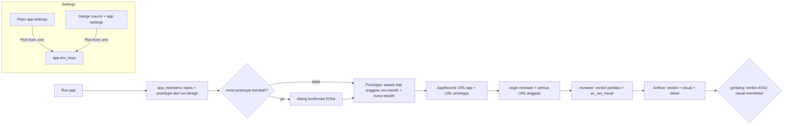

# Pick from .env dan perbandingan tampilan dengan prototype - Plan

## Goal Capsule

- **Objective:** Dev memilih kunci `.env` untuk Run app dari daftar nama kunci, bukan mengetik satu per satu. Reviewer AC menilai tampilan app run terhadap prototype yang dinyalakan Mandor, dan hasilnya ikut gerbang.
- **Product authority:** pemilik produk, 2026-11-03, saat menyiapkan Run app untuk workspace kelola-v2 (kelola-api dan kelola-web) dengan desain dari `kelola-web-prototype` (Next.js, branch `prototype` repo kelola-web). Keputusan: pembanding reviewer AI dan dev; perbedaan ikut gerbang dan diukur; prototype menyala ikut Run app; berlaku di laptop dan VM; standar "visual dekat"; baris Conflicts/Missing dinilai dari AC; Accept difference memakai keputusan per baris Rilis 2; prototype yang berubah perlu konfirmasi; tanpa sumber desain yang bisa dijalankan, tidak ada perbandingan tampilan.
- **Open blockers:** tidak ada.
- **Builds on:** `docs/plans/2026-10-21-003-feat-ac-review-plan.md` (Rilis 2: buku AC, sumber desain folder, Run app R24–R27, gerbang, keputusan per baris, uji browser), `docs/plans/2026-10-23-002-feat-vm-overnight-mode-plan.md` (review headless KTD-64, rentang port per developer).
- **Phasing:** Pick from .env untuk setelan app repo (R1–R5; bagian sumber desain dari R5 di U2) tidak bergantung pada bagian lain dan dikirim lebih dulu sebagai fase pertama (U1).
- **Product Contract preservation:** changed: R9 (diperjelas: Run app tidak menjalankan pull; pembaruan folder desain sebelum kartu VM dari plan 2026-10-30-001 KTD-8 tetap berlaku), R21 (screenshot hanya tersimpan untuk run VM; di laptop disimpan link halaman dan deskripsi perbedaan, keputusan pemilik produk 2026-11-03 karena screenshot Claude in Chrome tidak bisa disimpan), R26 (mengikuti R21), R28 (prototype VM hanya menyala pada revisi yang dikonfirmasi dev, keputusan pemilik produk 2026-11-03), R7 (host URL prototype harus berbeda dari host app agar cookie login app tidak terkirim ke prototype), R25 (Push anyway pada baris yang gagal perilaku melepas seluruh baris).
- **Execution profile:** test-first lewat antarmuka publik (domain, usecase dengan fake, store, dispatch); frontend Vitest; uji langsung di laptop dengan workspace kelola-v2 dan `kelola-web-prototype`, lalu di VM.
- **Authority hierarchy:** `CLAUDE.md` (standar `rust-engineering` mengikat) > Product Contract > Planning Contract > unit.
- **Stop conditions:** berhenti dan tanya bila perilaku produk harus berubah, atau bila unit tidak bisa selesai tanpa melanggar `rust-engineering`.
- **Tail ownership:** branch fitur per fase (U1 sendiri, lalu U2–U8), PR ke `main`, tanpa merge sendiri.

---

## Product Contract

### Summary

Settings → Repos mendapat tombol "Pick from .env" yang menampilkan nama kunci dari `.env` repo asli untuk dicentang.
Sumber desain jenis folder bisa diberi setelan app sehingga Run app menyalakan prototype bersama app run.
Reviewer AC lalu membandingkan halaman app dengan halaman prototype per baris AC, dan dev bisa membuka kedua halaman itu untuk mengecek sendiri.

### Problem Frame

Run app hanya meneruskan kunci `.env` yang tercantum di setelan repo, dan nama kunci harus diketik satu per satu. Untuk kelola-api yang punya sekitar 30 kunci, ini lambat dan rawan salah ketik.

Sumber desain saat ini hanya dibaca sebagai kode. Agent menilai per AC apakah perilaku ada di desain, tapi tidak ada yang memastikan tampilan hasil run mirip prototype. Tim kelola membangun prototype sebagai app Next.js yang bisa dijalankan, jadi perbedaan tampilan baru ketahuan saat reviewer manusia atau QA membuka keduanya.

### Key Decisions

- **Hanya nama kunci yang dibaca untuk dipilih.** Nilai `.env` tetap tidak ditampilkan, tidak disimpan, dan tidak disalin, sesuai R25/R25a Rilis 2. Upload file `.env` ditolak karena menyimpan nilai di Mandor.
- **Perbedaan tampilan ikut gerbang, dan akurasinya diukur.** Baris yang tampilannya berbeda dari prototype gagal, mengikuti gate mode (Block/Warn), dan masuk putaran perbaikan agent seperti AC gagal lainnya. Porsi gagal visual yang diterima dev dipantau (lihat Success Criteria).
- **Standar "visual dekat" pada viewport yang sama.** Susunan, komponen, teks UI, warna, tipografi, dan jarak harus tampak sama di screenshot berdampingan pada viewport desktop yang sama. Isi data diabaikan karena prototype memakai data demo dan app run memakai database lokal.
- **AC menang atas desain.** Perbandingan tampilan hanya mencakup bagian yang ada di desain. Baris Conflicts atau Missing dinilai dari perilaku AC saja. Baris Follow design tetap dikecualikan dari review dan gerbang seperti Rilis 2.
- **Accept difference memakai keputusan per baris Rilis 2.** Tidak ada mekanisme baru; dev memakai keputusan per baris yang sudah ada untuk baris yang gagal hanya karena tampilan.
- **Prototype ikut siklus Run app.** Prototype menyala dan mati bersama app run, dan aturan satu run aktif (R27) juga berlaku untuknya.
- **Prototype dikonfirmasi bila berubah.** Prototype bukan kode agent, tapi folder bisa berubah oleh git pull atau tulisan lain. Run app meminta konfirmasi sekali setiap revisi folder berubah, dan prototype selalu berjalan dengan environment bersih ditambah kunci pilihan dev.

### Actors

- A1. Dev: mengisi setelan, memilih kunci, menyalakan Run app, membuka prototype, menerima perbedaan.
- A2. Reviewer AC (agent): membuka halaman app dan prototype, menilai tampilan per baris AC.
- A3. Daemon Mandor: membaca nama kunci, menyalakan dan mematikan app serta prototype, menyimpan hasil, menerapkan gerbang.

### Requirements

**Pick from .env**

- R1. Di setelan app repo, tombol "Pick from .env" menampilkan daftar nama kunci dari `.env` di folder repo asli, dengan kunci yang sudah dipilih tercentang.
- R2. Kunci yang sudah dipilih tapi tidak ada di `.env` tetap tampil tercentang dengan tanda "not in .env", dan tetap tersimpan kecuali dev melepasnya.
- R3. Dev mencentang atau melepas kunci lalu menyimpan; hasilnya sama dengan mengetik nama kunci di daftar yang ada.
- R4. Nilai kunci tidak pernah dikirim ke client, ditampilkan, disimpan, atau dicatat di log.
- R5. Bila `.env` tidak ada atau tidak terbaca, dialog menjelaskannya dan dev tetap bisa mengetik kunci manual. Tombol yang sama tersedia untuk setelan app sumber desain (R7) dan untuk target VM, membaca `.env` di mesin tempat daemon itu berjalan.

**Prototype yang bisa dijalankan**

- R6. Sumber desain jenis folder punya pilihan "Runnable prototype". Tanpa pilihan ini, perilakunya sama seperti sekarang.
- R7. Sumber desain yang bisa dijalankan punya setelan app sendiri: setup command, start command, port, URL, dan kunci `.env`, dengan bentuk yang sama seperti setelan app repo. URL prototype harus alamat loopback pada port prototype, dengan host yang berbeda dari host URL app repo (mis. app `localhost`, prototype `127.0.0.1`), karena cookie login app terikat host, bukan port.
- R8. Port prototype tidak boleh sama dengan port app repo mana pun atau port prototype lain; di daemon VM, port juga harus berada di rentang port app developer itu.
- R9. Run app menjalankan prototype dari folder sumber apa adanya, tanpa `git pull` dan tanpa mengganti branch. Pembaruan folder desain sebelum kartu VM dimulai (plan 2026-10-30-001) tetap berlaku.

**Run app dan siklus prototype**

- R10. Bila run memakai sumber desain yang bisa dijalankan, Run app menyalakan prototype bersama semua app repo run itu.
- R11. Prototype mati bersama app run, termasuk saat run lain mengambil alih Run app (R27).
- R12. Status Run app menampilkan prototype sebagai satu baris sendiri (menyala, menunggu port, gagal dengan log).
- R13. Panel run punya tombol "Open prototype" di samping "Open app" saat prototype menyala.
- R14. Prototype berjalan dengan environment bersih seperti app run, ditambah hanya kunci `.env` yang dipilih untuk sumber itu.
- R15. Mandor mencatat revisi folder prototype (commit dan status perubahan, atau hash isi bila bukan repo git). Bila revisi berubah sejak terakhir dikonfirmasi dev, Run app menampilkan perubahannya dan meminta konfirmasi sebelum prototype menyala; bila tidak berubah, prototype menyala tanpa konfirmasi.
- R16. Run yang tidak memakai sumber desain yang bisa dijalankan tidak menyalakan prototype dan tidak menjalankan perbandingan tampilan; kolom Design dan review AC berperilaku seperti sekarang.

**Perbandingan tampilan oleh reviewer**

- R17. Untuk setiap baris AC berstatus Design In design atau Partly, reviewer membuka halaman terkait di app run dan di prototype, lalu menilai apakah tampilannya sesuai dengan standar "visual dekat". Untuk baris Partly, hanya bagian yang ada di desain yang dibandingkan.
- R18. Perbedaan yang berasal dari perilaku AC di luar desain (bagian Missing dari baris Partly, atau baris Conflicts/Missing lain di halaman yang sama) tidak dihitung sebagai gagal visual.
- R19. Browser reviewer untuk run itu hanya boleh membuka URL app run dan URL prototype; tidak ada origin lain yang ditambahkan.
- R20. Setiap baris yang dibandingkan menampilkan dua hasil terpisah: verdict perilaku dan hasil tampilan (Match, Differs, Can't verify, Accepted, Checked manually). Gerbang menghitung baris gagal bila salah satunya gagal, dan alasan gagal menyebut sisi mana.
- R21. Hasil tampilan disimpan bersama deskripsi perbedaan dari reviewer, path halaman app dan prototype yang dipakai (sebagai link yang membuka halaman itu di app dan prototype yang menyala), dan revisi prototype saat dibandingkan. Untuk run VM, screenshot kedua sisi juga disimpan; di laptop tidak ada screenshot tersimpan.
- R22. Hasil tampilan ditandai usang bila review berikutnya berjalan pada revisi prototype yang berbeda.
- R23. Baris yang tampilannya berbeda diperlakukan seperti AC gagal lainnya: masuk putaran perbaikan agent dan menahan push sesuai gate mode.
- R24. Baris dinilai "Can't verify" untuk tampilan, dengan alasannya, bila reviewer tidak menemukan halaman padanan di prototype, prototype gagal menyala, atau app tidak bisa mencapai keadaan UI yang sama dengan prototype karena data (mis. kosong versus berisi).
- R25. Untuk baris yang gagal hanya karena tampilan, dev memakai keputusan per baris Rilis 2 untuk menerima perbedaan. Keputusan itu hanya bisa dibuat dev dari client (tidak tersedia untuk agent atau reviewer), wajib alasan, tercatat dengan user Lark dan waktu, bertahan selama baris masih gagal, dan gugur saat hasil tampilan berubah. Accept difference tidak tersedia untuk baris yang juga gagal pada perilaku; Push anyway pada baris itu (aturan Rilis 2) melepas seluruh baris dengan satu alasan.
- R26. Screenshot perbandingan (run VM) hanya disimpan di daemon VM, tidak pernah ditulis ke PR, tracker, atau Lark, dan dihapus saat run ditutup.

**VM lembur**

- R27. Di VM, prototype dinyalakan dari folder sumber desain yang terdaftar di daemon VM, dan reviewer headless membandingkan tampilan dengan cara yang sama.
- R28. Bila folder prototype tidak ada atau tidak bisa dijalankan di VM, baris yang perlu dibandingkan dinilai "Can't verify" dan kartu ditahan gerbang seperti aturan VM yang ada. Di VM, prototype hanya menyala bila revisinya sama dengan revisi yang terakhir dikonfirmasi dev (dari laptop lewat tab Overnight); bila berubah, misalnya setelah pull folder desain, prototype tidak dinyalakan, baris tampilan menjadi Can't verify dengan alasan "prototype revision not confirmed", dan kartu ditahan gerbang.
- R29. Pagar lembur tetap berlaku: prototype di VM tidak menyentuh database atau environment staging, dan putaran perbaikan karena tampilan dihitung dalam batas putaran yang ada.

### Key Flows

- F1. Memilih kunci `.env`
  - **Trigger:** Dev membuka setelan app repo atau sumber desain dan menekan "Pick from .env".
  - **Actors:** A1, A3
  - **Steps:** Daemon membaca nama kunci dari `.env` folder asli; dialog menampilkan daftar centang beserta kunci tersimpan yang tidak ada di `.env`; dev memilih dan menyimpan.
  - **Covered by:** R1–R5
- F2. Review dengan perbandingan tampilan
  - **Trigger:** Review AC berjalan untuk run yang memakai sumber desain yang bisa dijalankan, setelah app dan prototype menyala lewat Run app (ditekan dev di laptop, atau dijalankan alur VM).
  - **Actors:** A2, A3
  - **Steps:** Reviewer menilai perilaku tiap AC; untuk baris In design atau Partly, reviewer membuka halaman di kedua app pada viewport yang sama dan membandingkan bagian yang ada di desain; daemon menyimpan hasil tampilan, screenshot (run VM saja), path halaman, dan revisi prototype; baris yang berbeda menjadi gagal dan masuk putaran perbaikan.
  - **Covered by:** R10–R24
- F3. Dev mengecek dan menerima perbedaan
  - **Trigger:** Dev membuka tab AC review dan melihat baris gagal karena tampilan.
  - **Actors:** A1
  - **Steps:** Dev membuka link halaman app dan prototype yang dipakai reviewer, membandingkan sendiri, lalu meminta agent memperbaiki atau menerima perbedaan lewat keputusan per baris dengan alasan.
  - **Covered by:** R13, R20, R21, R25

### Acceptance Examples

- AE1. **Covers R1, R4.** Given `.env` kelola-api berisi 30 kunci dan setelan sudah memilih `KELOLA_ADDR`, when dev menekan "Pick from .env", then dialog menampilkan 30 nama kunci dengan `KELOLA_ADDR` tercentang, dan tidak ada nilai kunci di dialog, respons daemon, maupun log.
- AE2. **Covers R2.** Given setelan memilih `OLD_KEY` yang sudah dihapus dari `.env`, when dialog dibuka, then `OLD_KEY` tampil tercentang dengan tanda "not in .env" dan tetap tersimpan bila dev tidak melepasnya.
- AE3. **Covers R5.** Given folder repo tidak punya `.env`, when dev menekan "Pick from .env", then dialog menyatakan `.env` tidak ditemukan dan daftar kunci manual tetap bisa diisi.
- AE4. **Covers R8.** Given kelola-web memakai port 3000, when dev mengisi port 3000 untuk sumber desain `kelola-web-prototype`, then Settings menolak dengan pesan port bentrok.
- AE5. **Covers R10, R11, R13.** Given run kelola-v2 memakai `kelola-web-prototype` yang bisa dijalankan, when dev menekan Run app, then kelola-api, kelola-web, dan prototype menyala, dan "Open prototype" muncul; when run lain menyalakan Run app, then ketiganya mati.
- AE6. **Covers R15.** Given dev sudah mengonfirmasi prototype pada commit A, when folder prototype di-pull ke commit B lalu dev menekan Run app, then Run app menampilkan perubahan A→B dan meminta konfirmasi sebelum prototype menyala; when commit tetap A, then prototype menyala tanpa konfirmasi.
- AE7. **Covers R16.** Given run tidak memilih sumber desain, atau hanya memilih sumber folder biasa, when review AC berjalan, then prototype tidak dinyalakan dan tidak ada perbandingan tampilan.
- AE8. **Covers R17, R20, R23.** Given baris AC berstatus In design dan tombol "Simpan" di app berwarna dan berposisi berbeda dari prototype, when reviewer membandingkan, then hasil tampilan Differs dengan deskripsi perbedaan dan link halaman kedua sisi, verdict perilaku tetap tampil terpisah, dan push ditahan pada gate mode Block.
- AE9. **Covers R17.** Given tabel di app menampilkan data database lokal sedangkan prototype menampilkan data demo, dengan kolom, label, dan gaya sama, when reviewer membandingkan, then hasil tampilan Match.
- AE10. **Covers R17, R18.** Given baris Partly yang AC-nya meminta filter tanggal yang tidak ada di prototype, sedangkan tabelnya ada di desain, when reviewer membandingkan, then hanya tabel yang dibandingkan dan filter tanggal tidak membuat hasil tampilan Differs.
- AE11. **Covers R18.** Given baris Conflicts karena AC meminta kolom yang tidak ada di prototype, when review berjalan, then baris dinilai dari perilaku AC saja; given baris Follow design, then baris tetap di luar review dan gerbang seperti Rilis 2.
- AE12. **Covers R24.** Given halaman app kosong karena database lokal belum berisi data, sedangkan prototype menampilkan tabel berisi, when reviewer membandingkan, then hasil tampilan Can't verify dengan alasan keadaan data berbeda.
- AE13. **Covers R25.** Given baris gagal hanya karena tampilan dan dev menerima perbedaan dengan alasan, when gerbang dihitung, then baris itu tidak menahan push; when review berikutnya mengubah verdict baris itu, then keputusan gugur.
- AE14. **Covers R22.** Given hasil tampilan dibuat pada revisi prototype A, when review berikutnya berjalan pada revisi B, then hasil lama ditandai usang dan baris dibandingkan ulang.
- AE15. **Covers R27, R28.** Given VM lembur mengerjakan kartu kelola-v2 dengan sumber desain yang bisa dijalankan, when folder prototype ada di VM, then reviewer headless membandingkan tampilan; when folder tidak ada, or revisi folder berubah setelah pull dan belum dikonfirmasi, then baris terkait "Can't verify" dan kartu ditahan.

### Success Criteria

- Porsi baris gagal visual yang diterima dev lewat keputusan per baris pada 20 run pertama yang memakai prototype dipantau. Bila di atas 50%, pemilik produk meninjau ulang apakah gagal visual tetap ikut gerbang atau menjadi peringatan.

### Scope Boundaries

- Jenis sumber URL prototype (deployed), Figma, dan gambar/PDF tetap di Rilis 2.1 dan tidak dibahas di sini.
- Tidak ada diff piksel otomatis; perbandingan dinilai reviewer dari screenshot.
- Tidak ada perbandingan responsif; hanya satu viewport desktop.
- Mandor tidak memperbarui folder prototype (pull, checkout) dan tidak menyiapkan database atau data demo untuknya.
- Upload atau penyimpanan isi `.env` di Mandor tidak didukung.

### Dependencies / Assumptions

- Prototype bisa dijalankan tanpa API backend, atau dev menyediakan kunci `.env` yang dibutuhkannya. Asumsi untuk `kelola-web-prototype`: memakai data demo bawaan.
- Rute halaman prototype cukup mirip dengan app sehingga reviewer bisa menemukan padanannya; bila tidak, berlaku R24.
- Di VM, Node dan pnpm tersedia untuk menjalankan prototype Next.js.
- Di laptop, screenshot Claude in Chrome hanya ada di konteks model dan tidak tersimpan ke disk; karena itu R21 menyimpan screenshot hanya untuk run VM (Playwright `--output-dir`).

### Outstanding Questions

**Resolved during planning**

- Screenshot di laptop: tidak disimpan; link halaman dan deskripsi perbedaan (pemilik produk, 2026-11-03).
- Pemetaan halaman app ke prototype: reviewer memakai catatan desain per AC dari cek desain saat plan (`design_note`) dan rute; ia melaporkan path kedua sisi lewat alat ledger (KTD-P6).
- Baris yang perilakunya lulus tapi tampilannya Can't verify: mengikuti aturan Can't verify Rilis 2, yaitu dev bisa menandai Checked manually (KTD-P5).
- Accept difference tanpa alasan atau dengan alasan: wajib alasan, sama seperti Push anyway (R25).

**Deferred to Implementation**

- Ukuran viewport desktop yang dipakai reviewer (konstanta di prompt; awal 1440×900) dan batas ukuran berkas screenshot VM.
- Bentuk baris prototype di tab Overnight untuk VM.

### Sources / Research

- `crates/mandord/src/apps.rs`: `env_keys` membaca `.env` dari folder repo asli dan hanya meneruskan kunci terpilih.
- `crates/mandor-domain/src/app_run.rs`: `AppSettings` (setup, start, port, URL, env keys, `unattended_login`).
- `crates/mandor-usecase/src/app_run.rs`: `app_members` menyalakan setiap repo anggota run yang punya start command dan port.
- `crates/mandord/src/dispatch/design.rs`: satu-satunya jenis sumber desain saat ini adalah `folder`.
- `crates/mandord/src/hook.rs` (pin origin browser reviewer) dan `crates/mandor-agent/src/port.rs` (Playwright `--allowed-origins`): origin reviewer saat ini hanya app run.
- `docs/plans/2026-10-21-003-feat-ac-review-plan.md`: R3, R7, R12–R13, R24–R28, R6a (alamat privat ditolak untuk sumber jenis URL prototype yang di-deploy; tidak berlaku untuk URL loopback prototype yang bisa dijalankan, R7), keputusan per baris dan pengecualian Follow design.

---

## Planning Contract

### Key Technical Decisions

- **KTD-P1. Nama kunci dibaca di daemon, hanya nama yang keluar.** Fungsi domain murni `env_key_names(text)` di `mandor_domain::app_run` memakai `parse_env` yang ada dan membuang nilai. RPC baru `app.env_keys { target: Repo(id) | Design(id) }` membaca `.env` dari folder asli (batas 5 detik, sama dengan `FILE_TIMEOUT` di `crates/mandord/src/apps.rs`) dan mengembalikan `{ found: bool, keys: [String] }`. Nilai tidak pernah masuk DTO, log, atau error. Client VM memanggil RPC yang sama ke daemon VM.
- **KTD-P2. Prototype memakai `AppSettings` yang sama.** Konfigurasi sumber desain jenis `folder` di `design_sources.config_json` mendapat field opsional `app: AppSettings` (tanpa migrasi). Sumber dengan `app` yang runnable adalah "Runnable prototype". Validasi berbagi fungsi dengan setelan app repo di `crates/mandord/src/dispatch/app_run.rs` (port valid, rentang port VM), ditambah aturan domain baru `port_conflict`/`prototype_url_error`: URL harus loopback dengan port yang sama dan host berbeda dari host URL app repo, dan port tidak boleh dipakai app repo atau prototype lain. Aturan bentrok berlaku di kedua arah: menyimpan setelan app repo juga diperiksa terhadap port prototype.
- **KTD-P3. Prototype adalah anggota app run.** `AppMember` mendapat jenis `Repo | Prototype { source_id }`. `RunService::app_members` menambahkan prototype dari `run.design` (daftar `DesignRoot` run), dengan `AppSettings` dibaca langsung dari sumber desain daemon lewat port `DesignSources` berdasarkan `id` (tidak disimpan di `DesignRoot`, sehingga perubahan setelan langsung berlaku dan state run lama tetap terbaca). Prototype dinyalakan setelah semua anggota repo; bila prototype gagal, hanya anggota itu yang `Failed` (dengan log), state record tetap `Running`, dan review menganggap prototype tidak menyala. `cwd` prototype adalah folder sumber, bukan worktree. Proses, log, status, dan penghentian mengikuti jalur anggota yang ada di `ProcApps`, sehingga R11/R12 tidak membutuhkan mekanisme baru. Karena origin reviewer berasal dari URL anggota `AppRecord`, prototype otomatis masuk allowlist browser (R19) tanpa mengubah `hook.rs` atau argumen Playwright.
- **KTD-P4. Konfirmasi revisi prototype memakai alur R25a.** `app_changes` mengembalikan entri prototype dengan revisi folder: untuk repo git, `HEAD` ditambah ringkasan `git status --porcelain` (hanya baca, tanpa menulis objek); untuk folder bukan git, hash SHA-256 atas path relatif terurut dan isi berkas, tanpa `node_modules`, `.next`, `dist`, `build`, dan folder tersembunyi, dibatasi jumlah berkas dan waktu (crate `sha2` sudah ada di allow list proyek; tabel crate `CLAUDE.md` diperbarui untuk crate pemakai baru). Perintah setup yang menulis `node_modules` karena itu tidak mengubah revisi, dan daftar berkas yang berubah sejak revisi yang terakhir dikonfirmasi. `AppRecord` menyimpan `prototype_confirmed: {source_id: revisi}`. Bila revisi sama, entri ditandai `confirmed` dan client melewati dialog untuk prototype (R15). Restart otomatis sebelum review (`restart_app_for_review`) menghitung ulang revisi dari folder: di laptop, prototype dengan revisi yang berubah dilewati (anggota repo tetap dinyalakan ulang); di VM, prototype hanya dinyalakan bila revisinya sama dengan `prototype_confirmed` yang dikonfirmasi dari laptop lewat tab Overnight (R28).
- **KTD-P5. Hasil tampilan sebagai kolom terpisah di baris AC.** `AcRow` mendapat `visual: Visual` (`NotCompared | Match | Differs | CantVerify | Accepted | CheckedManually`) dan `visual_detail: Option<VisualDetail>` (deskripsi, path app, path prototype, revisi prototype, berkas screenshot VM). Migrasi `0010_ac_visual.sql` menambah kolom ke `ac_rows`. Fungsi gerbang domain menghitung baris memblokir bila verdict perilaku memblokir atau `visual` adalah `Differs`/`CantVerify` (R20). Keputusan tampilan disimpan di field sendiri dalam `VisualDetail` (`decision_reason`, `decided_by`), terpisah dari `reason`/`decided_by` perilaku, supaya keputusan tampilan tidak pernah dipulihkan menjadi Skipped untuk kegagalan perilaku baru. Aturan gerbang dan keputusan ada di `crates/mandor-domain/src/push_gate.rs` (`evaluate`, `apply_decision`): Push anyway pada baris perilaku `Pass` + tampilan `Differs` menjadi `Accepted`; Checked manually pada tampilan `CantVerify` menjadi `CheckedManually`; Push anyway pada baris perilaku `Fail` melepas seluruh baris (perilaku `Skipped`, tampilan `Accepted`, alasan sama). Keputusan tampilan bertahan selama hasil tampilan dari reviewer sama dan gugur saat berubah; ini berlaku untuk run tunggal (`reset_for_review`) maupun grup (`reset_for_group_review`), yang keduanya mempertahankan keputusan tampilan sampai `restore_decisions` menilainya (R25). Baris tampilan `Differs` boleh dipilih untuk Send to agent seperti baris `Fail` (R23).
- **KTD-P6. Alat ledger baru untuk reviewer.** MCP `ac_set_visual { ac_id, result: match|differs|cant_verify, description, app_path, prototype_path, screenshots? }` untuk peran verdict, di `crates/mandor-api/src/mcp.rs`. Aturan kelayakan baris dan pengisian `prototype_rev` ada di usecase (`crates/mandor-usecase/src/review/capability.rs`, `ledger_set_visual`); dispatch hanya mengurai parameter dan memeriksa berkas screenshot. Daemon menolak `ac_set_visual` untuk baris yang tidak boleh dibandingkan (bukan In design/Partly, atau run tanpa prototype). Path halaman hanya diterima bila diawali satu `/`, bukan `//`, tanpa `@`, `\`, atau karakter kontrol, dan dibatasi panjangnya; client membangun link dengan `new URL(path, memberUrl)` dan hanya menampilkannya bila origin sama dengan origin anggota. `Accepted`/`CheckedManually` hanya lewat RPC client yang ada (R25), tidak pernah dari alat agent.
- **KTD-P7. Brief reviewer tahu prototype.** `ReviewBrief` mendapat URL prototype, viewport, dan daftar baris yang dibandingkan beserta catatan desain. Prompt di `crates/mandor-agent/src/prompt.rs` meminta: buka halaman padanan di kedua app pada viewport sama, bandingkan hanya bagian In design, abaikan isi data, gunakan Can't verify bila halaman padanan tidak ada atau keadaan data berbeda (R17, R18, R24). Untuk run tanpa prototype, brief dan prompt tidak berubah (R16).
- **KTD-P8. Screenshot VM.** Di peran `vm`, reviewer menyimpan screenshot lewat Playwright ke `--output-dir` run yang sudah ada dan melaporkan nama berkasnya di `ac_set_visual`. Path folder output didapat lewat method port agent baru (`review_output_dir(review_id)`, dihitung sama seperti `playwright_server`). Daemon hanya menerima nama berkas di dalam folder itu, membuka berkas sekali tanpa mengikuti symlink, memastikan berkas biasa dari handle yang sama, membatasi ukuran saat membaca, memeriksa magic bytes PNG/JPEG, lalu menulis salinannya ke folder run di bawah `~/.mandor` dan menghapusnya bersama run saat `close_run` (R26). Di laptop, field screenshot diabaikan. RPC baca screenshot menerima `{ run_id, ac_id, side: app|prototype }`, mengambil nama berkas dari `visual_detail`, dan tidak mengembalikan apa pun untuk run yang sudah ditutup atau bukan run VM.
- **KTD-P9. Usang karena revisi prototype.** Saat review dimulai, baris dengan `visual_detail.prototype_rev` berbeda dari revisi prototype yang sedang menyala ditandai `stale` dan dibandingkan ulang (R22), seperti penandaan `stale` saat kode berubah.

### High-Level Technical Design

### Implementation Units

### U1. Pick from .env

- **Goal:** Dev memilih kunci `.env` dari daftar nama untuk setelan app repo; jalur yang sama siap dipakai sumber desain di U2.
- **Requirements:** R1–R5; AE1–AE3.
- **Dependencies:** tidak ada.
- **Files:**
  - `crates/mandor-domain/src/app_run.rs` (`env_key_names`)
  - `crates/mandor-protocol/src/dto.rs`, `crates/mandor-protocol/src/lib.rs` (method `app.env_keys`, `EnvKeysParams`, `EnvKeysView`)
  - `crates/mandord/src/dispatch/app_run.rs` (handler, pembacaan berkas berbatas waktu)
  - `apps/desktop/src/lib/components/settings/EnvKeyPicker.svelte` (baru), `apps/desktop/src/lib/components/settings/RepoSettings.svelte`
  - `apps/desktop/src/lib/dev/mock-transport.ts`
  - Test: `crates/mandor-domain/src/app_run.rs` (modul test), `crates/mandord/src/dispatch/app_run.rs` (modul test), `crates/mandor-protocol/tests/env_keys_dto.rs` (baru), `apps/desktop/src/lib/envkeys.test.ts` (baru)
- **Approach:** `env_key_names` mengembalikan nama unik berurutan sesuai berkas, melewati komentar, baris kosong, dan `export`, serta melewati baris lanjutan nilai berkutip multi-baris (mis. kunci PEM) sampai kutip penutup. Dispatch membaca `<repo.path>/.env`; berkas tidak ada → `found: false`, gagal baca atau timeout → error tanpa isi berkas. Dialog menggabungkan nama dari `.env` dengan kunci tersimpan; yang tidak ada di `.env` diberi tanda "not in .env" (R2). Simpan memakai jalur `repos.update` yang ada.
- **Execution note:** fungsi domain dan handler dikerjakan test-first; nilai rahasia di fixture test harus dipastikan tidak muncul di respons maupun log.
- **Patterns to follow:** `parse_env`/`select_env` di `crates/mandor-domain/src/app_run.rs`; `env_keys` di `crates/mandord/src/apps.rs`; `ListEditor.svelte`.
- **Test scenarios:**
  - Covers AE1. `.env` berisi `A=1`, `# B=2`, `export C=3`, baris kosong, `A=4` → nama `[A, C]`, tanpa nilai.
  - Covers AE1. Respons `app.env_keys` untuk `.env` berisi `SECRET=hunter2` tidak memuat string `hunter2`.
  - Covers AE3. Repo tanpa `.env` → `found: false`, `keys: []`.
  - `.env` berisi `KEY="-----BEGIN...` multi-baris dengan baris base64 berisi `=` → hanya `KEY` yang keluar.
  - Repo tidak dikenal → error `invalid params` atau `not found` yang ada.
  - Covers AE2. Vitest: kunci tersimpan `OLD_KEY` tidak ada di daftar `.env` → tampil tercentang dengan tanda "not in .env"; melepas lalu menyimpan menghapusnya.
- **Verification:** dialog tampil di Settings → Repos untuk target Laptop dan VM, dan nilai tidak pernah tampil.

### U2. Sumber desain yang bisa dijalankan

- **Goal:** Sumber desain folder bisa diberi setelan app dan divalidasi.
- **Requirements:** R5 (sumber desain), R6–R8; AE4.
- **Dependencies:** U1.
- **Files:**
  - `crates/mandor-domain/src/app_run.rs` (aturan URL loopback dan bentrok port: `prototype_settings_error`)
  - `crates/mandord/src/dispatch/design.rs` (`FolderConfig.app`, add/update, view), `crates/mandord/src/design_port.rs` (`DesignRoot` membawa setelan app)
  - `crates/mandor-usecase/src/review/design.rs` (port `DesignSources`: setelan app per `id` sumber)
  - `crates/mandor-protocol/src/dto.rs` (`DesignSourceView.app`, `DesignSourceAdd/Update.app`)
  - `crates/mandord/src/dispatch/app_run.rs` dan `crates/mandord/src/dispatch.rs` (validasi bersama diekstrak, termasuk rentang port VM, dipakai juga saat menyimpan setelan app repo)
  - `apps/desktop/src/lib/components/settings/DesignSourceDialog.svelte`, `apps/desktop/src/lib/components/settings/AppSettingsForm.svelte` (baru, diekstrak dari `RepoSettings.svelte`)
  - Test: modul test `crates/mandor-domain/src/app_run.rs`, `crates/mandord/src/dispatch/design.rs`, `apps/desktop/src/lib/components/settings/design-source.test.ts` (baru)
- **Approach:** konfigurasi lama tanpa `app` tetap terbaca (serde default). Validasi bentrok membaca port semua repo dan sumber desain lain di daemon yang sama. `app.env_keys` dengan target `Design(id)` membaca `.env` di folder sumber. Form app repo diekstrak menjadi satu komponen untuk dipakai di dua tempat.
- **Patterns to follow:** `validate_app` dan pemeriksaan rentang port di `crates/mandord/src/dispatch/app_run.rs`.
- **Test scenarios:**
  - Covers AE4. Port 3000 dipakai kelola-web → menambah sumber dengan port 3000 ditolak dengan pesan bentrok.
  - Port sama dengan sumber prototype lain → ditolak.
  - URL `http://example.com:3001`, port berbeda dari port setelan, atau host sama dengan host URL app repo (`localhost`) → ditolak (R7).
  - Menyimpan setelan app repo dengan port yang sama dengan port prototype → ditolak.
  - Daemon VM dengan rentang 5100–5199 → port 3001 ditolak dengan pesan rentang.
  - Konfigurasi lama `{path}` tanpa `app` → view `app: null`, bukan error.
  - Menghapus `app` (mematikan "Runnable prototype") mengembalikan sumber ke perilaku folder biasa.
- **Verification:** `kelola-web-prototype` bisa didaftarkan dengan start `pnpm dev`, port 3001, URL `http://127.0.0.1:3001`, dan muncul sebagai runnable.

### U3. Prototype ikut Run app

- **Goal:** Run app menyalakan dan mematikan prototype bersama app run, dengan konfirmasi saat revisi berubah.
- **Requirements:** R9–R16; AE5–AE7; F2 (awal).
- **Dependencies:** U2.
- **Files:**
  - `crates/mandor-usecase/src/run_ports.rs` (`AppMember.kind`, `AppRecord.prototype_confirmed`, `AppMemberRecord.kind`)
  - `crates/mandor-usecase/src/app_run.rs` (`app_members`, `app_changes`, `app_run`, `start_members`, `restart_app`/`restart_app_for_review`)
  - `crates/mandor-usecase/src/review/snapshot.rs` (revisi prototype ikut snapshot review)
  - `crates/mandor-git/src/port.rs` (revisi folder: `HEAD` + status untuk repo git, hash isi berbatas waktu untuk folder lain)
  - `crates/mandord/src/apps.rs` (`cwd` dan sumber `.env` per jenis anggota)
  - `crates/mandor-store/src/app_port.rs` (field JSON baru, default untuk record lama)
  - `crates/mandor-protocol/src/dto.rs` (`AppMemberView.kind`, `AppChangesView.kind`/`confirmed`)
  - `apps/desktop/src/lib/components/workspace/RunAppControl.svelte`, `RunAppConfirm.svelte`
  - `apps/desktop/src/lib/app-run.ts`
  - Test: `crates/mandor-usecase/tests/app_run.rs`, `crates/mandor-usecase/tests/common/run_fakes.rs`, `crates/mandor-store/tests/run_ports.rs`, `apps/desktop/src/lib/app-run.test.ts`
- **Approach:** prototype ditambahkan setelah anggota repo hanya bila sumbernya runnable dan masih ada di daftar sumber; sumber yang hilang atau tidak runnable dilewati dengan catatan di status. Setup prototype berjalan di folder sumber dengan aturan lockfile yang sama. `app_run` menolak bila revisi prototype berubah sejak `app_changes` (sama seperti snapshot repo). Setelah start berhasil, revisi yang dikonfirmasi disimpan. Tombol "Open prototype" membaca anggota `kind: prototype` yang menyala.
- **Execution note:** mulai dari test usecase dengan fake untuk AE5–AE7 sebelum menyentuh adapter proses.
- **Patterns to follow:** alur `app_changes` → `app_run` → `start_members` di `crates/mandor-usecase/src/app_run.rs`.
- **Test scenarios:**
  - Covers AE5. Run dengan dua repo runnable dan satu sumber runnable → tiga anggota disalakan, URL prototype ada di `AppRecord`.
  - Covers AE5. Run lain menyalakan app → ketiga anggota run pertama dihentikan.
  - Covers AE6. Revisi prototype A sudah dikonfirmasi → `app_changes` menandai entri prototype `confirmed`; revisi B → entri berisi daftar berkas A→B dan tidak `confirmed`.
  - Revisi berubah antara `app_changes` dan `app_run` → `app_run` ditolak.
  - Covers AE7. Run tanpa sumber desain, atau dengan sumber folder biasa → hanya anggota repo; tidak ada entri prototype.
  - Prototype gagal setup atau port tidak terbuka → status anggota prototype `failed` dengan log; state record tetap `Running` dan anggota repo tetap berjalan.
  - Perintah setup menulis `node_modules` di folder bukan git → revisi tidak berubah dan start diterima.
  - Restart otomatis di laptop dengan revisi prototype berubah → anggota repo dinyalakan ulang, prototype dilewati dengan catatan.
  - Covers AE15. Peran VM, revisi folder berubah setelah pull dan berbeda dari `prototype_confirmed` → prototype tidak dinyalakan; revisi sama → prototype dinyalakan tanpa dialog.
  - Env prototype hanya berisi basis bersih plus kunci terpilih dari `.env` folder sumber (test adapter dengan folder sementara).
  - Record lama tanpa `prototype_confirmed` terbaca sebagai kosong.
- **Verification:** di laptop, Run app pada run kelola-v2 menyalakan kelola-api, kelola-web, dan prototype; "Open prototype" membuka port prototype.

### U4. Hasil tampilan di buku AC dan gerbang

- **Goal:** Baris AC menyimpan hasil tampilan terpisah dan gerbang menghitungnya.
- **Requirements:** R20, R22, R23, R25; AE13, AE14.
- **Dependencies:** tidak ada (bisa paralel dengan U2–U3).
- **Files:**
  - `crates/mandor-domain/src/ac_ledger.rs` (`Visual`, `VisualDetail`, `selectable`, `restore_decisions`, `mark_stale`)
  - `crates/mandor-domain/src/push_gate.rs` (`evaluate`, `apply_decision`, ringkasan PR per AC menampilkan hasil tampilan)
  - `crates/mandor-usecase/src/review/service.rs` (`reset_for_review` mempertahankan keputusan tampilan; `send_findings` menerima baris `Differs`)
  - `crates/mandor-usecase/src/run/publish.rs`, `crates/mandor-usecase/src/run/group_gate.rs` (gerbang memakai hasil tampilan)
  - `crates/mandor-store/migrations/0010_ac_visual.sql` (baru), `crates/mandor-store/src/ac_ledger.rs`, `crates/mandor-store/src/reviews.rs`, `crates/mandor-store/.sqlx/` (cache query offline)
  - `crates/mandor-usecase/src/review/ledger.rs` (keputusan dev untuk tampilan)
  - `crates/mandor-protocol/src/dto.rs` (`AcRowView.visual`, `visual_detail`)
  - `crates/mandord/src/dispatch/review.rs` (keputusan Push anyway / Checked manually untuk tampilan)
  - Test: modul test `crates/mandor-domain/src/ac_ledger.rs`, `crates/mandor-store/tests/review_store.rs`, `crates/mandor-usecase/tests/ac_ledger.rs`
- **Approach:** `Visual::NotCompared` default untuk semua baris lama. Baris memblokir bila verdict perilaku memblokir, atau `visual` adalah `Differs`/`CantVerify`. Keputusan mengikuti KTD-P5 (field keputusan tampilan terpisah; Push anyway pada baris `Fail` melepas seluruh baris). Hasil tampilan baru dari reviewer yang berbeda dari hasil sebelum keputusan menggugurkan keputusan tampilan (R25). Baris `Differs` yang dikirim ke agent menjadi `FixInProgress` dan hasil tampilannya kembali `NotCompared` untuk review berikutnya. Baris Follow design tidak pernah membawa hasil tampilan.
- **Execution note:** aturan gerbang dan restore dikerjakan test-first di domain.
- **Patterns to follow:** `restore_decisions`, `in_gate`, dan `fill_unreported` di `crates/mandor-domain/src/ac_ledger.rs`; migrasi `0005_ac_review.sql`.
- **Test scenarios:**
  - Perilaku `Pass`, tampilan `Differs` → baris memblokir; alasan gagal menyebut tampilan.
  - Perilaku `Fail`, tampilan `Match` → memblokir karena perilaku.
  - Covers AE13. Run tunggal: perilaku `Pass`, tampilan `Differs`, dev Push anyway dengan alasan → `Accepted`, tidak memblokir; review berikutnya `Differs` lagi → keputusan tetap; review berikutnya `Match` atau `CantVerify` → keputusan gugur.
  - Covers AE13. Skenario yang sama pada run grup.
  - Baris `Pass` + `Differs` yang sudah `Accepted`, lalu review berikutnya perilaku `Fail` → baris memblokir; keputusan tampilan tidak menjadi Skipped.
  - Perilaku `Fail` + tampilan `Differs`, Push anyway dengan alasan → perilaku `Skipped`, tampilan `Accepted`, baris tidak memblokir.
  - Baris `Pass` + `Differs` bisa dipilih dan dikirim ke agent (R23).
  - Perilaku `Pass`, tampilan `CantVerify`, dev Checked manually → `CheckedManually`, tidak memblokir.
  - Push anyway tanpa alasan → ditolak.
  - Covers AE14. Baris dengan `prototype_rev` A, revisi sekarang B → `stale` dan masuk daftar perbandingan ulang.
  - Baris Follow design → `visual` selalu `NotCompared` dan di luar gerbang.
  - Store: baris lama (tanpa kolom baru) terbaca `NotCompared`; simpan lalu baca mempertahankan semua field `VisualDetail`.
- **Verification:** `make check` hijau termasuk cek `sqlx` offline.

### U5. Reviewer membandingkan tampilan

- **Goal:** Reviewer menilai tampilan baris yang memenuhi syarat dan mencatatnya lewat alat ledger.
- **Requirements:** R16–R19, R21, R24; AE8–AE12; F2.
- **Dependencies:** U3, U4.
- **Files:**
  - `crates/mandor-usecase/src/run_ports.rs` (`ReviewBrief.prototype`, daftar baris visual)
  - `crates/mandor-usecase/src/review/service.rs` (brief, readiness prototype, `mark_stale` saat mulai)
  - `crates/mandor-agent/src/prompt.rs` (instruksi perbandingan)
  - `crates/mandor-api/src/mcp.rs` (alat `ac_set_visual`)
  - `crates/mandor-protocol/src/lib.rs`, `crates/mandor-protocol/src/dto.rs` (`LEDGER_TOOL_SET_VISUAL`, `LedgerToolSetVisual`, `LedgerToolInfo.visual`)
  - `crates/mandor-usecase/src/review/capability.rs` (`ledger_set_visual`: kelayakan baris, `prototype_rev`, validasi path halaman)
  - `crates/mandord/src/dispatch/review.rs` (mengurai parameter)
  - `crates/mandor-agent/src/prompt.rs` (`findings_message` memuat deskripsi perbedaan dan path kedua sisi)
  - Test: `crates/mandor-usecase/tests/review_flow.rs`, `crates/mandor-usecase/tests/ledger_tools.rs`, `crates/mandor-agent/src/prompt.rs` (modul test), `crates/mandor-api/src/mcp.rs` (modul test), `crates/mandord/src/dispatch/review.rs` (modul test)
- **Approach:** brief hanya memuat bagian prototype bila anggota prototype menyala dari revisi yang dikonfirmasi. Baris yang dibandingkan: di gerbang, `design` In design atau Partly. Bila prototype tidak menyala, baris itu diisi `CantVerify` saat review selesai, dengan alasan "prototype not running" (pola `fill_unreported`). `ac_set_visual` menolak `ac_id` di luar daftar, dan daemon mengisi `prototype_rev`.
- **Patterns to follow:** alat `ac_set_verdict` (`crates/mandor-api/src/mcp.rs`) dan handler di `crates/mandord/src/dispatch/review.rs`; `review_request` (origin dari URL anggota).
- **Test scenarios:**
  - Covers AE8. Reviewer memanggil `ac_set_visual` `differs` untuk baris In design → baris tersimpan `Differs` dengan deskripsi, path app, path prototype, dan revisi.
  - Covers AE11. `ac_set_visual` untuk baris Conflicts, Missing, atau Follow design → ditolak.
  - Covers AE7. Run tanpa prototype → brief tanpa bagian prototype, dan alat `ac_set_visual` tidak ditawarkan.
  - Prototype gagal menyala → baris In design/Partly menjadi `CantVerify` dengan alasan saat review selesai.
  - Origin reviewer berisi URL app dan URL prototype, tidak lebih (R19).
  - Prompt memuat viewport, aturan abaikan data, aturan Partly (hanya bagian In design), dan kapan memakai Can't verify (AE9, AE10, AE12 sebagai teks instruksi).
  - Alat agent tidak bisa menulis `Accepted` atau `CheckedManually`.
  - Path halaman `@evil.example/x`, `//evil.example`, atau berisi `\` → ditolak.
  - Pesan perbaikan untuk baris `Differs` memuat deskripsi perbedaan dan path app serta prototype.
- **Verification:** review run uji di laptop menghasilkan baris dengan dua hasil, dan link halaman membuka app dan prototype.

### U6. Tab AC review menampilkan hasil tampilan

- **Goal:** Dev melihat verdict perilaku dan hasil tampilan terpisah, membuka halaman kedua sisi, dan memakai keputusan per baris.
- **Requirements:** R13, R20, R21, R25; F3; AE8, AE13.
- **Dependencies:** U4, U5.
- **Files:**
  - `apps/desktop/src/lib/components/workspace/AcRow.svelte`, `AcChip.svelte`, `GateDialogs.svelte`
  - `apps/desktop/src/lib/stores/` (store ledger yang ada)
  - `apps/desktop/src/lib/dev/mock-ac.ts`
  - `docs/design/mandor-design/mandor-design-handoff/prototype/js/components-sheet.js` (desain lebih dulu, sesuai pola U4 plan sebelumnya)
  - Test: `apps/desktop/src/lib/components/workspace/acrow.test.ts` (baru)
- **Approach:** chip kedua "Looks" di samping verdict (Match, Differs, Can't verify, Accepted, Checked manually) hanya untuk baris yang punya hasil tampilan. Panel detail menampilkan deskripsi dan link "App page" / "Prototype page" ke URL anggota yang menyala ditambah path (dibangun dengan `new URL` dan hanya bila origin sama). Thumbnail screenshot VM ditambahkan di U7. Dialog Push anyway menjelaskan bahwa yang diterima adalah perbedaan tampilan.
- **Patterns to follow:** `AcRow.svelte` dan `GateDialogs.svelte` yang ada.
- **Test scenarios:**
  - Covers AE8. Baris `Pass` + `Differs` → dua chip, tombol Push anyway tersedia, alasan wajib.
  - Baris `Fail` + `Differs` → Push anyway tersedia dan melepas seluruh baris dengan satu alasan; tidak ada "accept difference" terpisah.
  - Baris tanpa hasil tampilan → hanya chip verdict (tidak berubah dari sekarang).
  - Link halaman memakai URL app dan prototype dari status Run app; bila app tidak menyala, link dinonaktifkan dengan keterangan.
- **Verification:** dicek di `/?mock` dan pada run kelola-v2 di laptop.

### U7. Screenshot VM dan pembersihan

- **Goal:** Run VM menyimpan screenshot kedua sisi dan membersihkannya saat run ditutup.
- **Requirements:** R21 (VM), R26–R29; AE15.
- **Dependencies:** U5.
- **Files:**
  - `crates/mandord/src/dispatch/review.rs` (validasi nama berkas di folder output review, salin ke folder run)
  - `crates/mandor-usecase/src/run/ownership.rs` (`close_run` menghapus folder screenshot run)
  - `crates/mandor-usecase/src/run_ports.rs`, `crates/mandor-agent/src/port.rs` (`review_output_dir`)
  - `apps/desktop/src/lib/components/workspace/AcRow.svelte` (thumbnail screenshot VM)
  - `crates/mandor-protocol/src/dto.rs`, `crates/mandord/src/dispatch/` (RPC baca screenshot terbatas run)
  - Test: modul test `crates/mandord/src/dispatch/review.rs`, `crates/mandor-usecase/tests/cleanup.rs`
- **Approach:** nama berkas dari reviewer dinormalisasi; path yang keluar dari folder output review (`..`, absolut, symlink) ditolak. Salinan disimpan di bawah folder data daemon per run, dengan batas ukuran per berkas. `close_run` menghapus folder itu bersama worktree. Konfirmasi revisi prototype di VM mengikuti konfirmasi app VM yang ada (R28).
- **Patterns to follow:** penanganan `--output-dir` Playwright di `crates/mandor-agent/src/port.rs`; `close_run` dan `dir_size` dari plan 2026-11-03-001.
- **Test scenarios:**
  - Nama berkas `../x.png` atau path absolut → ditolak; berkas di folder output → disalin.
  - Berkas yang divalidasi lalu ditukar dengan symlink → salinan ditolak.
  - Berkas tanpa magic bytes PNG/JPEG → ditolak.
  - RPC baca screenshot dengan `ac_id` milik run lain → not found.
  - Berkas melebihi batas ukuran → ditolak dengan pesan, hasil tampilan tetap tersimpan tanpa screenshot.
  - `close_run` menghapus folder screenshot run.
  - Covers AE15. Peran VM tanpa folder prototype, atau revisi belum dikonfirmasi → baris terkait `CantVerify`, kartu ditahan `ac_gate`.
  - Peran laptop → field screenshot diabaikan.
- **Verification:** run uji di VM menghasilkan screenshot yang tampil di tab AC review dari laptop dan hilang setelah run ditutup.

### U8. Dokumentasi dan uji langsung

- **Goal:** Runbook dan uji langsung untuk kelola-v2 di laptop dan VM.
- **Requirements:** semua; Success Criteria.
- **Dependencies:** U1–U7.
- **Files:** `README.md` (bagian Run app dan sumber desain), `docs/runbook/` (menyiapkan prototype di VM: Node, pnpm, folder), `docs/progress/env-picker-prototype-compare.md` (baru).
- **Approach:** uji langsung: Pick from .env di kelola-api; daftarkan `kelola-web-prototype`; Run app kelola-v2; review satu kartu kelola-v2 dengan baris In design; Accept difference; ulangi di VM dengan folder prototype di VM. Catat porsi gagal visual yang diterima dev untuk Success Criteria.
- **Test expectation:** none -- dokumentasi dan uji langsung.
- **Verification:** hasil uji tercatat di berkas progres.

### Sequencing

- Fase 1 (PR sendiri): U1.
- Fase 2: U2 → U3; U4 paralel dengan U2–U3; lalu U5 → U6 → U7 → U8.

---

## Verification Contract

- `make check` hijau (fmt, clippy pedantic, deny, test, coverage, `sqlx` offline).
- `bun run --cwd apps/desktop check` dan `bun run --cwd apps/desktop test` hijau.
- Test yang mencakup AE1–AE15 lulus sesuai skenario unit.
- Tidak ada nilai `.env` di respons RPC, log, atau DTO (test U1 dan U3).
- Uji langsung U8 tercatat di `docs/progress/env-picker-prototype-compare.md`.

## Definition of Done

- U1–U8 selesai dengan skenario test terpenuhi dan gerbang hijau; uji langsung laptop dan VM tercatat; PR per fase dibuka tanpa merge sendiri.

---

## Appendix

### Risks

- **Gagal visual palsu menahan push.** Penilaian visual oleh AI belum terbukti. Mitigasi: Accept difference per baris (R25), Can't verify untuk keadaan data berbeda (R24), dan Success Criteria dengan ambang tinjau ulang.
- **Kode prototype dijalankan tanpa dibaca dev.** Mitigasi: konfirmasi saat revisi berubah (R15), env bersih dengan kunci terpilih (R14), proses dalam process group milik daemon.
- **Putaran perbaikan bertambah di VM.** Mitigasi: batas putaran yang ada tetap berlaku (R29).
- **Path screenshot dari reviewer.** Mitigasi: hanya nama berkas di folder output review yang diterima (U7).
- **Port bentrok saat app dan prototype menyala bersama.** Mitigasi: validasi bentrok dua arah di Settings (R8).
- **Cookie login app terkirim ke prototype.** Cookie terikat host, bukan port. Mitigasi: host URL prototype harus berbeda dari host app (R7).
- **Kode prototype baru di VM berjalan tanpa dibaca.** Mitigasi: VM hanya menyalakan revisi yang dikonfirmasi dev (R28).
