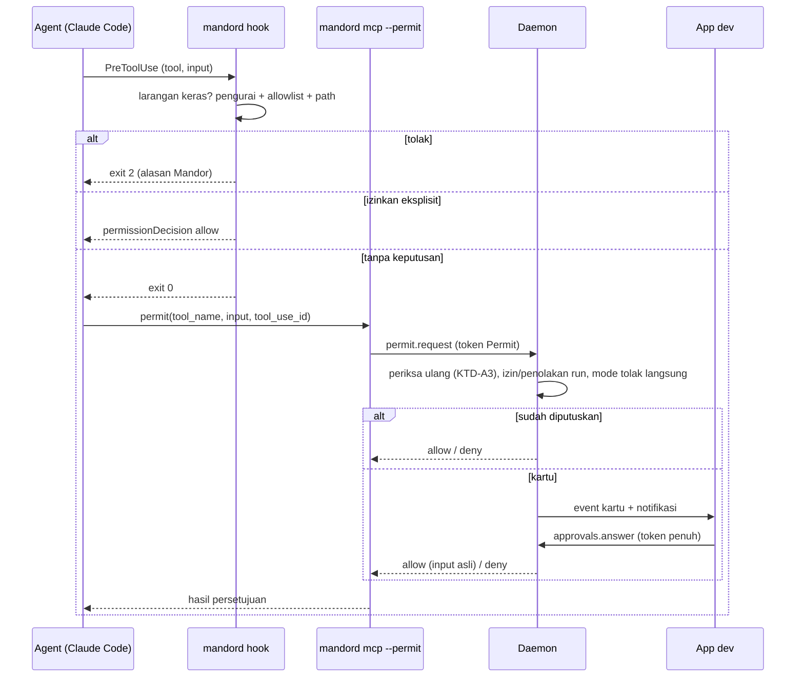
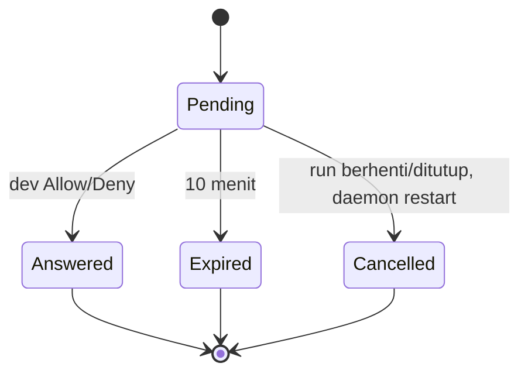

# Izin agent tanpa penolakan diam-diam - Plan

## Goal Capsule

- **Objective:** Agent Mandor tidak lagi kena penolakan otomatis untuk perintah aman, dan setiap permintaan izin lain di giliran implementasi dan plan di laptop sampai ke dev sebagai kartu persetujuan di Chat run.
- **Product authority:** pemilik produk Mandor (handokobeni). Keputusan di dokumen ini disetujui 2026-11-06.
- **Open blockers:** tidak ada. Spike S1–S4 (2026-11-06) membuktikan mekanisme Claude Code yang dipakai; hasilnya di Dependencies / Assumptions.
- **Authority order:** Product Contract > Planning Contract > Implementation Units. Aturan `CLAUDE.md` repo (rust-engineering, `make check`) berlaku penuh.
- **Stop conditions:** berhenti dan tanya pemilik produk bila sebuah unit hanya bisa selesai dengan melemahkan larangan keras (R11), mengizinkan otomatis bentuk di R14, atau melanggar standar rust-engineering.
- **Execution profile:** Rust TDD per unit (domain dulu, lalu adapter dan usecase), frontend Vitest, lalu uji langsung laptop dan VM.
- **Tail ownership:** implementer membuka PR; pemilik produk yang me-merge. Biner VM dipasang pemilik produk.
- **Product Contract preservation:** changed: R26 — "diperiksa hook" menjadi "diperiksa Mandor", karena pemeriksaan ulang di daemon (KTD-A3) memenuhi maksud R26 tanpa bergantung pada catatan proses hook; disetujui pemilik produk 2026-11-06. Selain itu Product Contract tidak berubah, hanya Outstanding Questions yang terjawab dipindah ke Dependencies.

---

## Product Contract

### Summary

Hook Mandor mengizinkan secara eksplisit perintah yang lolos pemeriksaan Mandor dan setiap bagiannya ada di allowlist giliran itu. Permintaan izin lain dari Claude Code di giliran implementasi dan plan di laptop muncul sebagai kartu persetujuan di Chat run (Allow once, Allow for this run, Deny) dan ditolak otomatis setelah 10 menit. Larangan keras Mandor tetap ditolak tanpa ditanya.

### Problem Frame

Agent berjalan headless (`claude -p`, `--permission-prompts none`, KTD-10 plan Rilis 1). Heuristik bawaan Claude Code meminta persetujuan untuk bentuk perintah tertentu walau perintahnya ada di allowlist:

- `cd <dir>` lalu `git` dalam satu perintah;
- `git -C`, `pnpm --dir`;
- pipe dan redirect (`2>&1 | tail`);
- path berisi `( ) [ ]`, seperti folder route Next.js.

Tanpa layar persetujuan, permintaan itu otomatis ditolak ("no approval surface in this session"). Agent lalu mencari jalan lain, bekerja lebih lama, atau melewatkan verifikasi; di uji langsung PGS-1402 agent gagal menjalankan Vitest dan test integrasi Go. Perintah di luar allowlist (mis. `docker`, `jq`) juga ditolak tanpa dev pernah tahu ada yang diminta. Arahan bentuk perintah di operator prompt (commit `c4f0b2e`) mengurangi kejadian tapi tidak menghilangkannya, karena agent tetap kadang memakai bentuk yang ditolak.

### Key Decisions

- **Dua lapis: izin otomatis untuk yang aman, kartu untuk sisanya.** Kartu untuk setiap permintaan akan memunculkan `cd x && git diff` puluhan kali per run, sehingga dev lelah dan asal menyetujui. Hook Mandor yang memutuskan perintah aman; kartu hanya untuk yang tidak dikenal.
- **Izin otomatis hanya untuk yang bisa diurai penuh.** Dengan izin eksplisit, hook Mandor menggantikan pemeriksaan bawaan Claude Code untuk perintah itu, jadi hook harus tahu persis setiap program yang dijalankan. Bentuk yang menyembunyikan program lain tidak pernah diizinkan otomatis.
- **Gagal memeriksa berarti tolak, bukan kartu.** Hook tetap fail-closed (KTD-10): bug atau input rusak tidak boleh berubah menjadi kartu yang bisa di-Allow.
- **Larangan keras tidak bisa dibuka dari kartu.** Pagar KTD-10/KTD-11 dan aturan lembur tetap mutlak. Tombol Allow tidak pernah muncul untuk permintaan yang ditolak hook Mandor.
- **Input mentah adalah isi utama kartu.** Deskripsi dari agent bisa menyesatkan (prompt injection dari data Lark), jadi dev menilai dari perintah sebenarnya.
- **Izin dari kartu paling lama berlaku sampai run ditutup, untuk permintaan persis sama.** Izin permanen tetap lewat Settings › Repos › Extra agent allowlist, supaya perluasan permanen selalu disengaja.
- **Tanpa jawaban berarti tolak, dan run tidak menunggu berulang.** Batas 10 menit per kartu; setelah satu kartu expired, permintaan berikutnya langsung ditolak sampai dev kembali.
- **Deny berlaku untuk sisa run.** Permintaan persis sama yang sudah ditolak dev tidak memunculkan kartu lagi, supaya agent tidak bisa membujuk lewat kartu berulang.
- **Setiap penolakan terlihat.** Penolakan di laptop tercatat di Chat dan penolakan di VM tercatat di laporan pagi, supaya dev tahu kenapa agent mengambil jalan lain.
- **Reviewer AC dan VM tetap tanpa kartu.** Review harus selesai tanpa ditunggu, dan lembur di VM tidak ada orangnya.

### Actors

- A1. Dev: menjawab kartu persetujuan di aplikasi laptop.
- A2. Agent (Claude Code): menjalankan tool; meminta izin bila heuristiknya ragu.
- A3. Daemon Mandor: hook yang memeriksa dan mengizinkan atau menolak, serta penghubung kartu persetujuan ke dev.

### Requirements

**Izin otomatis untuk perintah aman**

- R1. Perintah yang lolos pemeriksaan Mandor dan setiap program di dalamnya cocok dengan allowlist giliran itu berjalan tanpa persetujuan, termasuk bentuk gabungan, pipe, redirect, dan path berisi `( ) [ ]`.
- R2. Izin otomatis tidak pernah berlaku untuk perintah yang ditolak hook Mandor.
- R3. Izin otomatis berlaku di giliran implementasi, plan, dan reviewer, dengan aturan hanya-baca plan dan reviewer tetap berlaku.
- R14. Perintah yang tidak bisa diurai penuh menjadi program-program sederhana tidak pernah diizinkan otomatis; ini mencakup substitusi perintah (`$(…)`, backtick), substitusi proses (`<(…)`), `eval`, `sh -c`/`bash -c`, `xargs`, `env` sebagai pembungkus, dan here-doc.
- R15. Bentuk `cd <dir> && …`, `git -C <dir>`, dan `--dir <dir>` hanya diizinkan otomatis bila foldernya, setelah symlink dan `..` diselesaikan, di dalam worktree run dan bukan repo git bersarang; folder yang tidak bisa diselesaikan tidak diizinkan otomatis.
- R16. Target redirect dan argumen path dari perintah yang diizinkan otomatis diselesaikan ke path sebenarnya lalu diperiksa terhadap path terlarang yang sama dengan R11.

**Kartu persetujuan**

- R4. Permintaan izin Claude Code di giliran implementasi dan plan di laptop muncul sebagai kartu di Chat run, untuk semua jenis tool (Bash, web, dan lainnya).
- R5. Isi utama kartu adalah input tool apa adanya (perintah, URL, atau pasangan kunci-nilai), lengkap tanpa dipotong, dengan karakter kontrol dan bidi di-escape, ditambah folder kerja; input panjang bergulir di area terbatas sehingga tombol kartu tetap terlihat.
- R17. Deskripsi langkah dari agent tampil terpisah dengan label bahwa itu klaim agent yang tidak diverifikasi Mandor.
- R6. Kartu punya tiga pilihan berurutan Deny, Allow once, dan "Allow this exact request for this run"; tidak ada tombol yang fokus atau terpicu otomatis saat kartu muncul, tombol bisa dicapai dengan keyboard, dan kartu baru diumumkan sopan ke pembaca layar tanpa mengumumkan setiap detik hitung mundur.
- R7. Allow for this run berlaku untuk tool, input persis, dan folder kerja yang sama, sampai run ditutup, termasuk giliran berikutnya dan setelah daemon restart, tetapi hanya di jenis giliran tempat izin itu diberikan; giliran reviewer tidak pernah memakai izin dari kartu.
- R18. Jawaban hanya diterima dari koneksi aplikasi dev yang terautentikasi (bukan token atau proses milik agent), hanya untuk kartu yang masih menunggu di run itu, dan izin selalu menjalankan input asli tanpa perubahan.
- R8. Kartu yang tidak dijawab dalam 10 menit ditolak otomatis dan ditandai expired; kartu yang menunggu menampilkan sisa waktunya.
- R19. Setelah satu kartu expired, permintaan izin berikutnya di run itu langsung ditolak tanpa kartu dan tercatat di Chat, sampai dev membuka tab Chat run itu; Chat mencatat saat mode tolak langsung mulai dan berakhir.
- R20. Kartu punya status menunggu, sedang dikirim, dijawab, expired, dan dibatalkan (run berhenti, ditutup, atau daemon restart saat kartu menunggu); hanya kartu menunggu yang punya tombol, dan jawaban terlambat menampilkan pemberitahuan bahwa kartu sudah tidak berlaku.
- R9. Saat kartu menunggu, run mendapat badge "Needs approval" di daftar run dan board tanpa pindah kolom, tab Chat menampilkan jumlah kartu menunggu, dan notifikasi (sesuai preferensi yang ada) menyebut tool dan perintahnya lalu membuka Chat run di kartu itu.
- R10. Kartu yang sudah dijawab, expired, atau dibatalkan tetap tercatat di Chat bersama keputusannya.
- R23. Setelah dev menekan Deny, permintaan yang persis sama di run itu ditolak langsung tanpa kartu untuk sisa run dan tercatat di Chat.
- R24. Beberapa kartu yang menunggu bersamaan tampil urut dari yang terlama, masing-masing dengan batas waktunya sendiri; notifikasi hanya dikirim untuk kartu pertama dan membuka Chat di kartu terlama yang masih menunggu.

**Batas dan keterlihatan**

- R11. Larangan keras ditolak tanpa kartu: `git push`, `git commit`, `git remote`, `gh`, berkas kredensial, penulisan ke `.claude`, `.git`, `.husky`, `.githooks`, dan perubahan status Lark yang melewati Waiting Review.
- R21. Bila hook gagal memeriksa (error internal, input rusak, batas waktu), permintaan ditolak tanpa kartu, sesuai sifat fail-closed KTD-10.
- R12. Giliran reviewer AC tidak memunculkan kartu; permintaan di luar allowlist tetap ditolak otomatis.
- R22. Setiap penolakan di laptop (larangan keras, penolakan reviewer, kegagalan pemeriksaan hook, expired, dan penolakan langsung R19 dan R23) tercatat ringkas di Chat run dengan tool, perintah, dan alasan, tanpa tombol.
- R25. Nilai yang tampak rahasia (token bearer, pasangan kunci-nilai kredensial, userinfo di URL) disamarkan di catatan Chat yang tersimpan, teks notifikasi, dan laporan pagi; input lengkap tanpa disamarkan hanya tampil di kartu yang masih menunggu.
- R26. Kartu hanya boleh muncul untuk permintaan yang sudah diperiksa Mandor sampai selesai tanpa keputusan; permintaan yang tidak bisa diperiksa tuntas (mis. hook terhenti karena batas waktu dan pemeriksaan ulang gagal) ditolak tanpa kartu.
- R13. Di daemon VM tidak ada kartu; permintaan ditolak otomatis dan tercatat di laporan pagi kartu itu dengan perintah dan alasannya.

### Key Flows

- F1. Perintah aman dengan bentuk yang biasanya ditolak
  - **Trigger:** agent menjalankan `cd kelola-web && git diff -- src/app/(app)/x.tsx`.
  - **Steps:** hook Mandor mengurai perintah, foldernya di dalam worktree, setiap program ada di allowlist, hook mengizinkan; Claude Code menjalankannya tanpa bertanya.
  - **Outcome:** tidak ada kartu dan tidak ada penolakan.
  - **Covered by:** R1, R2, R15
- F2. Perintah di luar allowlist
  - **Trigger:** agent di giliran implementasi menjalankan `docker compose up -d db`.
  - **Steps:** hook selesai memeriksa, tidak ada larangan, tapi `docker` tidak di allowlist, jadi hook tidak memberi keputusan; Claude Code meminta izin; kartu muncul di Chat run, run mendapat badge, notifikasi dikirim; dev memilih Allow this exact request for this run; agent melanjutkan; permintaan yang persis sama berikutnya di run itu berjalan tanpa kartu.
  - **Outcome:** perintah berjalan atas keputusan dev.
  - **Covered by:** R4, R5, R6, R7, R9, R18
- F3. Dev tidak menjawab
  - **Trigger:** kartu muncul saat dev tidak di depan layar.
  - **Steps:** 10 menit berlalu; kartu ditandai expired; agent menerima penolakan; permintaan berikutnya di run itu langsung ditolak dan tercatat sampai dev kembali.
  - **Outcome:** run tidak menggantung berulang; semua penolakan tercatat di Chat.
  - **Covered by:** R8, R10, R19, R22

### Acceptance Examples

- AE1. **Covers R1, R3.** Given giliran plan, when agent menjalankan `cd kelola-api && git log --oneline -5`, then perintah berjalan tanpa kartu dan tanpa penolakan.
- AE2. **Covers R2, R11, R22.** Given giliran implementasi, when agent menjalankan `cd repo && git push origin HEAD`, then perintah ditolak dengan alasan Mandor, tidak ada kartu, dan penolakannya tercatat di Chat.
- AE3. **Covers R6, R7.** Given dev memilih Allow this exact request for this run untuk `jq . package.json`, when agent menjalankan `jq . package.json` lagi di folder yang sama, then perintah berjalan tanpa kartu; when agent menjalankan `jq .name package.json`, then kartu baru muncul.
- AE4. **Covers R8, R19.** Given kartu untuk `docker ps` tidak dijawab, when 10 menit berlalu, then kartu ditandai expired dan agent menerima penolakan; when agent lalu meminta izin untuk `jq . a.json`, then permintaan itu langsung ditolak tanpa kartu dan tercatat di Chat.
- AE5. **Covers R12, R22.** Given giliran reviewer AC, when reviewer menjalankan perintah di luar allowlist, then perintah ditolak otomatis tanpa kartu dan tercatat di Chat.
- AE6. **Covers R13.** Given agent di daemon VM saat lembur, when agent meminta izin untuk perintah di luar allowlist, then permintaan ditolak otomatis tanpa kartu dan tercatat di laporan pagi kartu itu.
- AE7. **Covers R4, R5.** Given giliran implementasi, when agent memakai WebFetch ke situs dokumentasi, then kartu muncul dengan URL lengkap sebagai isi utama.
- AE8. **Covers R14.** Given giliran implementasi, when agent menjalankan `echo $(docker ps)`, then perintah tidak diizinkan otomatis dan kartu muncul.
- AE9. **Covers R15.** Given worktree run memuat folder `fixtures/repo` yang berisi `.git` sendiri, when agent menjalankan `cd fixtures/repo && git status`, then perintah tidak diizinkan otomatis dan kartu muncul.
- AE10. **Covers R16, R11.** Given giliran implementasi, when agent menjalankan `echo x > .githooks/pre-push`, then perintah ditolak dengan alasan Mandor tanpa kartu.
- AE11. **Covers R21, R26.** Given input hook rusak atau hook melewati batas waktunya, when agent menjalankan perintah apa pun, then perintah ditolak tanpa kartu dan penolakannya tercatat di Chat.
- AE12. **Covers R18, R20.** Given kartu sudah expired, when dev menekan Allow dari tampilan lama, then jawaban ditolak dan kartu menampilkan bahwa ia sudah tidak berlaku.
- AE13. **Covers R23.** Given dev menekan Deny untuk `docker compose up -d`, when agent meminta permintaan yang persis sama lagi di run itu, then permintaan ditolak langsung tanpa kartu dan tercatat di Chat.
- AE14. **Covers R7.** Given dev memberi Allow for this run untuk `jq . a.json` di giliran implementasi, when giliran reviewer menjalankan `jq . a.json`, then izin itu tidak dipakai dan perintah ditolak otomatis.
- AE15. **Covers R15.** Given `docs` di worktree adalah symlink ke folder di luar worktree, when agent menjalankan `cd docs && git log`, then perintah tidak diizinkan otomatis.
- AE16. **Covers R18.** Given kartu menunggu, when jawaban Allow dikirim dengan token kapabilitas milik agent, then jawaban ditolak dan percobaannya tercatat sebagai penolakan.

### Success Criteria

- Run laptop di workspace kelola tidak lagi menampilkan penolakan "no approval surface" untuk perintah yang ada di allowlist.
- Setiap permintaan izin di laptop terlihat oleh dev sebagai kartu, berjalan karena izin otomatis, atau tercatat sebagai penolakan di Chat.
- Larangan keras dan bentuk perintah di R14–R16 tetap ditolak atau tidak diizinkan otomatis di semua giliran, terbukti oleh test.

### Scope Boundaries

- Izin permanen dari kartu ("Always allow in this repo") tidak dibangun.
- Kartu di giliran reviewer AC tidak dibangun.
- Persetujuan untuk permintaan di VM (mis. dijawab pagi hari lalu kartu dilanjutkan) tidak dibangun.
- Allow berbasis pola atau program (mis. `docker *`) dari kartu tidak dibangun; Allow for this run hanya untuk permintaan persis sama.
- Daftar izin yang sudah diberi di run dan pencabutannya tidak dibangun di rilis ini.

### Dependencies / Assumptions

Hasil spike dengan Claude Code 2.1.318 di mode `-p` stream-json, `--permission-mode acceptEdits`, model haiku, di repo uji sementara:

- S1. Tanpa jawaban hook, `cd sub && git diff --stat` ditolak ("changes directory before a version-control command"). Dengan hook `PreToolUse` yang menjawab `permissionDecision: allow`, perintah yang sama berjalan. R1 bisa dibangun di atas hook.
- S1b. Hook yang menjawab `allow` untuk `git push` tetap ditolak bila `Bash(git push*)` ada di `--disallowedTools`. Deny list Claude Code tetap lapis kedua di bawah hook Mandor.
- S2. Dengan `--permission-prompts host` dan `--permission-prompt-tool` ke tool MCP, permintaan izin sampai ke tool berisi `tool_name`, input lengkap (termasuk `description` dari agent), dan `tool_use_id`. Jawaban `{"behavior":"allow","updatedInput":...}` menjalankan perintah; `{"behavior":"deny","message":...}` meneruskan pesan itu ke agent.
- S2b. Alasan Claude Code meminta izin tidak dikirim ke tool, sehingga kartu memakai input mentah dan deskripsi dari agent (R5, R17).
- S2c. Claude Code menunggu jawaban tool paling tidak 11 menit (jeda 150 detik dan 660 detik sama-sama berhasil). Batas 10 menit di R8 dipegang Mandor.
- S3. Di `--permission-mode default` (giliran plan), izin dari hook dan `--permission-prompts host` berperilaku sama seperti di `acceptEdits`.
- S3b. Bila alat persetujuan mengembalikan error, Claude Code tidak menjalankan tool dan agent menerima error; jalurnya fail-closed.
- S4. Claude Code menyembunyikan alat `--permission-prompt-tool` dari agent ("No such tool available", tidak ditemukan `ToolSearch`), jadi agent tidak bisa membuat atau menjawab kartu lewat alat itu.
- S5. Pesan hasil stream-json memuat `permission_denials` (nama tool, input, `tool_use_id`) untuk penolakan Claude Code, termasuk yang tidak pernah dilihat hook.

Keadaan kode yang mempengaruhi planning (dari review dokumen):

- Hook Mandor sekarang hanya mencari kata terlarang dan menghasilkan dua keputusan (tidak keberatan atau tolak); ia belum mengurai perintah per program dan belum menerima allowlist giliran. R1 dan R14–R16 butuh keputusan ketiga (izinkan eksplisit) dan pengurai yang lebih ketat.
- Server MCP Mandor sekarang hanya terpasang di giliran reviewer dan plan yang punya sumber desain, dengan token kapabilitas berperan Design/Verdict, dan jembatan MCP ke daemon membatasi satu panggilan 10 detik. Alat persetujuan butuh server MCP di setiap giliran implementasi dan plan di laptop, peran kapabilitas sendiri, dan panggilan yang boleh menunggu sampai 10 menit.

### Outstanding Questions

Tidak ada yang memblokir. Pertanyaan yang tersisa dari review dijawab spike S3–S4 dan riset kode (lihat Dependencies / Assumptions dan Planning Contract).

### Sources / Research

- KTD-10 dan KTD-11 di `docs/plans/2026-10-18-001-feat-korlap-lark-lembur-plan.md`: pagar izin agent saat ini.
- `crates/mandor-agent/src/claude/command.rs`: argumen `claude` (`--permission-mode`, `--permission-prompts none`, allowlist).
- `crates/mandor-agent/src/claude/guardrails.rs`, `crates/mandor-domain/src/hook.rs`, `crates/mandor-domain/src/hook_review.rs`: hook dan allowlist per giliran.
- Commit `c4f0b2e` di `feat/prototype-compare`: arahan bentuk perintah di operator prompt.
- `docs/progress/env-picker-prototype-compare.md` (branch `feat/prototype-compare`, PR #19): penolakan yang teramati di uji langsung PGS-1402.

---

## Planning Contract

### Key Technical Decisions

- KTD-A1. **Hook mendapat keputusan ketiga.** `Verdict` di `mandor-domain` menjadi tolak, tanpa keputusan, atau izinkan eksplisit. Tanpa keputusan tetap exit 0 tanpa output (perilaku sekarang); izinkan eksplisit menulis JSON `hookSpecificOutput.permissionDecision: "allow"` ke stdout dengan exit 0. Tolak tetap exit 2 (KTD-10). Semua jalur error tetap tolak.
- KTD-A2. **Pengurai perintah ketat terpisah dari pemindai kata terlarang.** Modul domain baru mengurai satu perintah Bash menjadi daftar perintah sederhana (program, argumen, redirect) dengan aturan kutip shell, dan mengembalikan "tidak bisa diurai" untuk substitusi perintah/proses, backtick, `eval`, `sh -c`/`bash -c`, `xargs`, `env` sebagai pembungkus, here-doc, dan sintaks yang tidak dikenal. Pemindai lama (`words`, `check_command`) tetap dipakai untuk larangan keras; izin eksplisit hanya diberikan bila pengurai ketat berhasil.
- KTD-A3. **Pemeriksaan ulang di daemon saat permintaan izin datang.** Alat persetujuan memanggil fungsi keputusan domain yang sama dengan hook (larangan keras, pengurai, allowlist, aturan path). Tolak → tolak tanpa kartu; izinkan → izinkan tanpa kartu; tanpa keputusan → lanjut ke izin run, penolakan run, mode tolak langsung, lalu kartu. Ini memenuhi R26 bahkan bila hook terhenti di batas waktunya.
- KTD-A4. **Allowlist giliran dikirim ke hook lewat berkas.** Adapter agent menulis berkas JSON 0600 per giliran (allowlist, deny list, akar run, folder worktree anggota) di folder MCP yang sudah ada, dan hook menerima path-nya lewat argumen `--permit <berkas>`. Argv tetap pendek dan tidak memuat rahasia.
- KTD-A5. **Pencocokan allowlist meniru semantik `Bash(prefix…)` Claude Code.** `Bash(git diff*)` cocok untuk program+argumen yang diawali `git diff`; `Bash(pwd)` cocok persis; pola tanpa `Bash(` (mis. `Read`) tidak berlaku untuk perintah. Setiap perintah sederhana hasil pengurai harus cocok sendiri.
- KTD-A6. **Path diselesaikan oleh proses hook dan daemon, diputuskan di domain.** Proses hook (`mandord hook`) dan daemon melakukan `canonicalize` serta mengecek `.git` di folder tujuan; domain menerima fakta yang sudah diselesaikan (path nyata, ada di dalam akar run, batas repo) sehingga tetap bebas I/O. Path yang tidak bisa diselesaikan berarti tanpa keputusan, bukan izinkan.
- KTD-A7. **Server MCP persetujuan terpisah, `mandor_permit`.** Setiap giliran implementasi dan plan di laptop mendapat server MCP `mandord mcp --permit` dengan token kapabilitas peran baru `Permit` yang terikat run dan jenis giliran. Claude Code dijalankan dengan `--permission-prompts host --permission-prompt-tool mcp__mandor_permit__permit`. Giliran reviewer dan semua giliran VM tetap `--permission-prompts none`.
- KTD-A8. **Batas waktu panggilan persetujuan khusus.** Jembatan MCP memakai batas 11 menit hanya untuk metode `permit.request`; panggilan lain tetap 10 detik. Daemon memegang batas 10 menit kartu (R8) sehingga jembatan tidak pernah memutus lebih dulu.
- KTD-A9. **Kartu, izin run, dan penolakan run disimpan di SQLite.** Migrasi baru menambah tabel kartu persetujuan (run, `tool_use_id`, jenis giliran, tool, input, folder, status, keputusan, waktu) dan tabel izin run (run, jenis giliran, kunci, allow/deny). Penantian jawaban memakai channel di memori yang dibangun ulang dari tabel; kartu yang masih menunggu saat daemon start ditandai dibatalkan (KTD-13: sesi agent juga berhenti saat restart).
- KTD-A10. **Kunci "permintaan persis sama".** Kunci = jenis giliran + nama tool + input kanonis tanpa field `description` + folder kerja, di-hash SHA-256 (`sha2` sudah dipakai di `mandor-git`; penggunaan baru di `mandor-usecase` dicatat di tabel crate `CLAUDE.md`). Dipakai untuk izin run (R7) dan penolakan run (R23).
- KTD-A11. **Jawaban kartu hanya lewat koneksi token penuh.** Metode `approvals.answer`/`approvals.seen` adalah metode biasa di dispatch; koneksi token kapabilitas hanya bisa memanggil `call_scoped`, jadi token agent tidak bisa menjawab (R18). Upaya lewat koneksi terbatas ditolak dan dicatat.
- KTD-A12. **Penolakan dari luar hook ditangkap dari stream.** Parser stream menyimpan daftar `permission_denials` (bukan hanya jumlahnya) di `AgentEvent::Done`; usecase menuliskannya ke Chat (laptop) atau ke laporan pagi kartu (VM), disamarkan (R25).
- KTD-A13. **Penyamaran rahasia di domain.** Fungsi murni menyamarkan token bearer, pasangan kunci-nilai bernama rahasia (`token`, `secret`, `password`, `key`, `authorization`), dan userinfo URL. Dipakai untuk catatan Chat tersimpan, teks notifikasi, dan laporan pagi; kartu yang menunggu menampilkan input asli.

### High-Level Technical Design

Alur satu permintaan izin di giliran implementasi atau plan laptop:

Status kartu (R20):

Keputusan izin di domain dipakai dua tempat: proses hook (sebelum tool) dan daemon (saat permintaan izin datang), dengan fakta path yang diselesaikan di masing-masing proses.

### Assumptions

- Koneksi token penuh hanya dipegang aplikasi dev; agent tidak bisa membaca `~/.mandor` (deny list `Read(~/.mandor/**)` dan hook berkas kredensial, KTD-11).
- PR #19 (`feat/prototype-compare`) kemungkinan di-merge lebih dulu dan membawa migrasi 0010–0011 serta arahan bentuk perintah di operator prompt; branch ini di-rebase ke `main` sebelum PR dan migrasi barunya mengambil nomor berikutnya.
- Notifikasi kartu memakai mekanisme notifikasi dan preferensi yang ada (`NoticeKind` baru), dan klik notifikasi membuka run seperti notifikasi lain.

### Sequencing

U1 dan U2 (domain murni) lebih dulu. U3 (hook) bergantung pada U1–U2. U4 (penyimpanan dan usecase) bergantung pada U2. U5 (jalur alat persetujuan) bergantung pada U3–U4. U6 (protokol dan dispatch) bergantung pada U4–U5. U7 (UI) bergantung pada U6. U8 (penangkapan penolakan dan laporan VM) bergantung pada U2 dan U6. U9 (dokumen dan uji langsung) terakhir.

---

## Implementation Units

### U1. Pengurai perintah ketat dan pencocok allowlist

**Goal:** Domain bisa memutuskan apakah sebuah perintah Bash terurai penuh dan setiap program di dalamnya ada di allowlist giliran.

**Requirements:** R1, R14

**Dependencies:** —

**Files:**
- `crates/mandor-domain/src/permit/mod.rs` (baru), `crates/mandor-domain/src/permit/shell.rs` (baru), `crates/mandor-domain/src/permit/allowlist.rs` (baru)
- `crates/mandor-domain/src/lib.rs`
- Test di modul yang sama (`#[cfg(test)]`)

**Approach:** Pengurai mengenali kutip tunggal/ganda, escape, operator `&&`, `||`, `;`, `|`, redirect (`>`, `>>`, `2>&1`, `<`), dan kurung di dalam kutipan sebagai teks biasa. Hasilnya daftar perintah sederhana dengan program, argumen, dan target redirect, atau `Unparseable` dengan alasannya. Pencocok allowlist mengikuti KTD-A5.

**Execution note:** Test-first. Tulis tabel kasus berbahaya dari review dokumen sebelum implementasi.

**Patterns to follow:** gaya modul murni `crates/mandor-domain/src/hook.rs` dan `hook_review.rs` (tanpa I/O, test tabel).

**Test scenarios:**
- `cd kelola-web && git diff -- "src/app/(app)/x.tsx"` terurai menjadi dua perintah; path berkurung dalam kutipan tetap satu argumen.
- `npx vitest run "src/app/(app)/x.test.tsx" 2>&1 | tail -30` terurai menjadi dua perintah dengan redirect `2>&1` yang tidak menghasilkan target berkas.
- Covers AE8. `echo $(docker ps)` → Unparseable (substitusi perintah).
- Backtick, `<(curl x)`, `eval "x"`, `bash -c "ls"`, `sh -c ls`, `find . | xargs rm`, `env FOO=1 ls`, here-doc `cat <<EOF` → Unparseable masing-masing.
- Kutipan tidak tertutup dan karakter kontrol → Unparseable.
- Allowlist `Bash(git diff*)` cocok `git diff --stat`, tidak cocok `git push`; `Bash(pwd)` cocok `pwd` tetapi tidak `pwd -P`; pola non-Bash diabaikan.
- Perintah gabungan dengan satu bagian di luar allowlist → tidak cocok secara keseluruhan.

**Verification:** Semua kasus tabel lolos; tidak ada jalur yang menghasilkan cocok untuk input Unparseable.

### U2. Keputusan izin, aturan path, kunci izin, dan penyamaran

**Goal:** Satu fungsi domain memutuskan tolak, izinkan eksplisit, atau tanpa keputusan untuk sebuah tool call, dengan fakta path dari luar; ditambah kunci "persis sama" dan penyamaran rahasia.

**Requirements:** R1, R2, R3, R11, R14, R15, R16, R21, R7 (kunci), R23 (kunci), R25

**Dependencies:** U1

**Files:**
- `crates/mandor-domain/src/permit/decide.rs` (baru), `crates/mandor-domain/src/permit/redact.rs` (baru)
- `crates/mandor-domain/src/hook.rs` (bagikan pemeriksaan path terlarang dan larangan keras yang sudah ada)

**Approach:** Urutan keputusan: larangan keras lama (`classify_with_mcp`/`classify_planning`) → tolak; tool bukan Bash → tanpa keputusan (biarkan Claude Code dan allowlist-nya); Bash: urai (U1), Unparseable → tanpa keputusan; setiap target `cd`/`-C`/`--dir` harus punya fakta path "di dalam akar run, bukan repo bersarang" (KTD-A6) dan setiap target redirect/argumen path tidak boleh menyentuh path terlarang R11, kalau menyentuh → tolak; semua program cocok allowlist → izinkan eksplisit. Fakta path yang hilang berarti tanpa keputusan. Kunci izin mengikuti KTD-A10; penyamaran mengikuti KTD-A13.

**Execution note:** Test-first; satu test per contoh penerimaan yang relevan.

**Patterns to follow:** `check_path`, `is_credential_path`, dan konstanta penanda di `crates/mandor-domain/src/hook.rs`.

**Test scenarios:**
- Covers AE1. Giliran plan, `cd kelola-api && git log --oneline -5` dengan fakta "di dalam run, batas repo kelola-api" → izinkan eksplisit.
- Covers AE2. `cd repo && git push origin HEAD` → tolak dengan alasan Mandor, tidak pernah izinkan.
- Covers AE9. Fakta "repo bersarang" untuk `fixtures/repo` → tanpa keputusan.
- Covers AE15. Fakta "di luar akar run" (symlink) → tanpa keputusan.
- Covers AE10. `echo x > .githooks/pre-push` → tolak; `sed -i s/a/b/ .claude/settings.json` → tolak.
- `cat a.txt > out.txt` di dalam worktree dengan `cat` di allowlist → izinkan eksplisit.
- Tool `WebFetch` → tanpa keputusan.
- Kunci: dua input sama dengan `description` berbeda → kunci sama; folder berbeda → kunci berbeda; jenis giliran berbeda → kunci berbeda.
- Penyamaran: `curl -H "Authorization: Bearer abc123"` → token disamarkan; `PGPASSWORD=secret psql` → nilai disamarkan; `https://user:pw@host/x` → userinfo disamarkan; teks biasa tidak berubah.

**Verification:** Semua contoh penerimaan R1–R2, R11, R14–R16 terbukti di test domain.

### U3. Hook memberi izin eksplisit

**Goal:** `mandord hook` membaca berkas izin giliran, menyelesaikan fakta path, dan menjawab izinkan eksplisit untuk perintah aman.

**Requirements:** R1, R2, R3, R15, R16, R21

**Dependencies:** U1, U2

**Files:**
- `crates/mandord/src/hook.rs`
- `crates/mandor-agent/src/claude/guardrails.rs` (`run_hook` tiga keputusan dan output JSON)
- `crates/mandor-agent/src/port.rs` (tulis berkas izin 0600, tambah `--permit <berkas>` ke perintah hook untuk giliran implementasi, plan, dan reviewer)
- `crates/mandord/tests/hook.rs`

**Approach:** Berkas izin berisi allowlist, deny list, akar run, dan akar repo anggota. Hook menyelesaikan target `cd`/`-C`/`--dir`/redirect dengan `canonicalize` dan mencari `.git` terdekat untuk menentukan batas repo, lalu memanggil keputusan U2. Berkas izin yang hilang atau rusak berarti tanpa keputusan (perilaku lama), bukan tolak, supaya giliran lama tetap jalan; error saat memutuskan tetap tolak (R21).

**Patterns to follow:** argumen `--mcp`, `--design`, `--review` di `crates/mandord/src/hook.rs`; penulisan berkas MCP 0600 di `crates/mandor-agent/src/port.rs`.

**Test scenarios:**
- Hook dengan berkas izin dan worktree sementara: `cd sub && git diff --stat` → stdout berisi JSON izinkan, exit 0.
- Perintah di luar allowlist → exit 0 tanpa output.
- `git push` → exit 2 dengan alasan.
- Covers AE11. Input hook rusak → exit 2.
- Symlink ke luar worktree → exit 0 tanpa output (tidak diizinkan otomatis).
- Repo bersarang di dalam worktree (`.git` sendiri) → tidak diizinkan otomatis.
- Giliran reviewer dengan `--review`: perintah baca di allowlist reviewer → izin eksplisit; aturan hanya-baca reviewer tetap menolak penulisan.
- Adapter agent: spec giliran implementasi memuat `--permit <berkas>` dan berkasnya 0600 tanpa rahasia.

**Verification:** Uji integrasi hook di `crates/mandord/tests/hook.rs` hijau untuk ketiga keputusan.

### U4. Penyimpanan dan usecase kartu persetujuan

**Goal:** Daemon menyimpan kartu, izin run, dan penolakan run, dan memutuskan permintaan izin termasuk menunggu jawaban dev.

**Requirements:** R7, R8, R10, R18, R19, R20, R23, R24, R26

**Dependencies:** U2

**Files:**
- `crates/mandor-store/migrations/00NN_approvals.sql` (baru; nomor berikutnya setelah `main` saat implementasi)
- `crates/mandor-store/src/approvals.rs` (baru), `crates/mandor-store/src/lib.rs`, `.sqlx` diperbarui
- `crates/mandor-usecase/src/approval/mod.rs` (baru), `crates/mandor-usecase/src/approval/service.rs` (baru)
- `crates/mandor-usecase/src/run_ports.rs` (port `ApprovalStore` di bundel `Deps`)
- `crates/mandor-usecase/tests/approval_flow.rs` (baru), `crates/mandor-store/tests/approvals.rs` (baru)

**Approach:** Usecase `request(run, turn_kind, tool, input, tool_use_id, cwd)`: periksa ulang dengan U2 (fakta path dari port), lalu izin run, penolakan run (R23), dan mode tolak langsung run (R19); bila perlu, buat kartu Pending dengan tenggat 10 menit dan tunggu jawaban lewat channel di memori dengan batas waktu dan `CancellationToken` run. `answer(card_id, decision)` hanya untuk kartu Pending (R18). Expired menyalakan mode tolak langsung run; `seen(run)` mematikannya. Daemon start menandai kartu Pending sebagai Cancelled. Stop/close run membatalkan kartu Pending run itu. Setiap perubahan menulis item Chat (disamarkan) dan event.

**Execution note:** Test-first dengan jam palsu untuk batas waktu.

**Patterns to follow:** port dan `Deps` di `crates/mandor-usecase/src/run_ports.rs`; adapter `crates/mandor-store/src/reviews.rs`; jam palsu di `crates/mandor-usecase/tests/`.

**Test scenarios:**
- Covers AE3. Allow for this run lalu permintaan sama di folder sama → allow tanpa kartu; argumen berbeda → kartu baru.
- Covers AE14. Izin dari giliran implementasi tidak dipakai di giliran plan atau reviewer.
- Covers AE4. Kartu tidak dijawab 10 menit → Expired, hasil deny; permintaan berikutnya → deny langsung tanpa kartu; setelah `seen` → kartu lagi.
- Covers AE13. Deny lalu permintaan sama → deny langsung tanpa kartu.
- Covers AE12. Jawaban untuk kartu Expired/Answered → ditolak dengan pesan "no longer pending".
- Covers AE2 lewat jalur daemon: permintaan `git push` yang sampai ke daemon → deny tanpa kartu (KTD-A3).
- Dua kartu bersamaan → keduanya Pending dengan tenggat sendiri, urut waktu dibuat (R24).
- Daemon restart dengan kartu Pending → Cancelled; run stop → Cancelled.
- Store: izin run bertahan setelah buka ulang database; migrasi naik dari skema `main`.

**Verification:** Test usecase dan store hijau; `make sqlx-prepare` memperbarui `.sqlx` tanpa diff tak terduga.

### U5. Jalur alat persetujuan: kapabilitas, server MCP, dan argumen agent

**Goal:** Giliran implementasi dan plan di laptop memakai alat persetujuan Mandor sebagai `--permission-prompt-tool`.

**Requirements:** R4, R8, R12, R13, R18

**Dependencies:** U3, U4

**Files:**
- `crates/mandor-usecase/src/review/capability.rs` (peran `Permit` terikat run dan jenis giliran)
- `crates/mandor-api/src/permit.rs` (baru; server MCP stdio satu alat `permit`), `crates/mandor-api/src/client.rs` (batas waktu khusus `permit.request`), `crates/mandor-api/src/lib.rs`
- `crates/mandord/src/mcp.rs` (mode `--permit`), `crates/mandord/src/dispatch.rs` (`call_scoped` untuk `permit.request`)
- `crates/mandor-agent/src/port.rs`, `crates/mandor-agent/src/claude/command.rs` (`--permission-prompts host`, `--permission-prompt-tool`, server `mandor_permit` di konfigurasi MCP; reviewer dan VM tetap `none`)
- `crates/mandor-protocol/src/lib.rs`, `crates/mandor-protocol/src/dto.rs` (parameter dan hasil `permit.request`)
- Test: `crates/mandor-api/src/permit.rs` (unit), `crates/mandor-agent/src/port.rs` (spec), `crates/mandord/tests/` (integrasi panggilan scoped)

**Approach:** Alat `permit` menerima `tool_name`, `input`, `tool_use_id` dari Claude Code, meneruskannya ke daemon dengan token `Permit`, lalu mengembalikan JSON `behavior` sesuai S2. Allow selalu memakai input asli dari permintaan (R18). Error apa pun dikembalikan sebagai error alat (fail-closed, S3b). Hook menolak panggilan agent ke `mcp__mandor_permit__*` sebagai lapis tambahan di atas S4.

**Patterns to follow:** `crates/mandor-api/src/mcp.rs` (server ledger), `issue_capability` di `crates/mandor-usecase/src/review/capability.rs`, konfigurasi MCP di `crates/mandor-agent/src/port.rs`.

**Test scenarios:**
- Spec giliran implementasi laptop: argumen memuat `--permission-prompts host` dan `--permission-prompt-tool mcp__mandor_permit__permit`, konfigurasi MCP memuat server `mandor_permit` dengan token di env, bukan argv.
- Covers AE5. Spec giliran reviewer: tetap `--permission-prompts none`, tanpa server persetujuan.
- Covers AE6. Spec di peran VM: tetap `none` untuk semua giliran.
- Alat `permit`: jawaban daemon allow → `{"behavior":"allow","updatedInput":<input asli>}`; deny → `{"behavior":"deny","message":...}`; daemon tidak menjawab/error → error alat.
- Covers AE16. Token `Permit` tidak bisa memanggil `approvals.answer`; token ledger tidak bisa memanggil `permit.request`.
- Batas waktu: `permit.request` boleh menunggu lebih dari 10 detik; panggilan ledger tetap dibatasi 10 detik.

**Verification:** Spike S2 diulang dengan Mandor sungguhan di repo uji: perintah di luar allowlist memunculkan kartu dan berjalan setelah Allow.

### U6. Protokol, dispatch, dan notifikasi kartu

**Goal:** Aplikasi dev bisa melihat, menjawab, dan menandai kartu terlihat, dan menerima notifikasi.

**Requirements:** R9, R18, R19, R20, R22, R24, R25

**Dependencies:** U4, U5

**Files:**
- `crates/mandor-protocol/src/dto.rs`, `crates/mandor-protocol/src/lib.rs` (`ApprovalView`, `approvals.list/answer/seen`, event `approvals.updated`, `RunView.pending_approvals`), binding `apps/desktop/src/lib/protocol/*`
- `crates/mandord/src/dispatch/approvals.rs` (baru), `crates/mandord/src/dispatch.rs`
- `crates/mandor-usecase/src/run_ports.rs` (`NoticeKind::ApprovalNeeded`), adapter notifikasi di `crates/mandord/src/`
- Test: `crates/mandord/src/dispatch/approvals.rs` (unit), `crates/mandor-protocol/tests/ts_bindings.rs`

**Approach:** `approvals.list {run_id}` mengembalikan kartu urut waktu dibuat dengan sisa waktu; input disamarkan kecuali kartu Pending. Notifikasi dikirim hanya untuk kartu Pending pertama run (R24), teksnya disamarkan dan dipotong. `RunView` membawa jumlah kartu Pending untuk badge.

**Patterns to follow:** `crates/mandord/src/dispatch/review.rs`, event `ledger.updated`, `NoticeKind` yang ada.

**Test scenarios:**
- `approvals.answer` untuk kartu Pending → keputusan tercatat; untuk kartu lain run → ditolak.
- `approvals.seen` mematikan mode tolak langsung run dan menulis item Chat "Direct denial ended".
- Notifikasi kedua tidak dikirim saat kartu pertama masih Pending.
- `ApprovalView` kartu Answered menampilkan input tersamarkan; kartu Pending menampilkan input asli.
- Binding TypeScript diregenerasi dan lolos test binding.

**Verification:** Test dispatch hijau; binding TS bersih.

### U7. Kartu persetujuan dan badge di aplikasi

**Goal:** Dev melihat dan menjawab kartu di Chat run, melihat badge, dan mendapat notifikasi yang membuka kartu.

**Requirements:** R5, R6, R8, R9, R10, R17, R19, R20, R22, R24

**Dependencies:** U6

**Files:**
- `apps/desktop/src/lib/components/workspace/ApprovalCard.svelte` (baru), `apps/desktop/src/lib/approvals.ts` (baru, logika murni), `apps/desktop/src/lib/approvals.test.ts` (baru)
- `apps/desktop/src/lib/stores/approvals.svelte.ts` (baru) dan test-nya
- `apps/desktop/src/lib/components/workspace/Workspace.svelte` (kartu di Chat, hitungan di tab Chat, `approvals.seen` saat tab Chat terlihat)
- `apps/desktop/src/lib/components/workspace/ToolCallGroup.svelte`, `apps/desktop/src/lib/chat.ts` (penolakan ringkas dengan alasan Mandor, R22)
- `apps/desktop/src/lib/board.ts` dan komponen kartu board/daftar run (badge "Needs approval")
- `apps/desktop/src/lib/dev/mock-transport.ts` (kartu tiruan untuk `/?mock`)

**Approach:** Kartu menampilkan input mentah di blok monospace yang bergulir dengan tinggi terbatas, karakter kontrol/bidi di-escape, folder kerja, deskripsi agent berlabel "Agent's description (not verified by Mandor)", sisa waktu, dan tombol Deny, Allow once, Allow this exact request for this run tanpa fokus otomatis. Status Submitting menonaktifkan tombol; jawaban yang ditolak daemon menampilkan "This request is no longer pending". Kartu baru diumumkan lewat live region sopan, tanpa mengumumkan hitung mundur per detik. Beberapa kartu tampil urut dari yang terlama.

**Execution note:** Logika murni test-first di Vitest; cek tampilan di `/?mock` sebelum uji langsung.

**Patterns to follow:** `apps/desktop/src/lib/components/workspace/GateDialogs.svelte`, `AcRow.svelte`, store `ledger.svelte.ts`.

**Test scenarios:**
- Escape karakter kontrol dan bidi pada input (mis. `‮`) menghasilkan teks yang terlihat.
- Sisa waktu dihitung dari tenggat dan berhenti di 0.
- Urutan kartu dari yang terlama.
- Tombol nonaktif saat Submitting dan untuk status selain Pending.
- Badge muncul bila `pending_approvals > 0` tanpa mengubah kolom board.
- `approvals.seen` dikirim saat tab Chat run aktif dan terlihat, tidak saat tab lain.
- Penolakan hook ("PreToolUse … mandor: …") dan penolakan izin tampil sebagai entri ringkas dengan alasan.

**Verification:** Vitest hijau, `bun run check` 0 error, kartu tiruan tampil benar di `/?mock` (cek browser).

### U8. Penolakan dari luar hook di Chat dan laporan pagi VM

**Goal:** Penolakan Claude Code yang tidak terlihat hook tercatat di Chat laptop, dan penolakan di VM tercatat di laporan pagi.

**Requirements:** R13, R22, R25

**Dependencies:** U2, U6

**Files:**
- `crates/mandor-domain/src/agent.rs` (`Done` membawa daftar penolakan), `crates/mandor-agent/src/claude/stream.rs`
- `crates/mandor-store/src/codec.rs` (kodek event)
- `crates/mandor-usecase/src/run/session.rs` (tulis item Chat penolakan, laptop)
- `crates/mandor-usecase/src/overnight/report.rs`, `crates/mandor-protocol/src/dto.rs` (`ReportCardView.denials`), `apps/desktop/src/lib/components/overnight/ReportSection.svelte`
- Test: `crates/mandor-agent/src/claude/stream.rs`, `crates/mandor-usecase/tests/overnight.rs`, Vitest laporan

**Approach:** Parser menyimpan `permission_denials` (tool, ringkasan input tersamarkan, `tool_use_id`). Di laptop, usecase menulis item Chat untuk penolakan yang belum tercatat lewat jalur kartu. Di VM, laporan pagi kartu menampilkan daftar penolakan dengan perintah tersamarkan.

**Patterns to follow:** fixture stream di `crates/mandor-agent/tests/stream_fixtures/`, `design_notes` di `crates/mandor-usecase/src/overnight/report.rs`.

**Test scenarios:**
- Fixture `result` dengan dua `permission_denials` → `Done` membawa dua entri dengan input tersamarkan.
- Covers AE6. Kartu VM dengan penolakan → laporan pagi kartu memuat perintah dan alasan.
- Covers AE5. Penolakan reviewer di laptop → item Chat.
- Penolakan yang sudah tercatat lewat kartu (`tool_use_id` sama) tidak dicatat dua kali.
- Event lama tanpa daftar penolakan tetap terbaca (kodek kompatibel).

**Verification:** Test hijau; laporan pagi tiruan menampilkan penolakan di `/?mock`.

### U9. Dokumen, operator prompt, dan uji langsung

**Goal:** Runbook dan operator prompt sesuai perilaku baru, dan fitur terbukti di laptop dan VM.

**Requirements:** semua; Success Criteria

**Dependencies:** U1–U8

**Files:**
- `docs/runbook/ac-review.md` atau runbook agent yang relevan (bagian izin agent), `README.md` bila menyebut permission prompts
- `crates/mandor-agent/src/prompt.rs` (operator prompt: kartu persetujuan menggantikan sebagian daftar "always denied"; bentuk yang tetap tidak diizinkan otomatis disebut)
- `docs/progress/agent-permission-approval.md` (baru)
- `docs/plans/2026-10-18-001-feat-korlap-lark-lembur-plan.md` (amandemen KTD-10: `--permission-prompts host` untuk giliran implementasi dan plan laptop)

**Approach:** Uji langsung di run kelola laptop: `cd kelola-web && git diff`, Vitest dengan path `(app)`, perintah di luar allowlist (Allow once, Allow for this run, Deny, expired, mode tolak langsung), notifikasi dan badge. Satu kartu smoke di VM untuk laporan pagi.

**Test scenarios:**
- Test expectation: perubahan teks operator prompt dijaga test prompt yang ada (diperbarui), sisanya dokumen.

**Verification:** Catatan uji langsung di dokumen progres; Success Criteria terpenuhi.

---

## Verification Contract

| Gerbang | Perintah | Kapan |
|---|---|---|
| Rust penuh | `make check` (fmt, clippy pedantic, deny, test, coverage, sqlx offline) | setiap unit Rust |
| Cache sqlx | `make sqlx-prepare` | U4 dan setiap perubahan query |
| Binding TS | test `crates/mandor-protocol/tests/ts_bindings.rs` dengan `MANDOR_REGEN_TS=1` lalu tanpa | U5, U6, U8 |
| Frontend | `bun run --cwd apps/desktop test` dan `bun run --cwd apps/desktop check` | U7, U8 |
| Tampilan | `/?mock` di browser | U7, U8 |
| Uji langsung laptop | run kelola: AE1–AE5, AE7–AE16 yang bisa diamati | U9 |
| Uji langsung VM | satu kartu smoke dengan permintaan di luar allowlist: AE6 | U9 |

---

## Definition of Done

- Semua unit U1–U9 selesai dengan test di Verification Contract hijau, termasuk `make check`.
- Setiap contoh penerimaan AE1–AE16 terbukti oleh test otomatis atau dicatat di uji langsung.
- Larangan keras R11 dan bentuk R14 tidak pernah diizinkan otomatis, terbukti test domain dan hook.
- Tabel crate di `CLAUDE.md` mencatat penggunaan `sha2` di `mandor-usecase` bila dipakai.
- Runbook, operator prompt, dan amandemen KTD-10 diperbarui; dokumen progres memuat hasil uji langsung.
- Tidak ada kode percobaan yang ditinggalkan di diff; PR dibuka, tidak di-merge sendiri.
