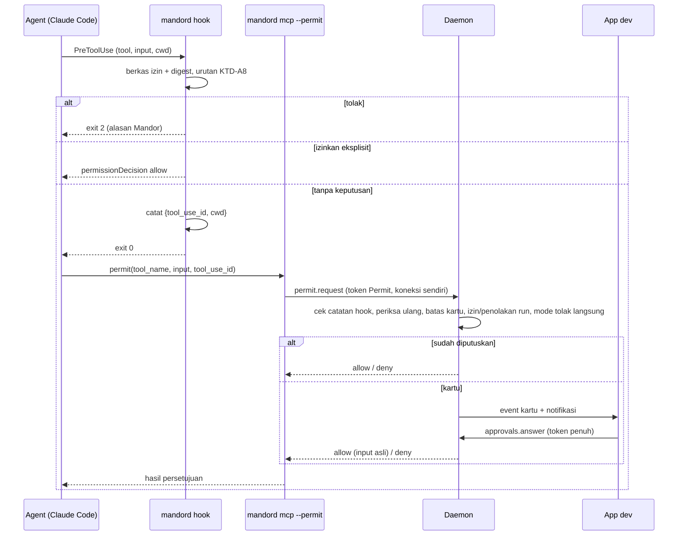
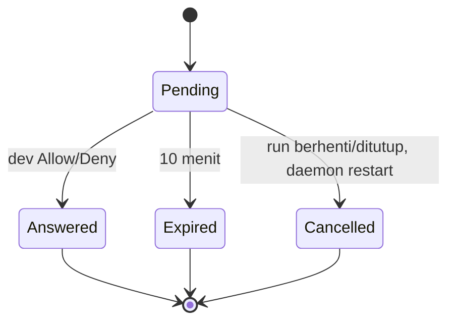

# Izin agent tanpa penolakan diam-diam - Plan

## Goal Capsule

- **Objective:** Agent Mandor tidak lagi kena penolakan otomatis untuk perintah aman, dan setiap permintaan izin lain di giliran implementasi dan plan di laptop sampai ke dev sebagai kartu persetujuan di Chat run.
- **Product authority:** pemilik produk Mandor (handokobeni). Keputusan di dokumen ini disetujui 2026-11-06.
- **Open blockers:** tidak ada. Spike S1–S6 (2026-11-06) membuktikan mekanisme Claude Code yang dipakai; hasilnya di Dependencies / Assumptions.
- **Authority order:** Product Contract > Planning Contract > Implementation Units. Aturan `CLAUDE.md` repo (rust-engineering, `make check`) berlaku penuh.
- **Stop conditions:** berhenti dan tanya pemilik produk bila sebuah unit hanya bisa selesai dengan melemahkan larangan keras (R11), mengizinkan otomatis bentuk di R14, atau melanggar standar rust-engineering.
- **Execution profile:** Rust TDD per unit (domain dulu, lalu adapter dan usecase), frontend Vitest, lalu uji langsung laptop dan VM.
- **Tail ownership:** implementer membuka PR; pemilik produk yang me-merge. Biner VM dipasang pemilik produk.
- **Product Contract preservation:** changed: R26 — "diperiksa hook" menjadi "diperiksa Mandor", karena pemeriksaan ulang di daemon (KTD-A3) memenuhi maksud R26 tanpa bergantung pada catatan proses hook; disetujui pemilik produk 2026-11-06. Selain itu Product Contract tidak berubah, hanya Outstanding Questions yang terjawab dipindah ke Dependencies.

---

## Product Contract

### Summary

Hook Mandor mengizinkan secara eksplisit perintah yang lolos pemeriksaan Mandor dan setiap bagiannya ada di allowlist giliran itu. Permintaan izin lain dari Claude Code di giliran implementasi dan plan di laptop muncul sebagai kartu persetujuan di Chat run (Allow once, Allow for this run, Deny) dan ditolak otomatis setelah 10 menit. Larangan keras Mandor tetap ditolak tanpa ditanya.

### Problem Frame

Agent berjalan headless (`claude -p`, `--permission-prompts none`, KTD-10 plan Rilis 1). Heuristik bawaan Claude Code meminta persetujuan untuk bentuk perintah tertentu walau perintahnya ada di allowlist:

- `cd <dir>` lalu `git` dalam satu perintah;
- `git -C`, `pnpm --dir`;
- pipe dan redirect (`2>&1 | tail`);
- path berisi `( ) [ ]`, seperti folder route Next.js.

Tanpa layar persetujuan, permintaan itu otomatis ditolak ("no approval surface in this session"). Agent lalu mencari jalan lain, bekerja lebih lama, atau melewatkan verifikasi; di uji langsung PGS-1402 agent gagal menjalankan Vitest dan test integrasi Go. Perintah di luar allowlist (mis. `docker`, `jq`) juga ditolak tanpa dev pernah tahu ada yang diminta. Arahan bentuk perintah di operator prompt (commit `c4f0b2e`) mengurangi kejadian tapi tidak menghilangkannya, karena agent tetap kadang memakai bentuk yang ditolak.

### Key Decisions

- **Dua lapis: izin otomatis untuk yang aman, kartu untuk sisanya.** Kartu untuk setiap permintaan akan memunculkan `cd x && git diff` puluhan kali per run, sehingga dev lelah dan asal menyetujui. Hook Mandor yang memutuskan perintah aman; kartu hanya untuk yang tidak dikenal.
- **Izin otomatis hanya untuk yang bisa diurai penuh.** Dengan izin eksplisit, hook Mandor menggantikan pemeriksaan bawaan Claude Code untuk perintah itu, jadi hook harus tahu persis setiap program yang dijalankan. Bentuk yang menyembunyikan program lain tidak pernah diizinkan otomatis.
- **Gagal memeriksa berarti tolak, bukan kartu.** Hook tetap fail-closed (KTD-10): bug atau input rusak tidak boleh berubah menjadi kartu yang bisa di-Allow.
- **Larangan keras tidak bisa dibuka dari kartu.** Pagar KTD-10/KTD-11 dan aturan lembur tetap mutlak. Tombol Allow tidak pernah muncul untuk permintaan yang ditolak hook Mandor.
- **Input mentah adalah isi utama kartu.** Deskripsi dari agent bisa menyesatkan (prompt injection dari data Lark), jadi dev menilai dari perintah sebenarnya.
- **Izin dari kartu paling lama berlaku sampai run ditutup, untuk permintaan persis sama.** Izin permanen tetap lewat Settings › Repos › Extra agent allowlist, supaya perluasan permanen selalu disengaja.
- **Tanpa jawaban berarti tolak, dan run tidak menunggu berulang.** Batas 10 menit per kartu; setelah satu kartu expired, permintaan berikutnya langsung ditolak sampai dev kembali.
- **Deny berlaku untuk sisa run.** Permintaan persis sama yang sudah ditolak dev tidak memunculkan kartu lagi, supaya agent tidak bisa membujuk lewat kartu berulang.
- **Setiap penolakan terlihat.** Penolakan di laptop tercatat di Chat dan penolakan di VM tercatat di laporan pagi, supaya dev tahu kenapa agent mengambil jalan lain.
- **Reviewer AC dan VM tetap tanpa kartu.** Review harus selesai tanpa ditunggu, dan lembur di VM tidak ada orangnya.

### Actors

- A1. Dev: menjawab kartu persetujuan di aplikasi laptop.
- A2. Agent (Claude Code): menjalankan tool; meminta izin bila heuristiknya ragu.
- A3. Daemon Mandor: hook yang memeriksa dan mengizinkan atau menolak, serta penghubung kartu persetujuan ke dev.

### Requirements

**Izin otomatis untuk perintah aman**

- R1. Perintah yang lolos pemeriksaan Mandor dan setiap program di dalamnya cocok dengan allowlist giliran itu berjalan tanpa persetujuan, termasuk bentuk gabungan, pipe, redirect, dan path berisi `( ) [ ]`.
- R2. Izin otomatis tidak pernah berlaku untuk perintah yang ditolak hook Mandor.
- R3. Izin otomatis berlaku di giliran implementasi, plan, dan reviewer, dengan aturan hanya-baca plan dan reviewer tetap berlaku.
- R14. Perintah yang tidak bisa diurai penuh menjadi program-program sederhana tidak pernah diizinkan otomatis; ini mencakup substitusi perintah (`$(…)`, backtick), substitusi proses (`<(…)`), `eval`, `sh -c`/`bash -c`, `xargs`, `env` sebagai pembungkus, dan here-doc.
- R15. Bentuk `cd <dir> && …`, `git -C <dir>`, dan `--dir <dir>` hanya diizinkan otomatis bila foldernya, setelah symlink dan `..` diselesaikan, di dalam worktree run dan bukan repo git bersarang; folder yang tidak bisa diselesaikan tidak diizinkan otomatis.
- R16. Target redirect dan argumen path dari perintah yang diizinkan otomatis diselesaikan ke path sebenarnya lalu diperiksa terhadap path terlarang yang sama dengan R11.

**Kartu persetujuan**

- R4. Permintaan izin Claude Code di giliran implementasi dan plan di laptop muncul sebagai kartu di Chat run, untuk semua jenis tool (Bash, web, dan lainnya).
- R5. Isi utama kartu adalah input tool apa adanya (perintah, URL, atau pasangan kunci-nilai), lengkap tanpa dipotong, dengan karakter kontrol dan bidi di-escape, ditambah folder kerja; input panjang bergulir di area terbatas sehingga tombol kartu tetap terlihat.
- R17. Deskripsi langkah dari agent tampil terpisah dengan label bahwa itu klaim agent yang tidak diverifikasi Mandor.
- R6. Kartu punya tiga pilihan berurutan Deny, Allow once, dan "Allow this exact request for this run"; tidak ada tombol yang fokus atau terpicu otomatis saat kartu muncul, tombol bisa dicapai dengan keyboard, dan kartu baru diumumkan sopan ke pembaca layar tanpa mengumumkan setiap detik hitung mundur.
- R7. Allow for this run berlaku untuk tool, input persis, dan folder kerja yang sama, sampai run ditutup, termasuk giliran berikutnya dan setelah daemon restart, tetapi hanya di jenis giliran tempat izin itu diberikan; giliran reviewer tidak pernah memakai izin dari kartu.
- R18. Jawaban hanya diterima dari koneksi aplikasi dev yang terautentikasi (bukan token atau proses milik agent), hanya untuk kartu yang masih menunggu di run itu, dan izin selalu menjalankan input asli tanpa perubahan.
- R8. Kartu yang tidak dijawab dalam 10 menit ditolak otomatis dan ditandai expired; kartu yang menunggu menampilkan sisa waktunya.
- R19. Setelah satu kartu expired, permintaan izin berikutnya di run itu langsung ditolak tanpa kartu dan tercatat di Chat, sampai dev membuka tab Chat run itu; Chat mencatat saat mode tolak langsung mulai dan berakhir.
- R20. Kartu punya status menunggu, sedang dikirim, dijawab, expired, dan dibatalkan (run berhenti, ditutup, atau daemon restart saat kartu menunggu); hanya kartu menunggu yang punya tombol, dan jawaban terlambat menampilkan pemberitahuan bahwa kartu sudah tidak berlaku.
- R9. Saat kartu menunggu, run mendapat badge "Needs approval" di daftar run dan board tanpa pindah kolom, tab Chat menampilkan jumlah kartu menunggu, dan notifikasi (sesuai preferensi yang ada) menyebut tool dan perintahnya lalu membuka Chat run di kartu itu.
- R10. Kartu yang sudah dijawab, expired, atau dibatalkan tetap tercatat di Chat bersama keputusannya.
- R23. Setelah dev menekan Deny, permintaan yang persis sama di run itu ditolak langsung tanpa kartu untuk sisa run dan tercatat di Chat.
- R24. Beberapa kartu yang menunggu bersamaan tampil urut dari yang terlama, masing-masing dengan batas waktunya sendiri; notifikasi hanya dikirim untuk kartu pertama dan membuka Chat di kartu terlama yang masih menunggu.

**Batas dan keterlihatan**

- R11. Larangan keras ditolak tanpa kartu: `git push`, `git commit`, `git remote`, `gh`, berkas kredensial, penulisan ke `.claude`, `.git`, `.husky`, `.githooks`, dan perubahan status Lark yang melewati Waiting Review.
- R21. Bila hook gagal memeriksa (error internal, input rusak, batas waktu), permintaan ditolak tanpa kartu, sesuai sifat fail-closed KTD-10.
- R12. Giliran reviewer AC tidak memunculkan kartu; permintaan di luar allowlist tetap ditolak otomatis.
- R22. Setiap penolakan di laptop (larangan keras, penolakan reviewer, kegagalan pemeriksaan hook, expired, dan penolakan langsung R19 dan R23) tercatat ringkas di Chat run dengan tool, perintah, dan alasan, tanpa tombol.
- R25. Nilai yang tampak rahasia (token bearer, pasangan kunci-nilai kredensial, userinfo di URL) disamarkan di catatan Chat yang tersimpan, teks notifikasi, dan laporan pagi; input lengkap tanpa disamarkan hanya tampil di kartu yang masih menunggu.
- R26. Kartu hanya boleh muncul untuk permintaan yang sudah diperiksa Mandor sampai selesai tanpa keputusan; permintaan yang tidak bisa diperiksa tuntas (mis. hook terhenti karena batas waktu dan pemeriksaan ulang gagal) ditolak tanpa kartu.
- R13. Di daemon VM tidak ada kartu; permintaan ditolak otomatis dan tercatat di laporan pagi kartu itu dengan perintah dan alasannya.

### Key Flows

- F1. Perintah aman dengan bentuk yang biasanya ditolak
  - **Trigger:** agent menjalankan `cd kelola-web && git diff -- src/app/(app)/x.tsx`.
  - **Steps:** hook Mandor mengurai perintah, foldernya di dalam worktree, setiap program ada di allowlist, hook mengizinkan; Claude Code menjalankannya tanpa bertanya.
  - **Outcome:** tidak ada kartu dan tidak ada penolakan.
  - **Covered by:** R1, R2, R15
- F2. Perintah di luar allowlist
  - **Trigger:** agent di giliran implementasi menjalankan `docker compose up -d db`.
  - **Steps:** hook selesai memeriksa, tidak ada larangan, tapi `docker` tidak di allowlist, jadi hook tidak memberi keputusan; Claude Code meminta izin; kartu muncul di Chat run, run mendapat badge, notifikasi dikirim; dev memilih Allow this exact request for this run; agent melanjutkan; permintaan yang persis sama berikutnya di run itu berjalan tanpa kartu.
  - **Outcome:** perintah berjalan atas keputusan dev.
  - **Covered by:** R4, R5, R6, R7, R9, R18
- F3. Dev tidak menjawab
  - **Trigger:** kartu muncul saat dev tidak di depan layar.
  - **Steps:** 10 menit berlalu; kartu ditandai expired; agent menerima penolakan; permintaan berikutnya di run itu langsung ditolak dan tercatat sampai dev kembali.
  - **Outcome:** run tidak menggantung berulang; semua penolakan tercatat di Chat.
  - **Covered by:** R8, R10, R19, R22

### Acceptance Examples

- AE1. **Covers R1, R3.** Given giliran plan, when agent menjalankan `cd kelola-api && git log --oneline -5`, then perintah berjalan tanpa kartu dan tanpa penolakan.
- AE2. **Covers R2, R11, R22.** Given giliran implementasi, when agent menjalankan `cd repo && git push origin HEAD`, then perintah ditolak dengan alasan Mandor, tidak ada kartu, dan penolakannya tercatat di Chat.
- AE3. **Covers R6, R7.** Given dev memilih Allow this exact request for this run untuk `jq . package.json`, when agent menjalankan `jq . package.json` lagi di folder yang sama, then perintah berjalan tanpa kartu; when agent menjalankan `jq .name package.json`, then kartu baru muncul.
- AE4. **Covers R8, R19.** Given kartu untuk `docker ps` tidak dijawab, when 10 menit berlalu, then kartu ditandai expired dan agent menerima penolakan; when agent lalu meminta izin untuk `jq . a.json`, then permintaan itu langsung ditolak tanpa kartu dan tercatat di Chat.
- AE5. **Covers R12, R22.** Given giliran reviewer AC, when reviewer menjalankan perintah di luar allowlist, then perintah ditolak otomatis tanpa kartu dan tercatat di Chat.
- AE6. **Covers R13.** Given agent di daemon VM saat lembur, when agent meminta izin untuk perintah di luar allowlist, then permintaan ditolak otomatis tanpa kartu dan tercatat di laporan pagi kartu itu.
- AE7. **Covers R4, R5.** Given giliran implementasi, when agent memakai WebFetch ke situs dokumentasi, then kartu muncul dengan URL lengkap sebagai isi utama.
- AE8. **Covers R14.** Given giliran implementasi, when agent menjalankan `echo $(docker ps)`, then perintah tidak diizinkan otomatis dan kartu muncul.
- AE9. **Covers R15.** Given worktree run memuat folder `fixtures/repo` yang berisi `.git` sendiri, when agent menjalankan `cd fixtures/repo && git status`, then perintah tidak diizinkan otomatis dan kartu muncul.
- AE10. **Covers R16, R11.** Given giliran implementasi, when agent menjalankan `echo x > .githooks/pre-push`, then perintah ditolak dengan alasan Mandor tanpa kartu.
- AE11. **Covers R21, R26.** Given input hook rusak atau hook melewati batas waktunya, when agent menjalankan perintah apa pun, then perintah ditolak tanpa kartu dan penolakannya tercatat di Chat.
- AE12. **Covers R18, R20.** Given kartu sudah expired, when dev menekan Allow dari tampilan lama, then jawaban ditolak dan kartu menampilkan bahwa ia sudah tidak berlaku.
- AE13. **Covers R23.** Given dev menekan Deny untuk `docker compose up -d`, when agent meminta permintaan yang persis sama lagi di run itu, then permintaan ditolak langsung tanpa kartu dan tercatat di Chat.
- AE14. **Covers R7.** Given dev memberi Allow for this run untuk `jq . a.json` di giliran implementasi, when giliran reviewer menjalankan `jq . a.json`, then izin itu tidak dipakai dan perintah ditolak otomatis.
- AE15. **Covers R15.** Given `docs` di worktree adalah symlink ke folder di luar worktree, when agent menjalankan `cd docs && git log`, then perintah tidak diizinkan otomatis.
- AE16. **Covers R18.** Given kartu menunggu, when jawaban Allow dikirim dengan token kapabilitas milik agent, then jawaban ditolak dan percobaannya tercatat sebagai penolakan.

### Success Criteria

- Run laptop di workspace kelola tidak lagi menampilkan penolakan "no approval surface" untuk perintah yang ada di allowlist.
- Setiap permintaan izin di laptop terlihat oleh dev sebagai kartu, berjalan karena izin otomatis, atau tercatat sebagai penolakan di Chat.
- Larangan keras dan bentuk perintah di R14–R16 tetap ditolak atau tidak diizinkan otomatis di semua giliran, terbukti oleh test.

### Scope Boundaries

- Izin permanen dari kartu ("Always allow in this repo") tidak dibangun.
- Kartu di giliran reviewer AC tidak dibangun.
- Persetujuan untuk permintaan di VM (mis. dijawab pagi hari lalu kartu dilanjutkan) tidak dibangun.
- Allow berbasis pola atau program (mis. `docker *`) dari kartu tidak dibangun; Allow for this run hanya untuk permintaan persis sama.
- Daftar izin yang sudah diberi di run dan pencabutannya tidak dibangun di rilis ini.

### Dependencies / Assumptions

Hasil spike dengan Claude Code 2.1.318 di mode `-p` stream-json, `--permission-mode acceptEdits`, model haiku, di repo uji sementara:

- S1. Tanpa jawaban hook, `cd sub && git diff --stat` ditolak ("changes directory before a version-control command"). Dengan hook `PreToolUse` yang menjawab `permissionDecision: allow`, perintah yang sama berjalan. R1 bisa dibangun di atas hook.
- S1b. Hook yang menjawab `allow` untuk `git push` tetap ditolak bila `Bash(git push*)` ada di `--disallowedTools`. Deny list Claude Code tetap lapis kedua di bawah hook Mandor.
- S2. Dengan `--permission-prompts host` dan `--permission-prompt-tool` ke tool MCP, permintaan izin sampai ke tool berisi `tool_name`, input lengkap (termasuk `description` dari agent), dan `tool_use_id`. Jawaban `{"behavior":"allow","updatedInput":...}` menjalankan perintah; `{"behavior":"deny","message":...}` meneruskan pesan itu ke agent.
- S2b. Alasan Claude Code meminta izin tidak dikirim ke tool, sehingga kartu memakai input mentah dan deskripsi dari agent (R5, R17).
- S2c. Claude Code menunggu jawaban tool paling tidak 11 menit (jeda 150 detik dan 660 detik sama-sama berhasil). Batas 10 menit di R8 dipegang Mandor.
- S3. Di `--permission-mode default` (giliran plan), izin dari hook dan `--permission-prompts host` berperilaku sama seperti di `acceptEdits`.
- S3b. Bila alat persetujuan mengembalikan error, Claude Code tidak menjalankan tool dan agent menerima error; jalurnya fail-closed.
- S4. Claude Code menyembunyikan alat `--permission-prompt-tool` dari agent ("No such tool available", tidak ditemukan `ToolSearch`), jadi agent tidak bisa membuat atau menjawab kartu lewat alat itu.
- S5. Pesan hasil stream-json memuat `permission_denials` (nama tool, input, `tool_use_id`) untuk penolakan Claude Code, termasuk yang tidak pernah dilihat hook.
- S6. Bila hook melewati batas waktu yang dipasang di `--settings`, Claude Code menganggapnya error non-blocking dan tetap menjalankan perintah yang ada di allowlist. Hook karena itu wajib punya tenggat sendiri jauh di bawah batas itu dan menolak sendiri (KTD-A14); deny list `--disallowedTools` tetap lapis kedua untuk larangan keras (S1b).

Keadaan kode yang mempengaruhi planning (dari review dokumen):

- Hook Mandor sekarang hanya mencari kata terlarang dan menghasilkan dua keputusan (tidak keberatan atau tolak); ia belum mengurai perintah per program dan belum menerima allowlist giliran. R1 dan R14–R16 butuh keputusan ketiga (izinkan eksplisit) dan pengurai yang lebih ketat.
- Server MCP Mandor sekarang hanya terpasang di giliran reviewer dan plan yang punya sumber desain, dengan token kapabilitas berperan Design/Verdict, dan jembatan MCP ke daemon membatasi satu panggilan 10 detik. Alat persetujuan butuh server MCP di setiap giliran implementasi dan plan di laptop, peran kapabilitas sendiri, dan panggilan yang boleh menunggu sampai 10 menit.

### Outstanding Questions

Tidak ada yang memblokir. Pertanyaan yang tersisa dari review dijawab spike S3–S4 dan riset kode (lihat Dependencies / Assumptions dan Planning Contract).

### Sources / Research

- KTD-10 dan KTD-11 di `docs/plans/2026-10-18-001-feat-korlap-lark-lembur-plan.md`: pagar izin agent saat ini.
- `crates/mandor-agent/src/claude/command.rs`: argumen `claude` (`--permission-mode`, `--permission-prompts none`, allowlist).
- `crates/mandor-agent/src/claude/guardrails.rs`, `crates/mandor-domain/src/hook.rs`, `crates/mandor-domain/src/hook_review.rs`: hook dan allowlist per giliran.
- Commit `c4f0b2e` di `feat/prototype-compare`: arahan bentuk perintah di operator prompt.
- `docs/progress/env-picker-prototype-compare.md` (branch `feat/prototype-compare`, PR #19): penolakan yang teramati di uji langsung PGS-1402.

---

## Planning Contract

### Key Technical Decisions

- KTD-A1. **Hook mendapat keputusan ketiga.** `Verdict` di `mandor-domain` menjadi tolak, tanpa keputusan, atau izinkan eksplisit. Tanpa keputusan tetap exit 0 tanpa output; izinkan eksplisit menulis JSON `hookSpecificOutput.permissionDecision: "allow"` ke stdout dengan exit 0; tolak tetap exit 2 (KTD-10). Semua jalur error tetap tolak.
- KTD-A2. **Pengurai perintah ketat terpisah dari pemindai kata terlarang.** Modul domain baru mengurai satu perintah Bash menjadi perintah sederhana (program, argumen, redirect). Hasilnya "tidak bisa diurai" untuk: substitusi perintah/proses, backtick, `eval`, `sh -c`/`bash -c`, `xargs`, `env` sebagai pembungkus, here-doc, assignment `NAME=value` di depan perintah, dan ekspansi shell di luar kutip tunggal (`$VAR`, `${…}`, `$'…'`, `~`, glob `* ? [`, brace `{a,b}`). Pemindai lama (`words`, `check_command`) tetap dipakai untuk larangan keras.
- KTD-A3. **Argumen berbahaya membatalkan izin otomatis.** Setelah pengurai berhasil, tabel per program menurunkan hasil menjadi tanpa keputusan bila argumen bisa menjalankan kode atau menulis berkas di luar pemeriksaan path: program teks `awk`/`sed` dengan `system`, perintah `e`/`w`, atau `-i`; `find` dengan `-exec`, `-execdir`, `-ok`, `-delete`, `-fprint*`; `git` dengan `-c`, `--output`, `--ext-diff`, `--exec-path`; `tee`; `sort -o`. Helper yang sudah ada (`readonly_violation`, `runs_node_code` di `hook_review.rs`) dipakai ulang. Program dengan eksekusi kode umum yang sudah ada di allowlist (`node`, `python3`, `npm`, `pnpm`) tidak bertambah kemampuannya oleh izin eksplisit, karena Claude Code sudah menjalankannya tanpa bertanya.
- KTD-A4. **Berkas izin giliran.** Adapter agent menulis berkas JSON per giliran berisi jenis giliran, allowlist, deny list, server MCP yang diizinkan, akar desain, akar run, dan folder worktree anggota. Mode berkas mengikuti pola berkas MCP (`file_mode`: 0600 di laptop, 0640 dengan folder setgid 2750 di VM, supaya terbaca user agent). Hook menerima `--permit <berkas> --permit-sha <hex>` di perintah hook yang tertulis di `--settings`; berkas hilang, rusak, atau digest tidak cocok berarti **tolak**. Folder berkas izin masuk daftar path terlarang hook untuk baca dan tulis agent.
- KTD-A5. **Pencocokan allowlist meniru semantik `Bash(prefix…)` Claude Code.** `Bash(git diff*)` cocok untuk program+argumen yang diawali `git diff`; `Bash(pwd)` cocok persis; pola non-Bash tidak berlaku untuk perintah. Setiap perintah sederhana harus cocok sendiri.
- KTD-A6. **Fakta path diselesaikan di proses, diputuskan di domain.** Folder kerja efektif dimulai dari `cwd` input hook, lalu dilacak per segmen `cd` (relatif terhadap target sebelumnya); target `-C`/`--dir`, redirect, dan argumen path diselesaikan relatif terhadapnya dengan `canonicalize`. Folder kerja efektif dan setiap target harus di dalam akar run dan di batas repo salah satu folder worktree anggota (batas = `.git` terdekat). Path yang terselesaikan tetapi di luar run atau di repo bersarang → tanpa keputusan (kartu). Path yang tidak bisa diselesaikan → tolak (R26). Baris perintah yang memuat program pembuat/pemindah (`mkdir`, `ln`, `mv`, `cp`, `git init`/`clone`/`worktree`, install paket) sekaligus target `cd`/`-C`/`--dir` → tanpa keputusan. Di daemon, panggilan filesystem ini berjalan lewat `spawn_blocking` dengan batas waktu.
- KTD-A7. **Argumen path untuk R16.** Setiap argumen yang bukan flag dan setiap nilai `--flag=value` diperlakukan sebagai kandidat path dan diperiksa terhadap path terlarang R11 (setelah diselesaikan), selain target redirect.
- KTD-A8. **Urutan keputusan bersama hook dan daemon.** Jenis giliran adalah input eksplisit. Urutan: pagar VM (`classify_vm`), akar desain (`check_design_path`), pemeriksa giliran (`classify_review` beserta `readonly_violation` untuk reviewer, `classify_planning` untuk plan, `classify_with_mcp` untuk implementasi) → tolak bila ada keberatan; lalu pengurai, argumen berbahaya, fakta path, dan allowlist → izinkan eksplisit atau tanpa keputusan. Di giliran reviewer, `mark_before` tetap berjalan untuk tanpa keputusan maupun izinkan eksplisit.
- KTD-A9. **Pemeriksaan ulang di daemon dan bukti pemeriksaan hook.** Untuk setiap tanpa keputusan, hook menulis catatan `{tool_use_id, cwd}` ke folder berkas izin giliran. `permit.request` hanya membuat kartu bila catatan itu ada; tanpa catatan (mis. hook terhenti) → tolak tanpa kartu (R26). Daemon memuat berkas izin yang path-nya tercatat di cakupan kapabilitas `Permit`, lalu menjalankan urutan KTD-A8 lagi dan hanya bisa menghasilkan tolak atau kartu, tidak izinkan.
- KTD-A10. **Server MCP persetujuan terpisah, `mandor_permit`, yang paralel.** Setiap giliran implementasi dan plan di laptop mendapat server `mandord mcp --permit` dengan token peran `Permit` (run, jenis giliran, path berkas izin). Claude Code dijalankan dengan `--permission-prompts host --permission-prompt-tool mcp__mandor_permit__permit`; reviewer dan semua giliran VM tetap `none`. Server memproses setiap `tools/call` sebagai task di `JoinSet` milik sesi, dengan satu penulis stdout dan satu koneksi daemon per panggilan, sehingga beberapa kartu bisa menunggu bersamaan (R24). `permit.request` boleh menunggu sampai 11 menit; panggilan lain tetap 10 detik.
- KTD-A11. **Kartu, izin run, dan penolakan run di SQLite.** Migrasi baru menambah tabel kartu (run, `tool_use_id`, jenis giliran, tool, input, folder, status Pending/Answered/Expired/Cancelled, keputusan, waktu) dan tabel keputusan run (run, jenis giliran nullable, hash kunci, allow/deny). Input mentah hanya disimpan selama Pending; transisi keluar Pending menimpanya dengan versi tersamarkan dalam transaksi yang sama. Setiap transisi adalah satu `UPDATE … WHERE status='pending'`; jumlah baris yang berubah menentukan pemenang, dan izin run ditulis di transaksi yang sama dengan Answered. Status "sedang dikirim" hanya ada di UI. Kartu Pending saat daemon start → Cancelled.
- KTD-A12. **Kunci "permintaan persis sama".** Domain membangun string kanonis (nama tool + input kanonis tanpa `description` + folder kerja); adapter store meng-hash-nya dengan SHA-256 sehingga input mentah tidak tersimpan di tabel keputusan. Izin run (R7) memakai kunci + jenis giliran; penolakan run (R23) memakai kunci tanpa jenis giliran. `sha2` sudah dipakai `mandor-lark` dan `mandor-git`; penggunaan baru di `mandor-store` ditambahkan ke baris `sha2` di tabel crate `CLAUDE.md`.
- KTD-A13. **Penantian jawaban lewat port.** Usecase tetap tanpa tokio: port `ApprovalWaiter` (tunggu jawaban kartu dengan tenggat dan pembatalan run) diimplementasi di `mandord` dengan channel tokio dan `CancellationToken` run; jam lewat port `Clock` yang ada.
- KTD-A14. **Tenggat internal hook.** Hook memutuskan dalam tenggat 5 detik; bila terlewati ia keluar dengan exit 2 (tolak). Batas waktu hook di `--settings` tetap 30 detik (S6).
- KTD-A15. **Batas kartu.** Bila run sudah punya 5 kartu Pending, atau input terserialisasi lebih dari 64 KiB, permintaan ditolak langsung tanpa kartu dan tercatat di Chat.
- KTD-A16. **Jawaban kartu hanya dari koneksi token penuh.** Handler `approvals.answer`/`approvals.seen` memeriksa jenis koneksi secara eksplisit selain pemisahan `call_scoped`. Panggilan terbatas (peran apa pun) ditolak dan menulis item Chat tersamarkan berisi kartu dan peran yang mencoba (AE16).
- KTD-A17. **Penolakan dari luar hook ditangkap dari stream.** Parser stream menyimpan daftar `permission_denials` di `AgentEvent::Done`; usecase menuliskannya ke Chat (laptop) atau ke laporan pagi kartu (VM), disamarkan. Penolakan hook sudah tampil sebagai `tool_result` error dan tidak ditulis dua kali.
- KTD-A18. **Penyamaran rahasia di domain.** Mencakup token bearer, header Authorization, pasangan kunci-nilai bernama rahasia (`token`, `secret`, `password`, `passwd`, `key`, `authorization`, `credential`), `-u user:pass`/`--user`, `--password[= ]`, `-p<rahasia>` untuk `mysql`/`psql`, awalan token dikenal (`ghp_`, `gho_`, `github_pat_`, `AKIA`, `sk-`, `xox`), userinfo URL, dan kunci bernama rahasia secara rekursif di input JSON non-Bash.

### High-Level Technical Design

Alur satu permintaan izin di giliran implementasi atau plan laptop:

Status kartu yang disimpan daemon (status "sedang dikirim" hanya di UI):

### Assumptions

- Koneksi token penuh hanya dipegang aplikasi dev; agent tidak bisa membaca `~/.mandor` (deny list `Read(~/.mandor/**)` dan hook berkas kredensial, KTD-11), dan tidak bisa menulis folder berkas izin (KTD-A4).
- PR #19 (`feat/prototype-compare`) sudah di-merge ke `main` (2026-11-06) dan branch ini sudah di-rebase ke atasnya: migrasi terakhir di `main` adalah `0011_run_scope.sql`, dan arahan bentuk perintah ada di operator prompt `crates/mandor-agent/src/prompt.rs`.
- Claude Code bisa mengirim beberapa permintaan izin bersamaan untuk tool call paralel; server persetujuan dibuat paralel (KTD-A10) sehingga keduanya ditangani.

### Sequencing

U1 dan U2 (domain murni) lebih dulu. U3 (hook) bergantung pada U1–U2. U4 (penyimpanan dan usecase) bergantung pada U2. U5 (jalur alat persetujuan) bergantung pada U3–U4. U6 (protokol, dispatch, notifikasi) bergantung pada U4–U5. U7 (UI) bergantung pada U6. U8 (penolakan dari stream dan laporan VM) bergantung pada U2 dan U6. U9 (dokumen dan uji langsung) terakhir.

---

## Implementation Units

### U1. Pengurai perintah ketat dan pencocok allowlist

**Goal:** Domain bisa mengurai perintah Bash menjadi perintah sederhana atau menolak menguraikannya, dan mencocokkan setiap program dengan allowlist giliran.

**Requirements:** R1, R14

**Dependencies:** —

**Files:**
- `crates/mandor-domain/src/permit/mod.rs` (baru), `crates/mandor-domain/src/permit/shell.rs` (baru), `crates/mandor-domain/src/permit/allowlist.rs` (baru)
- `crates/mandor-domain/src/lib.rs`

**Approach:** Pengurai mengenali kutip tunggal/ganda, escape, operator `&&`, `||`, `;`, `|`, redirect (`>`, `>>`, `2>&1`, `<`), dan kurung di dalam kutipan sebagai teks. Bentuk di KTD-A2 menghasilkan Unparseable dengan alasan. Pencocok mengikuti KTD-A5.

**Execution note:** Test-first. Tulis tabel kasus dari review dokumen sebelum implementasi.

**Patterns to follow:** modul murni `crates/mandor-domain/src/hook.rs` dan `hook_review.rs` (tanpa I/O, test tabel).

**Test scenarios:**
- `cd kelola-web && git diff -- "src/app/(app)/x.tsx"` → dua perintah; path berkurung satu argumen.
- `npx vitest run "src/app/(app)/x.test.tsx" 2>&1 | tail -30` → dua perintah; `2>&1` bukan target berkas.
- Covers AE8. `echo $(docker ps)` → Unparseable.
- Unparseable masing-masing: backtick, `<(curl x)`, `eval "x"`, `bash -c "ls"`, `sh -c ls`, `find . | xargs rm`, `env FOO=1 ls`, `cat <<EOF`, `GIT_SSH_COMMAND=x git diff`, `cat ~/.aws/credentials`, `cat .gi[t]/config`, `cd $X && git status`, `cat "${HOME}/x"`, `echo $'\x41'`, `ls {a,b}`, kutipan tidak tertutup, karakter kontrol.
- `cat '$HOME'` (kutip tunggal) → terurai dengan argumen literal.
- `Bash(git diff*)` cocok `git diff --stat`, tidak cocok `git push`; `Bash(pwd)` cocok `pwd`, tidak `pwd -P`; pola non-Bash diabaikan.
- Satu bagian di luar allowlist → tidak cocok secara keseluruhan.

**Verification:** Semua baris tabel lolos; Unparseable tidak pernah menghasilkan cocok.

### U2. Keputusan izin, argumen berbahaya, aturan path, kunci, dan penyamaran

**Goal:** Satu fungsi domain memutuskan tolak, izinkan eksplisit, atau tanpa keputusan untuk sebuah tool call dengan fakta path dari luar; ditambah string kunci dan penyamaran.

**Requirements:** R1, R2, R3, R11, R14, R15, R16, R21, R7, R23, R25

**Dependencies:** U1

**Files:**
- `crates/mandor-domain/src/permit/decide.rs` (baru), `crates/mandor-domain/src/permit/args.rs` (baru), `crates/mandor-domain/src/permit/redact.rs` (baru)
- `crates/mandor-domain/src/hook.rs`, `crates/mandor-domain/src/hook_review.rs` (bagikan pemeriksa yang ada)

**Approach:** Input: jenis giliran, tool call, isi berkas izin, dan fakta path (folder kerja efektif per segmen, target yang sudah diselesaikan atau "tidak terselesaikan", batas repo). Urutan KTD-A8, argumen berbahaya KTD-A3, kandidat path KTD-A7, aturan path KTD-A6. Keluaran juga membawa alasan untuk Chat. String kunci KTD-A12 (dua varian: dengan dan tanpa jenis giliran). Penyamaran KTD-A18.

**Execution note:** Test-first; satu test per contoh penerimaan yang relevan dan per butir R11.

**Patterns to follow:** `check_path`, `is_credential_path`, penanda di `crates/mandor-domain/src/hook.rs`; `readonly_violation` di `hook_review.rs`.

**Test scenarios:**
- Covers AE1. Plan, `cd kelola-api && git log --oneline -5`, fakta di dalam run dan batas repo kelola-api → izinkan eksplisit.
- Covers AE2. `cd repo && git push origin HEAD` → tolak.
- R11 per butir, jalur Bash dan jalur Write/Edit: `git commit`, `git remote add`, `gh pr list`, baca `~/.config/gh/hosts.yml`, tulis `.git/config`, `.husky/pre-commit`, `.githooks/pre-push`, `.claude/settings.json`, dan `curl` ke Lark yang mengubah status melewati Waiting Review → tolak.
- Covers AE9. Repo bersarang → tanpa keputusan. Covers AE15. Target di luar run (symlink) → tanpa keputusan.
- Target tidak terselesaikan (mis. `cd belum-ada && git status`) → tolak.
- `cd a && cd ../../outside` dengan fakta segmen kedua di luar run → tanpa keputusan; `mkdir x && cd x && git status` → tanpa keputusan; `ln -s /etc l && cd l` → tanpa keputusan.
- Folder kerja efektif (dari `cwd` hook) di repo bersarang, perintah `git status` → tanpa keputusan.
- Covers AE10. `echo x > .githooks/pre-push` → tolak; `sed -i s/a/b/ .claude/settings.json` → tolak; `git diff --output=.githooks/x` → tolak.
- Argumen berbahaya → tanpa keputusan: `awk 'BEGIN{system("x")}' f`, `sed 'e ls' f`, `sed -i s/a/b/ src/a.ts`, `find . -exec rm {} ;`, `find . -delete`, `git -c core.pager=x log`, `git diff --ext-diff`, `ls | tee out`, `sort -o out f`.
- Reviewer: `echo x > src/a.ts` dan `sed -i …` dengan program di allowlist → tolak (read-only reviewer).
- Tool `WebFetch` → tanpa keputusan.
- Kunci: `description` berbeda → string sama; folder berbeda → berbeda; varian izin membedakan jenis giliran, varian penolakan tidak.
- Penyamaran: Bearer, `PGPASSWORD=secret psql`, `https://user:pw@host`, `curl -u a:b`, `mysql -psecret`, `--password=x`, `ghp_xxx`, `AKIA…`, `sk-…`, JSON `{"api_key":"x","nested":{"token":"y"}}` → nilai disamarkan; teks biasa tidak berubah.

**Verification:** Semua contoh penerimaan R1–R2, R11, R14–R16 terbukti di test domain.

### U3. Hook memberi izin eksplisit dan mencatat bukti pemeriksaan

**Goal:** `mandord hook` memverifikasi berkas izin, menyelesaikan fakta path dari `cwd`, menjawab izinkan eksplisit untuk perintah aman, dan mencatat bukti untuk tanpa keputusan.

**Requirements:** R1, R2, R3, R15, R16, R21, R26

**Dependencies:** U1, U2

**Files:**
- `crates/mandord/src/hook.rs`
- `crates/mandor-agent/src/claude/guardrails.rs` (`parse_hook_input` membaca `cwd` dan `tool_use_id`; `run_hook` tiga keputusan, output JSON, tenggat 5 detik)
- `crates/mandor-domain/src/hook.rs` (`ToolCall` mendapat `cwd` dan `tool_use_id`; folder berkas izin di path terlarang)
- `crates/mandor-agent/src/port.rs` (tulis berkas izin dengan `file_mode`, hitung digest, `--permit`/`--permit-sha` untuk giliran implementasi, plan, dan reviewer di laptop dan VM)
- `crates/mandord/tests/hook.rs`

**Approach:** Berkas izin hilang, rusak, atau digest tidak cocok → tolak. Fakta path diselesaikan seperti KTD-A6. Untuk tanpa keputusan, hook menulis `{tool_use_id, cwd}` (berkas baru 0600/0640, tanpa mengikuti symlink) di folder berkas izin. Di reviewer, `mark_before` tetap berjalan (KTD-A8).

**Patterns to follow:** argumen `--mcp`, `--design`, `--review` di `crates/mandord/src/hook.rs`; `file_mode` dan `prepare_dir` di `crates/mandor-agent/src/port.rs`; penulisan berkas aman (`create_new`, `O_NOFOLLOW`) di `crates/mandor-agent/src/screens.rs`.

**Test scenarios:**
- `cd sub && git diff --stat` di worktree sementara → stdout JSON izinkan, exit 0.
- Perintah di luar allowlist → exit 0 tanpa output dan catatan `{tool_use_id, cwd}` tertulis.
- `git push` → exit 2.
- Covers AE11. Input hook rusak → exit 2.
- Berkas izin hilang, rusak, atau digest tidak cocok → exit 2.
- Agent menulis ke folder berkas izin (`echo x > <permit-dir>/x`, Write tool) → exit 2.
- Hook yang melewati tenggat internal (dipaksa lewat fakta path yang lambat di test) → exit 2.
- `cwd` input hook di repo bersarang, `git status` → tidak diizinkan otomatis.
- Plan: penulisan berkas → exit 2 (read-only plan tetap).
- Reviewer: perintah baca di allowlist reviewer → izin eksplisit dan state tab tetap dicatat; penulisan → exit 2.
- Adapter: spec laptop memuat `--permit <berkas> --permit-sha <hex>` dengan mode 0600; spec VM dengan mode 0640 di folder 2750; berkas tanpa rahasia.

**Verification:** Uji integrasi hook di `crates/mandord/tests/hook.rs` hijau untuk ketiga keputusan dan semua jalur tolak.

### U4. Penyimpanan dan usecase kartu persetujuan

**Goal:** Daemon menyimpan kartu dan keputusan run, dan memutuskan permintaan izin termasuk menunggu jawaban dev.

**Requirements:** R7, R8, R10, R18, R19, R20, R23, R24, R26

**Dependencies:** U2

**Files:**
- `crates/mandor-store/migrations/0012_approvals.sql` (baru)
- `crates/mandor-store/src/approvals.rs` (baru; hash kunci dengan `sha2`), `crates/mandor-store/src/lib.rs`, `crates/mandor-store/Cargo.toml`, `.sqlx`
- `crates/mandor-usecase/src/approval/mod.rs` (baru), `crates/mandor-usecase/src/approval/service.rs` (baru)
- `crates/mandor-usecase/src/run_ports.rs` (port `ApprovalStore`, `ApprovalWaiter`, `PermitFacts` di bundel `Deps`)
- `crates/mandord/src/approval_waiter.rs` (baru; channel tokio + `CancellationToken` run)
- `CLAUDE.md` (tabel crate: `sha2` di `mandor-store`)
- Test: `crates/mandor-usecase/tests/approval_flow.rs` (baru), `crates/mandor-store/tests/approvals.rs` (baru)

**Approach:** `request(run, turn_kind, tool, input, tool_use_id)`: ambil catatan hook `{tool_use_id, cwd}` lewat port (tidak ada → tolak tanpa kartu); muat berkas izin dari cakupan kapabilitas; periksa ulang dengan U2 (hanya tolak atau lanjut); batas kartu dan ukuran (KTD-A15); penolakan run (R23); izin run (R7); mode tolak langsung (R19); lalu kartu Pending dan tunggu lewat `ApprovalWaiter`. Transisi seperti KTD-A11. Expired menyalakan mode tolak langsung; `seen(run)` mematikannya. Stop/close run dan daemon start membatalkan kartu Pending. Setiap perubahan menulis item Chat tersamarkan dan event.

**Execution note:** Test-first dengan jam palsu dan waiter palsu.

**Patterns to follow:** port dan `Deps` di `crates/mandor-usecase/src/run_ports.rs`; adapter `crates/mandor-store/src/reviews.rs`; jam palsu di `crates/mandor-usecase/tests/`.

**Test scenarios:**
- Covers AE3. Allow for this run lalu permintaan sama di folder sama → allow tanpa kartu; argumen berbeda → kartu baru.
- Covers AE14. Izin dari giliran implementasi tidak dipakai di giliran plan.
- Covers AE4. Kartu tidak dijawab 10 menit → Expired dan deny; permintaan berikutnya → deny langsung; setelah `seen` → kartu lagi.
- Covers AE13. Deny di giliran plan lalu permintaan sama di giliran implementasi → deny langsung tanpa kartu.
- Covers AE12. Jawaban untuk kartu Expired/Answered → "no longer pending".
- Jawaban dan expired berlomba (jam palsu tepat di tenggat) → tepat satu pemenang; izin run hanya tertulis bila Answered menang.
- Covers AE2 lewat daemon. `git push` yang sampai ke `request` dengan catatan hook → deny tanpa kartu.
- Tanpa catatan hook (`tool_use_id` tidak dikenal) → deny tanpa kartu (R26).
- Kartu ke-6 saat 5 Pending → deny langsung dan tercatat; input 65 KiB → deny langsung.
- Dua kartu bersamaan → keduanya Pending dengan tenggat sendiri, urut waktu dibuat (R24).
- Daemon restart dan run stop → Pending menjadi Cancelled.
- Store: setelah Answered/Expired/Cancelled dan setelah buka ulang database, kolom input tidak memuat rahasia mentah; tabel keputusan hanya berisi hash; izin run bertahan setelah restart; migrasi naik dari skema `main`.

**Verification:** Test usecase dan store hijau; `make sqlx-prepare` memperbarui `.sqlx`.

### U5. Jalur alat persetujuan: kapabilitas, server MCP paralel, dan argumen agent

**Goal:** Giliran implementasi dan plan di laptop memakai alat persetujuan Mandor sebagai `--permission-prompt-tool`.

**Requirements:** R4, R8, R12, R13, R18, R24

**Dependencies:** U3, U4

**Files:**
- `crates/mandor-usecase/src/review/capability.rs` (peran `Permit` dengan run, jenis giliran, path berkas izin)
- `crates/mandor-api/src/permit.rs` (baru; server MCP stdio satu alat `permit`, `JoinSet`, satu penulis, koneksi daemon per panggilan), `crates/mandor-api/src/client.rs` (batas waktu per panggilan), `crates/mandor-api/src/lib.rs`
- `crates/mandord/src/main.rs` (argumen `mcp --permit`), `crates/mandord/src/mcp.rs`, `crates/mandord/src/dispatch.rs` (`call_scoped` untuk `permit.request`)
- `crates/mandor-agent/src/port.rs`, `crates/mandor-agent/src/claude/command.rs`
- `crates/mandor-protocol/src/lib.rs`, `crates/mandor-protocol/src/dto.rs`
- Test: `crates/mandor-api/src/permit.rs`, `crates/mandor-agent/src/port.rs`, `crates/mandord/tests/` (panggilan scoped)

**Approach:** Alat `permit` meneruskan `tool_name`, `input`, `tool_use_id` dengan token `Permit` dan mengembalikan JSON `behavior` (S2). Allow selalu memakai input asli (R18). Error apa pun dikembalikan sebagai error alat (S3b). Hook menolak panggilan agent ke `mcp__mandor_permit__*` sebagai lapis tambahan di atas S4.

**Patterns to follow:** `crates/mandor-api/src/mcp.rs` dan `mcp_stdio`, `issue_capability`, konfigurasi MCP di `crates/mandor-agent/src/port.rs`.

**Test scenarios:**
- Spec implementasi laptop: `--permission-prompts host`, `--permission-prompt-tool mcp__mandor_permit__permit`, server `mandor_permit` dengan token di env, bukan argv.
- Covers AE5. Spec reviewer: tetap `--permission-prompts none`, tanpa server persetujuan.
- Covers AE6. Spec VM: tetap `none` untuk semua giliran.
- Alat `permit`: allow → `updatedInput` sama persis dengan input; deny → pesan; daemon error/tidak menjawab → error alat.
- Dua panggilan `permit` beruntun → keduanya sampai di daemon sebelum salah satunya dijawab.
- Token `Permit` tidak bisa memanggil `approvals.answer`; token ledger tidak bisa memanggil `permit.request`.
- `permit.request` boleh menunggu lebih dari 10 detik; panggilan ledger tetap dibatasi 10 detik.

**Verification:** Spike S2 diulang dengan Mandor sungguhan di repo uji: perintah di luar allowlist memunculkan kartu dan berjalan setelah Allow.

### U6. Protokol, dispatch, dan notifikasi kartu

**Goal:** Aplikasi dev bisa melihat, menjawab, dan menandai kartu terlihat, dan menerima notifikasi yang membuka kartu.

**Requirements:** R9, R18, R19, R20, R22, R24, R25

**Dependencies:** U4, U5

**Files:**
- `crates/mandor-protocol/src/dto.rs`, `crates/mandor-protocol/src/lib.rs` (`ApprovalView`, `approvals.list/answer/seen`, event `approvals.updated`, `RunView.pending_approvals`, target notifikasi kartu), binding `apps/desktop/src/lib/protocol/*`
- `crates/mandord/src/dispatch/approvals.rs` (baru), `crates/mandord/src/dispatch.rs`
- `crates/mandor-usecase/src/run_ports.rs` (`NoticeKind::ApprovalNeeded`), adapter notifikasi di `crates/mandord/src/`
- `apps/desktop/src/lib/stores/notify-prefs.svelte.ts`, `apps/desktop/src/lib/stores/notifications.svelte.ts` (jenis notifikasi baru)
- Test: `crates/mandord/src/dispatch/approvals.rs`, `crates/mandor-protocol/tests/ts_bindings.rs`, `apps/desktop/src/lib/stores/notifications.test.ts`

**Approach:** `approvals.list {run_id}` mengembalikan kartu urut waktu dibuat dengan tenggat; input disamarkan kecuali kartu Pending. Handler jawaban memeriksa jenis koneksi (KTD-A16). Notifikasi hanya untuk kartu Pending pertama run, teks tersamarkan dan dipotong, dengan target "Chat run di kartu terlama yang menunggu".

**Patterns to follow:** `crates/mandord/src/dispatch/review.rs`, event `ledger.updated`, `NoticeKind` yang ada.

**Test scenarios:**
- `approvals.answer` untuk kartu Pending → keputusan tercatat; kartu run lain → ditolak.
- Covers AE16. `approvals.answer` lewat koneksi terbatas → ditolak dan item Chat tersamarkan tertulis dengan peran pencoba.
- `approvals.seen` mematikan mode tolak langsung dan menulis "Direct denial ended".
- Notifikasi kedua tidak dikirim saat kartu pertama masih Pending; target notifikasi menunjuk kartu terlama.
- Kartu Answered di `approvals.list` → input tersamarkan; Pending → input asli.
- Preferensi notifikasi mematikan jenis baru → tidak ada notifikasi.

**Verification:** Test dispatch dan frontend hijau; binding TS bersih.

### U7. Kartu persetujuan, badge, dan penolakan di aplikasi

**Goal:** Dev melihat dan menjawab kartu di Chat run, melihat badge, dan melihat setiap penolakan.

**Requirements:** R5, R6, R8, R9, R10, R17, R19, R20, R22, R24

**Dependencies:** U6

**Files:**
- `apps/desktop/src/lib/components/workspace/ApprovalCard.svelte` (baru), `apps/desktop/src/lib/approvals.ts` (baru), `apps/desktop/src/lib/approvals.test.ts` (baru)
- `apps/desktop/src/lib/stores/approvals.svelte.ts` (baru) dan test-nya
- `apps/desktop/src/lib/components/workspace/Workspace.svelte` (kartu di Chat, hitungan di tab Chat, `approvals.seen` saat tab Chat terlihat, buka kartu dari notifikasi)
- `apps/desktop/src/lib/components/workspace/ToolCallGroup.svelte`, `apps/desktop/src/lib/chat.ts`
- `apps/desktop/src/lib/board.ts` dan komponen kartu board/daftar run
- `apps/desktop/src/lib/dev/mock-transport.ts`

**Approach:** Kartu: input mentah di blok monospace bergulir dengan tinggi terbatas, karakter kontrol/bidi di-escape, folder kerja, deskripsi agent berlabel "Agent's description (not verified by Mandor)", sisa waktu, tombol Deny, Allow once, Allow this exact request for this run tanpa fokus otomatis. Submitting (UI saja) menonaktifkan tombol; jawaban yang ditolak menampilkan "This request is no longer pending". Kartu baru diumumkan lewat live region sopan tanpa hitung mundur per detik. Penolakan hook dan izin tampil sebagai entri ringkas dengan alasan.

**Execution note:** Logika murni test-first di Vitest; cek tampilan di `/?mock` sebelum uji langsung.

**Patterns to follow:** `GateDialogs.svelte`, `AcRow.svelte`, store `ledger.svelte.ts`.

**Test scenarios:**
- Escape `‮` dan karakter kontrol menghasilkan teks terlihat; input 64 KiB tampil utuh di blok bergulir.
- Label deskripsi agent selalu ada bila deskripsi ada.
- Sisa waktu dari tenggat, berhenti di 0.
- Urutan kartu dari yang terlama.
- Tombol nonaktif saat Submitting dan untuk status selain Pending; tidak ada tombol yang fokus saat kartu muncul.
- Kartu Answered/Expired/Cancelled tetap tampil di Chat dengan keputusannya.
- Badge muncul bila `pending_approvals > 0` tanpa mengubah kolom board.
- `approvals.seen` dikirim saat tab Chat run aktif dan terlihat, tidak saat tab lain.
- Notifikasi kartu membuka Workspace run di tab Chat dan menggulir ke kartu terlama.
- Penolakan hook (satu `tool_result` "PreToolUse … mandor: …") tampil tepat satu entri dengan alasan.

**Verification:** Vitest hijau, `bun run check` 0 error, kartu tiruan tampil benar di `/?mock`.

### U8. Penolakan dari stream di Chat dan laporan pagi VM

**Goal:** Penolakan Claude Code yang tidak terlihat hook tercatat di Chat laptop, dan penolakan di VM tercatat di laporan pagi.

**Requirements:** R13, R22, R25

**Dependencies:** U2, U6

**Files:**
- `crates/mandor-domain/src/agent.rs` (`Done` membawa daftar penolakan), `crates/mandor-agent/src/claude/stream.rs`
- `crates/mandor-store/src/codec.rs`
- `crates/mandor-usecase/src/run/session.rs` (item Chat penolakan, laptop)
- `crates/mandor-usecase/src/overnight/report.rs`, `crates/mandor-protocol/src/dto.rs` (`ReportCardView.denials`), `apps/desktop/src/lib/components/overnight/ReportSection.svelte`
- Test: `crates/mandor-agent/src/claude/stream.rs`, `crates/mandor-usecase/tests/overnight.rs`, Vitest laporan

**Approach:** Parser menyimpan `permission_denials` (tool, ringkasan input tersamarkan, `tool_use_id`). Di laptop, item Chat ditulis hanya untuk penolakan yang belum tercatat lewat jalur kartu atau `tool_result` hook (dedupe per `tool_use_id`). Di VM, laporan pagi kartu menampilkan daftar penolakan.

**Patterns to follow:** fixture di `crates/mandor-agent/tests/stream_fixtures/`, `design_notes` di `crates/mandor-usecase/src/overnight/report.rs`.

**Test scenarios:**
- Fixture `result` dengan dua `permission_denials` → `Done` membawa dua entri tersamarkan.
- Covers AE6. Kartu VM dengan penolakan → laporan pagi memuat perintah tersamarkan dan alasan.
- Covers AE5. Penolakan reviewer di laptop → satu item Chat.
- Penolakan dengan `tool_use_id` yang sudah tercatat → tidak dicatat dua kali.
- Event lama tanpa daftar penolakan tetap terbaca.

**Verification:** Test hijau; laporan tiruan menampilkan penolakan di `/?mock`.

### U9. Dokumen, operator prompt, dan uji langsung

**Goal:** Runbook dan operator prompt sesuai perilaku baru, dan fitur terbukti di laptop dan VM.

**Requirements:** semua; Success Criteria

**Dependencies:** U1–U8

**Files:**
- runbook agent yang relevan di `docs/runbook/` (bagian izin agent), `README.md` bila menyebut permission prompts
- `crates/mandor-agent/src/prompt.rs` (operator prompt: kartu persetujuan menggantikan sebagian daftar "always denied"; bentuk yang tetap tidak diizinkan otomatis disebut)
- `docs/progress/agent-permission-approval.md` (baru)
- `docs/plans/2026-10-18-001-feat-korlap-lark-lembur-plan.md` (amandemen KTD-10: `--permission-prompts host` untuk giliran implementasi dan plan laptop; izin eksplisit hook)

**Approach:** Uji langsung di run kelola laptop: `cd kelola-web && git diff`, Vitest dengan path `(app)`, perintah di luar allowlist (Allow once, Allow for this run, Deny, expired, mode tolak langsung, batas kartu), notifikasi dan badge. Satu kartu smoke di VM untuk izin eksplisit hook dan laporan pagi.

**Test scenarios:**
- Test expectation: perubahan operator prompt dijaga test prompt yang ada (diperbarui); sisanya dokumen dan uji langsung.

**Verification:** Catatan uji langsung di dokumen progres; Success Criteria terpenuhi.

---

## Verification Contract

| Gerbang | Perintah | Kapan |
|---|---|---|
| Rust penuh | `make check` (fmt, clippy pedantic, deny, test, coverage, sqlx offline) | setiap unit Rust |
| Cache sqlx | `make sqlx-prepare` | U4 dan setiap perubahan query |
| Binding TS | `MANDOR_REGEN_TS=1 cargo test -p mandor-protocol --test ts_bindings`, lalu tanpa variabel | U5, U6, U8 |
| Frontend | `bun run --cwd apps/desktop test` dan `bun run --cwd apps/desktop check` | U6, U7, U8 |
| Tampilan | `/?mock` di browser | U7, U8 |
| Uji langsung laptop | run kelola: AE1–AE5, AE7–AE16 yang bisa diamati | U9 |
| Uji langsung VM | satu kartu smoke dengan permintaan di luar allowlist dan `cd x && git diff`: AE6 | U9 |

---

## Definition of Done

- Semua unit U1–U9 selesai dengan gerbang di Verification Contract hijau, termasuk `make check`.
- Setiap contoh penerimaan AE1–AE16 terbukti oleh test otomatis atau dicatat di uji langsung.
- Setiap butir R11 dan setiap bentuk R14 serta argumen berbahaya KTD-A3 punya test yang membuktikan tidak pernah diizinkan otomatis.
- Tidak ada input mentah yang tertinggal di database setelah kartu keluar dari Pending (test store).
- Tabel crate di `CLAUDE.md` mencatat `sha2` di `mandor-store`.
- Runbook, operator prompt, dan amandemen KTD-10 diperbarui; dokumen progres memuat hasil uji langsung.
- Tidak ada kode percobaan yang ditinggalkan di diff; PR dibuka, tidak di-merge sendiri.
