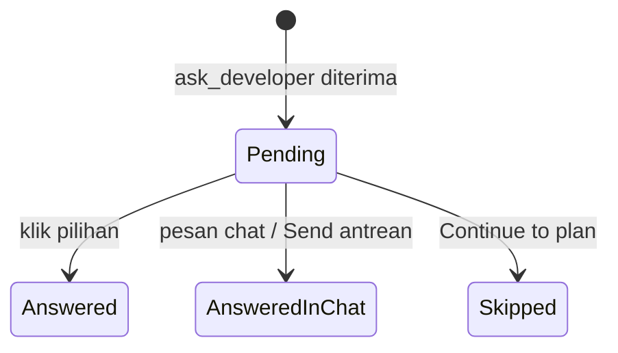

# Pertanyaan agent yang bisa diklik - Plan

## Goal Capsule

- **Objective:** Di giliran brainstorm dan plan, dev menjawab pertanyaan agent dengan satu klik pada kartu pertanyaan di Chat, bukan dengan mengetik ulang pilihan dari teks.
- **Product authority:** pemilik produk Mandor (handokobeni). Arah (alat MCP `ask_developer`, opsi b) dipilih 2026-11-04; cakupan di dokumen ini disetujui 2026-11-07.
- **Open blockers:** tidak ada.
- **Authority order:** Product Contract > Planning Contract > Implementation Units. Aturan `CLAUDE.md` repo (rust-engineering, `make check`) berlaku penuh.
- **Stop conditions:** berhenti dan tanya pemilik produk bila sebuah unit hanya bisa selesai dengan memberi alat ini ke giliran implementasi, VM, atau reviewer, atau dengan melanggar standar rust-engineering.
- **Execution profile:** Rust TDD per unit (domain, store, usecase, lalu adapter), frontend Vitest, lalu uji langsung di laptop.
- **Tail ownership:** implementer membuka PR; pemilik produk yang me-merge.
- **Product Contract preservation:** changed: R7 — "seperti kartu persetujuan" dihapus karena kartu persetujuan tampil di atas composer, bukan di aliran Chat; kartu pertanyaan tampil inline di langkah agent memanggil alat (klarifikasi, disetujui pemilik produk 2026-11-07). Changed: R13 — dev juga bisa membuang pesan antrean yang ditahan (Discard), disetujui pemilik produk 2026-11-07 saat konfirmasi cakupan plan.

---

## Product Contract

### Summary

Di giliran brainstorm dan plan, agent bisa bertanya lewat alat `ask_developer`: satu pertanyaan per giliran, 2–4 pilihan, satu pilihan bisa ditandai rekomendasi. Mandor mencatat pertanyaan itu di run dan menampilkannya di Chat sebagai kartu dengan tombol per pilihan. Klik satu pilihan langsung mengirim jawabannya sebagai pesan dev berikutnya; jawaban bebas ditulis di composer chat.

### Problem Frame

Agent berjalan headless, jadi dialog pertanyaan bawaan Claude Code tidak bisa dipakai. Prompt brainstorm menyuruh agent menulis pertanyaan dan saran jawaban di pesan akhir, dan skill plugin yang biasanya membuka dialog pertanyaan diminta menaruh pertanyaannya di teks. Akibatnya dev membaca pilihan A/B/C lalu mengetik ulang jawabannya di composer, untuk setiap pertanyaan brainstorm.

Giliran implementasi jarang bertanya: dari 49 giliran implementasi di daemon laptop (data 2026-11-07), hanya dua berakhir dengan pertanyaan ke dev, dan keduanya dari kartu yang di-Start tanpa plan. Karena itu cakupan dibatasi ke brainstorm dan plan.

### Key Decisions

- **Alat yang tidak menunggu jawaban.** `ask_developer` mencatat pertanyaan lalu menyuruh agent mengakhiri giliran. Jawaban datang sebagai pesan chat berikutnya, seperti sekarang. Alat yang menunggu akan menggantung proses agent berjam-jam dan rapuh saat daemon restart.
- **Hanya giliran brainstorm dan plan di laptop.** Giliran implementasi, semua giliran di VM, dan reviewer tidak mendapat alat ini; pertanyaan di sana tetap lewat teks, dan "Answer and queue" di laporan pagi VM tidak berubah.
- **Satu pertanyaan per giliran.** Klik langsung terkirim tanpa tombol Send terpisah, sesuai aturan brainstorm "satu pertanyaan per pesan".
- **Pertanyaan di giliran plan berarti plan belum ada.** Giliran plan yang berakhir dengan `ask_developer` tidak menampilkan tombol Approve; agent menulis plan di giliran setelah dijawab.
- **Jawaban bebas lewat composer, bukan kolom Other.** Pesan chat biasa sudah dihitung sebagai jawaban, jadi kartu tidak punya kotak teks sendiri; cukup satu jalur teks.
- **Pertanyaan menahan antrean chat.** Pesan yang ditulis dev selama giliran berjalan tidak dikirim otomatis bila giliran itu berakhir dengan pertanyaan, karena ditulis sebelum pertanyaannya ada.

### Actors

- A1. Dev: membaca kartu pertanyaan dan menjawab dengan klik atau pesan chat biasa.
- A2. Agent (giliran brainstorm atau plan): memanggil `ask_developer` lalu mengakhiri giliran.
- A3. Daemon Mandor: memvalidasi dan menyimpan pertanyaan, mengirim jawaban sebagai giliran berikutnya.

### Requirements

**Alat untuk agent**

- R1. Giliran brainstorm dan plan di laptop selalu punya alat `ask_developer`, termasuk run tanpa sumber desain. Giliran di VM tidak mendapatnya.
- R2. Satu panggilan berisi tepat satu pertanyaan, 2–4 pilihan (label dan penjelasan singkat), dan paling banyak satu pilihan bertanda rekomendasi. Panjang pertanyaan, label, dan penjelasan dibatasi.
- R3. Panggilan yang tidak valid ditolak dengan pesan yang menjelaskan kesalahannya, sehingga agent bisa memperbaiki dan memanggil lagi.
- R4. Panggilan kedua dalam giliran yang sama ditolak; agent diminta mengakhiri giliran.
- R5. Setelah panggilan diterima, alat membalas agar agent mengakhiri giliran tanpa menulis ulang pertanyaan di pesan akhir.
- R6. Prompt brainstorm dan plan, serta pengalihan skill plugin, menyuruh agent bertanya lewat `ask_developer`, bukan lewat teks atau dialog pertanyaan.

**Kartu pertanyaan di Chat**

- R7. Pertanyaan tampil di Chat run sebagai kartu inline, di langkah agent memanggil `ask_developer`: teks pertanyaan, satu tombol per pilihan beserta penjelasannya, tanda teks "Recommended" pada pilihan rekomendasi, dan petunjuk bahwa jawaban sendiri bisa ditulis di chat.
- R8. Klik satu pilihan langsung mengirim jawaban sebagai pesan dev berikutnya dan memulai giliran agent.
- R9. Saat jawaban dikirim, semua tombol kartu nonaktif dengan status "Sending…"; pengiriman yang gagal mengaktifkan kartu lagi dengan catatan error, dan klik pada kartu yang sudah terjawab tidak mengirim jawaban kedua.
- R10. Pesan chat biasa dari dev saat kartu belum terjawab dianggap jawaban; kartu ditandai terjawab lewat chat dan tombolnya nonaktif. Composer memberi petunjuk bahwa pesan akan menjawab pertanyaan.
- R11. Kartu yang selesai tetap tampil di Chat dengan pertanyaan, semua pilihan (pilihan yang dipakai ditandai), dan label "Answered", "Answered in chat", atau "Skipped".
- R12. Pertanyaan yang belum dijawab tetap tampil dan bisa dijawab setelah app ditutup, daemon restart, atau run dibuka dari client lain yang terhubung ke daemon yang sama.
- R13. Bila giliran berakhir dengan pertanyaan, pesan chat yang masuk antrean selama giliran itu tidak dikirim otomatis; kartu tampil dan pesan antrean tetap terlihat sampai dev menjawab kartu, mengirim pesan antrean itu, atau membuangnya.
- R14. Kartu mengikuti aksesibilitas kartu persetujuan: berlabel, tidak mengambil fokus saat muncul, urutan tab mengikuti pilihan, dan perubahan status diumumkan.

**Interaksi dengan plan**

- R15. Giliran plan yang berakhir dengan pertanyaan tidak menghasilkan plan, apa pun teks akhirnya: tombol Approve dan "Approve and queue for VM" tidak muncul, plan sebelumnya tidak bisa di-approve, dan notifikasi menyebut agent bertanya, bukan "plan ready". Tombol muncul lagi setelah agent menulis plan di giliran berikutnya.
- R16. Giliran brainstorm yang berakhir dengan pertanyaan tetap bisa diakhiri dev dengan tombol "Continue to plan"; kartu yang belum terjawab lalu ditandai "Skipped".

**Fallback**

- R17. Bila agent bertanya lewat teks biasa, Chat dan composer bekerja seperti sekarang tanpa kartu.

### Key Flows

- F1. **Brainstorm dengan klik.**
  - **Trigger:** dev memulai brainstorm kartu.
  - **Steps:** agent membaca kode lalu memanggil `ask_developer` → giliran selesai → kartu pertanyaan tampil → dev mengklik pilihan → jawaban terkirim sebagai pesan dev → agent melanjutkan dengan pertanyaan berikutnya atau ringkasan.
  - **Outcome:** brainstorm selesai tanpa dev mengetik ulang pilihan.
- F2. **Pertanyaan di giliran plan.**
  - **Trigger:** giliran plan menemukan hal yang harus diputuskan dev.
  - **Steps:** agent memanggil `ask_developer` → giliran selesai tanpa plan, Approve tersembunyi → dev menjawab → agent menulis plan → Approve muncul.
  - **Outcome:** plan yang disetujui sudah memuat jawaban dev.

### Acceptance Examples

- AE1. **Covers R2, R3.** Given agent memanggil `ask_developer` dengan satu pilihan saja, when daemon memeriksanya, then panggilan ditolak dengan alasan jumlah pilihan dan tidak ada kartu yang dibuat.
- AE2. **Covers R4, R5.** Given agent sudah bertanya di giliran ini, when agent memanggil `ask_developer` lagi, then panggilan ditolak dan hanya kartu pertama yang tampil.
- AE3. **Covers R8, R11.** Given kartu dengan pilihan "Keep both" dan "Replace", when dev mengklik "Keep both", then pesan dev berisi jawaban itu tampil, giliran agent dimulai, dan kartu menampilkan "Keep both" sebagai jawaban tanpa tombol aktif.
- AE4. **Covers R10.** Given kartu belum terjawab, when dev mengetik pesan biasa dan mengirimnya, then pesan itu diteruskan ke agent sebagai jawaban dan kartu ditandai terjawab lewat chat.
- AE5. **Covers R12.** Given kartu belum terjawab, when daemon di-restart lalu run dibuka lagi, then kartu yang sama tampil dan masih bisa diklik.
- AE6. **Covers R15.** Given giliran plan berakhir dengan pertanyaan dan agent masih menulis satu kalimat penutup, when dev membuka run, then tombol Approve tidak ada sampai giliran berikutnya menghasilkan plan.
- AE7. **Covers R1.** Given run tanpa sumber desain, when giliran brainstorm dimulai, then agent tetap punya `ask_developer` dan tetap tidak punya alat buku AC.
- AE8. **Covers R17.** Given agent menulis pertanyaan sebagai teks biasa, when giliran selesai, then Chat menampilkan teks itu seperti sekarang dan composer bisa dipakai menjawab.
- AE9. **Covers R13.** Given dev mengirim pesan saat agent bekerja dan giliran itu berakhir dengan pertanyaan, when giliran selesai, then pesan antrean belum dikirim, kartu tampil, dan pesan antrean terlihat.
- AE10. **Covers R16.** Given brainstorm berakhir dengan kartu yang belum dijawab, when dev menekan Continue to plan, then kartu berlabel "Skipped" dan giliran plan dimulai.

### Scope Boundaries

- Giliran implementasi (laptop dan VM) dan reviewer: tetap bertanya lewat teks; "Answer and queue" di laporan pagi VM tidak berubah.
- Beberapa pertanyaan dalam satu kartu, pilihan ganda (multi-select), kolom jawaban bebas di dalam kartu, dan batas waktu jawaban.
- Membawa kartu yang belum dijawab saat Take over ke laptop lain: riwayat Chat memang tidak ikut pindah.
- Notifikasi baru khusus pertanyaan: notifikasi "giliran selesai" yang sudah ada tetap dipakai.

### Dependencies / Assumptions

- Server MCP Mandor per run dengan token kapabilitas sudah ada dan saat ini hanya dipasang di giliran brainstorm/plan bila run punya sumber desain (`crates/mandor-usecase/src/run/members.rs`). Alat buku AC adalah `ac_ledger_read` dan `ac_set_design`. R1 berarti server itu juga dipasang tanpa sumber desain, dengan alat buku AC tetap hanya untuk run bersumber desain. `ask_developer` juga harus masuk allowlist giliran plan dan berkas izin hook `--plan`.
- Saat ini plan adalah teks akhir giliran plan yang tidak kosong (`crates/mandor-usecase/src/run/session.rs`), dan Approve, Approve and queue for VM, serta notifikasi "plan ready" bergantung padanya. R15 mengubah aturan itu untuk giliran yang bertanya.
- Pesan chat yang dikirim saat agent bekerja masuk antrean run dan dikirim otomatis di akhir giliran; R13 mengecualikan giliran yang bertanya.
- Asumsi: agent mematuhi instruksi mengakhiri giliran setelah alat membalas. Bila agent tetap menulis teks setelahnya, kartu tetap tampil dan teks itu tampil seperti biasa.

### Sources / Research

- `crates/mandor-agent/src/prompt.rs`: `brainstorm_message`, `plan_message`, `push_skill` (instruksi pertanyaan lewat teks saat ini).
- `crates/mandor-api/src/mcp.rs`: server MCP per run dan daftar alat per peran.
- `crates/mandor-usecase/src/review/capability.rs`: peran kapabilitas Design, Verdict, Permit.
- `docs/spec/02-agent-pipeline.md`: perilaku AskUserQuestion di Korlap asli (referensi).

---

## Planning Contract

### Key Technical Decisions

- KTD-Q1. **Pertanyaan disimpan di tabel baru `questions`, bukan di aliran pesan.** Pesan Chat bersifat append-only; status kartu (Pending, Answered, AnsweredInChat, Skipped) berubah setelah dibuat. Pola mengikuti tabel `approvals` (migrasi 0012): satu baris per pertanyaan, transisi keluar Pending lewat `UPDATE … WHERE status='pending'` sehingga klik ganda dan balapan chat hanya punya satu pemenang (R9).
- KTD-Q2. **Kartu ditautkan ke aliran Chat lewat id pertanyaan di hasil alat.** Panggilan MCP tidak membawa `tool_use_id`. `ask.tool.ask` mengembalikan string polos pendek (< 200 karakter, batas preview hasil tool di `crates/mandor-agent/src/claude/stream.rs`) yang diawali id pertanyaan, mis. `q-… recorded; end your turn now`, dan `chat.ts` mengganti blok tool `ask_developer` yang hasilnya memuat id itu dengan blok `question`. Panggilan yang ditolak tetap tampil sebagai tool call biasa dengan error-nya.
- KTD-Q3. **Satu pertanyaan per generasi giliran, dijaga database.** Baris menyimpan `generation` run, yang dinaikkan setiap giliran dimulai (`spawn_turn`) dan saat interupsi. Indeks UNIQUE `(run_id, generation)` membuat panggilan kedua, termasuk panggilan paralel, gagal di store dan dipetakan ke penolakan R4; `finish_turn` mencari pertanyaan Pending pada generasi giliran yang selesai untuk tahu giliran itu bertanya.
- KTD-Q4. **Peran kapabilitas baru `Ask`, dan peran Design mendapat alat yang sama.** Giliran brainstorm dan plan di laptop selalu mendapat token: peran Design bila run punya sumber desain (alat buku AC + `ask_developer`), selain itu peran `Ask` (hanya `ask_developer`, tanpa `ac_ledger_read`). `tools/list` di `mcp.rs` berubah: `ac_ledger_read` hanya untuk peran design dan verdict. Reviewer (Verdict) dan giliran implementasi tidak pernah mendapatnya. Penegakan ada di daemon, bukan hanya di `tools/list`: `scoped_route` di `crates/mandord/src/dispatch.rs` mendapat rute `Ask` yang hanya menerima `ask.tool.ask` dan `ledger.tool.info` untuk peran ask, dan `ask.tool.ask` untuk peran design; peran verdict dan permit menolak `ask.tool.ask`.
- KTD-Q5. **VM tidak mendapat alat.** `LedgerToolInfo` mendapat flag `ask` (seperti flag `visual`) yang false di daemon VM; `tools/list` hanya menambahkan `ask_developer` bila flag itu true, allowlist dan berkas izin hanya menambahkannya untuk giliran laptop, `agent_request` tidak menerbitkan token `Ask` di VM, dan `ask` di usecase menolak di VM (R1). Token Design di VM tetap seperti sekarang.
- KTD-Q6. **Approve dijaga oleh pertanyaan Pending, plan lama tidak dihapus.** `run.plan` tidak disimpan dari giliran yang bertanya (R15). Plan sebelumnya tetap tampil di tab Plan, tetapi `approve_plan` dan `prepare_for_vm` menolak selama run punya pertanyaan Pending, dan UI tidak merender kedua tombol (R15, AE6). `RunView` mendapat field pertanyaan Pending agar UI tidak perlu query terpisah.
- KTD-Q7. **Antrean ditahan, lalu dikirim atau dibuang oleh dev.** `finish_turn` tidak menguras `run.queue` bila giliran bertanya (R13). Chip antrean di composer mendapat aksi Send (mengirim semua pesan antrean sebagai satu pesan, dihitung jawaban lewat chat) dan Discard. Bila dev mengklik pilihan, jawaban dikirim dulu dan antrean terkuras normal setelah giliran itu.
- KTD-Q8. **Isi jawaban ke agent adalah label pilihan saja.** Agent masih punya pertanyaannya di sesi yang sama; pesan Chat dev menampilkan label itu.
- KTD-Q9. **Validasi dan batas di domain.** `mandor-domain` memvalidasi pertanyaan: satu pertanyaan tidak kosong ≤ 500 karakter, 2–4 pilihan dengan label unik tidak kosong ≤ 80 dan penjelasan tidak kosong ≤ 300, paling banyak satu `recommended`. Pesan tolak berbahasa Inggris dan menyebut aturan yang dilanggar (R3). Kartu menampilkan teks polos tanpa Markdown.
- KTD-Q10. **Pesan chat menjawab, Continue to plan melewati, dan baris ditutup setelah giliran mulai.** `send_message` dan `send_now` saat ada pertanyaan Pending menandainya AnsweredInChat dengan teks pesan (R10); `continue_to_plan` menandainya Skipped (R16). Baris ditutup hanya setelah `spawn_turn` berhasil, sehingga giliran yang gagal dimulai meninggalkan kartu Pending yang bisa dicoba lagi (R9); balapan dua jawaban diputus oleh simpan run bergenerasi di `spawn_turn`. `answer` menerima state yang sama dengan `send_message` (AwaitingDev dan Failed); pada run yang gagal, klik pilihan memulai giliran seperti pesan chat.
- KTD-Q11. **Notifikasi memakai jenis yang ada.** Giliran yang bertanya mengirim `AwaitingAnswer` dengan teks "The agent has a question: pick an answer or reply in chat", bukan "Plan ready" (R15).
- KTD-Q12. **Prompt mengikuti ketersediaan alat.** Bila giliran mendapat `ask_developer`, `brainstorm_message`, `plan_message`, `continue_plan_message`, dan `push_skill` meminta agent bertanya lewat alat itu lalu mengakhiri giliran. Bila tidak (VM), instruksi teks lama dipakai. Agent yang tetap bertanya lewat teks ditangani R17.

### High-Level Technical Design

```mermaid
sequenceDiagram
    participant A as Agent (claude -p)
    participant M as mandord mcp
    participant D as Daemon (usecase)
    participant S as SQLite questions
    participant UI as App (Chat)
    A->>M: tools/call ask_developer
    M->>D: ask.tool.ask (token Ask/Design)
    D->>D: validasi domain, peran, fase, satu per generasi
    D->>S: INSERT pending
    D-->>UI: event questions.changed
    D-->>A: "question q-… recorded; end your turn now"
    A-->>D: giliran selesai
    D->>D: finish_turn: ada pending → tidak simpan plan, tahan antrean, notifikasi "has a question"
    UI->>D: questions.answer(id, option)
    D->>S: UPDATE pending→answered
    D->>A: giliran baru dengan label pilihan
```



### Sequencing

U1 → U2 → U3 → U4 → U5 → U6 → U7. U6 bisa mulai dengan data tiruan setelah DTO di U5 ada.

### Risks

- `finish_turn` mencabut semua token run sebelum memeriksa generasi. Setelah `send_now`, `finish_turn` giliran lama bisa mencabut token giliran baru sehingga `ask_developer` gagal di giliran itu. Risiko ini sudah ada; U3 memperbaikinya dengan mencabut token hanya bila generasi cocok, bila perbaikannya kecil, atau mencatatnya sebagai tindak lanjut.

---

## Implementation Units

### U1. Model pertanyaan di domain

**Goal:** Aturan murni pertanyaan: validasi isi dan transisi status.

**Requirements:** R2, R3, R9, R10, R16.

**Dependencies:** tidak ada.

**Files:**
- `crates/mandor-domain/src/question.rs` (baru)
- `crates/mandor-domain/src/lib.rs`

**Approach:** Tipe `QuestionDraft` (teks, pilihan berisi label, penjelasan, flag rekomendasi) dengan `validate` yang mengembalikan error domain berpesan jelas sesuai KTD-Q9. Enum `QuestionStatus` (Pending, Answered, AnsweredInChat, Skipped) dengan `as_str`/`parse` dan fungsi transisi yang hanya mengizinkan keluar dari Pending.

**Patterns to follow:** enum berstatus di `crates/mandor-domain/src/ac_ledger.rs` (`parse`/`as_str`).

**Test scenarios:**
- Covers AE1. Satu pilihan saja → error "2 to 4 options"; lima pilihan → error yang sama.
- Pertanyaan kosong atau hanya spasi → ditolak; 501 karakter → ditolak; 500 → diterima.
- Label kosong, label duplikat (abaikan huruf besar-kecil), label 81 karakter, penjelasan kosong, penjelasan 301 karakter → masing-masing ditolak dengan pesan yang menyebut pilihan ke berapa.
- Dua pilihan `recommended` → ditolak; nol atau satu → diterima.
- Transisi Pending → Answered/AnsweredInChat/Skipped berhasil; transisi dari status selain Pending → error.
- `parse(as_str(x)) == x` untuk semua status; string tak dikenal → `None`.

**Verification:** test domain hijau; crate domain tetap tanpa dependensi I/O.

### U2. Penyimpanan pertanyaan

**Goal:** Tabel dan adapter store untuk pertanyaan.

**Requirements:** R9, R11, R12.

**Dependencies:** U1.

**Files:**
- `crates/mandor-store/migrations/0013_questions.sql` (baru)
- `crates/mandor-store/src/questions.rs` (baru), `crates/mandor-store/src/lib.rs`
- `crates/mandor-usecase/src/run_ports.rs` (trait `QuestionStore` dan tipe baris), `crates/mandor-usecase/src/ports.rs` (tipe asosiasi di `Deps`), `crates/mandor-usecase/tests/common/mod.rs` (fake), `crates/mandord/src/prod.rs` (wiring)
- `crates/mandor-store/tests/questions.rs` (baru)
- `.sqlx/` (cache query)

**Approach:** Kolom: `id`, `run_id`, `generation`, `question`, `options_json`, `status`, `answer`, `created_ms`, `closed_ms`; indeks `(run_id, created_ms)`, indeks UNIQUE `(run_id, generation)`, dan indeks parsial untuk `status='pending'`. Operasi: `insert` (melaporkan konflik bila generasi itu sudah punya pertanyaan), `list_for_run`, `pending_for_run`, `pending_for_generation`, dan `close(id, status, answer)` yang memakai `BEGIN IMMEDIATE` dan `UPDATE … WHERE status='pending'`, mengembalikan apakah baris berubah.

**Patterns to follow:** `crates/mandor-store/src/approvals.rs` dan migrasi `0012_approvals.sql`.

**Test scenarios:**
- Insert lalu `list_for_run` mengembalikan pertanyaan dengan pilihan utuh dan status Pending.
- `close` pertama mengembalikan true; `close` kedua pada id yang sama mengembalikan false dan tidak mengubah jawaban (R9).
- `pending_for_generation` hanya menemukan baris generasi itu; baris generasi lain atau yang sudah ditutup tidak ikut.
- Pertanyaan run lain tidak muncul di `list_for_run`.
- Insert kedua untuk run dan generasi yang sama → konflik, baris tetap satu.
- Covers AE5. Data bertahan setelah pool ditutup dan dibuka ulang pada berkas database yang sama.

**Verification:** test store hijau; `make sqlx-prepare` memperbarui cache.

### U3. Usecase: bertanya, menjawab, dan akhir giliran

**Goal:** Alur pertanyaan di `RunService`: menerima panggilan alat, menjawab, menandai lewat chat atau dilewati, menahan antrean, dan menjaga Approve.

**Requirements:** R1, R4, R5, R8, R10, R12, R13, R15, R16.

**Dependencies:** U1, U2.

**Files:**
- `crates/mandor-usecase/src/run/questions.rs` (baru)
- `crates/mandor-usecase/src/run/session.rs` (`finish_turn`, `send_message`, `send_now`, `continue_to_plan`, `approve_plan`)
- `crates/mandor-usecase/src/run/send_to_vm.rs` (`prepare_for_vm`)
- `crates/mandor-usecase/src/run/members.rs` (`agent_request`: token Ask/Design)
- `crates/mandor-usecase/src/review/capability.rs` (peran `Ask`)
- `crates/mandor-usecase/tests/questions_flow.rs` (baru)

**Approach:**
- `ask(scope, draft)`: peran harus Design atau Ask, run di fase Brainstorm atau Plan dan sedang bekerja, daemon bukan VM; validasi domain; simpan dengan generasi run (konflik store → penolakan R4); kembalikan string KTD-Q2. Event ke client lewat wrapper store di U5.
- `answer(question_id, option_index)`: run harus tidak sibuk (AwaitingDev atau Failed, sama dengan `send_message`); mulai giliran dengan label sebagai pesan dev; setelah `spawn_turn` berhasil, tutup baris sebagai Answered dengan label.
- `send_message`/`send_now`: bila ada pertanyaan Pending, setelah giliran berhasil dimulai tutup sebagai AnsweredInChat dengan teks pesan.
- `send_queued(run_id)` dan `discard_queued(run_id)`: kirim gabungan antrean sebagai satu pesan (menjawab lewat chat), atau kosongkan antrean.
- `finish_turn` untuk TurnEnd::Ok: bila ada Pending pada generasi ini → jangan simpan `run.plan`, jangan kuras antrean, state AwaitingDev, notifikasi KTD-Q11.
- `continue_to_plan` menutup Pending sebagai Skipped; `approve_plan` dan `prepare_for_vm` menolak bila ada Pending.
- `agent_request`: di fase Brainstorm dan Plan, terbitkan token Design bila ada sumber desain (seperti sekarang, juga di VM) atau token Ask bila tidak ada dan daemon bukan VM.

**Execution note:** mulai dari test usecase dengan fake port untuk `finish_turn` yang bertanya; perilaku ini paling mudah salah.

**Patterns to follow:** `crates/mandor-usecase/src/approval/service.rs` (transisi kartu, notifikasi), test `crates/mandor-usecase/tests/approval_flow.rs`.

**Test scenarios:**
- Covers AE2. Panggilan kedua pada generasi yang sama ditolak; baris tetap satu.
- Panggilan dari peran Verdict, dari run fase Implement, atau di daemon VM → ditolak tanpa baris.
- Covers AE6. Giliran plan memanggil alat lalu berakhir dengan teks "Waiting for your answer" → `run.plan` tidak berubah, notifikasi "has a question", `approve_plan` dan `prepare_for_vm` ditolak dengan alasan pertanyaan terbuka.
- Giliran plan tanpa pertanyaan → plan tersimpan dan notifikasi "Plan ready" seperti sekarang.
- Covers AE3. `answer` menutup baris sebagai Answered dengan label, giliran baru dimulai dengan pesan berisi label; `answer` kedua → error, tidak ada giliran kedua.
- `answer` dengan indeks di luar rentang atau saat run masih bekerja → error, baris tetap Pending.
- Spawn agent gagal saat `answer` atau `send_message` → baris tetap Pending dan `answer` bisa dicoba lagi.
- `answer` pada run Failed dengan pertanyaan Pending → giliran dimulai dan baris Answered.
- Covers AE4. `send_message` saat Pending → baris AnsweredInChat dengan teks pesan, giliran dimulai.
- Covers AE9. Pesan antrean saat giliran bertanya → setelah giliran, antrean utuh, tidak ada giliran baru; `send_queued` → satu giliran dengan pesan gabungan dan baris AnsweredInChat; `discard_queued` → antrean kosong, pertanyaan tetap Pending.
- Klik pilihan saat antrean ditahan → jawaban terkirim; setelah giliran jawaban selesai, antrean terkuras seperti biasa.
- Covers AE10. `continue_to_plan` saat Pending → Skipped, giliran plan dimulai.
- Covers AE7. Run tanpa sumber desain di laptop (brainstorm dan plan) → token Ask; dengan sumber desain → Design; VM dengan sumber desain → Design; VM tanpa sumber desain → tanpa token; `ask` di VM → ditolak.

**Verification:** test usecase hijau; perilaku lama (plan tanpa pertanyaan, antrean biasa) tidak berubah.

### U4. Alat MCP, allowlist, izin hook, dan prompt

**Goal:** Agent melihat dan bisa memanggil `ask_developer` di giliran yang tepat, dan diminta memakainya.

**Requirements:** R1, R2, R3, R5, R6, R17.

**Dependencies:** U3.

**Files:**
- `crates/mandor-protocol/src/lib.rs` (method `ask.tool.ask`), `crates/mandor-protocol/src/dto.rs` (`AskToolQuestion`, `LedgerToolInfo.role` mencakup `ask`, flag `LedgerToolInfo.ask`), `crates/mandor-protocol/tests/ts_bindings.rs`
- `crates/mandor-api/src/mcp.rs` (definisi alat, `tools/list` per peran, `tools/call`)
- `crates/mandor-agent/src/port.rs` (allowlist plan, berkas izin, server `mandor` untuk peran Ask)
- `crates/mandor-agent/src/prompt.rs`
- test di `crates/mandor-api/src/mcp.rs`, `crates/mandor-agent/src/port.rs`, `crates/mandor-agent/src/prompt.rs`

**Approach:** Skema input alat: `question` (string), `options` (array berisi `label`, `description`, `recommended` opsional). Deskripsi alat menjelaskan aturan KTD-Q9 dan bahwa giliran harus diakhiri setelah panggilan berhasil. `tools/list`: peran design → baca buku AC, set design, dan ask bila flag `ask`; peran ask → ask saja; verdict tidak berubah. Allowlist giliran brainstorm dan plan menambahkan `mcp__mandor__ask_developer` untuk giliran laptop dengan token Ask atau Design, terpisah dari alat buku AC; berkas izin `--plan` mengikutinya. Prompt sesuai KTD-Q12, dengan input ketersediaan alat.

**Patterns to follow:** alat `ac_set_visual` yang muncul bersyarat di `tools_list`; `PLAN_LEDGER_TOOLS` di `port.rs`.

**Test scenarios:**
- `tools/list` per peran: design dengan flag ask → `ac_ledger_read`, `ac_set_design`, `ask_developer`; design tanpa flag (VM) → tanpa `ask_developer`; ask → hanya `ask_developer`; verdict → tanpa `ask_developer`.
- `tools/call ask_developer` dengan argumen valid meneruskan ke `ask.tool.ask` dan mengembalikan teks berisi id; argumen salah bentuk → `isError` dengan pesan; error daemon (mis. panggilan kedua) → `isError` dengan pesan daemon.
- Covers AE7. Spesifikasi sesi giliran plan tanpa sumber desain memuat server `mandor` dan `mcp__mandor__ask_developer` di allowlist, tanpa alat buku AC; dengan sumber desain memuat ketiganya; giliran implementasi tidak memuatnya.
- Berkas izin giliran plan memuat alat yang sama dengan allowlist.
- Prompt brainstorm, plan, continue-to-plan, dan pengalihan skill dengan alat tersedia menyebut `ask_developer` dan mengakhiri giliran; tanpa alat memakai instruksi teks lama; prompt implementasi tidak menyebutnya.

**Verification:** test crate hijau; binding TS diperbarui.

### U5. Protokol client, dispatch, dan event

**Goal:** App bisa membaca, menjawab, dan mengelola antrean yang ditahan, dan mendapat kabar perubahan.

**Requirements:** R8, R11, R12, R13, R15.

**Dependencies:** U3, U4.

**Files:**
- `crates/mandor-protocol/src/lib.rs` (`questions.list`, `questions.answer`, `runs.queued.send`, `runs.queued.discard`, event `questions.changed`), `crates/mandor-protocol/src/dto.rs` (`QuestionView`, `RunView.pending_question`)
- `crates/mandord/src/dispatch/questions.rs` (baru), `crates/mandord/src/dispatch.rs` (`scoped_route` rute `Ask`), `crates/mandord/src/question_events.rs` (baru, wrapper store yang memancarkan `questions.changed` dan `run.updated`), `crates/mandord/src/views.rs`
- `crates/mandor-protocol/tests/ts_bindings.rs`, `apps/desktop/src/lib/protocol/` (hasil generate)

**Approach:** Rute kapabilitas mengurai `ask.tool.ask`, memanggil usecase dengan scope token, dan memetakan error domain ke pesan tool. Method client memakai run id dan id pertanyaan; error usecase dipetakan ke error RPC yang ada. Event `questions.changed` membawa run id, dipancarkan saat bertanya dan saat status berubah, mengikuti `approval_events.rs`.

**Patterns to follow:** `crates/mandord/src/dispatch/approvals.rs`, `crates/mandord/src/approval_events.rs`.

**Test scenarios:**
- `questions.list` mengembalikan pertanyaan run dengan status dan jawaban; run tak dikenal → error.
- `questions.answer` sukses lalu ulang → error kedua tanpa giliran baru.
- `ask.tool.ask` dengan token peran verdict atau permit → ditolak; dengan token ask atau design → tersimpan dan event dipancarkan.
- Token peran ask memanggil `ledger.tool.read` atau `ledger.tool.set_design` → ditolak.
- `runs.queued.send` dan `runs.queued.discard` meneruskan ke usecase.
- Binding TS `QuestionView` dan `RunView.pending_question` sesuai.

**Verification:** test mandord dan binding TS hijau.

### U6. Kartu pertanyaan, composer, dan gerbang Approve di app

**Goal:** Dev melihat dan menjawab pertanyaan di Chat.

**Requirements:** R7–R14, R15, R16.

**Dependencies:** U5.

**Files:**
- `apps/desktop/src/lib/stores/questions.svelte.ts` (baru) dan test-nya
- `apps/desktop/src/lib/chat.ts` dan `apps/desktop/src/lib/components/workspace/chat.test.ts`
- `apps/desktop/src/lib/components/workspace/QuestionCard.svelte` (baru) dan test-nya
- `apps/desktop/src/lib/components/workspace/ChatStream.svelte`, `Composer.svelte`, `Workspace.svelte`, `QueueForVm.svelte`
- mock `/?mock` untuk tampilan

**Approach:** Store memuat `questions.list` per run dan memuat ulang saat `questions.changed`. `toBlocks` mengubah tool call `mcp__mandor__ask_developer` yang hasilnya memuat id pertanyaan menjadi blok `question`; panggilan yang ditolak tetap tool call. `QuestionCard`: pertanyaan, tombol pilihan dengan penjelasan, label teks "Recommended", petunjuk "Or type your own answer below"; saat dikirim semua tombol nonaktif dengan "Sending…", gagal → aktif lagi dengan catatan error; status akhir dengan pilihan terpakai ditandai dan label Answered / Answered in chat / Skipped. Aksesibilitas mengikuti `ApprovalCard` (article berlabel, tanpa autofocus, status diumumkan). Composer: placeholder menyebut bahwa pesan menjawab pertanyaan saat ada Pending; chip antrean mendapat Send dan Discard saat run AwaitingDev dengan pertanyaan Pending. Tombol Approve dan Approve and queue for VM tidak dirender saat `pending_question` ada. Tombol pilihan nonaktif selama run sibuk, dengan petunjuk bahwa jawaban bisa dipilih setelah giliran selesai.

**Patterns to follow:** `ApprovalCard.svelte`, `stores/approvals.svelte.ts`, `ToolCallGroup.svelte`.

**Test scenarios:**
- `toBlocks`: tool call ask yang hasilnya memuat id → blok question di posisi itu; hasil error → tetap tool call; tool lain di grup yang sama tetap di blok tools.
- Covers AE3. Klik pilihan memanggil `questions.answer` dengan indeks; selama menunggu semua tombol nonaktif dan "Sending…" tampil; sukses → kartu menampilkan Answered dengan pilihan ditandai.
- Gagal kirim → tombol aktif lagi dengan catatan error.
- Kartu AnsweredInChat dan Skipped menampilkan label masing-masing tanpa tombol aktif.
- Pilihan rekomendasi menampilkan teks "Recommended".
- Covers AE6. Run dengan `pending_question` → tombol Approve dan Approve and queue for VM tidak ada.
- Run masih bekerja → tombol pilihan nonaktif dengan petunjuk; run Failed → tombol aktif.
- `toBlocks` menemukan id dari preview hasil yang berupa string JSON berkutip.
- Covers AE9. Chip antrean menampilkan Send dan Discard hanya saat ada pertanyaan Pending dan run AwaitingDev.
- Covers AE8. Pesan assistant berisi pertanyaan teks biasa tetap tampil sebagai blok assistant.

**Verification:** `bun run --cwd apps/desktop test` dan `check` hijau; tampilan dicek di `/?mock`.

### U7. Dokumen dan uji langsung

**Goal:** Fitur terbukti dengan agent asli dan terdokumentasi.

**Requirements:** semua; AE1–AE10 yang bisa diamati.

**Dependencies:** U1–U6.

**Files:**
- `docs/progress/clickable-agent-questions.md` (baru)
- `README.md` atau runbook terkait bila menyebut alur brainstorm

**Approach:** Kartu uji di Base salinan dan repo `mandor-smoke`, mode Brainstorm, then plan. Amati: agent bertanya lewat kartu, klik menjawab, pesan chat menjawab, Continue to plan melewati, giliran plan bertanya tanpa Approve, antrean ditahan, kartu bertahan setelah restart daemon. Catat hasil per AE.

**Test expectation:** none -- unit ini dokumentasi dan uji manual.

**Verification:** dokumen progres memuat hasil uji langsung per AE.

---

## Verification Contract

| Gerbang | Perintah | Kapan |
|---|---|---|
| Rust penuh | `make check` (fmt, clippy pedantic, deny, test, coverage, sqlx offline) | setiap unit Rust |
| Cache sqlx | `make sqlx-prepare` | U2 dan setiap perubahan query |
| Binding TS | `MANDOR_REGEN_TS=1 cargo test -p mandor-protocol --test ts_bindings`, lalu tanpa variabel | U4, U5 |
| Frontend | `bun run --cwd apps/desktop test` dan `bun run --cwd apps/desktop check` | U6 |
| Tampilan | `/?mock` di browser | U6 |
| Uji langsung laptop | kartu uji brainstorm dan plan: AE1–AE10 yang bisa diamati | U7 |

---

## Definition of Done

- Unit U1–U7 selesai dengan gerbang di Verification Contract hijau, termasuk `make check`.
- Setiap AE1–AE10 terbukti oleh test otomatis atau dicatat di uji langsung.
- Giliran implementasi, reviewer, dan semua giliran VM terbukti tidak mendapat `ask_developer` (test U3 dan U4).
- Dokumen progres memuat hasil uji langsung.
- PR dibuka dari branch fitur; tidak di-merge sendiri.
