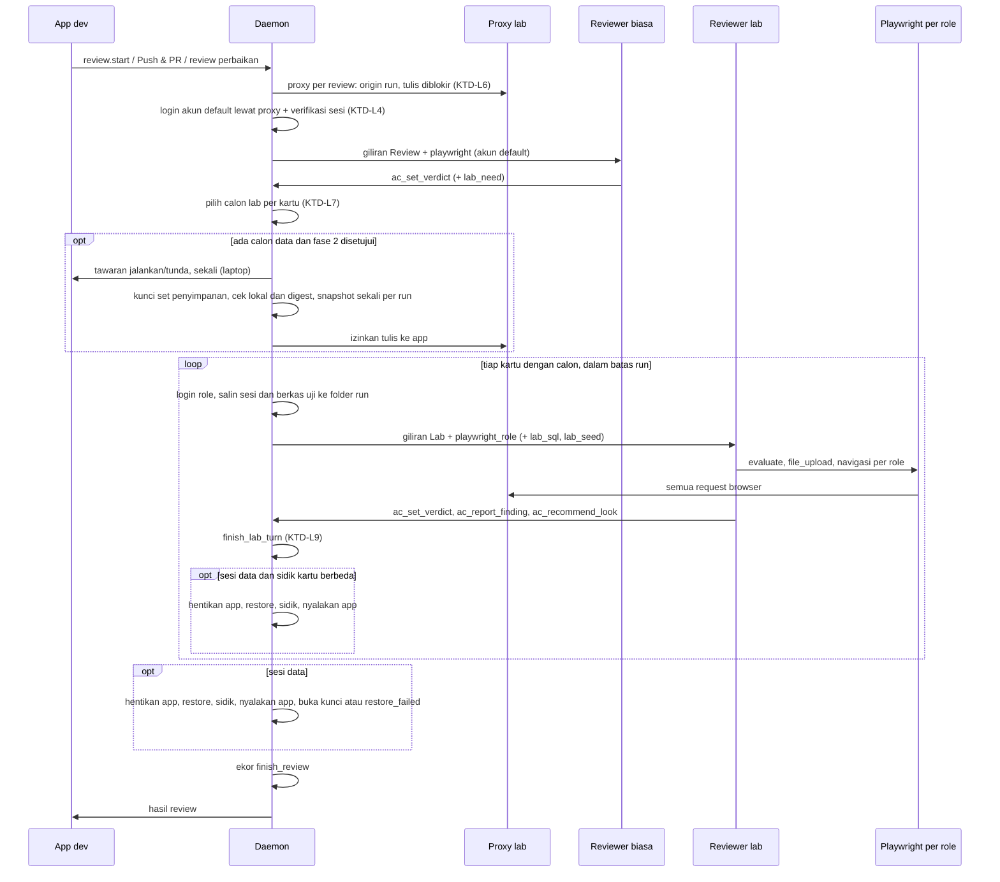
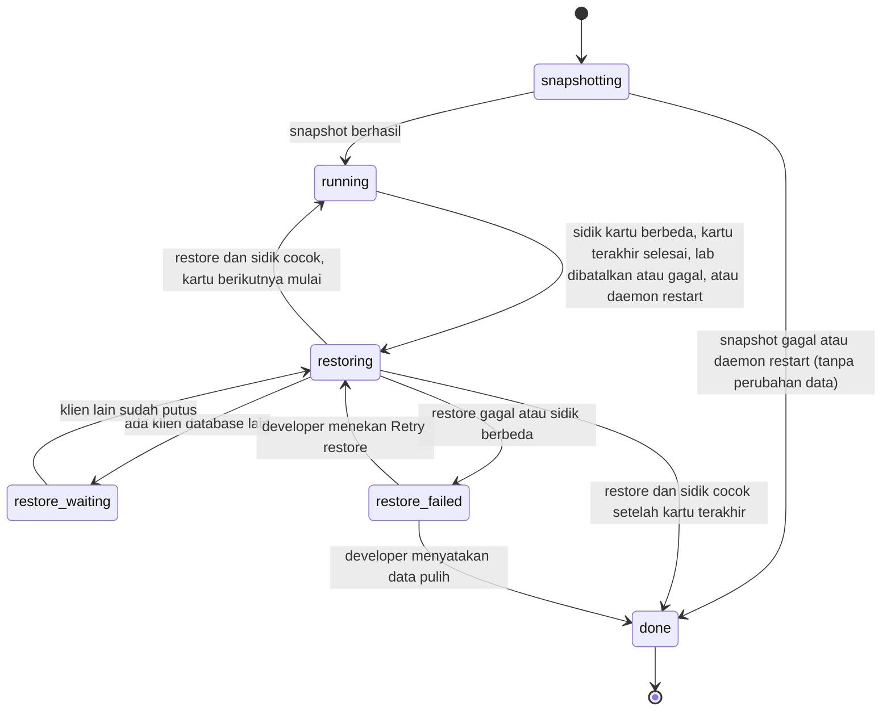

# Review lab untuk verifikasi AC otomatis - Plan

## Goal Capsule

- **Objective:** Mandor memverifikasi sendiri AC yang sekarang berakhir *Can't verify*, dengan mengubah data uji lokal, login sebagai akun uji per role, mensimulasikan kegagalan, dan melampirkan berkas uji, lalu memulihkan lingkungan lokal seperti semula.
- **Product authority:** pemilik produk Mandor (handokobeni). Arah dan cakupan disetujui 2026-11-10 dalam brainstorm ini; pemilik produk memberi izin reviewer menjalankan JavaScript di halaman, mengubah data uji, dan login dengan akun uji.
- **Open blockers:** tidak ada.
- **Execution profile:** dua fase berurutan dalam satu plan. Fase 1 (U1–U10, U17) dikirim sebagai PR sendiri dan diuji langsung di run kelola sebelum fase 2 (U11–U16) dimulai. Semua kode Rust mengikuti skill `rust-engineering` dan TDD lewat antarmuka publik.
- **Stop conditions:** berhenti dan tanya pemilik produk bila sebuah unit tidak bisa diselesaikan tanpa melanggar `rust-engineering`, bila versi Playwright MCP yang terpasang tidak mendukung `--storage-state`, `--proxy-server`, atau `browser_run_code` untuk login daemon (KTD-L4), bila login kelola-v2 bukan satu form di origin app, atau bila perilaku produk di Product Contract perlu berubah.
- **Tail ownership:** PR dibuka per fase dan tidak di-merge sendiri; pemilik produk yang me-merge. Daemon WSL dipasang ulang hanya bila tidak ada agent yang sedang bekerja.

---

## Product Contract

### Summary

Mandor menambah tahap **review lab** setelah review AC biasa. AC yang tidak bisa dibuktikan oleh review biasa otomatis diuji di lab: browser Playwright terpisah yang boleh mengubah data uji di database lokal, login dengan akun uji per role, mencegat atau menggagalkan request, dan melampirkan berkas uji. Seluruh perubahan data diapit snapshot sebelum lab dan restore sesudahnya.

### Problem Frame

Reviewer AC Mandor sekarang hanya-baca: prompt-nya melarang mengubah berkas atau git, ia memakai sesi Chrome milik developer, dan ia tidak punya cara menyiapkan keadaan yang dituntut AC. Aturan prompt "a pass for a criterion about what the user sees needs concrete browser steps" membuat AC yang butuh keadaan khusus berakhir *Can't verify*.

Pada run PGS-1477–PGS-1483 (kelola-v2, 2026-11-09), review terakhir menyisakan sekitar 58 AC *Can't verify* atau *looks different*. Semuanya berhasil diverifikasi manual di sesi Claude Code dalam beberapa jam, dengan teknik yang tidak tersedia bagi reviewer:

| Kebutuhan AC | Teknik manual | Kira-kira jumlah AC |
|---|---|---|
| Loading, error jaringan, 5xx, 403, unggah berkas (palsu, .xls, >10 MB, dua berkas) | JavaScript di halaman: memperlambat atau menggagalkan request, melampirkan berkas lewat `DataTransfer` | 25 |
| Data tertentu (nilai KB, nilai tidak valid, KB dipasang atau dilepas, corporate tanpa karyawan) | upload data uji, ubah aspek, lalu pulihkan | 15 |
| Role lain (non-admin, admin internal landlord) | developer login manual sebagai Manager; developer mengubah Corporate Config | 8 |
| Isolasi antar-corporate | corporate kedua (Pentest 2026) | 1 |
| Perbedaan dengan prototype | keputusan developer | 9 |

Verifikasi manual itu juga meninggalkan sisa data yang tidak bisa dihapus lewat app (KB library uji, nilai karyawan uji, data di corporate kedua), dan sekali membuat review gagal memakai browser karena beberapa Chrome tersambung ke akun Claude yang sama.

### Key Decisions

- **Dua tahap: review biasa, lalu lab hanya untuk AC yang perlu.** Review biasa tetap cepat, murah, dan hanya-baca. Alat berisiko, budget besar, dan kunci app hanya dipakai di lab.
- **Perubahan data hanya di database lokal development.** Mandor menolak menjalankan lab bila app tidak memakai database di mesin sendiri. Staging bersama dan produksi tetap hanya-baca.
- **Snapshot dan restore otomatis lewat perintah repo.** Data kembali persis seperti sebelum lab, termasuk data yang tidak bisa dihapus lewat app. Cakupannya semua penyimpanan state lokal app (database, berkas unggahan, cache), dan Mandor memeriksa hasil restore, tidak hanya kode keluarnya.
- **Jangkauan: semua database lokal app.** Tenant utama, tenant lain (corporate kedua), dan landlord ikut snapshot dan restore, sehingga AC seperti batas atas KB dan isolasi antar-corporate bisa diuji.
- **Jalur perubahan data: UI/API app dengan akun uji, perintah seed repo, dan SQL langsung ke database lokal.** SQL diizinkan karena beberapa keadaan tidak bisa dibuat lewat app; lingkungan lokal dan restore membatasi risikonya. Seed dan SQL dijalankan daemon atas permintaan reviewer, sehingga kredensial tidak pernah dipegang agent.
- **Playwright headless untuk seluruh review, di laptop dan VM.** Satu mesin browser yang mendukung intersep jaringan, lampiran berkas, JavaScript, dan beberapa akun sekaligus, tanpa menyentuh Chrome developer dan tanpa masalah ekstensi. Review biasa login dengan akun uji default repo, karena sesi Chrome developer tidak lagi tersedia.
- **Akun uji per role disimpan sebagai secret per repo.** Developer mengisi password sendiri; daemon yang login, dan reviewer memakai browser terpisah per akun yang sudah login.
- **Batas lab ditegakkan daemon, bukan kepatuhan agent.** Reviewer lab membaca halaman dan repo yang tidak tepercaya sambil memegang alat berisiko, jadi batas lokal, allowlist, dan isolasi kredensial harus tetap berlaku walau agent terkena injeksi prompt.
- **Perlengkapan lab diusulkan agent, disetujui developer.** Agent membaca repo dan mengusulkan perintah snapshot, restore, seed, akses database lokal, dan daftar akun uji; developer memeriksa lalu menyimpan.
- **App lokal dikunci selama lab.** Developer diperingatkan sebelum lab mulai, dan selama lab app lokal dianggap milik reviewer, karena restore akan menghapus perubahan apa pun yang dibuat selama itu.
- **Keputusan produk tetap di developer, dengan rekomendasi reviewer.** Untuk tiap *looks different*, reviewer menyarankan *difference accepted* atau ikut prototype beserta alasannya; temuan di luar AC dicatat terpisah. Developer menyetujui atau menolak dengan satu klik.
- **AC yang lulus di lab adalah Pass penuh.** Tidak perlu konfirmasi manual saat push; konfirmasi manual hanya untuk AC yang tetap *Can't verify*. Pass yang keadaan awalnya dibuat lewat SQL langsung atau simulasi request tetap Pass penuh, tetapi ditandai di verdict agar terlihat. *Looks different* tetap menahan push seperti sekarang sampai developer memutuskannya.
- **Dikirim dua fase.** Fase 1: Playwright untuk semua review, serta simulasi request, JavaScript, lampiran berkas, dan akun uji untuk lab, tanpa mengubah data dan tanpa kunci app; perkiraan awal sekitar 33 dari 49 AC calon lab, dihitung ulang saat uji langsung karena AC upload yang butuh server pindah ke fase 2. Fase 2: snapshot dan restore, seed, SQL, dan kunci app. Nilai terbesar datang lebih dulu, bagian paling berisiko menyusul setelah fase 1 terbukti.
- **Di laptop, lab yang mengubah data bisa ditunda.** Developer memilih menjalankannya sekarang atau membiarkan AC *Can't verify* dulu dan menjalankannya nanti; di VM lab berjalan otomatis.

### Actors

- A1. Developer: menjalankan run, menyetujui perlengkapan lab, mengisi password akun uji, memutuskan rekomendasi tampilan dan temuan.
- A2. Reviewer biasa: agent yang menilai AC seperti sekarang, hanya-baca.
- A3. Reviewer lab: agent dengan izin lab yang menguji AC sisa.
- A4. Daemon Mandor: menjalankan snapshot, restore, dan kunci app; login akun uji; menjalankan seed dan SQL atas permintaan reviewer lab; menegakkan batas lingkungan lokal; menyimpan hasil.
- A5. Agent pengusul: membaca repo dan mengusulkan perlengkapan lab.

### Key Flows

- F1. Review dengan lab
  - **Trigger:** developer menjalankan review, atau review dipicu Push & PR.
  - **Actors:** A1, A2, A3, A4
  - **Steps:** A2 menilai semua AC. AC yang berakhir *Can't verify* karena butuh data, role, simulasi, atau berkas ditandai calon lab. Bila ada calon yang butuh data, repo punya perlengkapan lab data, dan app memakai database lokal, A4 memperingatkan A1, mengunci penyimpanan, dan mengambil snapshot. A3 menguji calon lab dan mencatat verdict, bukti, serta rekomendasi. A4 menjalankan restore dan membuka kunci app.
  - **Outcome:** verdict akhir per AC, dengan *Can't verify* hanya untuk AC yang tidak bisa diuji sama sekali.
  - **Covered by:** R1, R2, R3, R4, R5, R7, R8, R9, R17, R21, R23
- F2. Penyiapan perlengkapan lab
  - **Trigger:** review pertama yang menemukan calon lab di repo tanpa perlengkapan lab, atau developer membuka pengaturan lab.
  - **Actors:** A1, A4, A5
  - **Steps:** agent membaca repo dan mengusulkan perintah snapshot, restore, seed, akses database lokal, dan daftar role akun uji. A1 memeriksa, mengubah bila perlu, mengisi password, lalu menyimpan.
  - **Outcome:** repo siap untuk lab; tanpa persetujuan A1, lab tidak berjalan.
  - **Covered by:** R11, R13, R14
- F3. Restore gagal
  - **Trigger:** perintah restore keluar dengan error, melewati batas waktu, atau hasilnya berbeda dari snapshot.
  - **Actors:** A1, A4
  - **Steps:** A4 menghentikan lab, mempertahankan kunci app, menampilkan peringatan dengan langkah pemulihan, dan menahan review serta giliran agent berikutnya.
  - **Outcome:** developer tahu data lokal masih dalam keadaan uji, dan Mandor tidak melanjutkan di atas data yang salah.
  - **Covered by:** R6, R22, R23

### Requirements

**Alur lab**

- R1. Setelah review biasa, AC yang tidak bisa dibuktikan karena butuh data, role, simulasi kegagalan, atau berkas uji otomatis diuji di lab, tanpa langkah tambahan dari developer selain tawaran jalankan atau tunda di laptop untuk lab yang mengubah data (R7), selama perlengkapan lab sudah disetujui (R14) dan tidak ada restore yang tertahan (R6).
- R2. AC yang sudah terbukti di review biasa tidak diuji ulang di lab.
- R3. Lab punya batas waktu dan budget sendiri yang lebih besar dari review biasa, dan bisa dipecah per kartu pada run grup.

**Lingkungan dan pemulihan data**

- R4. Lab hanya berjalan bila semua database yang akan diubah adalah database lokal development; selain itu AC calon lab tetap *Can't verify* dengan alasan yang jelas. Daemon yang memeriksa ini sebelum memberi akses, dan memeriksanya ulang setiap kali lab mulai.
- R5. Sebelum lab mengubah data, Mandor mengambil snapshot semua penyimpanan state lokal app: database (tenant utama, tenant lain, landlord) serta berkas unggahan dan cache bila app memakainya. Sesudah lab, Mandor memulihkannya, termasuk saat lab dibatalkan atau gagal.
- R6. Bila restore gagal, Mandor menghentikan lab, mempertahankan kunci app, menampilkan peringatan dengan langkah pemulihan, dan menahan review serta giliran agent berikutnya untuk repo itu sampai developer menyatakan data sudah pulih. Run repo lain tetap berjalan kecuali memakai penyimpanan yang sama (KTD-L21); di VM, kegagalan ini masuk laporan pagi.
- R7. Sebelum lab yang mengubah data mulai, developer diperingatkan bahwa data lokal akan diubah lalu dipulihkan. Di laptop, peringatan itu menawarkan "jalankan lab sekarang" atau "biarkan *Can't verify* dulu", dan lab yang ditunda bisa dijalankan nanti dari tab AC review; di VM lab berjalan otomatis. Selama lab, app lokal dikunci untuk reviewer. Hanya satu lab berjalan per set penyimpanan lokal; lab lain dan review biasa run lain terhadap app yang sama menunggu.
- R22. Snapshot hanya bisa dibaca pemilik dan dihapus setelah restore terbukti berhasil atau setelah developer menyatakan data sudah pulih (R6). Status lab, kunci app, dan restore yang tertunda bertahan saat daemon restart, sehingga restore dicoba lagi saat daemon hidup kembali.
- R23. Setelah restore, Mandor membandingkan keadaan penyimpanan dengan snapshot; perbedaan diperlakukan sebagai restore gagal (R6).

**Kemampuan reviewer lab**

- R8. Reviewer lab boleh mengubah data uji lewat UI/API app dengan akun uji, lewat perintah seed repo, dan lewat SQL langsung ke database lokal. Seed dan SQL dijalankan daemon atas permintaan reviewer, dengan role database berhak minimum (bukan superuser, tanpa akses berkas atau eksekusi program); reviewer lab tidak mendapat shell yang bisa menulis.
- R9. Reviewer lab boleh mencegat, memperlambat, dan menggagalkan request app, menjalankan JavaScript di halaman app, dan melampirkan berkas uji ke input berkas.
- R10. Reviewer lab memakai akun uji per role (misalnya admin, non-admin, admin internal landlord), masing-masing di browser headless terpisah. Daemon yang login; reviewer memilih role berdasarkan nama dan tidak pernah memegang password.
- R11. Akun uji dan akses database lokal disimpan sebagai secret per repo dan tidak pernah muncul di prompt, log, argv, maupun bukti.
- R12. Reviewer lab hanya membuka URL app lokal yang terdaftar untuk run; request ke situs lain diblokir. Pemblokiran ditegakkan di luar kendali agent dan berlaku untuk browser dan SQL. Berkas skrip seed disetujui developer dan dipin digest, tetapi kode repo yang dimuatnya dari worktree tidak ikut dipin (ditampilkan di layar persetujuan); jaringan seed tidak diblokir.
- R21. Isi halaman, repo, seed, dan hasil database diperlakukan sebagai data tak tepercaya di prompt lab, dan setiap batas lab (R4, R8, R10, R11, R12) tetap berlaku walau agent mengikuti instruksi tersisip.

**Penyiapan perlengkapan**

- R13. Bila repo belum punya perlengkapan lab, agent mengusulkan perintah snapshot, restore, seed, akses database lokal, daftar penyimpanan state lokal, dan daftar role akun uji dari isi repo; developer memeriksa, mengisi password, lalu menyimpan. Agent pengusul tidak mendapat akses database maupun kredensial. Sebelum disimpan, Mandor menguji snapshot, perubahan kecil, restore, lalu membandingkan hasilnya; perlengkapan yang gagal uji ini tidak bisa disetujui.
- R14. Lab tidak berjalan dengan perlengkapan yang belum disetujui developer. Persetujuan mengikat perintah beserta isi skrip repo yang dipanggilnya; bila skrip itu berubah, persetujuan harus diulang. Login akun default untuk review biasa juga hanya memakai perlengkapan yang disetujui; di VM, `unattended_login` tetap menjadi sumber login sampai perlengkapan repo disetujui.

**Browser**

- R15. Seluruh review, biasa maupun lab, memakai Playwright headless di laptop dan VM; review tidak lagi memakai Chrome developer. Review biasa login dengan akun uji default repo; repo tanpa akun uji mendapat *Can't verify* untuk AC yang butuh login, dengan alasan "No test login is prepared for unattended review" dan tawaran penyiapan perlengkapan (F2).
- R16. Bukti browser memuat langkah bernomor dan screenshot, sehingga developer bisa menilai tanpa menonton proses.

**Verdict dan keputusan**

- R17. AC yang lulus di lab dicatat sebagai Pass penuh dan tidak memerlukan konfirmasi manual saat push. Bila keadaan awalnya dibuat lewat SQL langsung atau simulasi request, verdict menampilkan tanda itu.
- R18. Untuk tiap AC *looks different*, reviewer memberi rekomendasi *difference accepted* (app mengikuti AC, perbedaan dengan prototype diterima) atau ikut prototype beserta alasannya; developer menyetujui atau menolaknya dengan satu klik. Sampai diputuskan, *looks different* tetap menahan push seperti sekarang.
- R19. Temuan reviewer di luar AC (misalnya bug yang terlihat saat menguji) dicatat di daftar terpisah dan tidak mengubah verdict AC.
- R20. Bukti lab menyebut data apa yang disiapkan, akun apa yang dipakai, dan simulasi apa yang dijalankan untuk tiap AC.

**Pembagian fase**

- Fase 1 (tanpa mengubah data): R1–R3, R9–R12, R15–R21, serta bagian R13–R14 untuk akun uji.
- Fase 2 (mengubah data): R4–R8, R22, R23, serta bagian R13–R14 untuk snapshot, restore, seed, dan akses database.

### Acceptance Examples

- AE1. **Covers R1, R5, R8, R17.** Given AC "nilai tetap tersimpan saat batas atas corporate berubah", repo dengan perlengkapan lab, app memakai database lokal. When review berjalan. Then reviewer lab mengunggah nilai uji, mengubah batas atas di landlord, memeriksa penanda tidak valid, lalu Mandor memulihkan database; AC tercatat Pass dan batas atas serta nilai lokal kembali seperti sebelum review.
- AE2. **Covers R4.** Given app kelola-web dikonfigurasi memakai database staging bersama. When review menemukan calon lab. Then lab tidak berjalan, dan AC itu *Can't verify* dengan alasan "lab only runs against local databases".
- AE3. **Covers R6.** Given lab sudah mengubah data. When perintah restore gagal. Then app tetap terkunci, developer melihat peringatan dengan langkah pemulihan, dan Start, review, maupun giliran agent berikutnya ditolak sampai developer menyatakan data pulih.
- AE4. **Covers R10, R11.** Given repo dengan akun uji "non-admin" tersimpan. When reviewer lab menguji AC "akses langsung via URL oleh pengguna bukan admin". Then reviewer login sebagai akun itu di konteks terpisah, bukti menyebut role yang dipakai, dan password tidak muncul di bukti maupun log.
- AE5. **Covers R2, R3.** Given run grup dengan 113 AC, 49 di antaranya calon lab (9 AC *looks different* lainnya ditangani rekomendasi R18, bukan lab). When review berjalan. Then dengan fase 2 siap, hanya 49 AC itu masuk lab, terbagi per kartu, masing-masing dengan batas waktu sendiri; di fase 1 hanya calon yang tidak butuh data yang masuk, dan sisanya tetap *Can't verify*.
- AE6. **Covers R18.** Given AC berstatus *looks different* karena prototype menulis "Key Behaviour" sedangkan AC menulis "Key Behavior". When review selesai. Then baris itu menampilkan rekomendasi "difference accepted: app mengikuti AC" yang bisa disetujui dengan satu klik.
- AE7. **Covers R14.** Given repo tanpa perlengkapan lab yang disetujui. When review menemukan calon lab. Then Mandor menawarkan penyiapan perlengkapan, dan AC calon lab tetap *Can't verify* sampai developer menyetujui perlengkapannya.

### Success Criteria

- Pada run sebesar PGS-1477–PGS-1483, *Can't verify* setelah review tersisa hanya untuk AC yang memang mustahil diuji otomatis, tanpa developer membuka browser atau mengubah data sendiri.
- Setelah setiap lab, penyimpanan lokal app sama dengan sebelum lab, dan tidak ada sisa data uji.
- Developer tidak perlu menonton review; bukti per AC cukup untuk menilai hasilnya.

### Scope Boundaries

**Ditunda**

- Resep uji yang disimpan lalu diputar ulang pada review berikutnya untuk AC yang sama (mengurangi biaya dan perbedaan verdict antar-review).
- Database terpisah khusus review agar developer bisa terus bekerja selama lab.
- Pass lewat unit test sebagai bukti tersendiri untuk keadaan yang tidak bisa dipicu sama sekali.

**Di luar cakupan**

- Mengubah data di staging bersama atau produksi.
- Reviewer mengambil keputusan produk sendiri (menandai *difference accepted* tanpa persetujuan developer, atau mengubah teks AC).
- Reviewer mengubah kode, berkas repo, atau git.

### Dependencies / Assumptions

- Repo yang memakai lab bisa menjalankan app dengan database lokal, dan database itu bisa di-snapshot serta dipulihkan dengan perintah yang wajar waktunya (asumsi untuk kelola-v2: PostgreSQL lokal di mesin developer).
- Mode VM sudah memakai Playwright headless dan setup command repo; lab memakai Playwright yang sama, tetapi dengan profil guard lab sendiri karena guard review sekarang menolak JavaScript dan unggah berkas.
- Kebutuhan memori naik saat app lokal dan Playwright berjalan bersamaan; batas memori WSL saat ini 19 GB.

### Outstanding Questions

Pertanyaan yang ditunda ke planning sudah dijawab di Planning Contract: penentuan database lokal (KTD-L15), penandaan calon lab (KTD-L7), batas waktu dan pembagian sesi (KTD-L8), bentuk kunci app (KTD-L21), dan memori (KTD-L5).

**Deferred to Implementation**

- Nama flag dan tool yang tepat pada versi `@playwright/mcp` yang dipin (`--storage-state`, `browser_run_code`, `browser_file_upload`), dicek terhadap biner yang terpasang di laptop dan VM.
- Isi perintah snapshot, restore, sidik, dan seed untuk kelola-v2; diusulkan agent pengusul dan disetujui developer saat uji langsung, bukan ditulis di plan.
- Angka akhir batas waktu dan budget lab setelah uji langsung fase 1.

### Sources

- `crates/mandor-agent/src/prompt.rs`: aturan reviewer saat ini (hanya-baca, pass butuh langkah browser, aturan Chrome dan Playwright).
- `crates/mandor-usecase/src/review/service.rs`: kesiapan review dan pemilihan driver browser (Chrome di laptop, Playwright di VM).
- `docs/plans/2026-11-03-002-feat-env-picker-prototype-compare-plan.md`: perbandingan tampilan dengan prototype yang menghasilkan *looks different*.
- Catatan verifikasi manual run PGS-1477–PGS-1483: keputusan dan bukti per AC, termasuk teknik yang dipakai.

---

## Planning Contract

Product Contract preservation: changed R1, R6, R12, R14, R15, R22, F1, AE2, AE5, Key Decisions (klarifikasi dari doc review: pengecualian tawaran laptop, login default hanya dengan perlengkapan disetujui, teks alasan dalam bahasa Inggris); R12 (seed tidak diblokir jaringannya, keputusan pemilik produk 2026-11-10); Key Decisions fase 1 (POST hanya untuk path baca-saja yang disetujui, AC upload yang butuh server pindah ke fase 2, keputusan pemilik produk 2026-11-10).

### Key Technical Decisions

**Browser, jaringan, dan login (fase 1)**

- KTD-L1. **Playwright MCP untuk semua review, terpisah dari mode tanpa pengawas.** `ClaudeConfig.headless_browser` diisi dari konfigurasi umum (env `MANDOR_PLAYWRIGHT_MCP`), tidak lagi hanya dari `vm_agent`. `BrowserDriver` dipecah menjadi mesin browser (selalu Playwright) dan penanda `unattended` dari `is_vm()`; `restarts_app` tetap memakai penanda `unattended`, sehingga review di laptop tidak menyalakan app yang mati dan tidak mengambil alih app run lain. `ReviewBrowser::Chrome` dan jalur `--chrome` untuk review dihapus; perbandingan tampilan memakai Playwright. Fakta kesiapan menyebut "Playwright is not installed" bila biner tidak ada.
- KTD-L2. **Secret dan sesi di folder milik daemon, bukan keyring.** Mengikuti pola `FileTokenStore`: `secrets.json` per repo (0600) dan snapshot di `<lab_root>/<repo>/private/` (0700, tidak pernah di bawah folder setgid). `lab_root` adalah path absolut dari config daemon dan diteruskan eksplisit ke hook (`--lab-root`), tidak lewat ekspansi `~`. View RPC hanya memuat `has_password`; input kosong mempertahankan secret lama. Di VM secret diisi lewat RPC ke daemon VM seperti `VmLarkSettings`.
- KTD-L3. **Perlengkapan lab tersimpan sebagai JSON per repo dengan digest persetujuan.** Kolom `repos.lab_json` memuat akun (role, username, default), form login (URL, isian username dan password, tombol kirim, tanda berhasil, URL halaman terautentikasi untuk verifikasi), daftar path POST baca-saja yang boleh lewat proxy (KTD-L6), folder berkas uji, dan (fase 2) penyimpanan state, perintah, folder skrip, serta perubahan uji. `lab_approved_digest` adalah SHA-256 dari string kanonis perlengkapan ditambah digest isi folder skrip; didefinisikan dan dihitung sejak fase 1 (U3), sehingga fase 2 membandingkan nilai yang sama.
- KTD-L4. **Daemon login lewat sesi Playwright MCP miliknya sendiri, dengan template tetap, lalu memverifikasi sesi.** Klien MCP stdio di `mandor-agent` memakai `Supervised` (process group, stdin/stdout tetap terbuka) dengan loop JSON-RPC per baris dan batas waktu per permintaan di bawah total 60 detik. Proses Playwright berjalan dengan `clean_env`, cwd dan `--output-dir` di folder sementara milik daemon yang dihapus setelah login, tanpa trace atau log sesi, dan dengan `--allowed-origins` serta proxy lab yang sama dengan reviewer. Skrip `browser_run_code` adalah template tetap; URL, selector, tanda berhasil, username, dan password hanya masuk sebagai satu literal JSON data, tidak pernah disambung ke kode. `validate_equipment` membatasi selector ke tata bahasa sempit (`#id`, `[name=…]`, label teks) dengan panjang maksimum 120. Setelah `storageState` tersimpan, konteks baru dengan state itu membuka URL halaman terautentikasi dan memeriksa tanda berhasil lagi. Teks balasan dan error MCP tidak pernah diteruskan ke log atau UI; port hanya mengembalikan `LoginCategory`. Login multi-langkah, SSO lintas origin, dan token di `sessionStorage` tidak didukung; bentuk login kelola-v2 diperiksa sebelum U4 dimulai (stop condition). Proxy review dijalankan sebelum login, dan path submit form login dari perlengkapan otomatis termasuk daftar POST yang diizinkan.
- KTD-L5. **Satu server Playwright per role, sesi per run.** Reviewer biasa mendapat server `playwright` dengan sesi akun default; reviewer lab mendapat `playwright_<role>` per akun (maksimum 4). Daemon menyalin berkas `storageState` yang diperlukan giliran itu ke folder sesi per run (0600 di laptop; 0640 dengan folder setgid milik grup agent per developer di VM, tidak pernah grup bersama) dan menghapusnya setelah run; saat start, daemon menghapus folder sesi yang bukan milik run aktif. Setiap server memakai `--isolated --storage-state --block-service-workers --allowed-origins <origin run> --proxy-server <proxy lab>`, dan env server tidak pernah memuat `PLAYWRIGHT_DISABLE_FORCED_CHROMIUM_PROXIED_LOOPBACK` sehingga Playwright memaksa trafik loopback lewat proxy.
- KTD-L6. **Proxy allowlist milik daemon adalah batas jaringan browser.** Daemon menjalankan proxy HTTP per review di `mandord` (crate `hyper`, `hyper-util`, `http-body-util`, dicatat di tabel crate `CLAUDE.md`) yang hanya meneruskan ke origin run; `CONNECT` diizinkan hanya ke host:port origin run: untuk origin HTTPS selalu, untuk origin HTTP hanya selama tulis diizinkan (sesi lab data), karena isi terowongan mentah tidak bisa diperiksa; WebSocket app HTTP tidak tersambung di review biasa dan lab fase 1. Origin lain dan port loopback lain (termasuk port mandord) ditolak. Pada sesi tanpa lab data (review biasa dan lab fase 1), metode HTTP selain GET/HEAD/OPTIONS ke app ditolak, kecuali path POST baca-saja yang disetujui di perlengkapan (pencarian, refresh token). Penolakan memakai status 418 dan header `X-Mandor-Proxy: blocked` dan dicatat per review. Daemon sendiri mengisi `blocked_requests` di bukti AC (terpisah dari `simulated`) dengan penolakan yang terjadi di antara langkah pertama dan terakhir AC itu. Bila di jendela itu ada request tulis ke origin run yang diblokir, Pass maupun Fail diubah daemon menjadi *Can't verify* dengan `lab_need: data` dan method serta path sebagai alasan; penolakan ke origin lain (font, analytics, CDN) hanya dicatat dan tidak mengubah verdict. Blokir tulis hanya terjamin untuk origin HTTP loopback; perubahan lewat frame WebSocket dan GET yang punya efek samping tidak tertangkap dan dicatat sebagai risiko. Lab, di fase mana pun, hanya berjalan bila semua origin app adalah HTTP loopback dan env database app yang dideklarasikan menunjuk host lokal (pemeriksaan env KTD-L15 berlaku sejak fase 1). Review biasa hanya memuat sesi akun default bila origin app loopback; di origin lain AC yang butuh login tetap *Can't verify*.

**Tahap lab (fase 1)**

- KTD-L7. **Calon lab ditandai reviewer biasa.** `ac_set_verdict` mendapat `lab_need` opsional (`role`, `simulation`, `file`, `data`) yang hanya sah bersama *Can't verify*. AC upload yang butuh validasi di server ditandai `data`, karena request upload ditolak proxy di luar sesi data. Calon `data` hanya masuk lab bila fase 2 aktif dan lab data disetujui; selain itu tetap *Can't verify* dengan alasan yang menyebut sebabnya.
- KTD-L8. **Lab per kartu, berurutan, dengan batas per sesi dan per run.** `LabSettings{model, budget_cents: 300, timeout_secs: 1200, run_budget_cents: 1500, run_timeout_secs: 5400}`. Run grup punya satu sesi per kartu yang punya calon; setelah batas run tercapai, kartu sisanya tetap *Can't verify* "lab run limit reached". Lab juga berjalan untuk review perbaikan otomatis; `after_fix_review` menunggu sesi lab terakhir.
- KTD-L9. **Giliran lab punya jalur selesai sendiri.** `RunRecord` mendapat `lab: Option<LabCursor{review_id, card_index}>`; `finish_turn` di `run/session.rs` memeriksanya dan memanggil `finish_lab_turn`, bukan `finish_review`. `finish_review` dipecah: penilaian review biasa, lalu ekor (`end_review`, simpan `ReviewRecord`, `after_fix_review`/AwaitingDev/`vm_after_review`) yang baru dijalankan setelah sesi lab terakhir; `run.review_id.take()` dan `end_review` pindah ke ekor. Lab yang ditunda (KTD-L23) memakai jalur selesai sendiri yang hanya memperbarui verdict, tanpa menjalankan ekor lagi. `ReviewState` versi lama di disk dibaca sebagai default, bukan error.
- KTD-L10. **Jenis giliran `Lab` dan `LabSetup` tanpa Bash, baca hanya dari allowlist.** Keduanya hanya mendapat `Read`, `Grep`, `Glob` untuk path yang dinormalisasi di bawah worktree run (LabSetup: worktree utama repo) dan folder staging berkas uji; `.env*` selain `.env.example`, folder sesi per run, `<lab_root>`, `~/.mandor`, `~/.ssh`, worktree repo lain, dan `/proc` ditolak. Untuk semua jenis giliran review, `browser_navigate` dan tool pembuka tab hanya menerima URL http/https di origin run (bukan `file:`, `data:`, `javascript:`, `view-source:`, `chrome:`); server Playwright tidak pernah diberi `--allow-unrestricted-file-access`, dan cwd serta `--output-dir`-nya folder kosong milik daemon. Profil hook lab mengizinkan `browser_evaluate` dan `browser_file_upload` hanya dari staging; `browser_run_code`, `browser_install`, dan tool baru ditolak. Prefiks `mcp__playwright__` diganti parser yang menerima `mcp__playwright__` dan `mcp__playwright_<role>__` dan mengembalikan (server, tool); matcher PreToolUse dan PostToolUse menjadi `mcp__playwright(_[a-z0-9-]+)?__.*`. `ReviewState` menyimpan state halaman per server.
- KTD-L11. **Berkas uji disalin ke staging milik daemon.** Saat sesi lab mulai, daemon menyalin folder berkas uji yang disetujui (subfolder repo, bukan root) ke folder staging per run: hanya berkas biasa, tanpa symlink dan dotfile, maksimal 50 MiB per berkas. Hook mengizinkan upload hanya dari staging itu, untuk setiap elemen `paths`.
- KTD-L12. **Bukti terstruktur, disamarkan.** `ac_set_verdict` menerima `steps`, `screenshots`, `prepared`, dan `simulated` (`none`, `request`, `sql`). Sebelum disimpan, semua teks bukti, temuan, dan hasil alat lab disamarkan dengan nilai secret repo dan nilai cookie/token dari berkas sesi (`redact`). Screenshot disalin ke `~/.mandor/screens/<run>` dengan prefiks role. Bukti tersimpan di `evidence_json`; kolom teks `evidence` lama diisi dari langkah selama UI lama masih membacanya. Pass tanpa langkah untuk AC browser ditolak tool. `simulated: sql` diisi daemon sendiri bila `lab_sql` atau `lab_seed` dipanggil dalam sesi kartu itu; redaksi memakai penyamar berbasis nilai yang baru, karena `redact` di `mandor-proc` hanya berbasis pola. `blocked_requests` hanya diisi daemon, tidak ada di skema `ac_set_verdict`.
- KTD-L13. **Temuan dan rekomendasi lewat tool ledger baru.** `ac_report_finding` mengisi tabel `review_findings`; `ac_recommend_look(row, accept|follow_prototype, reason)` mengisi rekomendasi pada baris *looks different*. Approve menerapkan rekomendasi lewat `apply_visual_decision`; Reject membiarkan baris *looks different* dan tetap menahan push.
- KTD-L14. **Agent pengusul adalah giliran `LabSetup` baca-saja.** Giliran tanpa Bash dan browser dengan satu tool MCP `lab_propose(json)` (peran kapabilitas `LabSetup`); usulan tersimpan sebagai draf. Layar persetujuan menampilkan baris perintah lengkap, nama env key, dan isi skrip yang dirujuk, dengan penanda untuk utilitas jaringan dan host non-loopback.

**Data uji (fase 2)**

- KTD-L15. **Daemon memegang koneksi database dan memastikannya lokal.** Kredensial lab menyebut host, port, database, dan user secara terpisah; DSN dengan `host`/`hostaddr` di query string atau beberapa host ditolak. Daemon membuka koneksi sendiri dan, sebelum snapshot, memeriksa server sungguhan (`inet_server_addr()` null, loopback, atau alamat privat seperti jaringan kontainer Docker yang portnya dipublikasikan ke loopback; keputusan pemilik produk 2026-11-10). Perintah repo menerima koneksi lewat `PGHOST`/`PGPORT`/`PGDATABASE`/`PGUSER`/`PGPASSWORD` dari daemon. Env app (`env_keys()`) yang menyebut host database juga harus loopback; key yang dideklarasikan tetapi tidak ada di `.env` dianggap tidak lokal. Terowongan ke database jauh lewat loopback tidak terdeteksi dan dicatat sebagai risiko. Ada dua kredensial terpisah: role lab berhak minimum (diperiksa positif, KTD-L16) untuk `lab_sql` dan seed, dan kredensial pemeliharaan untuk snapshot, restore, dan sidik saja. Kredensial pemeliharaan tidak pernah diberikan ke seed, agent, atau proses yang boleh berjaringan, dan host-nya diperiksa dengan aturan yang sama. Pemeriksaan `pg_stat_activity` berjalan di koneksi daemon dengan kredensial pemeliharaan, yang wajib anggota `pg_read_all_stats` atau superuser (diperiksa saat persetujuan); baris klien yang kolomnya tersembunyi (NULL) dihitung sebagai klien lain, sehingga pemeriksaan gagal tertutup.
- KTD-L16. **SQL lewat driver; batasnya pemeriksaan role positif.** `lab_sql(store, statement)` dijalankan daemon dengan sqlx PostgreSQL (fitur `postgres` tanpa TLS di `mandor-store`, hanya kueri runtime `sqlx::query` tanpa makro `query!`, sehingga `.sqlx` dan `sqlx-check` tetap SQLite saja), satu pernyataan lewat protokol extended, batas waktu 60 detik, hasil dipotong 64 KiB, disamarkan, dan dibungkus `data_block`. Pemeriksaan role positif menjadi batas utama: role lab bukan anggota role apa pun selain PUBLIC (keanggotaan transitif diselesaikan), tanpa `rolsuper`/`rolcreaterole`/`rolcreatedb`/`rolreplication`/`rolbypassrls`, tanpa hak `CREATE` pada database atau schema mana pun (di PostgreSQL < 15 runbook mewajibkan `REVOKE CREATE ON SCHEMA public FROM PUBLIC`), tanpa `TRIGGER` pada tabel, tidak memiliki objek, dan extension `dblink`/`postgres_fdw`/`file_fdw` tidak terpasang. Daftar larangan teks (`DO`, `CALL`, `COPY`, `CREATE`, `ALTER`, `DROP`, `GRANT`, `REVOKE`, `SET ROLE`, `SET SESSION AUTHORIZATION`, `lo_*`, `pg_read_file`, `pg_ls_dir`, `dblink*`, `set_config`) tetap sebagai lapisan kedua. Engine selain PostgreSQL: SQL tidak tersedia. Sebelum snapshot, daemon memeriksa role lab punya SELECT/INSERT/UPDATE/DELETE pada setiap tabel di penyimpanan yang dideklarasikan; tabel tanpa akses (mis. dari migrasi branch) membuat calon data *Can't verify* "lab database role has no access to <table>", dan runbook menjelaskan `ALTER DEFAULT PRIVILEGES`.
- KTD-L17. **Seed dijalankan sebagai berkas eksekusi di salinan yang dipin.** `lab_seed(name)` hanya menerima nama yang persis ada di perlengkapan. Setiap perintah snapshot, restore, sidik, dan seed harus berupa berkas eksekusi di dalam folder skrip yang dipin, tanpa flag eval interpreter (`-e`, `-c`) dan tanpa runner (`npm run`, `bun run`, `make`); dijalankan sebagai argv tanpa shell dengan cwd di salinan skrip. Snapshot, restore, dan sidik harus mandiri di folder yang dipin (path absolut atau `..` keluar folder ditolak secara leksikal) dan tidak menerima path worktree. Seed boleh memanggil kode repo lewat `MANDOR_WORKTREE` dan memakai jaringan (keputusan pemilik produk, R12); layar persetujuan menyatakan bahwa kode yang dimuat seed dari worktree tidak ikut dipin. Uji bolak-balik persetujuan menjalankan setiap seed dan memeriksa lewat `pg_stat_activity.usename` bahwa seed hanya tersambung sebagai role lab; seed yang tersambung dengan role lain (mis. dari `.env` app) membuat persetujuan ditolak.
- KTD-L18. **Skrip dijalankan dari salinan milik daemon.** Saat persetujuan, folder skrip disalin lebih dulu ke `<lab_root>/<repo>/private/scripts/<digest>/` (baca-saja, symlink ditolak), lalu digest dihitung dan layar persetujuan ditampilkan dari salinan itu. Semua perintah lab dan pemulihan saat start dijalankan dari salinan itu. Bila isi folder skrip di worktree run berbeda dari salinan, lab data tidak berjalan ("lab commands changed since approval").
- KTD-L19. **Penyimpanan state, sidik per penyimpanan.** Setiap penyimpanan wajib punya perintah snapshot, restore, dan sidik berbasis isi (checksum dump atau hash per tabel), diperiksa `validate_equipment`. Perintah berjalan lewat `Cmd` dengan umask 077 dan batas waktu 300 detik; mode berkas snapshot diperiksa setelahnya. Uji bolak-balik saat persetujuan mengubah setiap penyimpanan dan mewajibkan setiap sidik berubah lalu kembali sama setelah restore.
- KTD-L20. **App dihentikan saat snapshot dan restore.** Urutan sesi data: hentikan app → snapshot semua penyimpanan → sidik → nyalakan app → lab kartu → hentikan app → restore → sidik → nyalakan app, dan sidik dijalankan setelah setiap kartu; restore diulang bila salah satu penyimpanan berbeda dari sidik awal, agar kartu berikutnya mulai dari keadaan yang sama. Di laptop, lab data hanya berjalan bila origin dilayani app milik run yang direview (`app_run` run itu); selain itu calon data *Can't verify* "lab needs the app started from this run". Snapshot diambil sekali per run dan dihapus setelah kartu terakhir pulih. Sebelum snapshot dan sebelum setiap restore, daemon memeriksa `pg_stat_activity` yang disaring ke database lab dan `backend_type = 'client backend'`, tanpa pid milik daemon. Ada klien lain → lab data tidak mulai dan alasannya menyebut `application_name` dan `client_addr` klien itu; untuk restore, sesi masuk fase `restore_waiting` yang terus mencoba dan tidak pernah naik sendiri ke `restore_failed`. Uji bolak-balik persetujuan juga berjalan dengan app berhenti. App gagal menyala setelah restore yang berhasil → sesi `done` dan banner menyebut app perlu dinyalakan manual. Perubahan skema yang terdeteksi sidik (mis. migrasi dari run lain) dicatat sebagai alasan `restore_failed` tersendiri: "the database schema changed during the lab". Saat `restore_waiting`, Stop manual untuk app pada penyimpanan yang dikunci diizinkan agar developer bisa memutus klien yang menghalangi.
- KTD-L21. **Kunci per penyimpanan, menunggu dengan tenggat.** Satu kunci berkas OS per penyimpanan (host:port/database yang dinormalkan, dengan socket Unix dan TCP loopback ke port yang sama dianggap satu server; path folder kanonis), diambil berurutan menurut kunci untuk menghindari deadlock, di folder `lab_lock_dir` dari config (di VM dibuat root dengan mode 1777; berkas kunci dibuat 0666 secara eksplisit). Kunci dipegang di semua fase selain `done`, termasuk `restore_failed`, dan diambil ulang saat daemon start sebelum melayani kerja lab atau review. Berkas kunci dibuka tanpa `O_CREAT` lebih dulu (aman terhadap `fs.protected_regular`), dibuat dengan `create_new` dan `O_NOFOLLOW` hanya bila belum ada, `fchmod` 0666 lewat fd, dan berkas milik user tak dikenal ditolak. Sebelum `running`, pemegang menulis penanda `<kunci>.dirty` (uid, sesi, fase) yang baru dihapus saat `done`; daemon lain yang mendapat kunci dengan penanda milik orang lain melepasnya dan menganggap penyimpanan masih dikunci, dan yang menunggu membaca fase dari penanda tiap poll sehingga langsung ditolak saat `restore_failed`. Pengambilan memakai `try_write` yang dipoll tiap 2 detik dengan `CancellationToken`. Selama kunci dipegang, review dan lab lain yang penyimpanannya bertumpuk menunggu sampai tenggat (`run_timeout_secs` + jendela coba ulang restore), sesuai R7; giliran agent biasa tidak menunggu, dan koneksi database yang mereka buat tertangkap pemeriksaan klien lain. Giliran milik sesi pemegang kunci tidak menunggu. Tenggat lewat → calon lab *Can't verify* "local data is locked by another lab". Saat `restore_failed`, semua yang menunggu dibangunkan dan ditolak dengan alasan itu, dan setiap review serta giliran agent baru untuk repo yang memakai penyimpanan itu ditolak di awal giliran (dibaca dari `lab_sessions` atau penanda `.dirty`) sampai developer menyatakan data pulih (R6); giliran yang sudah berjalan selesai normal. Start, Restart, dan Stop manual ditolak selama kunci dipegang, kecuali Stop saat `restore_waiting` (KTD-L20). Penanda `.dirty` dihapus sebelum sesi ditandai `done`; saat start, daemon menghapus penanda milik uid-nya yang tidak punya sesi aktif, dan runbook menjelaskan cara admin menghapus penanda user lain setelah data dipastikan pulih. `O_NOFOLLOW` memakai `libc` (unix) di `mandord`, dicatat di tabel crate.
- KTD-L22. **Pemulihan saat start di latar, dengan aksi coba ulang.** Setelah daemon siap melayani, task terlacak memeriksa `lab_sessions`: `snapshotting` → `done` dan snapshot setengah jadi dihapus; `running`/`restoring`/`restore_waiting` → periksa klien lain lalu restore dari salinan skrip yang dipin, dicoba ulang dengan jeda bertambah sampai 10 menit sebelum `restore_failed`. Developer punya aksi "Retry restore" yang menjalankan ulang hentikan app → restore → sidik. Snapshot disimpan sampai sidik cocok atau developer memilih "Data restored, discard snapshot".
- KTD-L23. **Tawaran tunda sekali per review di laptop.** Sebelum snapshot pertama, laptop membuka dialog "Run lab now" / "Leave Can't verify for now"; Push & PR menunggu jawaban sampai 10 menit, lalu menunda. `review.lab_start` hanya diterima bila HEAD worktree run sama dengan commit yang direview dan belum ada giliran agent sejak itu; selain itu developer diminta review ulang. VM selalu otomatis. Review perbaikan otomatis di laptop tidak membuka dialog; calon datanya ditunda ("lab deferred") dan lab tanpa data tetap berjalan.
- KTD-L24. **Keputusan murni di domain.** Pemetaan hasil pemeriksaan role, pemeriksaan pernyataan SQL, perbandingan digest, dan pemeriksaan host ada di `mandor-domain`, sehingga tercakup gerbang coverage; `mandord` hanya melakukan I/O.

### High-Level Technical Design

Alur review dengan lab:

Status sesi lab data:

### Assumptions

- `@playwright/mcp` yang dipin mendukung `--isolated`, `--storage-state`, `--allowed-origins`, `--block-service-workers`, `--proxy-server`, `browser_evaluate`, `browser_file_upload`, dan `browser_run_code`; laptop WSL memasangnya di path yang sama dengan VM, dan versinya dicatat di `docs/runbook/review-lab.md`. Playwright memaksa trafik loopback lewat `--proxy-server` (aturan bypass `<-loopback>`), dibuktikan oleh test browser di U17.
- Login kelola-v2 adalah satu form username dan password di origin app, dengan sesi di cookie atau `localStorage`.
- kelola-v2 menjalankan PostgreSQL lokal dan app di mesin yang sama dengan daemon; penyimpanan selain database (unggahan, cache) dideklarasikan saat penyiapan.
- Di VM bersama, beberapa developer bisa memakai PostgreSQL yang sama; kunci per set penyimpanan (KTD-L21) yang mencegah tabrakan.
- Run grup tetap satu sesi reviewer biasa; hanya lab yang dipecah per kartu.

### Risks

| Risiko | Penanganan |
|---|---|
| Login app tidak berbentuk satu form | Stop condition KTD-L4; bentuk login kelola-v2 diperiksa sebelum U4 dimulai |
| Perubahan data lewat frame WebSocket atau GET yang punya efek samping di luar sesi data | Tidak ditangkap proxy; dicek di kelola-v2 saat U10 dan dicatat di runbook |
| Seed memakai jaringan dan memuat kode worktree yang tidak dipin | Diterima pemilik produk; skrip seed dipin digest, seed hanya memegang role lab berhak minimum, dan layar persetujuan menyebut kode worktree yang tidak dipin |
| Giliran agent run lain menulis ke database bersama selama lab data | Giliran agent tidak menunggu kunci (R7); sidik per kartu mendeteksi perubahan dan perubahan skema tercatat sebagai alasan `restore_failed` tersendiri |
| Perubahan lewat app ke layanan luar database (object storage, antrean, email) | Tidak dipulihkan restore; penyimpanan yang dipakai app harus dideklarasikan di perlengkapan |
| Terowongan ke database jauh lewat loopback | Tidak terdeteksi oleh pemeriksaan host; dicatat di runbook |
| Memori: sampai 4 Chromium per sesi lab ditambah app | Batas 4 role; dipantau saat uji langsung di WSL 19 GB dan VM |
| Agent tidak jujur menandai `simulated` | Bukti menyimpan langkah dan skrip yang dijalankan; developer bisa memeriksa |

### Sequencing

Fase 1: U1 (domain) → U2 (store) → U3 (secret dan perlengkapan) → U17 (proxy) → periksa bentuk login kelola-v2 → U4 (Playwright laptop dan login daemon) → U5 (bukti terstruktur) → U6 (giliran lab) → U7 (orkestrasi lab) → U8 (agent pengusul) → U9 (UI) → U10 (uji langsung fase 1, PR fase 1). Fase 2 mulai setelah PR fase 1 di-merge: U11 (domain fase 2) → U12 (store sesi lab) → U13 (eksekutor perintah) → U14 (tool data dan orkestrasi) → U15 (UI fase 2) → U16 (uji langsung fase 2, dokumen, PR fase 2).

---

## Implementation Units

| U-ID | Judul | Berkas utama | Bergantung pada |
|---|---|---|---|
| U1 | Model domain lab | `crates/mandor-domain/src/lab.rs`, `ac_ledger.rs` | – |
| U2 | Penyimpanan perlengkapan, bukti, temuan | `crates/mandor-store/migrations/0014_review_lab.sql`, `src/reviews.rs`, `src/run_port.rs` | U1 |
| U3 | Secret akun uji dan RPC perlengkapan | `crates/mandord/src/lab_secrets.rs`, `crates/mandord/src/dispatch/lab.rs` | U2 |
| U17 | Proxy allowlist lab | `crates/mandord/src/lab_proxy.rs`, `crates/mandor-domain/src/lab.rs` | U1 |
| U4 | Playwright di laptop dan login daemon | `crates/mandor-agent/src/playwright_login.rs`, `port.rs`, `crates/mandor-usecase/src/review/service.rs` | U3, U17 |
| U5 | Bukti terstruktur dan screenshot | `crates/mandor-api/src/mcp.rs`, `crates/mandor-usecase/src/review/capability.rs` | U2 |
| U6 | Giliran lab dan profil guard | `crates/mandor-domain/src/hook_review.rs`, `permit/decide.rs`, `crates/mandor-agent/src/prompt.rs` | U1, U4 |
| U7 | Orkestrasi lab per kartu | `crates/mandor-usecase/src/review/lab.rs`, `service.rs`, `run/session.rs` | U5, U6 |
| U8 | Agent pengusul perlengkapan | `crates/mandor-usecase/src/review/lab_setup.rs`, `crates/mandor-api/src/mcp.rs` | U3, U6 |
| U9 | UI fase 1 | `apps/desktop/src/lib/components/workspace/AcReviewTab.svelte`, `settings/RepoLab.svelte` | U5, U7, U8 |
| U10 | Uji langsung fase 1 dan runbook | `docs/runbook/review-lab.md`, `docs/progress/` | U9 |
| U11 | Domain fase 2 | `crates/mandor-domain/src/lab_data.rs` | U1 |
| U12 | Sesi lab data dan kunci | `crates/mandor-store/migrations/0015_lab_sessions.sql`, `src/lab_port.rs`, `src/lab_pg.rs` | U11 |
| U13 | Eksekutor perintah lab | `crates/mandord/src/lab_exec.rs` | U12 |
| U14 | Tool data dan orkestrasi fase 2 | `crates/mandor-usecase/src/review/lab_data.rs`, `crates/mandor-api/src/mcp.rs` | U7, U13 |
| U15 | UI fase 2 | `apps/desktop/src/lib/components/workspace/LabBanner.svelte`, `GateDialogs.svelte` | U14 |
| U16 | Uji langsung fase 2 dan dokumen | `docs/runbook/review-lab.md`, `CLAUDE.md` | U15 |

### U1. Model domain lab

- **Goal:** aturan murni untuk perlengkapan lab, kebutuhan lab, bukti, temuan, rekomendasi tampilan, dan pemeriksaan path.
- **Requirements:** R1, R2, R10, R13, R14, R16, R17, R18, R19, R20.
- **Dependencies:** –
- **Files:** `crates/mandor-domain/src/lab.rs` (baru), `crates/mandor-domain/src/ac_ledger.rs`, `crates/mandor-domain/src/lib.rs`; test di modul yang sama.
- **Approach:** tipe `LabNeed`, `Simulated`, `Evidence{steps, screenshots, prepared, simulated, blocked_requests}`, `Finding`, `LookRecommendation`, `LabEquipment` (bagian fase 2 sebagai `Option`). `lab_candidates(rows, phase2_ready)` mengelompokkan calon per kartu dan mengecualikan baris yang sudah terbukti. `validate_equipment` memeriksa role unik dengan nama `^[a-z0-9][a-z0-9-]{0,15}$` (nama tool `mcp__playwright_<role>__<tool>` terpanjang tetap ≤ 64 karakter) (dipakai di path berkas sesi dan nama server `playwright_<role>`), maksimum 4 akun, tepat satu akun default, URL login dan URL terautentikasi di origin app, selector login dalam tata bahasa sempit KTD-L4, path POST baca-saja berupa path absolut di origin app, folder berkas uji berupa subfolder repo (bukan `.`, bukan root, tanpa `..`). `equipment_canonical` menghasilkan string kanonis untuk digest (KTD-L3). `is_loopback_origin` untuk syarat lab KTD-L6.
- **Patterns to follow:** `crates/mandor-domain/src/ac_ledger.rs` (`effective_verdict`, `selectable`), `crates/mandor-domain/src/push_gate.rs`.
- **Test scenarios:**
  - `lab_candidates` hanya memilih *Can't verify* dengan `lab_need`; Pass dan Fail tidak masuk (R2). Covers AE5.
  - Calon `data` dikecualikan bila `phase2_ready` false dan tetap *Can't verify*.
  - Run grup: calon dikelompokkan per kartu, urutan kartu stabil.
  - `lab_need` bersama verdict selain *Can't verify* ditolak.
  - Nama role `../x`, `Super Admin`, `a__b`, atau lima akun ditolak.
  - Selector berisi `'); process.exit(` atau lebih dari 120 karakter ditolak; `#email` dan `[name=password]` diterima.
  - Dua akun default, role ganda, URL login di origin lain, folder berkas uji `.`, `../x`, atau kosong ditolak dengan alasan spesifik.
  - Perubahan satu field perlengkapan mengubah string kanonis; urutan kunci JSON tidak.
  - `is_loopback_origin`: `http://localhost:3000`, `http://127.0.0.1:5173`, `http://stagingintegro.localhost:3000` lokal; `https://staging.example.com` dan `http://localhost.evil.com` tidak.
  - Bukti Pass dengan `simulated: request` tetap Pass penuh (R17).
- **Verification:** modul domain tanpa dependensi I/O; test lulus.

### U2. Penyimpanan perlengkapan, bukti, temuan

- **Goal:** persistensi perlengkapan lab per repo, bukti terstruktur, temuan, rekomendasi, dan pengaturan lab.
- **Requirements:** R13, R14, R16, R18, R19, R20.
- **Dependencies:** U1
- **Files:** `crates/mandor-store/migrations/0014_review_lab.sql`, `crates/mandor-store/src/reviews.rs`, `crates/mandor-store/src/review_port.rs`, `crates/mandor-store/src/run_port.rs`, `crates/mandor-store/tests/review_store.rs`, `.sqlx/`.
- **Approach:** kolom `repos.lab_json`, `repos.lab_approved_digest`, `repos.lab_approved_at`; kolom `evidence_json`, `lab_need`, `look_recommendation_json` di `ac_rows` dan `review_verdicts`; tabel `review_findings`. `LabSettings` (KTD-L8) di tabel settings kunci `"lab"`. Menyimpan perlengkapan mengosongkan persetujuan dalam transaksi yang sama.
- **Patterns to follow:** migrasi `0010_ac_visual.sql`, `ReviewerSettings` di `review_port.rs`.
- **Test scenarios:**
  - Simpan lalu baca perlengkapan; menyimpan perubahan menghapus `lab_approved_digest`.
  - Bukti terstruktur tersimpan di `ac_rows` dan tersalin ke `review_verdicts`.
  - `restore_decisions` mempertahankan rekomendasi yang sudah diputuskan setelah review ulang.
  - Temuan tersimpan per review dan terbaca per run.
  - `LabSettings` default sesuai KTD-L8 bila belum diatur.
- **Verification:** `make sqlx-prepare` bersih; test store lulus.

### U3. Secret akun uji dan RPC perlengkapan

- **Goal:** developer menyimpan perlengkapan dan password akun uji per repo, di laptop maupun VM, tanpa secret bocor.
- **Requirements:** R10, R11, R13, R14.
- **Dependencies:** U2
- **Files:** `crates/mandord/src/lab_secrets.rs` (baru), `crates/mandord/src/dispatch/lab.rs` (baru), `crates/mandord/src/config.rs` (`lab_root`), `crates/mandor-usecase/src/run_ports.rs` (port `LabSecrets`), `crates/mandor-protocol/src/lib.rs`, `crates/mandor-protocol/src/dto.rs`, `crates/mandor-agent/src/claude/guardrails.rs`, `crates/mandor-domain/src/hook.rs`, `CLAUDE.md` (baris `sha2` untuk `mandord`), `crates/mandord/tests/daemon.rs`.
- **Approach:** RPC `lab.get`, `lab.set`, `lab.approve`, `lab.propose` (U8) hanya diterima dari koneksi token penuh milik app, sama seperti `lab.retry_restore`, `lab.data_restored`, dan `review.lab_start`. Secret di `<lab_root>/<repo>/private/secrets.json` (KTD-L2). `lab.approve` memvalidasi perlengkapan, memastikan setiap role punya password, menyalin folder skrip ke folder milik daemon lebih dulu lalu menghitung `lab_approved_digest` dari salinan itu lewat `sha2` (KTD-L3, KTD-L18; di fase 1 folder skrip kosong). Hook dan deny list menerima `lab_root` absolut lewat argumen, bukan `~`.
- **Patterns to follow:** `crates/mandord/src/settings.rs` (`merge` secret kosong), `crates/mandor-lark/src/token_store.rs`, `dispatch/app_run.rs`.
- **Test scenarios:**
  - `lab.set` dengan password kosong mempertahankan password lama; view tidak pernah memuat password.
  - `secrets.json` 0600 dan folder `private` 0700, juga dengan tata letak VM (folder sesi setgid terpisah).
  - `lab.approve` ditolak bila ada role tanpa password.
  - Setiap token peran kapabilitas (Review, Lab, LabSetup, LabData, Design) mendapat error otorisasi pada semua RPC `lab.*` dan `review.lab_start`.
  - Hook menolak `Read` ke `<lab_root>/...` dengan path absolut, relatif, lewat symlink, dan lewat `$HOME`, untuk semua jenis giliran.
  - Log `tracing` saat `lab.set` tidak memuat password.
- **Verification:** binding TS terbarui; test daemon lulus.

### U17. Proxy allowlist lab

- **Goal:** semua request browser review dan lab melewati proxy milik daemon yang hanya mengizinkan origin run.
- **Requirements:** R12, R21; fase 1 tanpa mengubah data.
- **Dependencies:** U1
- **Files:** `crates/mandord/src/lab_proxy.rs` (baru), `crates/mandord/Cargo.toml` (`hyper`, `hyper-util`, `http-body-util`), `CLAUDE.md` (tabel crate), `crates/mandor-domain/src/lab.rs` (`proxy_decision`), `crates/mandor-usecase/src/run_ports.rs` (port `ReviewProxy`), `crates/mandord/tests/lab_proxy.rs` (baru), `crates/mandor-agent/tests/playwright_login.rs` (test browser lewat proxy).
- **Approach:** keputusan murni `proxy_decision(origins, write_allowed, safe_posts, method, target)` di domain (KTD-L6); adapter hyper di `mandord` mendengarkan di loopback port acak per review, meneruskan request ke origin yang diizinkan, mengizinkan `CONNECT` hanya ke host:port origin run, menolak origin lain dan port loopback lain, dan menjawab penolakan dengan 418 dan `X-Mandor-Proxy: blocked`. Daftar penolakan per server diteruskan ke usecase sebagai `blocked_requests` (bukan `simulated`). `write_allowed` hanya true selama sesi lab data `running`. Task proxy dimiliki `TaskTracker` dan berhenti lewat `CancellationToken` saat review selesai; setiap koneksi upstream dibatasi waktu.
- **Execution note:** test keputusan domain lebih dulu, lalu test integrasi proxy dengan server HTTP lokal.
- **Patterns to follow:** server axum di `crates/mandor-api`, spawner `TaskTracker` di `crates/mandord/src/prod.rs`.
- **Test scenarios:**
  - GET ke origin run diteruskan; GET ke `https://example.com` dan ke `127.0.0.1:<port mandord>` ditolak.
  - `CONNECT` ke host:port origin run diteruskan (WebSocket dari halaman di Playwright tersambung); `CONNECT` ke host lain atau port loopback lain ditolak.
  - POST ke origin run ditolak dengan 418 saat `write_allowed` false, kecuali path POST baca-saja yang disetujui; diteruskan saat true.
  - Test browser (`MANDOR_E2E=1`): Playwright MCP sungguhan dengan `--proxy-server` mengirim POST ke origin loopback dan fetch ke port mandord; keduanya terlihat di proxy dan ditolak.
  - Pass atau Fail yang jendela langkahnya memuat POST yang diblokir ke origin run menjadi *Can't verify* dengan `lab_need: data`, dan `blocked_requests` terisi.
  - Penolakan GET ke origin pihak ketiga (font, analytics) diikuti Fail: verdict tetap Fail.
  - Review dibatalkan: proxy berhenti dan port dilepas.
- **Verification:** test domain dan daemon lulus.

### U4. Playwright di laptop dan login daemon

- **Goal:** review biasa di laptop dan VM memakai Playwright headless dengan sesi akun default yang dibuat dan diverifikasi daemon.
- **Requirements:** R10, R11, R14, R15.
- **Dependencies:** U3, U17
- **Files:** `crates/mandord/src/config.rs`, `crates/mandord/src/session.rs`, `crates/mandor-agent/src/port.rs`, `crates/mandor-agent/src/playwright_login.rs` (baru), `crates/mandor-agent/src/prompt.rs`, `crates/mandor-usecase/src/review/service.rs`, `crates/mandor-usecase/tests/review_flow.rs`, `crates/mandor-agent/tests/playwright_login.rs`, `README.md` (pemasangan Playwright di laptop).
- **Approach:** KTD-L1 memisahkan mesin browser dari `unattended`. Port `TestLogin::login(repo, role) -> Result<SessionFile, LoginCategory>`; adapter mengikuti KTD-L4. `start_review` memanggil login akun default hanya bila perlengkapan disetujui dan origin app loopback, menjalankan proxy (U17), dan `playwright_server` menerima `--storage-state` serta `--proxy-server`. Sumber login berurutan: perlengkapan disetujui, lalu `unattended_login` di VM, lalu tanpa login dengan fakta "No test login is prepared for unattended review" (R15). `login_confirmed` di laptop diganti oleh login perlengkapan; `database_confirmed` tetap.
- **Execution note:** sebelum mulai, periksa bentuk login kelola-v2 terhadap stop condition KTD-L4. Pasang Playwright MCP di WSL dulu, lalu mulai dari test integrasi klien terhadap biner sungguhan di belakang `MANDOR_E2E=1`; sesudahnya test unit dengan server palsu.
- **Patterns to follow:** `playwright_server` di `crates/mandor-agent/src/port.rs`, `Supervised` di `crates/mandor-proc/src/supervised.rs`.
- **Test scenarios:**
  - Laptop dan VM sama-sama memakai Playwright; biner hilang → fakta "Playwright is not installed".
  - Review di laptop tidak menyalakan app yang mati dan tidak menghentikan app milik run lain; di VM perilaku lama tetap.
  - Login berhasil dan verifikasi sesi di konteks baru lulus → berkas sesi tersimpan dan argumen `--storage-state` ada di konfigurasi MCP.
  - Tanda berhasil muncul tetapi halaman terautentikasi kembali ke login → `LoginCategory::SessionNotKept`.
  - Login gagal dalam 60 detik → alasan "test login failed for admin".
  - Selector dan password berisi tanda kutip dan `${}` sampai ke template hanya sebagai data JSON; kode template tidak berubah.
  - Origin app bukan loopback: review berjalan tanpa sesi akun default.
  - Server palsu menggemakan kode `browser_run_code` di balasan dan error: password tidak ada di log, `LoginCategory`, argv, env, maupun folder output (yang terhapus setelah login).
  - Repo VM dengan `unattended_login` tanpa perlengkapan tetap mendapat AC browser.
  - Perlengkapan belum disetujui: review berjalan tanpa login dan fakta kesiapan menyebut login belum disiapkan.
  - Prototype compare berjalan di Playwright tanpa Chrome.
- **Verification:** `cargo test` lulus; satu review manual di laptop dengan Playwright.

### U5. Bukti terstruktur dan screenshot

- **Goal:** setiap verdict browser membawa langkah bernomor, screenshot, data yang disiapkan, dan penanda simulasi; reviewer bisa melaporkan temuan dan rekomendasi tampilan.
- **Requirements:** R11, R16, R17, R18, R19, R20.
- **Dependencies:** U2
- **Files:** `crates/mandor-api/src/mcp.rs`, `crates/mandor-usecase/src/review/capability.rs` (termasuk `keep_screenshots` untuk laptop), `crates/mandord/src/dispatch/review.rs`, `crates/mandor-protocol/src/dto.rs`, `crates/mandor-api/tests/mcp.rs`, `crates/mandor-usecase/tests/review_flow.rs`.
- **Approach:** skema `ac_set_verdict` diperluas (KTD-L12); tool `ac_report_finding` dan `ac_recommend_look` (KTD-L13). Screenshot harus berkas biasa di folder output review (tanpa symlink); disalin dengan prefiks role. Semua teks disamarkan dengan nilai secret repo sebelum disimpan.
- **Patterns to follow:** `ledger_set_visual` dan `truncate_evidence` di `capability.rs`, `redact` di `crates/mandor-proc`.
- **Test scenarios:**
  - Pass untuk AC browser tanpa `steps` ditolak dengan pesan yang meminta langkah.
  - Screenshot `../x.png`, symlink, atau berkas yang tidak ada ditolak.
  - Verdict yang langkahnya memuat password akun uji tersimpan tersamarkan.
  - `simulated: request` tersimpan dan terbaca di DTO verdict.
  - `ac_recommend_look` pada baris bukan *looks different* ditolak; pada baris *looks different* tersimpan dengan alasan. Covers AE6.
  - `ac_report_finding` tidak mengubah verdict baris mana pun (R19).
- **Verification:** tool MCP terdaftar dengan skema baru; test lulus.

### U6. Giliran lab dan profil guard

- **Goal:** reviewer lab berjalan dengan izin lab yang ditegakkan hook, argv, dan proxy, tidak oleh kepatuhan agent.
- **Requirements:** R9, R10, R12, R21.
- **Dependencies:** U1, U4
- **Files:** `crates/mandor-domain/src/permit/decide.rs`, `crates/mandor-domain/src/hook_review.rs`, `crates/mandord/src/hook.rs`, `crates/mandord/src/review_state.rs`, `crates/mandor-agent/src/port.rs` (`lab_spec`), `crates/mandor-agent/src/claude/guardrails.rs`, `crates/mandor-agent/src/prompt.rs` (`lab_operator_prompt`), `crates/mandord/tests/hook.rs`.
- **Approach:** `TurnKind::Lab` dan profil KTD-L10. Parser nama tool menggantikan `PLAYWRIGHT_PREFIX`; matcher hook di `guardrails.rs` diperluas. `ReviewState.pages` per nama server; `record_pw`, `mark_before`, dan `playwright_verdict` memakai nama server hasil parser; state lama di disk dibaca sebagai default. Hook menerima `--fixtures <staging>` dan `--lab-root`. `lab_spec` menyusun satu server per role (KTD-L5), allowlist `Read`/`Grep`/`Glob` saja, deny Bash, `WebFetch`, `WebSearch`. Prompt lab: isi halaman, repo, dan hasil database ada di `data_block` bernonce sebagai data tak tepercaya; setiap Pass memuat langkah, akun, dan simulasi.
- **Execution note:** test hook lebih dulu untuk setiap tool yang diizinkan dan ditolak.
- **Patterns to follow:** `classify_review` dan `playwright_verdict` di `hook_review.rs`, `review_spec` di `port.rs`.
- **Test scenarios:**
  - Giliran Lab: `browser_evaluate` diizinkan; `browser_run_code`, `browser_install`, tool baru, dan Bash apa pun ditolak.
  - `browser_file_upload` dari staging diizinkan; path di luar staging, symlink, atau salah satu elemen `paths` di luar ditolak.
  - Navigasi dan tunggu di `playwright_admin` tidak membuka interaksi di `playwright_user`.
  - `Read` ke `.env`, `.env.local`, `/proc/self/environ`, `<lab_root>`, folder sesi per run, `~/.ssh`, dan repo lain ditolak di giliran Lab; `.env.example` dan berkas di worktree run diizinkan.
  - `browser_navigate` ke `file:///proc/self/environ`, `data:`, `javascript:`, dan `view-source:` ditolak di giliran Lab dan Review.
  - Matcher hook lab mencakup `mcp__playwright_admin__browser_click`, dan tool itu tercatat di state server `playwright_admin`.
  - Giliran Review biasa tetap menolak `browser_evaluate` dan `browser_file_upload`.
  - Konfigurasi MCP lab memuat satu server per role, masing-masing dengan `--allowed-origins`, `--block-service-workers`, dan `--proxy-server`.
  - Prompt lab membungkus teks AC dan isi halaman di `data_block`.
- **Verification:** test hook dan agent lulus.

### U7. Orkestrasi lab per kartu

- **Goal:** setelah review biasa, calon lab otomatis diuji di sesi lab per kartu, dan hasilnya menjadi verdict akhir.
- **Requirements:** R1, R2, R3, R10, R14, R17, R20.
- **Dependencies:** U5, U6
- **Files:** `crates/mandor-usecase/src/review/lab.rs` (baru), `crates/mandor-usecase/src/review/service.rs` (`finish_review` dipecah, `end_review` pindah ke ekor), `crates/mandor-usecase/src/run/session.rs` (`finish_turn`), `crates/mandor-usecase/src/run/group_gate.rs`, `crates/mandor-domain/src/run.rs` (`LabCursor`), `crates/mandor-usecase/tests/review_lab.rs` (baru), `crates/mandor-usecase/tests/common/run_fakes.rs`.
- **Approach:** KTD-L9 untuk jalur selesai. Penilaian review biasa memanggil `start_lab` bila ada calon, perlengkapan disetujui, dan origin app loopback; selain itu calon tetap *Can't verify* dengan alasan dan event tawaran penyiapan (AE7). Setiap sesi kartu: login role, salin sesi dan berkas uji (KTD-L5, KTD-L11), spawn giliran Lab. `finish_lab_turn` mengisi baris yang tidak dilaporkan dengan "lab did not report", lalu lanjut ke kartu berikutnya atau ke ekor review. Batas per run (KTD-L8). Review perbaikan otomatis ikut menjalankan lab; `after_fix_review` dipanggil dari ekor.
- **Patterns to follow:** `start_review`/`finish_review`, `fill_unreported`, `review_cards` di `group_gate.rs`.
- **Test scenarios:**
  - Run tunggal dengan dua calon: satu sesi lab, keduanya mendapat verdict lab, `end_review` dipanggil sekali setelah lab. Covers AE1 (bagian alur).
  - Run grup dengan calon di tiga kartu dari lima: tiga sesi berurutan, masing-masing dengan batas waktu sendiri. Covers AE5.
  - Batas biaya run tercapai setelah kartu kedua: kartu ketiga *Can't verify* "lab run limit reached".
  - Tanpa perlengkapan disetujui: tidak ada sesi lab, calon *Can't verify* dengan alasan dan event tawaran. Covers AE7.
  - Origin app bukan loopback: tidak ada sesi lab, calon *Can't verify* "lab only runs against a local app".
  - AC akses URL langsung oleh non-admin: sesi lab memakai server `playwright_non-admin`, bukti menyebut role itu, dan password tidak ada di bukti maupun log. Covers AE4.
  - Login role gagal: AC yang butuh role itu *Can't verify* "test login failed", sesi tetap jalan untuk AC lain.
  - Cancel review di tengah sesi kedua: sesi dihentikan, sisa dilewati, `cancel_review` menemukan `review_id`, run kembali ke AwaitingDev.
  - Review perbaikan otomatis dengan calon lab: `after_fix_review` baru dipanggil setelah sesi lab terakhir.
  - Pass lab tidak memerlukan konfirmasi manual di gate; *looks different* tetap menahan push.
- **Verification:** test usecase dengan fake agent lulus.

### U8. Agent pengusul perlengkapan

- **Goal:** Mandor mengusulkan perlengkapan lab dari isi repo, dan developer menyetujuinya.
- **Requirements:** R13, R14.
- **Dependencies:** U3, U6
- **Files:** `crates/mandor-usecase/src/review/lab_setup.rs` (baru), `crates/mandor-usecase/src/review/capability.rs` (`CapabilityRole::LabSetup`), `crates/mandor-api/src/mcp.rs` (`lab_propose`), `crates/mandor-agent/src/prompt.rs` (`lab_setup_prompt`), `crates/mandor-domain/src/permit/decide.rs` (`TurnKind::LabSetup`), `crates/mandor-usecase/tests/lab_setup.rs`.
- **Approach:** RPC `lab.propose(repo)` memutar giliran `LabSetup` (KTD-L14) di worktree utama repo dengan budget 100 sen dan 600 detik. Agent membaca README, `.env.example`, skrip seed, dan form login, lalu memanggil `lab_propose`. Usulan divalidasi U1 dan disimpan sebagai draf. Fase 2 menambah bagian penyimpanan, perintah, dan folder skrip ke skema usulan yang sama.
- **Patterns to follow:** giliran review di `start_review`, kapabilitas `Design`.
- **Test scenarios:**
  - Usulan valid tersimpan sebagai draf tanpa persetujuan.
  - Usulan tidak valid ditolak tool dengan pesan; agent bisa mengirim ulang sekali.
  - Giliran LabSetup menolak Bash, browser, `.env`, dan `<lab_root>`.
  - Usulan yang memuat field password ditolak.
- **Verification:** test usecase lulus.

### U9. UI fase 1

- **Goal:** developer melihat hasil lab, bukti, temuan, dan rekomendasi, serta bisa menyiapkan perlengkapan.
- **Requirements:** R13, R15, R16, R17, R18, R19, R20.
- **Dependencies:** U5, U7, U8
- **Files:** `apps/desktop/src/lib/components/settings/RepoLab.svelte` (baru), `apps/desktop/src/lib/components/settings/RepoSettings.svelte`, `apps/desktop/src/lib/components/workspace/AcReviewTab.svelte`, `AcRow.svelte`, `ReviewHistory.svelte`, `apps/desktop/src/lib/ac-review.ts`, `apps/desktop/src/lib/lab.ts` (baru), `apps/desktop/src/lib/stores/ledger.svelte.ts`, test `*.test.ts` di samping masing-masing, mock `/?mock`.
- **Approach:** bagian "Review lab" di pengaturan repo: akun per role, form login, folder berkas uji, "Propose from repo", dan "Approve" yang menampilkan baris perintah lengkap dan isi skrip dengan penanda utilitas jaringan dan host non-loopback (KTD-L14). Baris AC menampilkan langkah bernomor, screenshot, badge "Lab", badge "Simulated request" atau "Prepared with SQL", dan rekomendasi dengan tombol "Approve" dan "Reject" (KTD-L13). Daftar "Findings outside AC" terpisah di tab AC.
- **Patterns to follow:** `GateDialogs.svelte`, `ScreenshotViewer.svelte`, `envkeys.ts`.
- **Test scenarios:**
  - `gate()` menganggap Pass lab sebagai Pass penuh; Pass bertanda simulasi tetap tidak butuh konfirmasi.
  - Approve pada rekomendasi *accept* memindahkan baris ke *difference accepted*; Reject membiarkan baris *looks different* dan push tetap tertahan.
  - Temuan tidak memengaruhi hitungan verdict.
  - Form perlengkapan tidak pernah menampilkan password tersimpan; mengosongkan field tidak menghapusnya.
  - Repo tanpa perlengkapan menampilkan "No test login is prepared for unattended review" dan tombol penyiapan.
- **Verification:** `bun run --cwd apps/desktop test` dan `check` hijau; tampilan dicek di `/?mock`.

### U10. Uji langsung fase 1 dan runbook

- **Goal:** fase 1 terbukti di run kelola dan didokumentasikan.
- **Requirements:** R15, R16, Success Criteria.
- **Dependencies:** U9
- **Files:** `docs/runbook/ac-review.md`, `docs/runbook/review-lab.md` (baru, termasuk versi Playwright MCP yang dipin dan risiko di Planning Contract), `docs/progress/2026-11-review-lab.md` (baru).
- **Approach:** periksa dulu bentuk login kelola-v2 terhadap stop condition KTD-L4. Siapkan perlengkapan kelola-v2 lewat agent pengusul, jalankan review pada worktree PGS-1477–1483, lalu bandingkan verdict lab untuk AC simulasi, berkas, dan role dengan catatan keputusan manual di `../integro-kelola/kelola-v2/review-fixtures/keputusan-AC-PGS-1477-1483.md` (di luar repo; salin ringkasannya ke dokumen progres).
- **Test expectation:** none -- uji langsung dan dokumentasi; hasil dicatat di dokumen progres.
- **Verification:** AC simulasi, berkas, dan role yang dulu diverifikasi manual kini diputuskan lab dengan bukti; perbedaan dengan keputusan manual dicatat dan dijelaskan.

### U11. Domain fase 2

- **Goal:** aturan murni untuk host lokal, pernyataan SQL, hak role, digest, status sesi, dan hasil restore.
- **Requirements:** R4, R5, R6, R7, R8, R14, R22, R23.
- **Dependencies:** U1
- **Files:** `crates/mandor-domain/src/lab_data.rs` (baru), `crates/mandor-domain/src/lab.rs`.
- **Approach:** `is_local_db(host, port)` dan penolakan DSN dengan host di query string atau beberapa host (KTD-L15); `check_statement(sql)` untuk daftar larangan KTD-L16; `role_block(privileges)` memetakan hasil kueri hak role ke `LabDataBlock` dengan aturan positif KTD-L16; `other_clients(activity, lab_dbs, own_pids)` hanya menghitung client backend di database lab (KTD-L20); `scripts_match(approved, current)`; mesin status sesi (diagram di atas) dengan transisi tidak sah ditolak; `RestoreOutcome` dari kode keluar, batas waktu, dan sidik per penyimpanan; `lock_keys(stores)` menghasilkan satu kunci per penyimpanan, terurut, dengan socket Unix dan TCP loopback ke port yang sama dianggap satu server. Perluasan `validate_equipment`: setiap penyimpanan punya snapshot, restore, sidik, dan perubahan uji (KTD-L19).
- **Patterns to follow:** mesin status kartu di `crates/mandor-domain/src/permit/`.
- **Test scenarios:**
  - `is_local_db`: `localhost`, `127.0.0.1`, `::1`, socket Unix lokal; `db.staging.example.com`, `10.0.0.5`, `localhost.evil.com`, `::ffff:10.0.0.5` tidak. Covers AE2.
  - DSN `postgres://u@localhost/db?host=prod.example.com` dan `postgres://u@localhost,prod/db` ditolak.
  - `check_statement` menolak `CREATE EXTENSION dblink`, `COPY t TO PROGRAM 'id'`, `SELECT lo_export(...)`, `ALTER SYSTEM`, dan fungsi `LANGUAGE plpython3u`; menerima `UPDATE` dan `INSERT` biasa.
  - `role_block` menolak superuser, anggota transitif role apa pun (termasuk `pg_read_all_data` dan role pemilik app), hak `CREATE` pada schema `public`, hak `TRIGGER` pada tabel, kepemilikan objek, dan extension `postgres_fdw` terpasang; role yang hanya punya SELECT/INSERT/UPDATE/DELETE diterima.
  - `check_statement` menolak `DO $$ … $$`, `/* x */ COPY`, dan `cOpY … PROGRAM` sebagai lapisan kedua.
  - `other_clients` menandai client backend lain di database lab; koneksi ke database lain dan worker autovacuum diabaikan.
  - `role_block` tidak menolak `TEMP` bawaan PUBLIC.
  - Transisi `running → done` langsung ditolak; `restore_failed → done` hanya lewat pernyataan developer; `snapshotting` saat start → `done`.
  - Satu penyimpanan dengan sidik berbeda → `restore_failed` (R23).
  - Perlengkapan dengan penyimpanan tanpa sidik ditolak; uji bolak-balik yang tidak mengubah sidik salah satu penyimpanan ditolak.
  - `lock_keys` sama untuk `localhost:5432/db`, `127.0.0.1:5432/db`, dan socket Unix ke port 5432; dua perlengkapan dengan database sama tetapi folder unggahan berbeda berbagi kunci database.
- **Verification:** test domain lulus.

### U12. Sesi lab data, kunci, dan adapter PostgreSQL

- **Goal:** status sesi lab data tahan restart, dan daemon bisa menjalankan SQL ke database lab lewat driver.
- **Requirements:** R5, R6, R7, R8, R22.
- **Dependencies:** U11
- **Files:** `crates/mandor-store/migrations/0015_lab_sessions.sql`, `crates/mandor-store/src/lab_port.rs` (baru), `crates/mandor-store/src/lab_pg.rs` (baru), `crates/mandor-store/Cargo.toml` dan `Cargo.toml` (fitur `postgres` sqlx), `crates/mandor-usecase/src/run_ports.rs` (port `LabSessions`, `LabDatabase`), `CLAUDE.md` (baris `sqlx` menyebut fitur `postgres` untuk lab), `crates/mandor-store/tests/lab_store.rs` (baru).
- **Approach:** tabel `lab_sessions(id, run_id, repo_id, lock_key, phase (termasuk `restore_waiting`), snapshot_dir, scripts_digest, fingerprints_before, error, created_at, updated_at)`; transisi lewat `UPDATE … WHERE phase = ?`. `lab_pg` hanya memakai kueri runtime `sqlx::query` tanpa makro (KTD-L16), membuka koneksi tunggal tanpa TLS dengan opsi eksplisit dari kredensial (bukan DSN bebas), batas waktu koneksi dan pernyataan, membaca `pg_stat_activity`, menjalankan kueri `inet_server_addr()` dan kueri hak role untuk U11, dan menjalankan satu pernyataan `lab_sql` dalam batas waktu. `cargo deny` dicek untuk fitur baru.
- **Patterns to follow:** transisi kartu di `crates/mandor-store/src/` (migrasi `0012_approvals.sql`).
- **Test scenarios:**
  - Dua transisi bersamaan dari `running`: hanya satu berhasil.
  - `pending_recovery` mengembalikan `snapshotting`, `running`, `restoring`, `restore_waiting`; bukan `done` atau `restore_failed`.
  - Dengan PostgreSQL sungguhan: koneksi milik role lain terdeteksi lewat kredensial pemeliharaan; kredensial tanpa `pg_read_all_stats` ditolak saat persetujuan.
  - `lab_pg` menolak kredensial dengan host bukan loopback sebelum membuka koneksi.
  - Dengan PostgreSQL sungguhan (`MANDOR_E2E=1`): `inet_server_addr()` terbaca, kueri hak role mengembalikan data yang dipetakan U11, pernyataan lambat dihentikan batas waktu.
- **Verification:** `make sqlx-prepare` bersih; test store lulus.

### U13. Eksekutor perintah lab

- **Goal:** daemon menjalankan snapshot, restore, sidik, dan seed dari salinan skrip yang dipin, dengan batas waktu dan secret yang aman.
- **Requirements:** R5, R8, R11, R13, R14, R22, R23.
- **Dependencies:** U12
- **Files:** `crates/mandord/src/lab_exec.rs` (baru), `crates/mandor-usecase/src/run_ports.rs` (port `LabExec`), `crates/mandord/tests/lab_exec.rs` (baru).
- **Approach:** setiap perintah adalah berkas eksekusi di salinan skrip (KTD-L17, KTD-L18), dijalankan sebagai argv tanpa shell lewat `Cmd` dengan cwd di salinan itu, umask 077, `clean_env` ditambah variabel koneksi dari daemon (KTD-L15), dan batas waktu KTD-L19. Keluaran dipotong 64 KiB dan disamarkan. Folder snapshot 0700 di `private`, mode berkas diperiksa setelah snapshot, dihapus setelah sidik cocok. Uji bolak-balik persetujuan (KTD-L19) memakai fungsi yang sama. Keputusan (sidik, digest, hak role) memanggil fungsi U11.
- **Execution note:** test integrasi dengan skrip shell palsu untuk setiap perintah.
- **Patterns to follow:** `ProcApps` di `crates/mandord/src/apps.rs`, `run_secret`/`redact` di `crates/mandor-proc`.
- **Test scenarios:**
  - Perintah melewati batas waktu dihentikan bersama process group-nya.
  - Password database masuk env proses anak, tidak ke argv; keluaran yang memuatnya tersamarkan.
  - Env seed memuat kredensial role lab dan `MANDOR_WORKTREE`, tidak pernah kredensial pemeliharaan; env snapshot dan restore tidak memuat path worktree.
  - Skrip restore yang merujuk `../src/x` atau path absolut ditolak saat persetujuan.
  - Uji bolak-balik: seed yang tersambung dengan role selain role lab membuat persetujuan ditolak.
  - Nama seed dengan karakter shell atau nama yang tidak ada di perlengkapan ditolak; perintah `bun run seed`, `node -e …`, atau path di luar folder skrip ditolak saat persetujuan.
  - Folder skrip dengan symlink ditolak saat disalin.
  - Skrip di worktree run berubah setelah persetujuan → `LabDataBlock::CommandsChanged`; perintah tetap dijalankan dari salinan, bukan worktree.
  - Uji bolak-balik: restore palsu yang tidak memulihkan salah satu penyimpanan → persetujuan ditolak dengan keluaran sidik.
  - Folder snapshot 0700 dan terhapus setelah sidik cocok; berkas snapshot dengan mode longgar dilaporkan.
- **Verification:** test daemon lulus.

### U14. Tool data dan orkestrasi fase 2

- **Goal:** lab data berjalan aman dari snapshot sampai restore terverifikasi, termasuk tawaran tunda, kunci, kegagalan, dan pemulihan saat start.
- **Requirements:** R1, R4, R5, R6, R7, R8, R12, R21, R22, R23.
- **Dependencies:** U7, U13
- **Files:** `crates/mandor-usecase/src/review/lab_data.rs` (baru), `crates/mandor-usecase/src/review/lab.rs`, `crates/mandor-usecase/src/app_run.rs`, `crates/mandor-usecase/src/run/session.rs` (penolakan giliran saat `restore_failed`), `crates/mandor-usecase/src/review/capability.rs` (`CapabilityRole::LabData`), `crates/mandor-api/src/mcp.rs` (`lab_sql`, `lab_seed`), `crates/mandord/src/lab_lock.rs` (baru, `fd-lock`), `crates/mandord/Cargo.toml` (`libc`, unix), `CLAUDE.md` (baris `libc`), `crates/mandord/src/config.rs` (`lab_lock_dir`), `crates/mandord/src/main.rs` (task pemulihan), `crates/mandor-usecase/src/overnight/report.rs` (laporan pagi), `crates/mandor-usecase/tests/review_lab_data.rs` (baru).
- **Approach:** sebelum kartu pertama dengan calon `data`: tawaran tunda di laptop (KTD-L23), kunci per penyimpanan dan tunggu giliran yang sedang berjalan (KTD-L21), pemeriksaan lokal, digest, role, dan klien lain (KTD-L15, KTD-L16, KTD-L18, KTD-L20), lalu `snapshotting` → snapshot dan sidik dengan app berhenti → nyalakan app → `running`, dan proxy mengizinkan tulis. Setelah setiap kartu, sidik; bila berbeda, restore lalu sidik ulang (KTD-L20). Reviewer lab mendapat `lab_sql` dan `lab_seed` lewat kapabilitas `LabData` yang hanya berlaku selama sesi itu; hasilnya dibungkus `data_block` dan disamarkan. Setelah kartu terakhir (selesai, batal, gagal, batas waktu): proxy kembali hanya baca, app dihentikan, `restoring` → restore → sidik → app dinyalakan → `done` atau `restore_failed` (KTD-L20). Review dan lab yang penyimpanannya bertumpuk menunggu kunci dengan tenggat; giliran agent biasa tidak menunggu tetapi ditolak saat penyimpanan repo itu `restore_failed`; Start/Restart/Stop manual ditolak kecuali Stop saat `restore_waiting` (KTD-L21). Pemulihan saat start sebagai task terlacak (KTD-L22). RPC `lab.retry_restore` dan `lab.data_restored` (dengan pilihan buang snapshot) dari koneksi token penuh. `review.lab_start` memeriksa HEAD dan giliran sejak review (KTD-L23).
- **Patterns to follow:** `ApprovalWaiter` (menunggu dengan tenggat), `vm_after_review`, `restarts_app`.
- **Test scenarios:**
  - Alur penuh: snapshot, `lab_sql`, restore, sidik cocok → `done`, verdict Pass bertanda SQL, app berjalan lagi. Covers AE1.
  - App dengan env DB ke host staging → lab data tidak jalan, calon *Can't verify* "lab only runs against local databases". Covers AE2.
  - Restore gagal → `restore_failed`; Start, review, dan giliran agent berikutnya untuk repo itu ditolak; repo lain tetap bisa. Covers AE3.
  - Run kedua di repo yang sama meminta review saat sesi `running` → menunggu, lalu berjalan setelah `done`; giliran Lab milik sesi itu sendiri tidak menunggu.
  - Tenggat tunggu lewat → calon *Can't verify* "local data is locked by another lab"; sesi masuk `restore_failed` → semua yang menunggu ditolak dengan alasan itu.
  - Dua daemon (dua user VM) dengan database sama tetapi folder unggahan berbeda: lab kedua menunggu kunci database; berkas kunci yang dibuat user lain bisa dibuka.
  - Daemon restart saat `restore_failed`: kunci diambil ulang sebelum review dilayani.
  - Ada koneksi lain di `pg_stat_activity` → lab data tidak mulai dengan alasan yang menyebut klien lain.
  - Kartu 1 mengubah data lewat UI app, sidik berbeda, kartu 2 mulai setelah restore dan sidik cocok.
  - Klien lain tersambung saat restore → `restore_waiting`, lalu restore berjalan setelah klien putus, tanpa `restore_failed`.
  - Laptop: origin dilayani app milik run lain → calon data *Can't verify* "lab needs the app started from this run".
  - Berkas kunci milik user lain di folder 1777 dibuka tanpa `O_CREAT`; symlink di folder kunci ditolak.
  - Daemon A mati saat `running`: daemon B mendapat kunci, melihat penanda `.dirty` milik A, dan tidak memulai lab.
  - Giliran agent biasa di run lain tidak menunggu kunci; saat `restore_failed`, giliran baru untuk repo itu ditolak dan giliran yang sedang berjalan selesai.
  - Daemon restart saat `restore_waiting` → restore dilanjutkan.
  - Saat `restore_waiting`, Stop app lain pada penyimpanan yang sama diizinkan, lalu restore berjalan.
  - Sidik mendeteksi tabel baru dari migrasi run lain → `restore_failed` dengan alasan perubahan skema.
  - Daemon mati setelah sesi `done` tetapi sebelum penanda terhapus: saat start, penanda milik uid sendiri dihapus.
  - Restore gagal lalu "Retry restore" berhasil → `done`, snapshot terhapus.
  - `review.lab_start` setelah ada giliran agent baru → ditolak, developer diminta review ulang.
  - Laptop, developer memilih tunda → tidak ada snapshot, calon *Can't verify* "lab deferred", `review.lab_start` menjalankannya nanti; tawaran hanya muncul sekali per review.
  - Push & PR tanpa jawaban 10 menit → lab ditunda; VM tidak bertanya.
  - Daemon restart saat `snapshotting` → `done` tanpa restore; saat `running` → restore di latar dengan coba ulang sampai database siap.
  - `lab_sql` dari token peran lain, setelah sesi selesai, atau dengan `COPY … PROGRAM` ditolak.
  - Laporan pagi VM memuat restore yang gagal dan `restore_waiting` yang melewati jendela coba ulang.
- **Verification:** test usecase lulus.

### U15. UI fase 2

- **Goal:** developer melihat dan mengendalikan lab data: tawaran, kunci, kegagalan restore, dan perlengkapan penyimpanan.
- **Requirements:** R6, R7, R13, R14.
- **Dependencies:** U14
- **Files:** `apps/desktop/src/lib/components/workspace/LabBanner.svelte` (baru), `apps/desktop/src/lib/components/workspace/GateDialogs.svelte`, `apps/desktop/src/lib/components/settings/RepoLab.svelte`, `apps/desktop/src/lib/lab.ts`, test `*.test.ts`.
- **Approach:** dialog "This lab changes your local data and stops the app until it restores. Run lab now / Leave Can't verify for now". Banner kunci saat sesi aktif dan saat menunggu kunci; banner `restore_waiting` menyebut klien yang menghalangi (`application_name`, `client_addr`, `usename`) dan menawarkan Stop app tersebut; banner merah saat `restore_failed` dengan langkah pemulihan, tombol "Retry restore", dan "Data restored, discard snapshot". Tombol "Run lab" di tab AC untuk calon yang ditunda. Start/Restart nonaktif dengan alasan saat terkunci. Approve menampilkan hasil uji bolak-balik per penyimpanan.
- **Patterns to follow:** `GateDialogs.svelte`, kartu persetujuan di plan 2026-11-06-001.
- **Test scenarios:**
  - Dialog tawaran muncul hanya di laptop, sekali per review, dan hanya untuk calon data.
  - Banner `restore_failed` menahan tombol Start dan menampilkan langkah; "Data restored" memanggil RPC lalu banner hilang.
  - Persetujuan gagal menampilkan keluaran sidik tersamarkan per penyimpanan.
- **Verification:** test frontend dan `check` hijau; tampilan dicek di `/?mock`.

### U16. Uji langsung fase 2 dan dokumen

- **Goal:** fase 2 terbukti di kelola dan aturan proyek diperbarui.
- **Requirements:** Success Criteria, R5, R23.
- **Dependencies:** U15
- **Files:** `docs/runbook/review-lab.md`, `docs/progress/2026-11-review-lab.md`, `CLAUDE.md` (rencana aktif).
- **Approach:** buat role database lab berhak minimum untuk kelola-v2, setujui perlengkapan data (tenant, landlord, folder unggahan) dengan uji bolak-balik, lalu jalankan review pada run PGS-1477–1483. Ulangi AC data dan isolasi antar-corporate, termasuk batas atas KB di landlord. Paksa satu restore gagal untuk melihat banner dan penahanan.
- **Test expectation:** none -- uji langsung dan dokumentasi.
- **Verification:** AC data yang dulu diverifikasi manual kini diputuskan lab dengan bukti; sidik sesudah lab sama dengan sebelum; tidak ada KB uji, nilai uji, atau data corporate kedua yang tersisa.

---

## Verification Contract

| Gerbang | Perintah | Kapan |
|---|---|---|
| Rust penuh | `make check` (fmt, clippy pedantic, deny, test, coverage ≥85% di luar `crates/mandord`, sqlx offline) | setiap unit Rust |
| Cache sqlx | `make sqlx-prepare` | U2, U12, dan setiap perubahan query |
| Binding TS | `MANDOR_REGEN_TS=1 cargo test -p mandor-protocol --test ts_bindings`, lalu tanpa variabel | U3, U5, U7, U14 |
| Frontend | `bun run --cwd apps/desktop test` dan `bun run --cwd apps/desktop check` | U9, U15 |
| Tampilan | `/?mock` di browser | U9, U15 |
| Playwright sungguhan | `MANDOR_E2E=1 cargo test -p mandor-agent --test playwright_login` | U4 |
| PostgreSQL sungguhan | `MANDOR_E2E=1 cargo test -p mandor-store --test lab_store` | U12 |
| Uji langsung fase 1 | run kelola PGS-1477–1483: AC simulasi, berkas, role; AE4–AE7 | U10 |
| Uji langsung fase 2 | run kelola yang sama: AC data dan isolasi; AE1–AE3; satu restore gagal paksa | U16 |

---

## Definition of Done

- Fase 1 (U1–U10, U17) dan fase 2 (U11–U16) selesai, masing-masing dengan PR sendiri, dan semua gerbang di Verification Contract hijau, termasuk `make check`.
- Setiap contoh penerimaan AE1–AE7 terbukti oleh test otomatis atau tercatat di uji langsung.
- Test membuktikan password akun uji dan kredensial database tidak muncul di argv, env agent, prompt, log, balasan MCP yang diteruskan, maupun bukti (R11).
- Test membuktikan giliran Review tetap menolak `browser_evaluate` dan `browser_file_upload`, giliran Lab menolak Bash, `browser_run_code`, dan upload di luar staging, dan proxy menolak origin lain serta tulis di luar sesi data.
- Setelah setiap lab data di uji langsung, sidik semua penyimpanan sama dengan sebelum lab dan folder snapshot terhapus.
- Tabel crate di `CLAUDE.md` mencatat `sha2` di `mandord`, `hyper`/`hyper-util`/`http-body-util` di `mandord` (proxy U17), `libc` di `mandord` (kunci lab U14), dan fitur `postgres` sqlx di `mandor-store`; runbook `review-lab.md`, `ac-review.md`, README, dokumen progres, dan daftar rencana aktif diperbarui.
- Tidak ada kode percobaan yang ditinggalkan di diff; PR dibuka, tidak di-merge sendiri.
